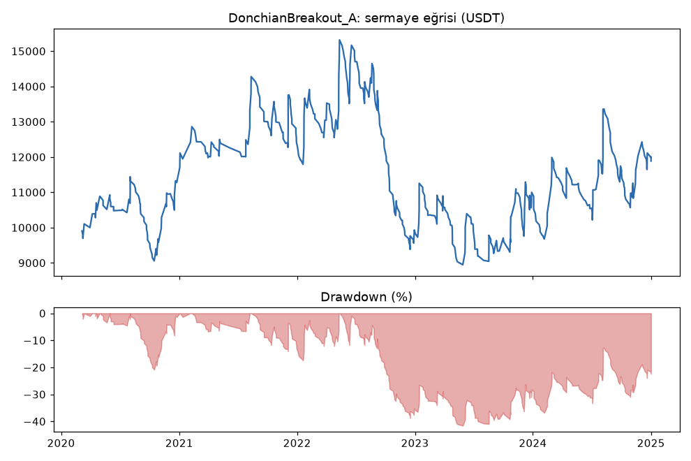
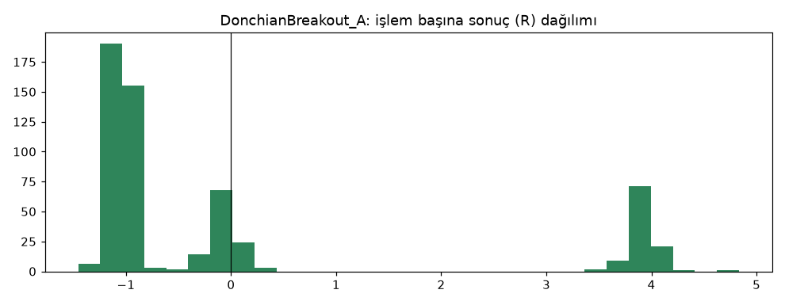
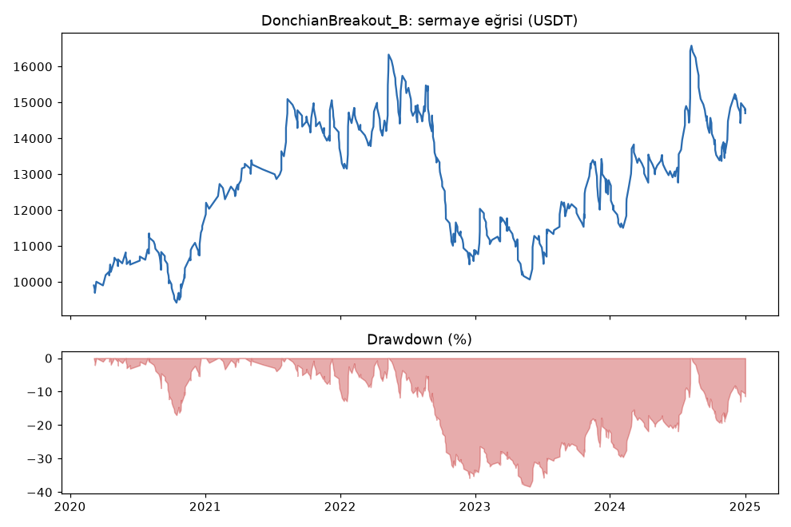
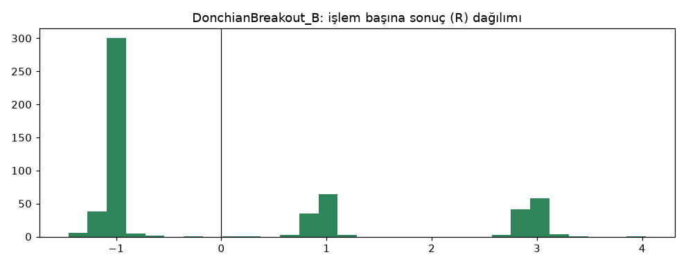

# DonchianBreakout_A vs DonchianBreakout_B — ilk_backtest_gelistirme — 2026-10-04

## Özet
- **DonchianBreakout_A**: 570 işlem, işlem başına ortalama **0.06R** (maliyet ve funding dahil), net getiri 18.9%, en büyük düşüş 41.6%.
- **DonchianBreakout_B**: 567 işlem, işlem başına ortalama **0.09R** (maliyet ve funding dahil), net getiri 47.0%, en büyük düşüş 38.4%.
- Aynı dönemde coinleri al-tut (eşit ağırlık): getiri 3297.6%, ortalama en büyük düşüş 84.1%.

## Ayarlar
- Dönem: 2020-02-20 00:00:00 → 2025-01-01 00:00:00
- Coinler: BTC/USDT:USDT, ETH/USDT:USDT, SOL/USDT:USDT, XRP/USDT:USDT, BNB/USDT:USDT, DOGE/USDT:USDT
- Zaman dilimi: 4h
- Yön: long + short
- Mod: futures / isolated
- Kaldıraç: en fazla 3x, likidasyon stop mesafesinin en az 2 katı uzakta (bölüm 7.6)
- Risk: işlem başına sermayenin %1'i (pozisyon büyüklüğü stop mesafesine göre)
- Maliyet: her emir için %0.05 komisyon + %0.05 kayma (= %0.1), funding geçmiş veriden
- Başlangıç sermayesi: 10000 USDT

## Metrikler
| Metrik | DonchianBreakout_A | DonchianBreakout_B | Al-tut |
|---|---|---|---|
| Net getiri | 18.9% | 47.0% | 3297.6% |
| Max drawdown | 41.6% | 38.4% | 84.1% |
| Profit factor | 1.04 | 1.10 | — |
| Ortalama R | 0.06 | 0.09 | — |
| İşlem sayısı | 570 | 567 | — |
| Winrate | 24.6% | 37.9% | — |

Winrate tek başına başarı ölçütü değildir; asıl ölçüt ortalama R (expectancy) ve drawdown'dur.

## Long / short ayrımı
| Strateji | Yön | İşlem | Ortalama R | Toplam R | Profit factor |
|---|---|---|---|---|---|
| DonchianBreakout_A | long | 332 | 0.12 | 40.45 | 1.09 |
| DonchianBreakout_A | short | 238 | -0.02 | -3.75 | 0.98 |
| DonchianBreakout_B | long | 330 | 0.14 | 46.70 | 1.14 |
| DonchianBreakout_B | short | 237 | 0.02 | 5.38 | 1.04 |

## Sinyal istatistikleri
| Strateji | Stop | BE | TP1 sonrası BE | TP2 | Diğer | İptal (bölgeye gelmedi / önce stop) | Toplam funding (USDT) |
|---|---|---|---|---|---|---|---|
| DonchianBreakout_A | 61.9% | 19.1% | 0.0% | 18.4% | 0.5% | 8.8% | -1302.17 |
| DonchianBreakout_B | 61.7% | 0.0% | 18.7% | 19.0% | 0.5% | 8.8% | -1160.38 |

## Coin bazında
| Strateji | Coin | İşlem | Ortalama R | Toplam R | Al-tut getirisi |
|---|---|---|---|---|---|
| DonchianBreakout_A | BTC/USDT:USDT | 116 | 0.06 | 7.37 | 879.8% |
| DonchianBreakout_A | ETH/USDT:USDT | 112 | 0.10 | 11.56 | 1184.9% |
| DonchianBreakout_A | SOL/USDT:USDT | 64 | 0.41 | 25.96 | 5552.9% |
| DonchianBreakout_A | XRP/USDT:USDT | 104 | -0.20 | -20.86 | 659.5% |
| DonchianBreakout_A | BNB/USDT:USDT | 102 | -0.02 | -1.99 | 3083.0% |
| DonchianBreakout_A | DOGE/USDT:USDT | 72 | 0.20 | 14.67 | 8425.3% |
| DonchianBreakout_B | BTC/USDT:USDT | 115 | 0.09 | 10.10 | 879.8% |
| DonchianBreakout_B | ETH/USDT:USDT | 111 | 0.11 | 12.50 | 1184.9% |
| DonchianBreakout_B | SOL/USDT:USDT | 62 | 0.40 | 24.50 | 5552.9% |
| DonchianBreakout_B | XRP/USDT:USDT | 103 | -0.09 | -9.54 | 659.5% |
| DonchianBreakout_B | BNB/USDT:USDT | 102 | -0.01 | -0.58 | 3083.0% |
| DonchianBreakout_B | DOGE/USDT:USDT | 74 | 0.20 | 15.09 | 8425.3% |

## Grafikler

## Veri ve dönem
- Veri: Binance USDⓈ-M arşivi (data.binance.vision). Doğrulama: [`research/data/validation_report.md`](../../research/data/validation_report.md).
- Sadece **geliştirme dönemi** (2020-01-01 → 2024-12-31). Doğrulama ve kasa verisine dokunulmadı.
- Parametreler (kanal 20, 4h) test öncesi kartta sabitlendi; bu sonuca göre değiştirilmedi.
- Hile testi: `lookahead-analysis` 60 sinyalde bias bulmadı; `recursive-analysis` 300 mum ısınmada ATR sapması ~%0.

## Yıllara göre toplam R (DonchianBreakout_B)
| Yıl | Long işlem | Long R | Short işlem | Short R |
|---|---|---|---|---|
| 2020 | 56 | +31.3 | 28 | -9.5 |
| 2021 | 57 | +1.8 | 26 | +12.2 |
| 2022 | 69 | -21.9 | 79 | +2.2 |
| 2023 | 73 | +21.5 | 50 | -4.8 |
| 2024 | 75 | +13.9 | 54 | +5.4 |

## Maliyet x2 testi (emir başına %0.2)
| | Ortalama R | Net getiri | Max drawdown | Profit factor |
|---|---|---|---|---|
| DonchianBreakout_A | +0.03 | -3.2% | 44.7% | 0.99 |
| DonchianBreakout_B | +0.05 | +18.3% | 41.7% | 1.04 |

## Yorum: güçlü yanlar / şüpheli noktalar
- **Pozitif beklenti:** maliyet ve funding sonrası işlem başına +0.06R (A) ve +0.09R (B). trend_ma'nın aksine sıfırın üstünde.
- **Long tarafı taşıyor:** B'de long +46.7R, 5 yılın 4'ünde pozitif (sadece 2022 düşüş yılında -21.9R). Short neredeyse başa baş (+5.4R).
- **Coinlerin çoğunda pozitif:** B'de 6 coinin 4'ü pozitif (BTC, ETH, SOL, DOGE); XRP ve BNB negatif. Kârın büyük kısmı SOL ve DOGE'den (+39.6R), yani birkaç büyük trende bağımlı.
- **Drawdown çok büyük:** %38-42 (eşik ≤ %25). En büyük sorun bu. Aynı anda 5 işleme kadar açılabildiği ve coinler birlikte hareket ettiği için kayıplar üst üste biniyor.
- **Kâr faktörü zayıf:** 1.04-1.10. Doğrulama eşiği ≥ 1.2.
- **Maliyete hassas:** maliyet iki katına çıkınca B hâlâ pozitif (+0.05R) ama A başa baş (PF 0.99). "Kırılgan" sayılır.
- **Model A vs B:** B her ölçüde daha iyi (ortalama R, getiri, drawdown, maliyete dayanıklılık).
- **Funding yükü:** B'de toplam -1160 USDT; trend takibinde long tarafı çoğunlukla funding ödüyor.
- Al-tut çok daha yüksek getiri yaptı (+%3298) ama %84 düşüşle.

## Karar: devam / düzelt / emekli
**Devam (dikkatle).** İlk backtest'in temel şartı olan pozitif beklentiyi sağladı ve işlem sayısı, coin oranı yeterli. Ama drawdown ve kâr faktörü active olmak için gereken eşiklerin altında; bu yüzden umut verici ama henüz yeterli değil. Sıradaki aşama: sadece geliştirme verisinde TP model ızgarası (aşama 3), sonra doğrulama verisi (aşama 4). Drawdown aşama 4'te de %25'in üstündeyse strateji ya volatilite/trend filtresiyle **yeni bir kart** olarak denenir ya da emekli edilir; bu kartın parametreleri değiştirilmez.
