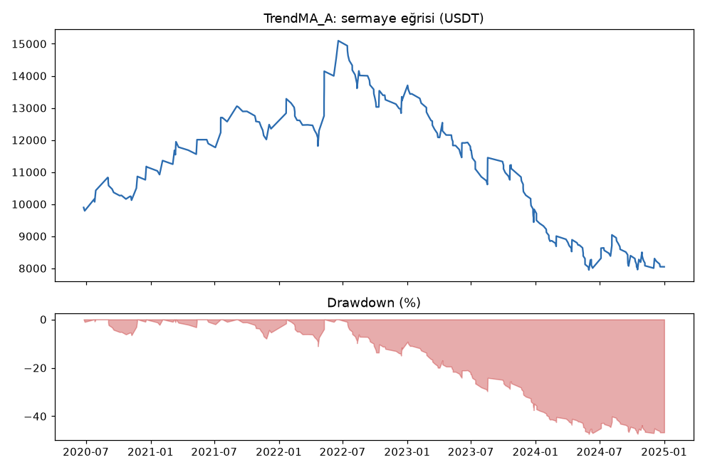
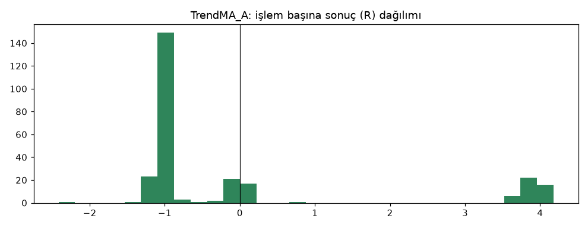
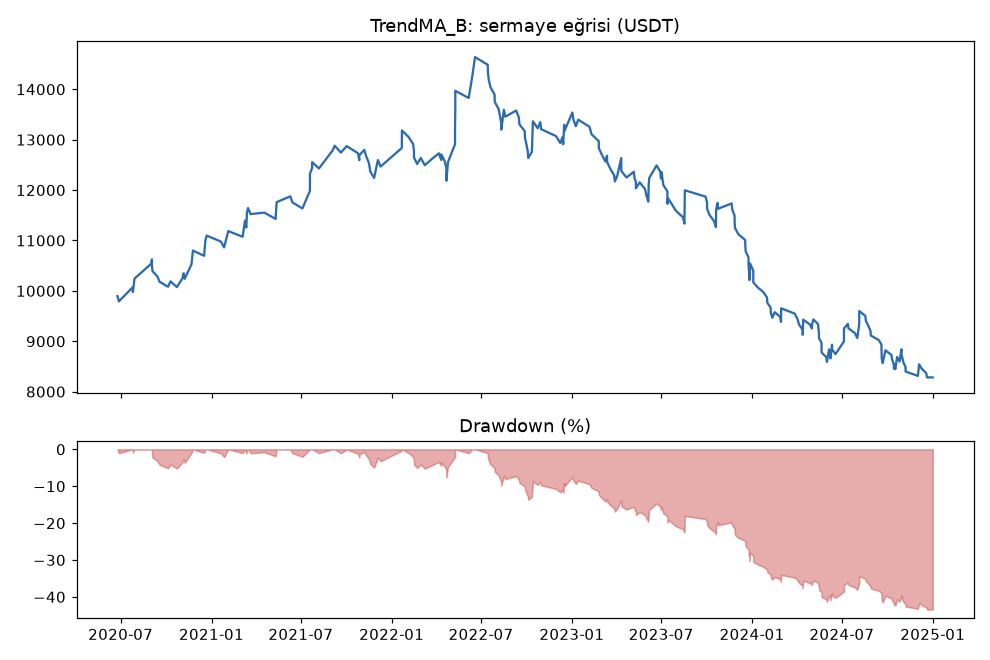
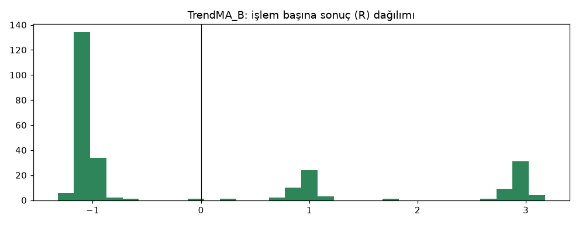

# TrendMA_A vs TrendMA_B — ilk_backtest_gelistirme — 2026-10-04

## Özet
- **TrendMA_A**: 263 işlem, işlem başına ortalama **-0.06R** (maliyet ve funding dahil), net getiri -19.5%, en büyük düşüş 47.3%.
- **TrendMA_B**: 264 işlem, işlem başına ortalama **-0.06R** (maliyet ve funding dahil), net getiri -17.2%, en büyük düşüş 43.4%.
- Aynı dönemde coinleri al-tut (eşit ağırlık): getiri 3572.8%, ortalama en büyük düşüş 84.1%.

## Ayarlar
- Dönem: 2020-06-15 16:00:00 → 2025-01-01 00:00:00
- Coinler: BTC/USDT:USDT, ETH/USDT:USDT, SOL/USDT:USDT, XRP/USDT:USDT, BNB/USDT:USDT, DOGE/USDT:USDT
- Zaman dilimi: 4h
- Yön: long + short
- Mod: futures / isolated
- Kaldıraç: en fazla 3x, likidasyon stop mesafesinin en az 2 katı uzakta (bölüm 7.6)
- Risk: işlem başına sermayenin %1'i (pozisyon büyüklüğü stop mesafesine göre)
- Maliyet: her emir için %0.05 komisyon + %0.05 kayma (= %0.1), funding geçmiş veriden
- Başlangıç sermayesi: 10000 USDT

## Metrikler
| Metrik | TrendMA_A | TrendMA_B | Al-tut |
|---|---|---|---|
| Net getiri | -19.5% | -17.2% | 3572.8% |
| Max drawdown | 47.3% | 43.4% | 84.1% |
| Profit factor | 0.91 | 0.92 | — |
| Ortalama R | -0.06 | -0.06 | — |
| İşlem sayısı | 263 | 264 | — |
| Winrate | 24.0% | 32.6% | — |

Winrate tek başına başarı ölçütü değildir; asıl ölçüt ortalama R (expectancy) ve drawdown'dur.

## Long / short ayrımı
| Strateji | Yön | İşlem | Ortalama R | Toplam R | Profit factor |
|---|---|---|---|---|---|
| TrendMA_A | long | 129 | -0.20 | -25.78 | 0.72 |
| TrendMA_A | short | 134 | 0.07 | 8.85 | 1.11 |
| TrendMA_B | long | 130 | -0.21 | -27.51 | 0.70 |
| TrendMA_B | short | 134 | 0.09 | 12.28 | 1.15 |

## Sinyal istatistikleri
| Strateji | Stop | BE | TP1 sonrası BE | TP2 | Diğer | İptal (bölgeye gelmedi / önce stop) | Toplam funding (USDT) |
|---|---|---|---|---|---|---|---|
| TrendMA_A | 66.9% | 16.0% | 0.0% | 16.7% | 0.4% | 9.0% | -449.49 |
| TrendMA_B | 67.0% | 0.0% | 15.5% | 17.0% | 0.4% | 9.0% | -355.66 |

## Coin bazında
| Strateji | Coin | İşlem | Ortalama R | Toplam R | Al-tut getirisi |
|---|---|---|---|---|---|
| TrendMA_A | BTC/USDT:USDT | 46 | -0.09 | -3.94 | 896.7% |
| TrendMA_A | ETH/USDT:USDT | 45 | -0.14 | -6.51 | 1343.7% |
| TrendMA_A | SOL/USDT:USDT | 29 | -0.14 | -3.94 | 5552.9% |
| TrendMA_A | XRP/USDT:USDT | 55 | -0.19 | -10.34 | 1003.8% |
| TrendMA_A | BNB/USDT:USDT | 52 | 0.26 | 13.54 | 4214.2% |
| TrendMA_A | DOGE/USDT:USDT | 36 | -0.16 | -5.76 | 8425.3% |
| TrendMA_B | BTC/USDT:USDT | 46 | 0.00 | 0.10 | 896.7% |
| TrendMA_B | ETH/USDT:USDT | 45 | -0.17 | -7.43 | 1343.7% |
| TrendMA_B | SOL/USDT:USDT | 29 | -0.23 | -6.62 | 5552.9% |
| TrendMA_B | XRP/USDT:USDT | 56 | -0.08 | -4.61 | 1003.8% |
| TrendMA_B | BNB/USDT:USDT | 52 | 0.14 | 7.06 | 4214.2% |
| TrendMA_B | DOGE/USDT:USDT | 36 | -0.10 | -3.71 | 8425.3% |

## Grafikler

## Veri ve dönem
- Veri: Binance USDⓈ-M arşivi (data.binance.vision), 2020-01 → 2026-09. Doğrulama: [`research/data/validation_report.md`](../../research/data/validation_report.md).
- Bu test sadece **geliştirme dönemi** (2020-01-01 → 2024-12-31). Doğrulama (2025-01 → 2026-03) ve kasa (2026-04 → 2026-09) verisine dokunulmadı.
- İlk ~5.5 ay EMA200 ısınması için kullanıldı, işlemler 2020-06-15'te başlıyor.
- Hile testi: `lookahead-analysis` 60 sinyalde bias bulmadı; `recursive-analysis` 1000 mum ısınmanın yeterli olduğunu gösterdi (EMA200 sapması %0.000).

## Yıllara göre toplam R (TrendMA_B)
| Yıl | Long işlem | Long R | Short işlem | Short R |
|---|---|---|---|---|
| 2020 (Haz-Ara) | 16 | +12.7 | 6 | -1.8 |
| 2021 | 23 | -0.4 | 12 | +15.7 |
| 2022 | 14 | -6.8 | 46 | +14.0 |
| 2023 | 38 | -18.3 | 32 | -9.1 |
| 2024 | 39 | -14.7 | 38 | -6.5 |

## Yorum: güçlü yanlar / şüpheli noktalar
- **İşlem yönetimi doğru çalışıyor:** stop'lar ortalama -1.05R, TP2'ler ortalama +3.9R ile kapanıyor (maliyet + funding dahil). Yani kayıplar planlanan risk kadar; sorun yönetimde değil, girişlerin kalitesinde.
- **Strateji kazandırmıyor:** iki modelde de işlem başına ortalama -0.06R, profit factor 0.91-0.92. Eşik ≥ 1.2.
- **Drawdown çok büyük:** %43-47 (eşik ≤ %25).
- **Sadece belli bir dönemde çalışmış:** 2020 ortasından 2022 ortasına kadar sermaye 10.000 → 14.600 USDT oldu, sonraki 2.5 yılda hepsini ve fazlasını geri verdi. 2023-2024'te hem long hem short zararda.
- **Short tarafı "iyi" görünüyor ama güvenilmez:** short kârının tamamı 2021-2022 düşüş piyasasından geliyor; 2023-2024'te short da zararda. Sadece short'u bırakmak sonuca bakıp seçim yapmak olur (aşırı uyum riski).
- **Model A vs B:** B biraz daha iyi (net -17.2% vs -19.5%, drawdown 43% vs 47%), fark küçük. Strateji eşikleri geçmediği için TP model seçimi aşamasına geçilmedi.
- Al-tut aynı dönemde +%3573 (ama %84 düşüşle). Strateji bunun çok gerisinde.

## Karar: devam / düzelt / emekli
**Öneri: emekli.** Test hattının 2. aşamasında (ilk backtest) eşikleri açık farkla geçemedi: ortalama R negatif, profit factor < 1, drawdown eşiğin neredeyse iki katı. Parametreyle oynamak (ör. EMA uzunlukları) geliştirme verisine uydurma olur ve kart kuralına aykırı. Sıradaki adım: Seviye 1'deki diğer strateji aileleri (Donchian kırılımı, RSI ortalamaya dönüş, ATR filtreli versiyonlar).
