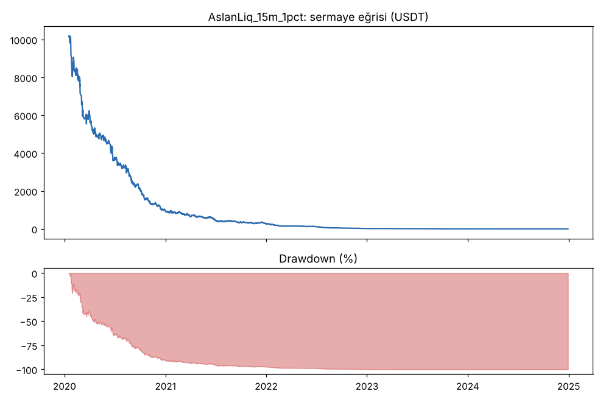
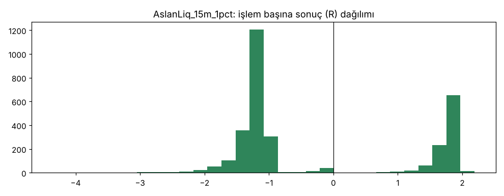

# AslanLiq_15m_1pct — ilk_backtest_15m — 2026-10-08

## Özet
- **AslanLiq_15m_1pct**: 3143 işlem, işlem başına ortalama **-0.28R** (maliyet ve funding dahil), net getiri -100.0%, en büyük düşüş 100.0%.
- Aynı dönemde coinleri al-tut (eşit ağırlık): getiri 2273.9%, ortalama en büyük düşüş 86.6%.

## Ayarlar
- Dönem: 2020-01-09 08:00:00 → 2025-01-01 00:00:00
- Coinler: BTC/USDT:USDT, ETH/USDT:USDT, ADA/USDT:USDT, SOL/USDT:USDT, XRP/USDT:USDT
- Zaman dilimi: 15m
- Yön: long + short
- Mod: futures / isolated
- Kaldıraç: en fazla 20x, likidasyon stop mesafesinin en az 2 katı uzakta (bölüm 7.6)
- Risk: işlem başına sermayenin %1'i (pozisyon büyüklüğü stop mesafesine göre)
- Maliyet: her emir için %0.05 komisyon + %0.05 kayma (= %0.1), funding geçmiş veriden
- Başlangıç sermayesi: 10000 USDT

## Metrikler
| Metrik | AslanLiq_15m_1pct | Al-tut |
|---|---|---|
| Net getiri | -100.0% | 2273.9% |
| Max drawdown | 100.0% | 86.6% |
| Profit factor | 0.63 | — |
| Ortalama R | -0.28 | — |
| İşlem sayısı | 3143 | — |
| Winrate | 31.7% | — |

Winrate tek başına başarı ölçütü değildir; asıl ölçüt ortalama R (expectancy) ve drawdown'dur.

## Long / short ayrımı
| Strateji | Yön | İşlem | Ortalama R | Toplam R | Profit factor |
|---|---|---|---|---|---|
| AslanLiq_15m_1pct | long | 1599 | -0.30 | -474.51 | 0.65 |
| AslanLiq_15m_1pct | short | 1544 | -0.27 | -416.62 | 0.60 |

## Sinyal istatistikleri
| Strateji | Stop | BE | TP1 sonrası BE | TP2 | Diğer | İptal (bölgeye gelmedi / önce stop) | Toplam funding (USDT) |
|---|---|---|---|---|---|---|---|
| AslanLiq_15m_1pct | 66.3% | 1.8% | 0.0% | 31.9% | 0.0% | 0.2% | -195.27 |

## Coin bazında
| Strateji | Coin | İşlem | Ortalama R | Toplam R | Al-tut getirisi |
|---|---|---|---|---|---|
| AslanLiq_15m_1pct | BTC/USDT:USDT | 582 | -0.34 | -198.66 | 1078.7% |
| AslanLiq_15m_1pct | ETH/USDT:USDT | 715 | -0.32 | -228.82 | 2292.5% |
| AslanLiq_15m_1pct | ADA/USDT:USDT | 757 | -0.27 | -203.65 | 1479.5% |
| AslanLiq_15m_1pct | SOL/USDT:USDT | 410 | -0.25 | -101.92 | 5601.2% |
| AslanLiq_15m_1pct | XRP/USDT:USDT | 679 | -0.23 | -158.08 | 917.7% |

## Grafikler

## Yorum: güçlü yanlar / şüpheli noktalar
_(Claude tarafından rakamlara bakılarak yazılır.)_

## Karar: devam / düzelt / emekli
_(Claude tarafından yazılır, gerekçesiyle.)_
