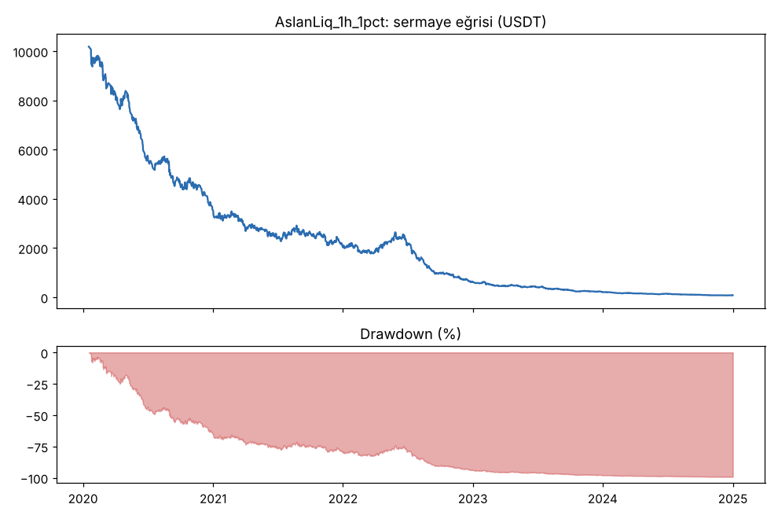
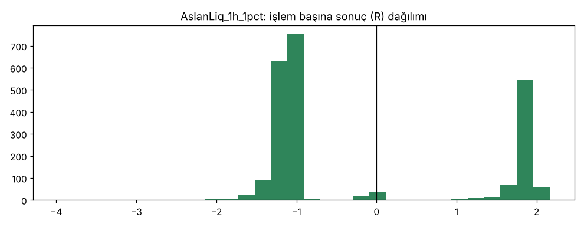
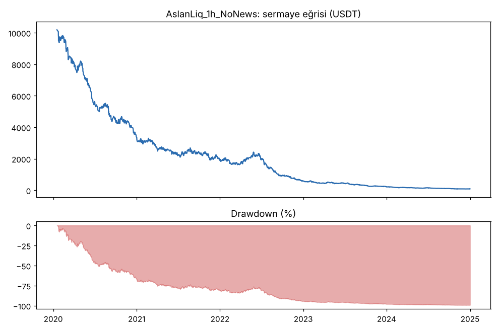
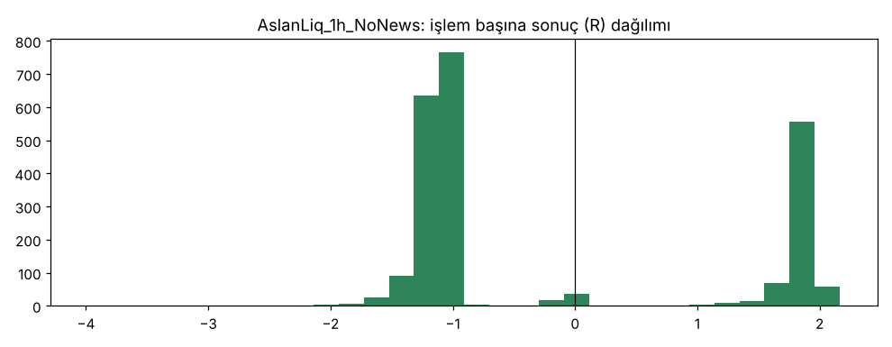

# AslanLiq_1h_1pct vs AslanLiq_1h_NoNews — ilk_backtest_1h — 2026-10-08

## Özet
- **AslanLiq_1h_1pct**: 2266 işlem, işlem başına ortalama **-0.21R** (maliyet ve funding dahil), net getiri -99.3%, en büyük düşüş 99.3%.
- **AslanLiq_1h_NoNews**: 2302 işlem, işlem başına ortalama **-0.21R** (maliyet ve funding dahil), net getiri -99.2%, en büyük düşüş 99.2%.
- Aynı dönemde coinleri al-tut (eşit ağırlık): getiri 2283.7%, ortalama en büyük düşüş 86.5%.

## Ayarlar
- Dönem: 2020-01-09 08:00:00 → 2025-01-01 00:00:00
- Coinler: BTC/USDT:USDT, ETH/USDT:USDT, ADA/USDT:USDT, SOL/USDT:USDT, XRP/USDT:USDT
- Zaman dilimi: 1h
- Yön: long + short
- Mod: futures / isolated
- Kaldıraç: en fazla 20x, likidasyon stop mesafesinin en az 2 katı uzakta (bölüm 7.6)
- Risk: işlem başına sermayenin %1'i (pozisyon büyüklüğü stop mesafesine göre)
- Maliyet: her emir için %0.05 komisyon + %0.05 kayma (= %0.1), funding geçmiş veriden
- Başlangıç sermayesi: 10000 USDT

## Metrikler
| Metrik | AslanLiq_1h_1pct | AslanLiq_1h_NoNews | Al-tut |
|---|---|---|---|
| Net getiri | -99.3% | -99.2% | 2283.7% |
| Max drawdown | 99.3% | 99.2% | 86.5% |
| Profit factor | 0.72 | 0.71 | — |
| Ortalama R | -0.21 | -0.21 | — |
| İşlem sayısı | 2266 | 2302 | — |
| Winrate | 30.6% | 30.7% | — |

Winrate tek başına başarı ölçütü değildir; asıl ölçüt ortalama R (expectancy) ve drawdown'dur.

## Long / short ayrımı
| Strateji | Yön | İşlem | Ortalama R | Toplam R | Profit factor |
|---|---|---|---|---|---|
| AslanLiq_1h_1pct | long | 1182 | -0.23 | -269.86 | 0.76 |
| AslanLiq_1h_1pct | short | 1084 | -0.19 | -208.07 | 0.67 |
| AslanLiq_1h_NoNews | long | 1207 | -0.22 | -260.39 | 0.76 |
| AslanLiq_1h_NoNews | short | 1095 | -0.20 | -213.59 | 0.65 |

## Sinyal istatistikleri
| Strateji | Stop | BE | TP1 sonrası BE | TP2 | Diğer | İptal (bölgeye gelmedi / önce stop) | Toplam funding (USDT) |
|---|---|---|---|---|---|---|---|
| AslanLiq_1h_1pct | 66.9% | 2.3% | 0.0% | 30.7% | 0.1% | 0.1% | -391.72 |
| AslanLiq_1h_NoNews | 66.8% | 2.3% | 0.0% | 30.8% | 0.1% | 0.1% | -380.48 |

## Coin bazında
| Strateji | Coin | İşlem | Ortalama R | Toplam R | Al-tut getirisi |
|---|---|---|---|---|---|
| AslanLiq_1h_1pct | BTC/USDT:USDT | 471 | -0.24 | -112.27 | 1088.9% |
| AslanLiq_1h_1pct | ETH/USDT:USDT | 444 | -0.15 | -67.61 | 2313.4% |
| AslanLiq_1h_1pct | ADA/USDT:USDT | 533 | -0.23 | -123.49 | 1474.4% |
| AslanLiq_1h_1pct | SOL/USDT:USDT | 375 | -0.26 | -95.75 | 5616.2% |
| AslanLiq_1h_1pct | XRP/USDT:USDT | 443 | -0.18 | -78.81 | 925.5% |
| AslanLiq_1h_NoNews | BTC/USDT:USDT | 481 | -0.24 | -117.47 | 1088.9% |
| AslanLiq_1h_NoNews | ETH/USDT:USDT | 454 | -0.15 | -69.25 | 2313.4% |
| AslanLiq_1h_NoNews | ADA/USDT:USDT | 537 | -0.22 | -118.84 | 1474.4% |
| AslanLiq_1h_NoNews | SOL/USDT:USDT | 382 | -0.25 | -94.41 | 5616.2% |
| AslanLiq_1h_NoNews | XRP/USDT:USDT | 448 | -0.17 | -74.00 | 925.5% |

## Grafikler

## Yorum: güçlü yanlar / şüpheli noktalar
_(Claude tarafından rakamlara bakılarak yazılır.)_

## Karar: devam / düzelt / emekli
_(Claude tarafından yazılır, gerekçesiyle.)_
