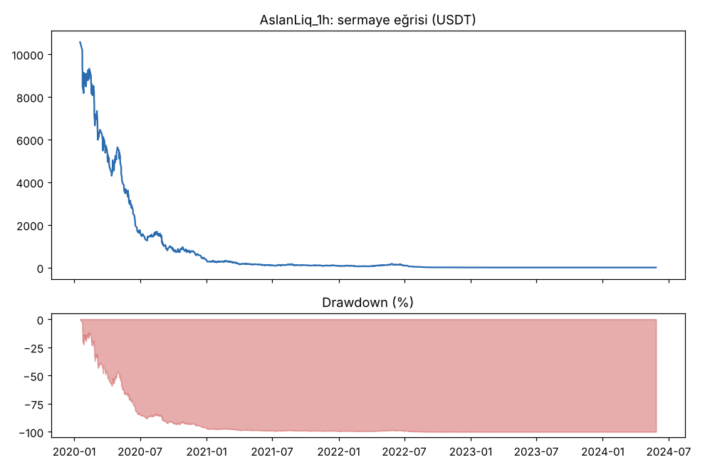
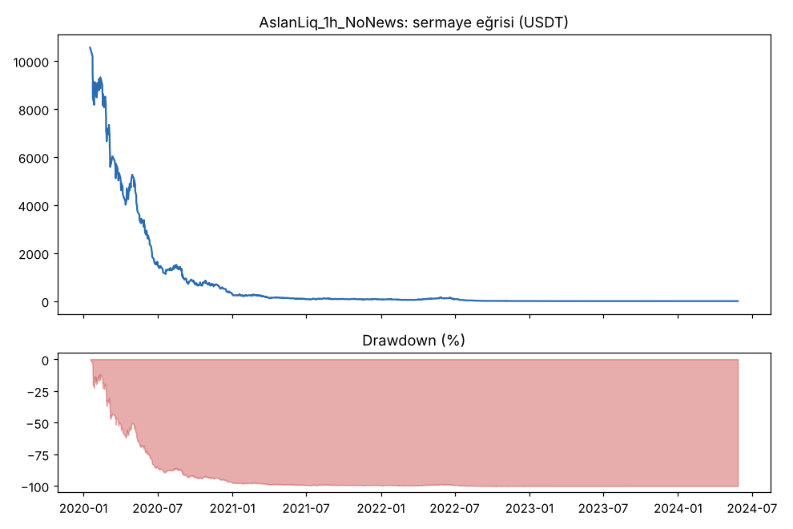
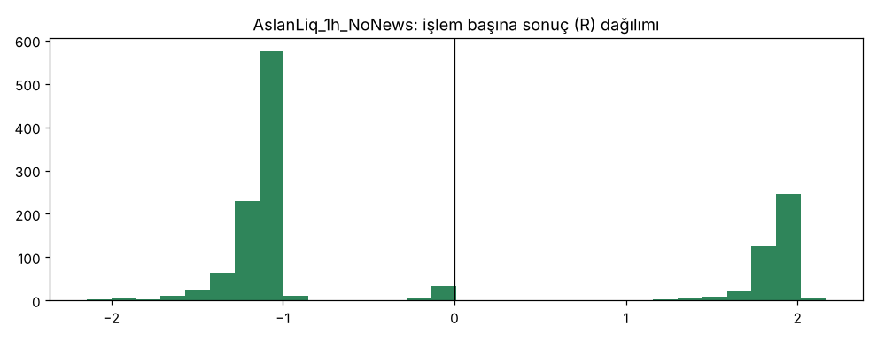

# AslanLiq_1h vs AslanLiq_1h_NoNews — ilk_backtest_1h_risk3 — 2026-10-08

## Özet
- **AslanLiq_1h**: 1369 işlem, işlem başına ortalama **-0.22R** (maliyet ve funding dahil), net getiri -100.0%, en büyük düşüş 100.0%.
- **AslanLiq_1h_NoNews**: 1378 işlem, işlem başına ortalama **-0.21R** (maliyet ve funding dahil), net getiri -100.0%, en büyük düşüş 100.0%.
- Aynı dönemde coinleri al-tut (eşit ağırlık): getiri 2283.7%, ortalama en büyük düşüş 86.5%.

## Ayarlar
- Dönem: 2020-01-09 08:00:00 → 2025-01-01 00:00:00
- Coinler: BTC/USDT:USDT, ETH/USDT:USDT, ADA/USDT:USDT, SOL/USDT:USDT, XRP/USDT:USDT
- Zaman dilimi: 1h
- Yön: long + short
- Mod: futures / isolated
- Kaldıraç: en fazla 20x, likidasyon stop mesafesinin en az 2 katı uzakta (bölüm 7.6)
- Risk: işlem başına sermayenin %3'i (pozisyon büyüklüğü stop mesafesine göre)
- Maliyet: her emir için %0.05 komisyon + %0.05 kayma (= %0.1), funding geçmiş veriden
- Başlangıç sermayesi: 10000 USDT

## Metrikler
| Metrik | AslanLiq_1h | AslanLiq_1h_NoNews | Al-tut |
|---|---|---|---|
| Net getiri | -100.0% | -100.0% | 2283.7% |
| Max drawdown | 100.0% | 100.0% | 86.5% |
| Profit factor | 0.62 | 0.60 | — |
| Ortalama R | -0.22 | -0.21 | — |
| İşlem sayısı | 1369 | 1378 | — |
| Winrate | 30.0% | 30.1% | — |

Winrate tek başına başarı ölçütü değildir; asıl ölçüt ortalama R (expectancy) ve drawdown'dur.

## Long / short ayrımı
| Strateji | Yön | İşlem | Ortalama R | Toplam R | Profit factor |
|---|---|---|---|---|---|
| AslanLiq_1h | long | 700 | -0.25 | -173.29 | 0.78 |
| AslanLiq_1h | short | 669 | -0.19 | -125.43 | 0.43 |
| AslanLiq_1h_NoNews | long | 705 | -0.24 | -165.84 | 0.77 |
| AslanLiq_1h_NoNews | short | 673 | -0.19 | -128.40 | 0.41 |

## Sinyal istatistikleri
| Strateji | Stop | BE | TP1 sonrası BE | TP2 | Diğer | İptal (bölgeye gelmedi / önce stop) | Toplam funding (USDT) |
|---|---|---|---|---|---|---|---|
| AslanLiq_1h | 67.5% | 2.5% | 0.0% | 30.0% | 0.0% | 0.1% | -404.55 |
| AslanLiq_1h_NoNews | 67.1% | 2.8% | 0.0% | 30.1% | 0.0% | 0.1% | -380.46 |

## Coin bazında
| Strateji | Coin | İşlem | Ortalama R | Toplam R | Al-tut getirisi |
|---|---|---|---|---|---|
| AslanLiq_1h | BTC/USDT:USDT | 275 | -0.27 | -73.64 | 1088.9% |
| AslanLiq_1h | ETH/USDT:USDT | 295 | -0.22 | -65.31 | 2313.4% |
| AslanLiq_1h | ADA/USDT:USDT | 328 | -0.23 | -73.86 | 1474.4% |
| AslanLiq_1h | SOL/USDT:USDT | 178 | -0.24 | -41.88 | 5616.2% |
| AslanLiq_1h | XRP/USDT:USDT | 293 | -0.15 | -44.03 | 925.5% |
| AslanLiq_1h_NoNews | BTC/USDT:USDT | 278 | -0.29 | -80.47 | 1088.9% |
| AslanLiq_1h_NoNews | ETH/USDT:USDT | 306 | -0.21 | -63.39 | 2313.4% |
| AslanLiq_1h_NoNews | ADA/USDT:USDT | 331 | -0.23 | -76.47 | 1474.4% |
| AslanLiq_1h_NoNews | SOL/USDT:USDT | 164 | -0.20 | -32.45 | 5616.2% |
| AslanLiq_1h_NoNews | XRP/USDT:USDT | 299 | -0.14 | -41.47 | 925.5% |

## Grafikler

## Yorum: güçlü yanlar / şüpheli noktalar
_(Claude tarafından rakamlara bakılarak yazılır.)_

## Karar: devam / düzelt / emekli
_(Claude tarafından yazılır, gerekçesiyle.)_
