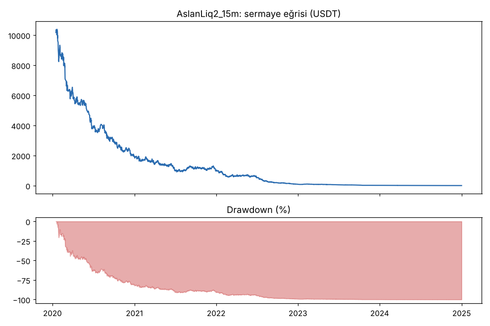
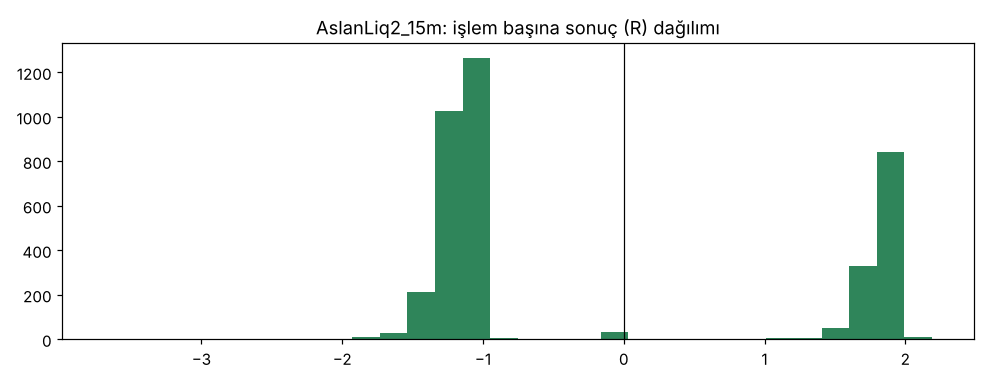
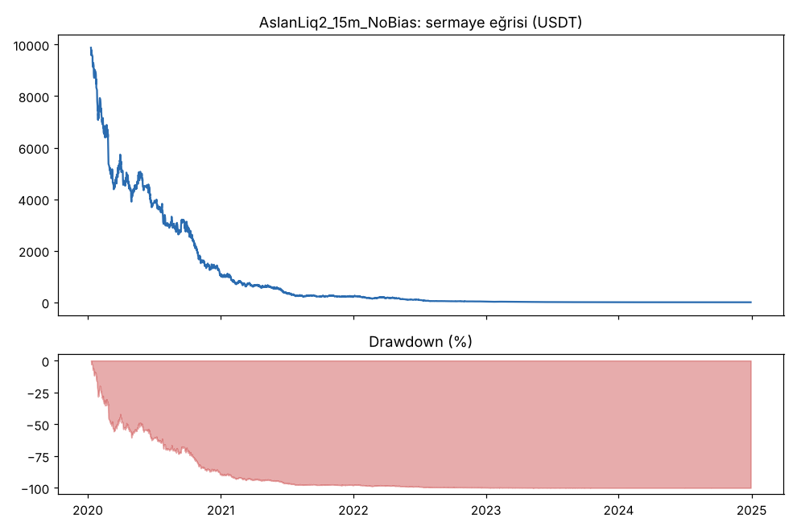
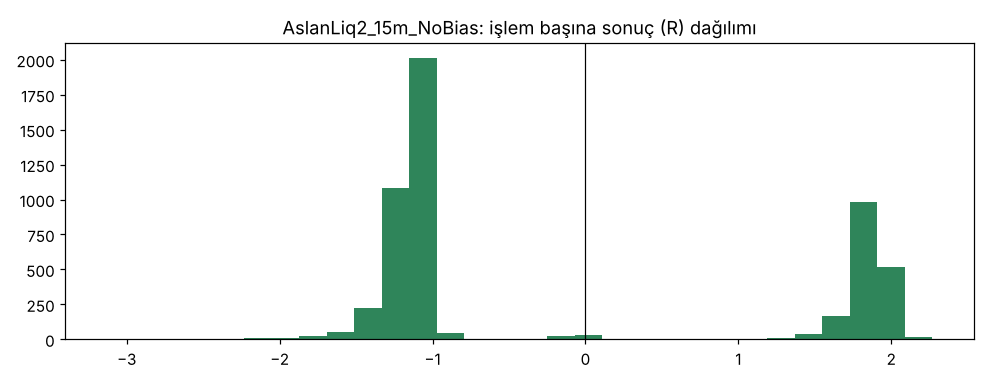

# AslanLiq2_15m vs AslanLiq2_15m_NoBias — v2_15m — 2026-10-08

## Özet
- **AslanLiq2_15m**: 3851 işlem, işlem başına ortalama **-0.20R** (maliyet ve funding dahil), net getiri -100.0%, en büyük düşüş 100.0%.
- **AslanLiq2_15m_NoBias**: 5260 işlem, işlem başına ortalama **-0.16R** (maliyet ve funding dahil), net getiri -100.0%, en büyük düşüş 100.0%.
- Aynı dönemde coinleri al-tut (eşit ağırlık): getiri 2273.9%, ortalama en büyük düşüş 86.6%.

## Ayarlar
- Dönem: 2020-01-09 08:00:00 → 2025-01-01 00:00:00
- Coinler: BTC/USDT:USDT, ETH/USDT:USDT, ADA/USDT:USDT, SOL/USDT:USDT, XRP/USDT:USDT
- Zaman dilimi: 15m
- Yön: long + short
- Mod: futures / isolated
- Kaldıraç: en fazla 20x, likidasyon stop mesafesinin en az 2 katı uzakta (bölüm 7.6)
- Risk: işlem başına sermayenin %1'i (pozisyon büyüklüğü stop mesafesine göre)
- Maliyet: her emir için %0.05 komisyon + %0.05 kayma (= %0.1), funding geçmiş veriden
- Başlangıç sermayesi: 10000 USDT

## Metrikler
| Metrik | AslanLiq2_15m | AslanLiq2_15m_NoBias | Al-tut |
|---|---|---|---|
| Net getiri | -100.0% | -100.0% | 2273.9% |
| Max drawdown | 100.0% | 100.0% | 86.6% |
| Profit factor | 0.73 | 0.75 | — |
| Ortalama R | -0.20 | -0.16 | — |
| İşlem sayısı | 3851 | 5260 | — |
| Winrate | 32.5% | 33.0% | — |

Winrate tek başına başarı ölçütü değildir; asıl ölçüt ortalama R (expectancy) ve drawdown'dur.

## Long / short ayrımı
| Strateji | Yön | İşlem | Ortalama R | Toplam R | Profit factor |
|---|---|---|---|---|---|
| AslanLiq2_15m | long | 1956 | -0.22 | -421.64 | 0.76 |
| AslanLiq2_15m | short | 1895 | -0.18 | -336.92 | 0.69 |
| AslanLiq2_15m_NoBias | long | 2475 | -0.18 | -457.18 | 0.81 |
| AslanLiq2_15m_NoBias | short | 2785 | -0.14 | -397.12 | 0.71 |

## Sinyal istatistikleri
| Strateji | Stop | BE | TP1 sonrası BE | TP2 | Diğer | İptal (bölgeye gelmedi / önce stop) | Toplam funding (USDT) |
|---|---|---|---|---|---|---|---|
| AslanLiq2_15m | 66.6% | 0.9% | 0.0% | 32.5% | 0.0% | 0.2% | -359.49 |
| AslanLiq2_15m_NoBias | 65.9% | 1.1% | 0.0% | 33.0% | 0.0% | 0.3% | 235.53 |

## Coin bazında
| Strateji | Coin | İşlem | Ortalama R | Toplam R | Al-tut getirisi |
|---|---|---|---|---|---|
| AslanLiq2_15m | BTC/USDT:USDT | 685 | -0.23 | -157.61 | 1078.7% |
| AslanLiq2_15m | ETH/USDT:USDT | 861 | -0.19 | -159.47 | 2292.5% |
| AslanLiq2_15m | ADA/USDT:USDT | 921 | -0.21 | -194.89 | 1479.5% |
| AslanLiq2_15m | SOL/USDT:USDT | 581 | -0.19 | -110.12 | 5601.2% |
| AslanLiq2_15m | XRP/USDT:USDT | 803 | -0.17 | -136.47 | 917.7% |
| AslanLiq2_15m_NoBias | BTC/USDT:USDT | 1012 | -0.22 | -219.67 | 1078.7% |
| AslanLiq2_15m_NoBias | ETH/USDT:USDT | 1258 | -0.16 | -198.09 | 2292.5% |
| AslanLiq2_15m_NoBias | ADA/USDT:USDT | 1217 | -0.13 | -159.28 | 1479.5% |
| AslanLiq2_15m_NoBias | SOL/USDT:USDT | 729 | -0.15 | -108.50 | 5601.2% |
| AslanLiq2_15m_NoBias | XRP/USDT:USDT | 1044 | -0.16 | -168.76 | 917.7% |

## Grafikler

## Yorum: güçlü yanlar / şüpheli noktalar
_(Claude tarafından rakamlara bakılarak yazılır.)_

## Karar: devam / düzelt / emekli
_(Claude tarafından yazılır, gerekçesiyle.)_
