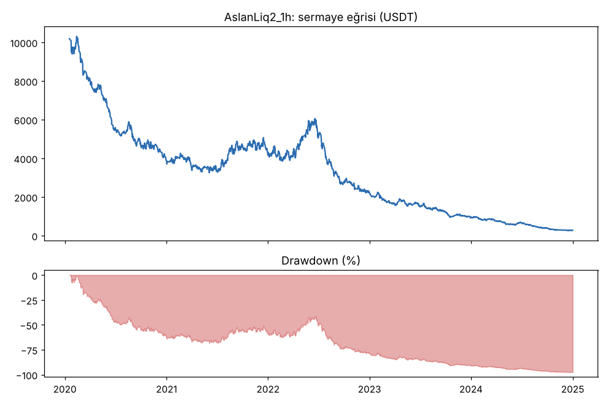
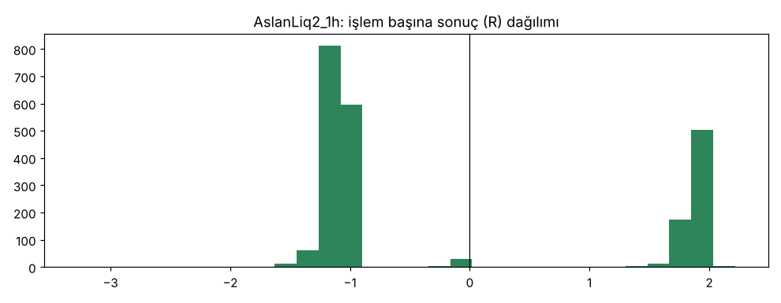
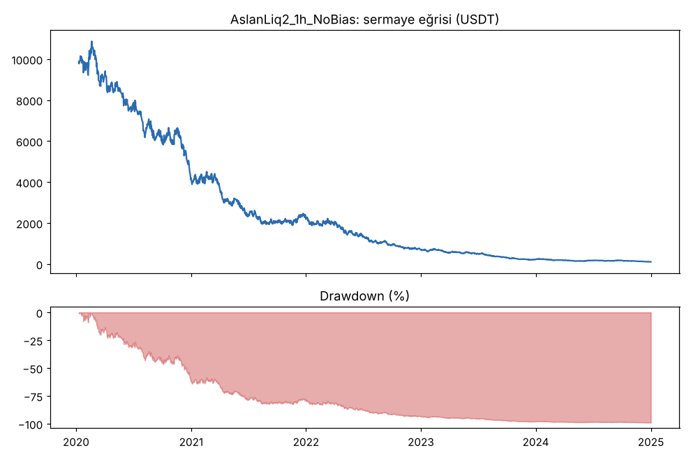
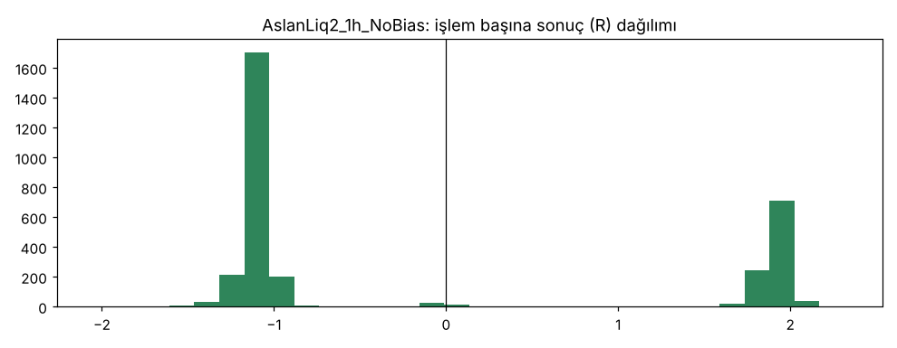

# AslanLiq2_1h vs AslanLiq2_1h_NoBias — v2_1h — 2026-10-08

## Özet
- **AslanLiq2_1h**: 2222 işlem, işlem başına ortalama **-0.16R** (maliyet ve funding dahil), net getiri -97.2%, en büyük düşüş 97.4%.
- **AslanLiq2_1h_NoBias**: 3256 işlem, işlem başına ortalama **-0.14R** (maliyet ve funding dahil), net getiri -98.9%, en büyük düşüş 99.0%.
- Aynı dönemde coinleri al-tut (eşit ağırlık): getiri 2283.7%, ortalama en büyük düşüş 86.5%.

## Ayarlar
- Dönem: 2020-01-09 08:00:00 → 2025-01-01 00:00:00
- Coinler: BTC/USDT:USDT, ETH/USDT:USDT, ADA/USDT:USDT, SOL/USDT:USDT, XRP/USDT:USDT
- Zaman dilimi: 1h
- Yön: long + short
- Mod: futures / isolated
- Kaldıraç: en fazla 20x, likidasyon stop mesafesinin en az 2 katı uzakta (bölüm 7.6)
- Risk: işlem başına sermayenin %1'i (pozisyon büyüklüğü stop mesafesine göre)
- Maliyet: her emir için %0.05 komisyon + %0.05 kayma (= %0.1), funding geçmiş veriden
- Başlangıç sermayesi: 10000 USDT

## Metrikler
| Metrik | AslanLiq2_1h | AslanLiq2_1h_NoBias | Al-tut |
|---|---|---|---|
| Net getiri | -97.2% | -98.9% | 2283.7% |
| Max drawdown | 97.4% | 99.0% | 86.5% |
| Profit factor | 0.80 | 0.82 | — |
| Ortalama R | -0.16 | -0.14 | — |
| İşlem sayısı | 2222 | 3256 | — |
| Winrate | 31.5% | 31.8% | — |

Winrate tek başına başarı ölçütü değildir; asıl ölçüt ortalama R (expectancy) ve drawdown'dur.

## Long / short ayrımı
| Strateji | Yön | İşlem | Ortalama R | Toplam R | Profit factor |
|---|---|---|---|---|---|
| AslanLiq2_1h | long | 1153 | -0.17 | -191.79 | 0.81 |
| AslanLiq2_1h | short | 1069 | -0.15 | -159.07 | 0.79 |
| AslanLiq2_1h_NoBias | long | 1503 | -0.13 | -190.40 | 0.92 |
| AslanLiq2_1h_NoBias | short | 1753 | -0.14 | -253.84 | 0.74 |

## Sinyal istatistikleri
| Strateji | Stop | BE | TP1 sonrası BE | TP2 | Diğer | İptal (bölgeye gelmedi / önce stop) | Toplam funding (USDT) |
|---|---|---|---|---|---|---|---|
| AslanLiq2_1h | 67.1% | 1.4% | 0.0% | 31.5% | 0.1% | 0.1% | -545.37 |
| AslanLiq2_1h_NoBias | 67.2% | 1.2% | 0.0% | 31.5% | 0.1% | 0.3% | 333.42 |

## Coin bazında
| Strateji | Coin | İşlem | Ortalama R | Toplam R | Al-tut getirisi |
|---|---|---|---|---|---|
| AslanLiq2_1h | BTC/USDT:USDT | 442 | -0.16 | -68.90 | 1088.9% |
| AslanLiq2_1h | ETH/USDT:USDT | 428 | -0.09 | -39.63 | 2313.4% |
| AslanLiq2_1h | ADA/USDT:USDT | 513 | -0.19 | -95.95 | 1474.4% |
| AslanLiq2_1h | SOL/USDT:USDT | 431 | -0.24 | -102.58 | 5616.2% |
| AslanLiq2_1h | XRP/USDT:USDT | 408 | -0.11 | -43.81 | 925.5% |
| AslanLiq2_1h_NoBias | BTC/USDT:USDT | 653 | -0.16 | -105.41 | 1088.9% |
| AslanLiq2_1h_NoBias | ETH/USDT:USDT | 672 | -0.05 | -34.63 | 2313.4% |
| AslanLiq2_1h_NoBias | ADA/USDT:USDT | 714 | -0.15 | -109.95 | 1474.4% |
| AslanLiq2_1h_NoBias | SOL/USDT:USDT | 614 | -0.21 | -128.05 | 5616.2% |
| AslanLiq2_1h_NoBias | XRP/USDT:USDT | 603 | -0.11 | -66.21 | 925.5% |

## Grafikler

## Yorum: güçlü yanlar / şüpheli noktalar
_(Claude tarafından rakamlara bakılarak yazılır.)_

## Karar: devam / düzelt / emekli
_(Claude tarafından yazılır, gerekçesiyle.)_
