# DonchianATR_A vs DonchianATR_B vs RSIReversionATR_A vs RSIReversionATR_B vs TrendMAATR_A vs TrendMAATR_B — ilk_backtest_gelistirme — 2026-10-08

## Özet
- **DonchianATR_A**: 255 işlem, işlem başına ortalama **0.15R** (maliyet ve funding dahil), net getiri 32.9%, en büyük düşüş 17.9%.
- **DonchianATR_B**: 254 işlem, işlem başına ortalama **0.16R** (maliyet ve funding dahil), net getiri 41.8%, en büyük düşüş 17.1%.
- **RSIReversionATR_A**: 54 işlem, işlem başına ortalama **-0.41R** (maliyet ve funding dahil), net getiri -20.3%, en büyük düşüş 24.3%.
- **RSIReversionATR_B**: 54 işlem, işlem başına ortalama **-0.32R** (maliyet ve funding dahil), net getiri -16.0%, en büyük düşüş 18.8%.
- **TrendMAATR_A**: 80 işlem, işlem başına ortalama **-0.27R** (maliyet ve funding dahil), net getiri -20.3%, en büyük düşüş 31.6%.
- **TrendMAATR_B**: 80 işlem, işlem başına ortalama **-0.24R** (maliyet ve funding dahil), net getiri -18.3%, en büyük düşüş 26.9%.
- Aynı dönemde coinleri al-tut (eşit ağırlık): getiri 3572.8%, ortalama en büyük düşüş 84.1%.

## Ayarlar
- Dönem: 2020-06-15 16:00:00 → 2025-01-01 00:00:00
- Coinler: BTC/USDT:USDT, ETH/USDT:USDT, SOL/USDT:USDT, XRP/USDT:USDT, BNB/USDT:USDT, DOGE/USDT:USDT
- Zaman dilimi: 4h
- Yön: long + short
- Mod: futures / isolated
- Kaldıraç: en fazla 3x, likidasyon stop mesafesinin en az 2 katı uzakta (bölüm 7.6)
- Risk: işlem başına sermayenin %1'i (pozisyon büyüklüğü stop mesafesine göre)
- Maliyet: her emir için %0.05 komisyon + %0.05 kayma (= %0.1), funding geçmiş veriden
- Başlangıç sermayesi: 10000 USDT

## Metrikler
| Metrik | DonchianATR_A | DonchianATR_B | RSIReversionATR_A | RSIReversionATR_B | TrendMAATR_A | TrendMAATR_B | Al-tut |
|---|---|---|---|---|---|---|---|
| Net getiri | 32.9% | 41.8% | -20.3% | -16.0% | -20.3% | -18.3% | 3572.8% |
| Max drawdown | 17.9% | 17.1% | 24.3% | 18.8% | 31.6% | 26.9% | 84.1% |
| Profit factor | 1.17 | 1.22 | 0.47 | 0.58 | 0.64 | 0.68 | — |
| Ortalama R | 0.15 | 0.16 | -0.41 | -0.32 | -0.27 | -0.24 | — |
| İşlem sayısı | 255 | 254 | 54 | 54 | 80 | 80 | — |
| Winrate | 27.1% | 39.8% | 16.7% | 27.8% | 23.8% | 27.5% | — |

Winrate tek başına başarı ölçütü değildir; asıl ölçüt ortalama R (expectancy) ve drawdown'dur.

## Long / short ayrımı
| Strateji | Yön | İşlem | Ortalama R | Toplam R | Profit factor |
|---|---|---|---|---|---|
| DonchianATR_A | long | 131 | 0.39 | 50.67 | 1.52 |
| DonchianATR_A | short | 124 | -0.11 | -13.27 | 0.82 |
| DonchianATR_B | long | 132 | 0.32 | 41.69 | 1.46 |
| DonchianATR_B | short | 122 | -0.00 | -0.01 | 0.98 |
| RSIReversionATR_A | long | 29 | -0.33 | -9.53 | 0.63 |
| RSIReversionATR_A | short | 25 | -0.51 | -12.81 | 0.22 |
| RSIReversionATR_B | long | 29 | -0.39 | -11.22 | 0.55 |
| RSIReversionATR_B | short | 25 | -0.24 | -5.93 | 0.63 |
| TrendMAATR_A | long | 30 | -0.19 | -5.64 | 0.71 |
| TrendMAATR_A | short | 50 | -0.31 | -15.68 | 0.60 |
| TrendMAATR_B | long | 30 | -0.28 | -8.48 | 0.62 |
| TrendMAATR_B | short | 50 | -0.22 | -10.94 | 0.72 |

## Sinyal istatistikleri
| Strateji | Stop | BE | TP1 sonrası BE | TP2 | Diğer | İptal (bölgeye gelmedi / önce stop) | Toplam funding (USDT) |
|---|---|---|---|---|---|---|---|
| DonchianATR_A | 60.4% | 19.6% | 0.0% | 20.0% | 0.0% | 9.6% | -551.40 |
| DonchianATR_B | 60.2% | 0.0% | 18.9% | 20.9% | 0.0% | 9.6% | -425.33 |
| RSIReversionATR_A | 72.2% | 18.5% | 0.0% | 9.3% | 0.0% | 5.3% | -88.17 |
| RSIReversionATR_B | 72.2% | 0.0% | 18.5% | 9.3% | 0.0% | 5.3% | -66.00 |
| TrendMAATR_A | 72.5% | 15.0% | 0.0% | 12.5% | 0.0% | 12.1% | -77.65 |
| TrendMAATR_B | 72.5% | 0.0% | 15.0% | 12.5% | 0.0% | 12.1% | -69.75 |

## Coin bazında
| Strateji | Coin | İşlem | Ortalama R | Toplam R | Al-tut getirisi |
|---|---|---|---|---|---|
| DonchianATR_A | BTC/USDT:USDT | 67 | 0.22 | 14.59 | 896.7% |
| DonchianATR_A | ETH/USDT:USDT | 56 | 0.03 | 1.40 | 1343.7% |
| DonchianATR_A | SOL/USDT:USDT | 21 | 0.15 | 3.25 | 5552.9% |
| DonchianATR_A | XRP/USDT:USDT | 37 | 0.26 | 9.45 | 1003.8% |
| DonchianATR_A | BNB/USDT:USDT | 46 | 0.26 | 11.99 | 4214.2% |
| DonchianATR_A | DOGE/USDT:USDT | 28 | -0.12 | -3.29 | 8425.3% |
| DonchianATR_B | BTC/USDT:USDT | 67 | 0.28 | 18.88 | 896.7% |
| DonchianATR_B | ETH/USDT:USDT | 55 | 0.05 | 2.50 | 1343.7% |
| DonchianATR_B | SOL/USDT:USDT | 21 | 0.28 | 5.94 | 5552.9% |
| DonchianATR_B | XRP/USDT:USDT | 37 | 0.26 | 9.59 | 1003.8% |
| DonchianATR_B | BNB/USDT:USDT | 46 | 0.26 | 12.13 | 4214.2% |
| DonchianATR_B | DOGE/USDT:USDT | 28 | -0.26 | -7.36 | 8425.3% |
| RSIReversionATR_A | BTC/USDT:USDT | 14 | -0.48 | -6.67 | 896.7% |
| RSIReversionATR_A | ETH/USDT:USDT | 12 | 0.22 | 2.64 | 1343.7% |
| RSIReversionATR_A | SOL/USDT:USDT | 8 | -0.30 | -2.39 | 5552.9% |
| RSIReversionATR_A | XRP/USDT:USDT | 11 | -0.69 | -7.58 | 1003.8% |
| RSIReversionATR_A | BNB/USDT:USDT | 4 | -1.06 | -4.23 | 4214.2% |
| RSIReversionATR_A | DOGE/USDT:USDT | 5 | -0.82 | -4.11 | 8425.3% |
| RSIReversionATR_B | BTC/USDT:USDT | 14 | -0.34 | -4.69 | 896.7% |
| RSIReversionATR_B | ETH/USDT:USDT | 12 | 0.07 | 0.80 | 1343.7% |
| RSIReversionATR_B | SOL/USDT:USDT | 8 | -0.30 | -2.39 | 5552.9% |
| RSIReversionATR_B | XRP/USDT:USDT | 11 | -0.32 | -3.51 | 1003.8% |
| RSIReversionATR_B | BNB/USDT:USDT | 4 | -1.06 | -4.23 | 4214.2% |
| RSIReversionATR_B | DOGE/USDT:USDT | 5 | -0.63 | -3.13 | 8425.3% |
| TrendMAATR_A | BTC/USDT:USDT | 15 | -0.28 | -4.15 | 896.7% |
| TrendMAATR_A | ETH/USDT:USDT | 15 | -0.24 | -3.66 | 1343.7% |
| TrendMAATR_A | SOL/USDT:USDT | 4 | -1.03 | -4.14 | 5552.9% |
| TrendMAATR_A | XRP/USDT:USDT | 16 | -0.01 | -0.17 | 1003.8% |
| TrendMAATR_A | BNB/USDT:USDT | 19 | -0.26 | -5.01 | 4214.2% |
| TrendMAATR_A | DOGE/USDT:USDT | 11 | -0.38 | -4.19 | 8425.3% |
| TrendMAATR_B | BTC/USDT:USDT | 15 | -0.28 | -4.14 | 896.7% |
| TrendMAATR_B | ETH/USDT:USDT | 15 | -0.24 | -3.62 | 1343.7% |
| TrendMAATR_B | SOL/USDT:USDT | 4 | -1.03 | -4.14 | 5552.9% |
| TrendMAATR_B | XRP/USDT:USDT | 16 | 0.24 | 3.76 | 1003.8% |
| TrendMAATR_B | BNB/USDT:USDT | 19 | -0.42 | -8.01 | 4214.2% |
| TrendMAATR_B | DOGE/USDT:USDT | 11 | -0.30 | -3.27 | 8425.3% |

## Grafikler
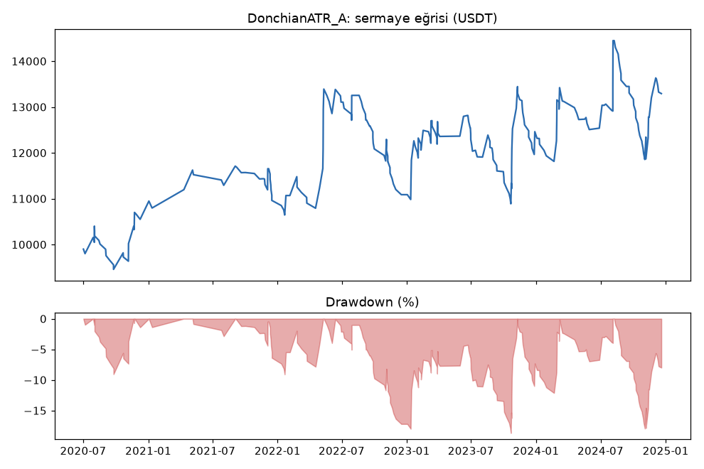
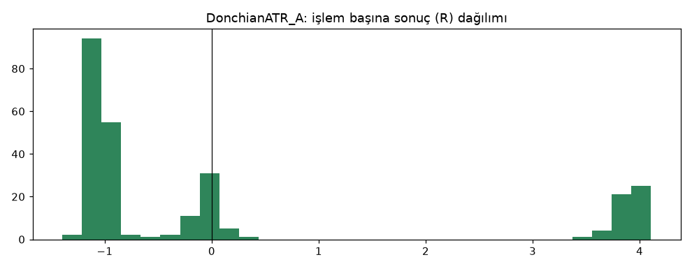
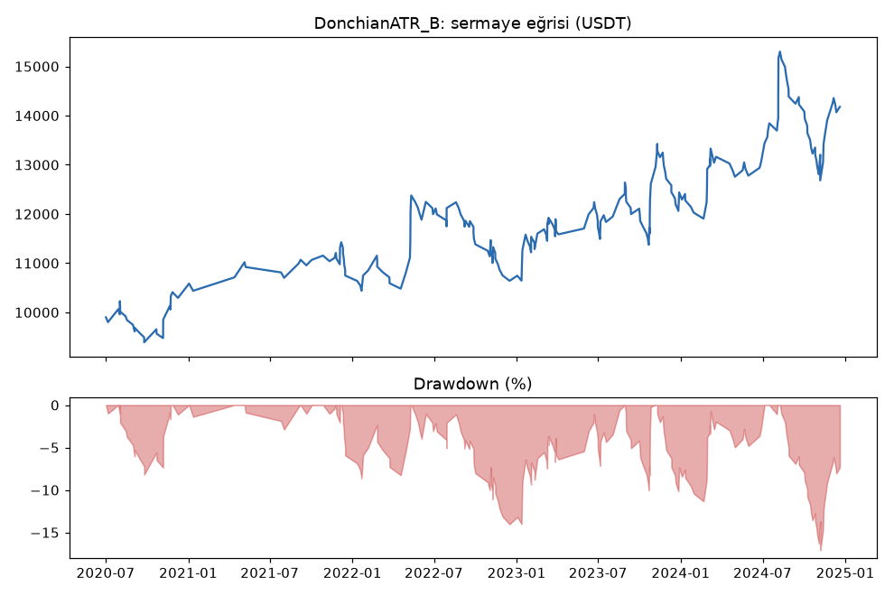
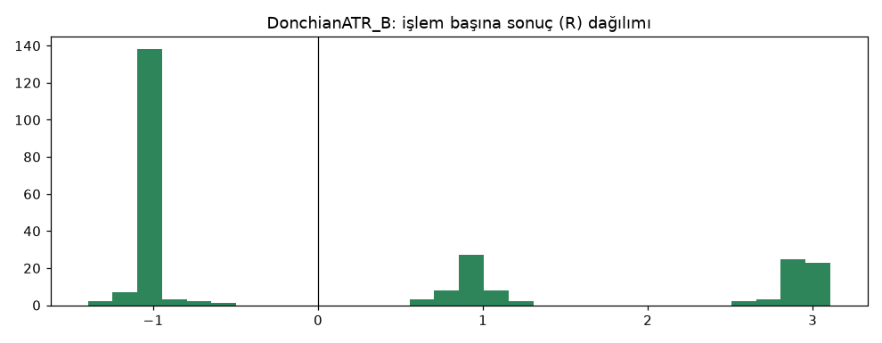
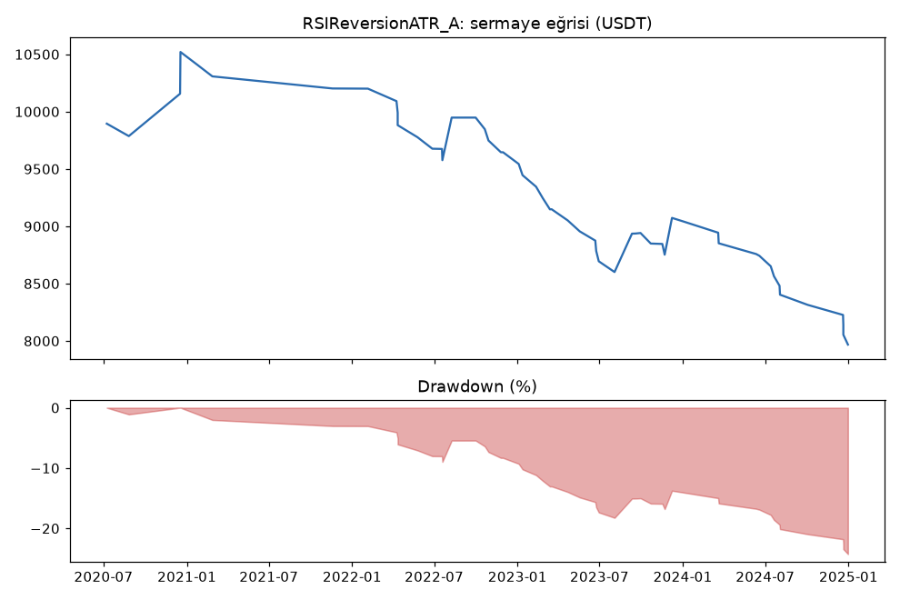
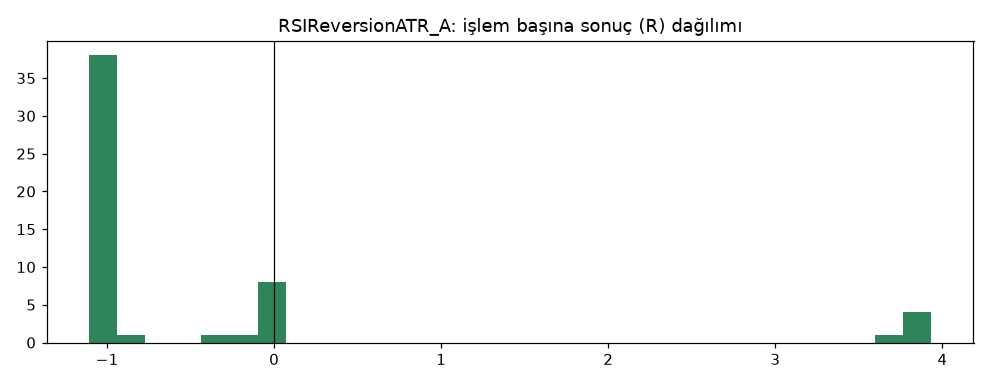
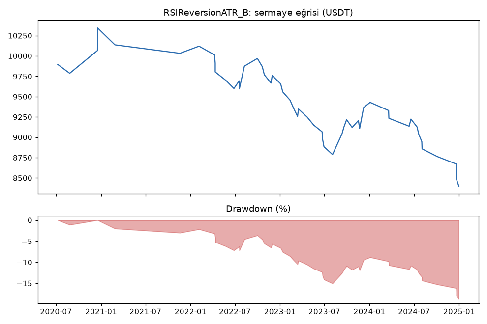
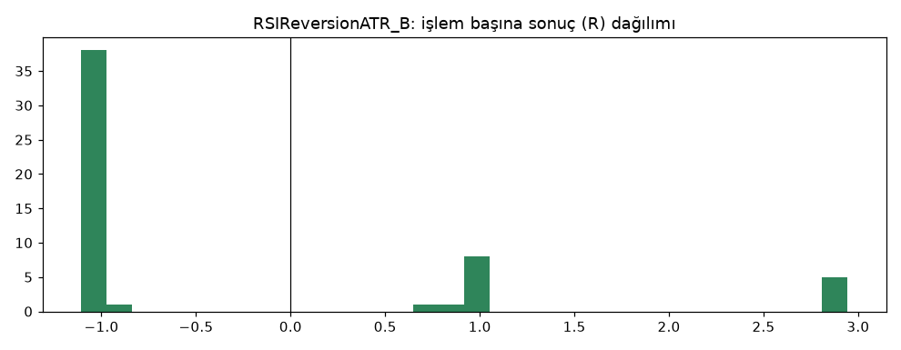
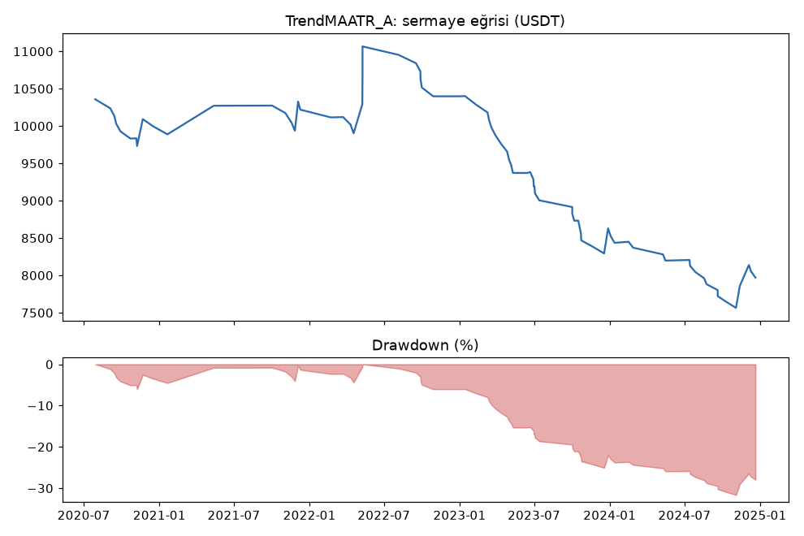
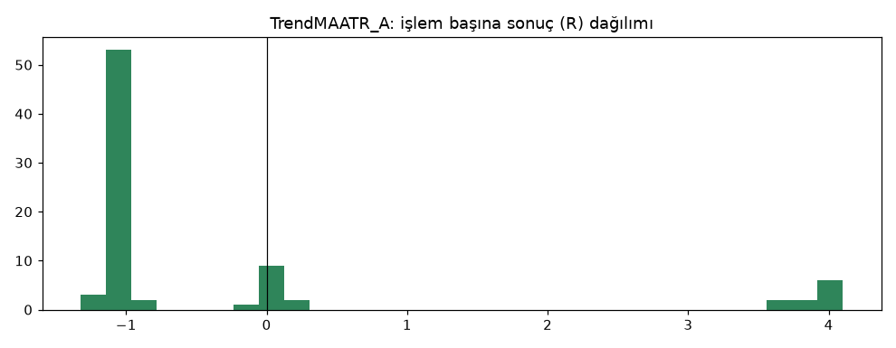
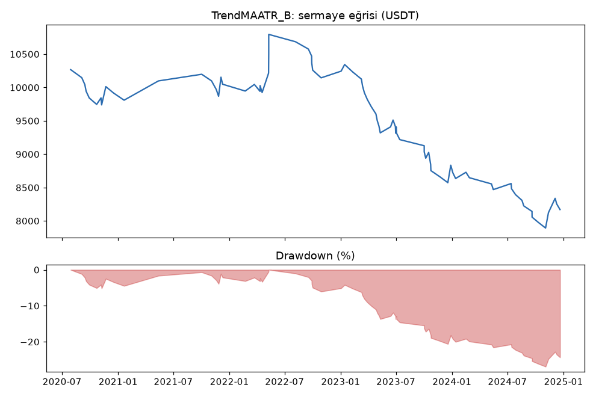
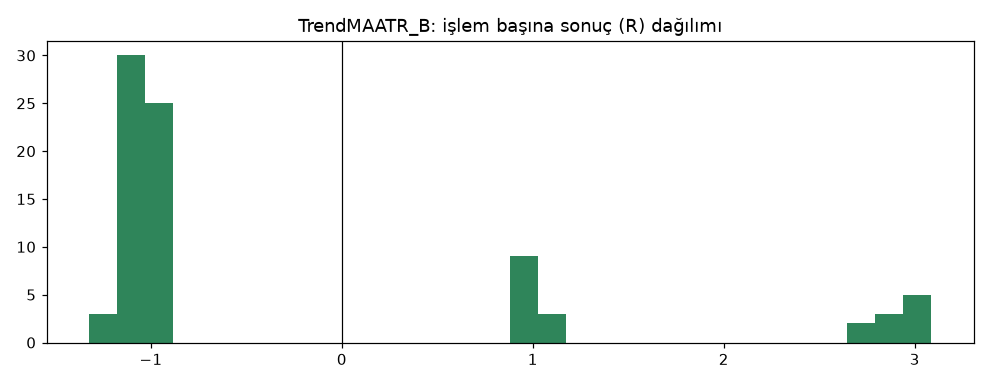

## Veri ve dönem
- Sadece geliştirme verisi. Tek filtre kuralı (ATR%'si 200 mumluk medyanın üstünde) üç strateji için test öncesi sabitlendi. Altı strateji tek seferde çalıştırıldığı için hepsi en uzun ısınmaya (1000 mum) göre 2020-06'da başlar.
- Hile testi: üç filtreli strateji için `lookahead-analysis` bias bulmadı.

## Yorum: güçlü yanlar / şüpheli noktalar
- **Filtre Donchian'ı belirgin iyileştirdi:** DonchianATR_B +0.16R/işlem, PF 1.22, drawdown %17.1 (filtresiz: +0.09R, PF 1.10, DD %38). İşlem sayısı yarıya indi (567 → 254). 6 coinin 5'i pozitif.
- Donchian'da kârı yine **long** taşıyor (+41.7R, 2022 hariç her yıl pozitif); short başa baş.
- **Filtre RSI ve trend_ma'yı daha da kötüleştirdi:** ikisi de belirgin zararda (-0.24R ile -0.41R).
- Model B, A'dan her üç stratejide de iyi.

## Karar: devam / düzelt / emekli
- **DonchianATR: devam** (aşama 3 TP ızgarası, dayanıklılık, sonra doğrulama).
- **RSIReversionATR ve TrendMAATR: elendi (aşama 2).**
