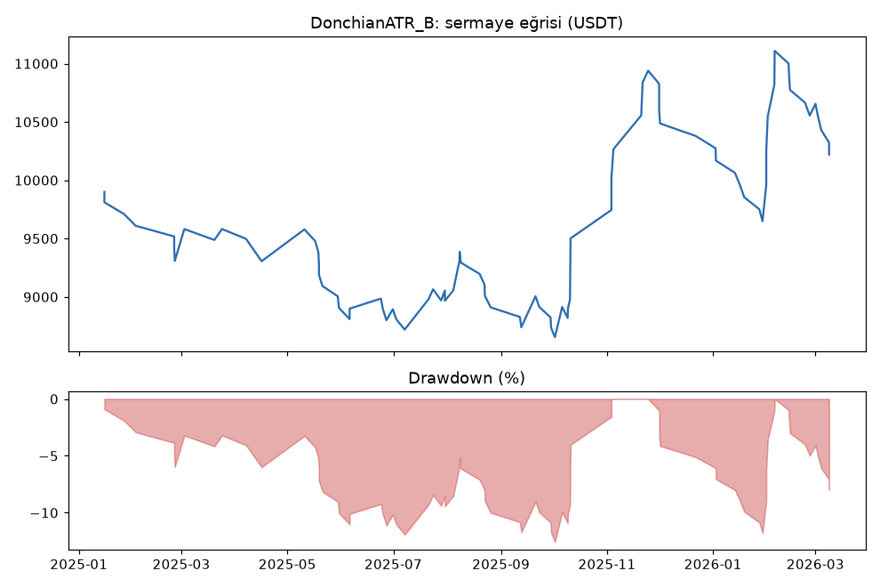
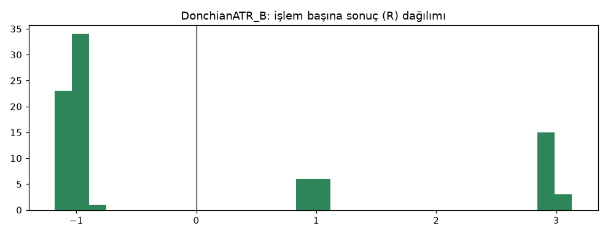

# DonchianATR_B — dogrulama — 2026-10-08

## Özet
- **DonchianATR_B**: 88 işlem, işlem başına ortalama **0.06R** (maliyet ve funding dahil), net getiri 2.2%, en büyük düşüş 13.5%.
- Aynı dönemde coinleri al-tut (eşit ağırlık): getiri -40.1%, ortalama en büyük düşüş 64.5%.

## Ayarlar
- Dönem: 2025-01-01 00:00:00 → 2026-04-01 00:00:00
- Coinler: BTC/USDT:USDT, ETH/USDT:USDT, SOL/USDT:USDT, XRP/USDT:USDT, BNB/USDT:USDT, DOGE/USDT:USDT
- Zaman dilimi: 4h
- Yön: long + short
- Mod: futures / isolated
- Kaldıraç: en fazla 3x, likidasyon stop mesafesinin en az 2 katı uzakta (bölüm 7.6)
- Risk: işlem başına sermayenin %1'i (pozisyon büyüklüğü stop mesafesine göre)
- Maliyet: her emir için %0.05 komisyon + %0.05 kayma (= %0.1), funding geçmiş veriden
- Başlangıç sermayesi: 10000 USDT

## Metrikler
| Metrik | DonchianATR_B | Al-tut |
|---|---|---|
| Net getiri | 2.2% | -40.1% |
| Max drawdown | 13.5% | 64.5% |
| Profit factor | 1.04 | — |
| Ortalama R | 0.06 | — |
| İşlem sayısı | 88 | — |
| Winrate | 34.1% | — |

Winrate tek başına başarı ölçütü değildir; asıl ölçüt ortalama R (expectancy) ve drawdown'dur.

## Long / short ayrımı
| Strateji | Yön | İşlem | Ortalama R | Toplam R | Profit factor |
|---|---|---|---|---|---|
| DonchianATR_B | long | 41 | -0.22 | -8.98 | 0.67 |
| DonchianATR_B | short | 47 | 0.30 | 13.95 | 1.45 |

## Sinyal istatistikleri
| Strateji | Stop | BE | TP1 sonrası BE | TP2 | Diğer | İptal (bölgeye gelmedi / önce stop) | Toplam funding (USDT) |
|---|---|---|---|---|---|---|---|
| DonchianATR_B | 65.9% | 0.0% | 13.6% | 20.5% | 0.0% | 9.3% | -22.40 |

## Coin bazında
| Strateji | Coin | İşlem | Ortalama R | Toplam R | Al-tut getirisi |
|---|---|---|---|---|---|
| DonchianATR_B | BTC/USDT:USDT | 16 | -0.16 | -2.63 | -27.4% |
| DonchianATR_B | ETH/USDT:USDT | 24 | -0.12 | -2.82 | -37.3% |
| DonchianATR_B | SOL/USDT:USDT | 13 | -0.27 | -3.54 | -56.2% |
| DonchianATR_B | XRP/USDT:USDT | 13 | 0.66 | 8.57 | -36.0% |
| DonchianATR_B | BNB/USDT:USDT | 17 | 0.38 | 6.52 | -12.5% |
| DonchianATR_B | DOGE/USDT:USDT | 5 | -0.23 | -1.13 | -71.0% |

## Grafikler

## Aşama
Aşama 4 (doğrulama): 2025-01-01 → 2026-03-31. TP modeli aşama 3'te seçildi (ızgarada en iyi yine Model B: [ızgara](../2026-10-08_donchian_atr_tp_izgara/izgara.md)). Geliştirme dayanıklılığı: [parametre ±%20 ve maliyet x2](../2026-10-08_donchian_atr_dayaniklilik/parametre_komsulari.md). Kasa (2026-04 → 2026-09) kullanılmadı.

**Dürüstlük notu:** filtresiz donchian_breakout bu veride bir kez test edilmişti (kaybetti). Filtre kuralı ondan önce, geliştirme verisine bakılmadan sabitlenmişti; yine de bu doğrulama tam "kör" sayılmaz.

## Yorum: güçlü yanlar / şüpheli noktalar
- **Hâlâ pozitif ama çok zayıf:** işlem başına +0.06R, profit factor 1.04 (eşik ≥ 1.2). Net +%2.2.
- **Drawdown iyi:** %13.5 (eşik ≤ %25). Al-tut aynı dönemde -%40 (DD %64) — sermayeyi korudu.
- **Yönler yer değiştirdi:** geliştirmede kârı long getiriyordu, burada long zararda (-9.0R), short kârda (+14.0R). Tutarlı bir taraf yok; bu, sonucun büyük kısmının şans/piyasa rejimi olabileceğini gösteriyor.
- 6 coinin sadece 2'si pozitif (XRP, BNB; eşik ≥ %50).
- 88 işlem; istatistiksel olarak +0.06R sıfırdan ayırt edilemez.

## Karar: devam / düzelt / emekli
**Doğrulama eşiklerini geçemedi** (PF 1.04 < 1.2, pozitif coin oranı %33 < %50). Şimdiye kadarki **en iyi aday** bu: iki dönemde de pozitif, düşük drawdown, düşen piyasada al-tut'tan çok iyi. Ama kurallara göre "active" olamaz; kasa testine geçilmedi. Karar proje sahibiyle verilecek (bkz. `docs/decisions.md`).
