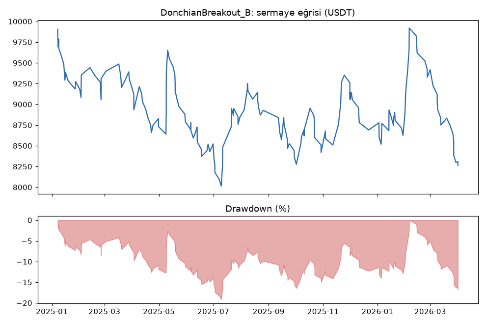
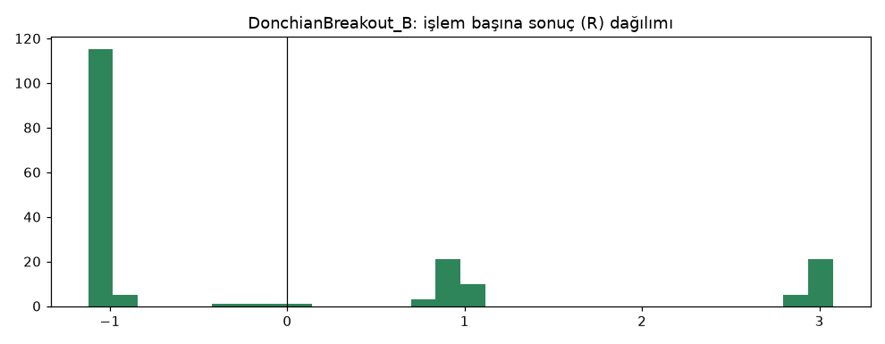

# DonchianBreakout_B — dogrulama — 2026-10-08

## Özet
- **DonchianBreakout_B**: 184 işlem, işlem başına ortalama **-0.09R** (maliyet ve funding dahil), net getiri -17.4%, en büyük düşüş 19.9%.
- Aynı dönemde coinleri al-tut (eşit ağırlık): getiri -40.1%, ortalama en büyük düşüş 64.5%.

## Ayarlar
- Dönem: 2025-01-01 00:00:00 → 2026-04-01 00:00:00
- Coinler: BTC/USDT:USDT, ETH/USDT:USDT, SOL/USDT:USDT, XRP/USDT:USDT, BNB/USDT:USDT, DOGE/USDT:USDT
- Zaman dilimi: 4h
- Yön: long + short
- Mod: futures / isolated
- Kaldıraç: en fazla 3x, likidasyon stop mesafesinin en az 2 katı uzakta (bölüm 7.6)
- Risk: işlem başına sermayenin %1'i (pozisyon büyüklüğü stop mesafesine göre)
- Maliyet: her emir için %0.05 komisyon + %0.05 kayma (= %0.1), funding geçmiş veriden
- Başlangıç sermayesi: 10000 USDT

## Metrikler
| Metrik | DonchianBreakout_B | Al-tut |
|---|---|---|
| Net getiri | -17.4% | -40.1% |
| Max drawdown | 19.9% | 64.5% |
| Profit factor | 0.84 | — |
| Ortalama R | -0.09 | — |
| İşlem sayısı | 184 | — |
| Winrate | 33.2% | — |

Winrate tek başına başarı ölçütü değildir; asıl ölçüt ortalama R (expectancy) ve drawdown'dur.

## Long / short ayrımı
| Strateji | Yön | İşlem | Ortalama R | Toplam R | Profit factor |
|---|---|---|---|---|---|
| DonchianBreakout_B | long | 102 | -0.20 | -20.14 | 0.69 |
| DonchianBreakout_B | short | 82 | 0.05 | 4.15 | 1.06 |

## Sinyal istatistikleri
| Strateji | Stop | BE | TP1 sonrası BE | TP2 | Diğer | İptal (bölgeye gelmedi / önce stop) | Toplam funding (USDT) |
|---|---|---|---|---|---|---|---|
| DonchianBreakout_B | 65.2% | 0.0% | 18.5% | 14.1% | 2.2% | 12.4% | -38.33 |

## Coin bazında
| Strateji | Coin | İşlem | Ortalama R | Toplam R | Al-tut getirisi |
|---|---|---|---|---|---|
| DonchianBreakout_B | BTC/USDT:USDT | 34 | -0.47 | -15.89 | -27.4% |
| DonchianBreakout_B | ETH/USDT:USDT | 40 | -0.16 | -6.44 | -37.3% |
| DonchianBreakout_B | SOL/USDT:USDT | 32 | -0.11 | -3.57 | -56.2% |
| DonchianBreakout_B | XRP/USDT:USDT | 35 | 0.20 | 6.85 | -36.0% |
| DonchianBreakout_B | BNB/USDT:USDT | 28 | 0.14 | 3.80 | -12.5% |
| DonchianBreakout_B | DOGE/USDT:USDT | 15 | -0.05 | -0.75 | -71.0% |

## Grafikler

## Aşama
Aşama 4 (doğrulama): 2025-01-01 → 2026-03-31, geliştirmede hiç kullanılmamış veri. TP modeli aşama 3'te seçildi: ızgarada en iyi varyant zaten Model B'ydi ([ızgara](../2026-10-08_donchian_breakout_tp_izgara/izgara.md)). Kasa (2026-04 → 2026-09) kullanılmadı.

## Yorum: güçlü yanlar / şüpheli noktalar
- **Görülmemiş veride kaybetti:** işlem başına -0.09R, profit factor 0.84 (eşik ≥ 1.2).
- Geliştirmede kârı taşıyan **long tarafı burada çöktü** (-20.1R); bu dönem coinlerin %12-71 düştüğü bir düşüş piyasası.
- 6 coinin sadece 2'si pozitif (XRP, BNB).
- Olumlu tek nokta: al-tut (-%40) kadar kaybetmedi ve drawdown %20'de kaldı. Ama bu kâr değil.

## Karar: devam / düzelt / emekli
**Elendi (aşama 4).** Doğrulamada beklenti negatif. Bu kartın parametreleri değiştirilmez. Filtreli versiyonu (`DonchianATR`) ayrı kartta test edildi.
