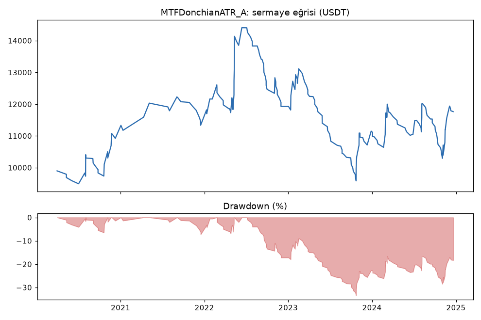
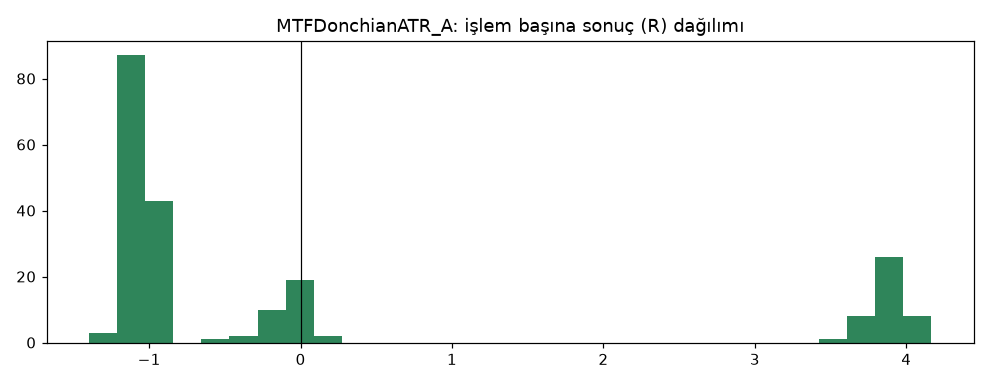
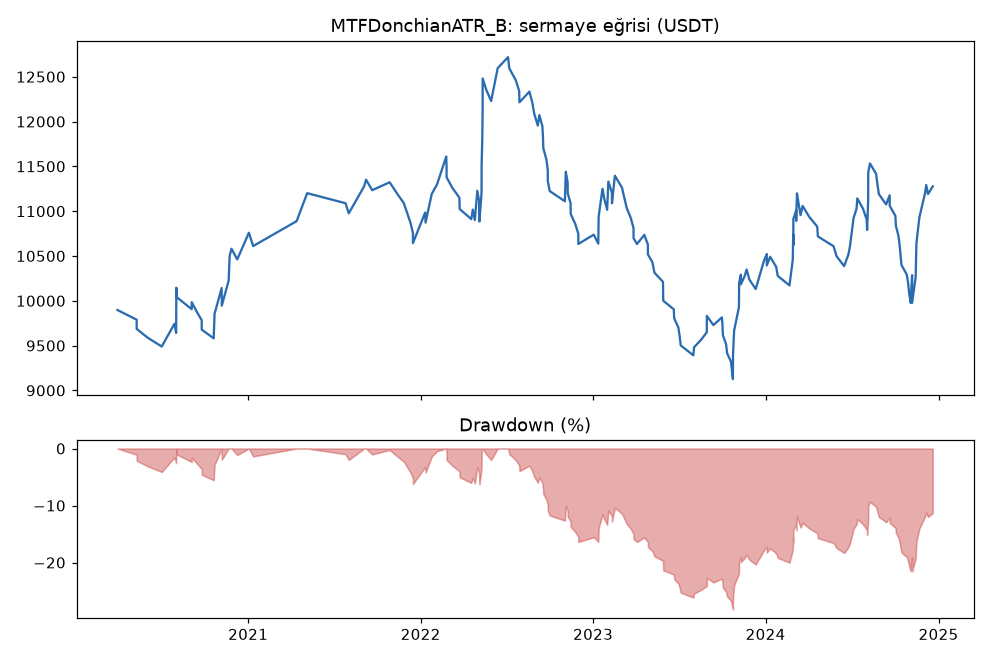
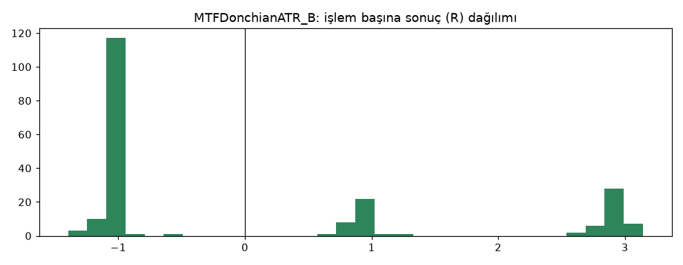
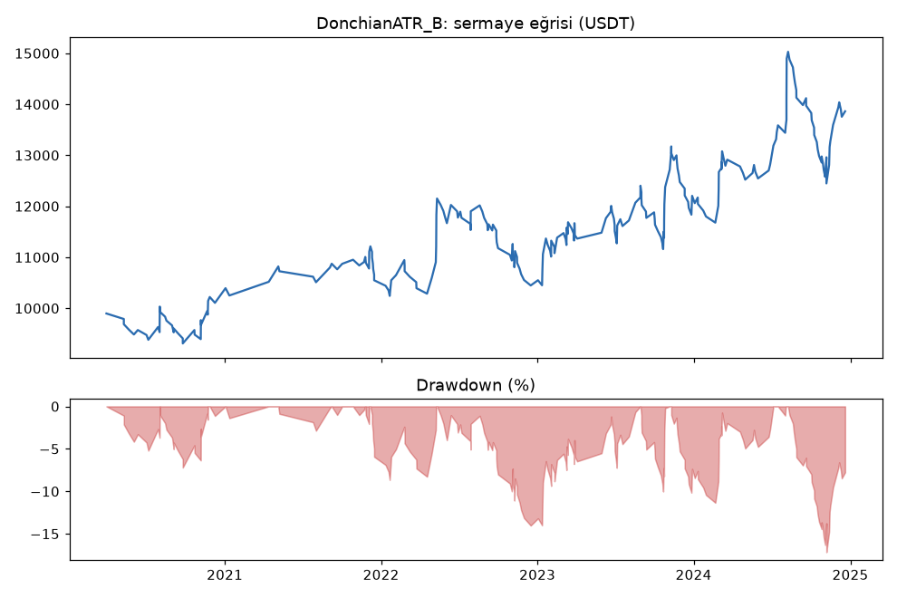
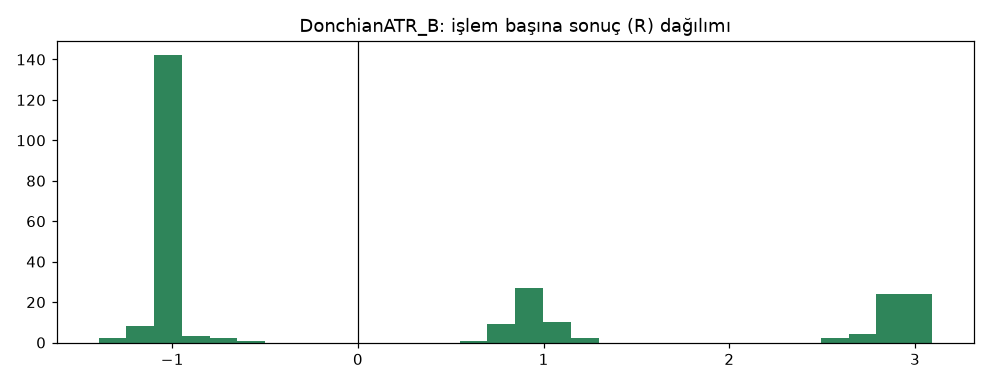

# MTFDonchianATR_A vs MTFDonchianATR_B vs DonchianATR_B — ilk_backtest_gelistirme — 2026-10-08

## Özet
- **MTFDonchianATR_A**: 210 işlem, işlem başına ortalama **0.12R** (maliyet ve funding dahil), net getiri 17.6%, en büyük düşüş 33.5%.
- **MTFDonchianATR_B**: 208 işlem, işlem başına ortalama **0.08R** (maliyet ve funding dahil), net getiri 12.8%, en büyük düşüş 28.2%.
- **DonchianATR_B**: 261 işlem, işlem başına ortalama **0.15R** (maliyet ve funding dahil), net getiri 38.6%, en büyük düşüş 17.2%.
- Aynı dönemde coinleri al-tut (eşit ağırlık): getiri 4055.7%, ortalama en büyük düşüş 84.1%.

## Ayarlar
- Dönem: 2020-03-24 08:00:00 → 2025-01-01 00:00:00
- Coinler: BTC/USDT:USDT, ETH/USDT:USDT, SOL/USDT:USDT, XRP/USDT:USDT, BNB/USDT:USDT, DOGE/USDT:USDT
- Zaman dilimi: 4h
- Yön: long + short
- Mod: futures / isolated
- Kaldıraç: en fazla 3x, likidasyon stop mesafesinin en az 2 katı uzakta (bölüm 7.6)
- Risk: işlem başına sermayenin %1'i (pozisyon büyüklüğü stop mesafesine göre)
- Maliyet: her emir için %0.05 komisyon + %0.05 kayma (= %0.1), funding geçmiş veriden
- Başlangıç sermayesi: 10000 USDT

## Metrikler
| Metrik | MTFDonchianATR_A | MTFDonchianATR_B | DonchianATR_B | Al-tut |
|---|---|---|---|---|
| Net getiri | 17.6% | 12.8% | 38.6% | 4055.7% |
| Max drawdown | 33.5% | 28.2% | 17.2% | 84.1% |
| Profit factor | 1.11 | 1.09 | 1.20 | — |
| Ortalama R | 0.12 | 0.08 | 0.15 | — |
| İşlem sayısı | 210 | 208 | 261 | — |
| Winrate | 24.3% | 36.5% | 39.5% | — |

Winrate tek başına başarı ölçütü değildir; asıl ölçüt ortalama R (expectancy) ve drawdown'dur.

## Long / short ayrımı
| Strateji | Yön | İşlem | Ortalama R | Toplam R | Profit factor |
|---|---|---|---|---|---|
| MTFDonchianATR_A | long | 112 | 0.41 | 45.57 | 1.54 |
| MTFDonchianATR_A | short | 98 | -0.22 | -21.36 | 0.71 |
| MTFDonchianATR_B | long | 112 | 0.32 | 35.87 | 1.46 |
| MTFDonchianATR_B | short | 96 | -0.19 | -18.49 | 0.74 |
| DonchianATR_B | long | 137 | 0.31 | 41.79 | 1.44 |
| DonchianATR_B | short | 124 | -0.02 | -2.08 | 0.96 |

## Sinyal istatistikleri
| Strateji | Stop | BE | TP1 sonrası BE | TP2 | Diğer | İptal (bölgeye gelmedi / önce stop) | Toplam funding (USDT) |
|---|---|---|---|---|---|---|---|
| MTFDonchianATR_A | 63.8% | 15.7% | 0.0% | 20.5% | 0.0% | 8.3% | -755.58 |
| MTFDonchianATR_B | 63.5% | 0.0% | 15.9% | 20.7% | 0.0% | 8.4% | -581.55 |
| DonchianATR_B | 60.5% | 0.0% | 18.8% | 20.7% | 0.0% | 9.7% | -473.08 |

## Coin bazında
| Strateji | Coin | İşlem | Ortalama R | Toplam R | Al-tut getirisi |
|---|---|---|---|---|---|
| MTFDonchianATR_A | BTC/USDT:USDT | 58 | 0.26 | 15.07 | 1293.4% |
| MTFDonchianATR_A | ETH/USDT:USDT | 49 | -0.03 | -1.49 | 2283.7% |
| MTFDonchianATR_A | SOL/USDT:USDT | 12 | 0.04 | 0.42 | 5552.9% |
| MTFDonchianATR_A | XRP/USDT:USDT | 27 | -0.02 | -0.59 | 1197.7% |
| MTFDonchianATR_A | BNB/USDT:USDT | 40 | 0.25 | 9.94 | 5581.1% |
| MTFDonchianATR_A | DOGE/USDT:USDT | 24 | 0.04 | 0.85 | 8425.3% |
| MTFDonchianATR_B | BTC/USDT:USDT | 57 | 0.29 | 16.53 | 1293.4% |
| MTFDonchianATR_B | ETH/USDT:USDT | 48 | -0.07 | -3.15 | 2283.7% |
| MTFDonchianATR_B | SOL/USDT:USDT | 12 | 0.12 | 1.47 | 5552.9% |
| MTFDonchianATR_B | XRP/USDT:USDT | 27 | -0.09 | -2.47 | 1197.7% |
| MTFDonchianATR_B | BNB/USDT:USDT | 40 | 0.21 | 8.22 | 5581.1% |
| MTFDonchianATR_B | DOGE/USDT:USDT | 24 | -0.13 | -3.22 | 8425.3% |
| DonchianATR_B | BTC/USDT:USDT | 68 | 0.26 | 17.52 | 1293.4% |
| DonchianATR_B | ETH/USDT:USDT | 57 | 0.01 | 0.41 | 2283.7% |
| DonchianATR_B | SOL/USDT:USDT | 21 | 0.28 | 5.82 | 5552.9% |
| DonchianATR_B | XRP/USDT:USDT | 38 | 0.22 | 8.51 | 1197.7% |
| DonchianATR_B | BNB/USDT:USDT | 48 | 0.33 | 15.81 | 5581.1% |
| DonchianATR_B | DOGE/USDT:USDT | 29 | -0.29 | -8.37 | 8425.3% |

## Grafikler

## Yorum: güçlü yanlar / şüpheli noktalar
- Günlük trend filtresini en iyi adaya (DonchianATR_B) eklemek onu **kötüleştirdi**: +0.15R → +0.08R, DD %17 → %28, short -2R → -18.5R.
- Long tarafı yine güçlü (+35.9R), ama zaten filtresiz de güçlüydü.

## Karar: devam / düzelt / emekli
**Elendi (aşama 2):** pozitif ama temel versiyondan her ölçüde kötü; doğrulamaya alınmadı.
