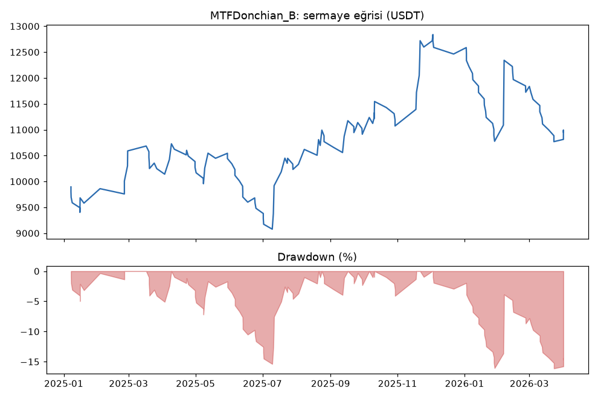
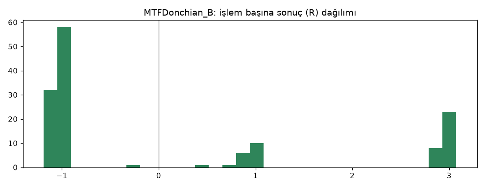

# MTFDonchian_B — dogrulama — 2026-10-08

## Özet
- **MTFDonchian_B**: 140 işlem, işlem başına ortalama **0.10R** (maliyet ve funding dahil), net getiri 9.5%, en büyük düşüş 16.1%.
- Aynı dönemde coinleri al-tut (eşit ağırlık): getiri -40.1%, ortalama en büyük düşüş 64.5%.

## Ayarlar
- Dönem: 2025-01-01 00:00:00 → 2026-04-01 00:00:00
- Coinler: BTC/USDT:USDT, ETH/USDT:USDT, SOL/USDT:USDT, XRP/USDT:USDT, BNB/USDT:USDT, DOGE/USDT:USDT
- Zaman dilimi: 4h
- Yön: long + short
- Mod: futures / isolated
- Kaldıraç: en fazla 3x, likidasyon stop mesafesinin en az 2 katı uzakta (bölüm 7.6)
- Risk: işlem başına sermayenin %1'i (pozisyon büyüklüğü stop mesafesine göre)
- Maliyet: her emir için %0.05 komisyon + %0.05 kayma (= %0.1), funding geçmiş veriden
- Başlangıç sermayesi: 10000 USDT

## Metrikler
| Metrik | MTFDonchian_B | Al-tut |
|---|---|---|
| Net getiri | 9.5% | -40.1% |
| Max drawdown | 16.1% | 64.5% |
| Profit factor | 1.09 | — |
| Ortalama R | 0.10 | — |
| İşlem sayısı | 140 | — |
| Winrate | 35.0% | — |

Winrate tek başına başarı ölçütü değildir; asıl ölçüt ortalama R (expectancy) ve drawdown'dur.

## Long / short ayrımı
| Strateji | Yön | İşlem | Ortalama R | Toplam R | Profit factor |
|---|---|---|---|---|---|
| MTFDonchian_B | long | 62 | 0.07 | 4.08 | 1.06 |
| MTFDonchian_B | short | 78 | 0.12 | 9.67 | 1.13 |

## Sinyal istatistikleri
| Strateji | Stop | BE | TP1 sonrası BE | TP2 | Diğer | İptal (bölgeye gelmedi / önce stop) | Toplam funding (USDT) |
|---|---|---|---|---|---|---|---|
| MTFDonchian_B | 64.3% | 0.0% | 10.7% | 22.1% | 2.9% | 10.3% | -85.08 |

## Coin bazında
| Strateji | Coin | İşlem | Ortalama R | Toplam R | Al-tut getirisi |
|---|---|---|---|---|---|
| MTFDonchian_B | BTC/USDT:USDT | 24 | -0.41 | -9.75 | -27.4% |
| MTFDonchian_B | ETH/USDT:USDT | 24 | -0.04 | -0.98 | -37.3% |
| MTFDonchian_B | SOL/USDT:USDT | 25 | 0.25 | 6.25 | -56.2% |
| MTFDonchian_B | XRP/USDT:USDT | 25 | 0.15 | 3.77 | -36.0% |
| MTFDonchian_B | BNB/USDT:USDT | 29 | 0.38 | 11.09 | -12.5% |
| MTFDonchian_B | DOGE/USDT:USDT | 13 | 0.26 | 3.36 | -71.0% |

## Grafikler

## Aşama
Aşama 4 (doğrulama): 2025-01-01 → 2026-03-31. TP modeli ızgarada seçildi (en iyi yine Model B: [ızgara](../2026-10-08_mtf_donchian_tp_izgara/izgara.md)). Dayanıklılık: [±%20 ve maliyet x2](../2026-10-08_mtf_donchian_dayaniklilik/parametre_komsulari.md). Kasa kullanılmadı.

**Dürüstlük notu:** Bu veride daha önce donchian_breakout ve DonchianATR test edildi. MTFDonchian'ın kuralları ondan bağımsız sabitlendi (proje sahibinin "önce trend" fikri), ama aynı ailenin üçüncü denemesi olduğu unutulmamalı.

## Yorum: güçlü yanlar / şüpheli noktalar
- **Tutarlı:** geliştirmede +0.10R, burada da +0.10R. Şimdiye kadar iki dönemde aynı kalan tek strateji.
- **İki yön de pozitif** (long +4.1R, short +9.7R), 6 coinin 4'ü pozitif (eşik ≥ %50 sağlandı).
- **Düşen piyasada sermayeyi korudu:** net +%9.5, al-tut -%40.
- **Zayıf taraf:** profit factor 1.09 (eşik ≥ 1.2). BTC -9.8R.
- Geliştirme döneminde drawdown %37 (eşik ≤ %25); burada %16.

## Karar: devam / düzelt / emekli
**Eşikleri geçemedi** (PF 1.09 < 1.2; geliştirme DD %37 > %25). DonchianATR_B ile birlikte en iyi iki adaydan biri; tutarlılık açısından daha iyi, drawdown açısından daha kötü. Kasa testine geçilmedi; karar proje sahibiyle.
