# MTFDonchian_A vs MTFDonchian_B vs MTFPullback_A vs MTFPullback_B vs MTFSupertrend_A vs MTFSupertrend_B vs MTFSqueeze_A vs MTFSqueeze_B — ilk_backtest_gelistirme — 2026-10-08

## Özet
- **MTFDonchian_A**: 461 işlem, işlem başına ortalama **0.09R** (maliyet ve funding dahil), net getiri 28.2%, en büyük düşüş 41.3%.
- **MTFDonchian_B**: 460 işlem, işlem başına ortalama **0.10R** (maliyet ve funding dahil), net getiri 41.4%, en büyük düşüş 36.9%.
- **MTFPullback_A**: 603 işlem, işlem başına ortalama **0.02R** (maliyet ve funding dahil), net getiri -2.9%, en büyük düşüş 50.6%.
- **MTFPullback_B**: 602 işlem, işlem başına ortalama **0.00R** (maliyet ve funding dahil), net getiri -8.9%, en büyük düşüş 46.0%.
- **MTFSupertrend_A**: 226 işlem, işlem başına ortalama **0.00R** (maliyet ve funding dahil), net getiri -6.0%, en büyük düşüş 45.3%.
- **MTFSupertrend_B**: 225 işlem, işlem başına ortalama **-0.03R** (maliyet ve funding dahil), net getiri -10.5%, en büyük düşüş 40.5%.
- **MTFSqueeze_A**: 419 işlem, işlem başına ortalama **-0.06R** (maliyet ve funding dahil), net getiri -31.6%, en büyük düşüş 53.7%.
- **MTFSqueeze_B**: 418 işlem, işlem başına ortalama **-0.08R** (maliyet ve funding dahil), net getiri -33.0%, en büyük düşüş 53.0%.
- Aynı dönemde coinleri al-tut (eşit ağırlık): getiri 3406.7%, ortalama en büyük düşüş 84.1%.

## Ayarlar
- Dönem: 2020-03-07 16:00:00 → 2025-01-01 00:00:00
- Coinler: BTC/USDT:USDT, ETH/USDT:USDT, SOL/USDT:USDT, XRP/USDT:USDT, BNB/USDT:USDT, DOGE/USDT:USDT
- Zaman dilimi: 4h
- Yön: long + short
- Mod: futures / isolated
- Kaldıraç: en fazla 3x, likidasyon stop mesafesinin en az 2 katı uzakta (bölüm 7.6)
- Risk: işlem başına sermayenin %1'i (pozisyon büyüklüğü stop mesafesine göre)
- Maliyet: her emir için %0.05 komisyon + %0.05 kayma (= %0.1), funding geçmiş veriden
- Başlangıç sermayesi: 10000 USDT

## Metrikler
| Metrik | MTFDonchian_A | MTFDonchian_B | MTFPullback_A | MTFPullback_B | MTFSupertrend_A | MTFSupertrend_B | MTFSqueeze_A | MTFSqueeze_B | Al-tut |
|---|---|---|---|---|---|---|---|---|---|
| Net getiri | 28.2% | 41.4% | -2.9% | -8.9% | -6.0% | -10.5% | -31.6% | -33.0% | 3406.7% |
| Max drawdown | 41.3% | 36.9% | 50.6% | 46.0% | 45.3% | 40.5% | 53.7% | 53.0% | 84.1% |
| Profit factor | 1.07 | 1.11 | 0.99 | 0.98 | 0.96 | 0.93 | 0.89 | 0.88 | — |
| Ortalama R | 0.09 | 0.10 | 0.02 | 0.00 | 0.00 | -0.03 | -0.06 | -0.08 | — |
| İşlem sayısı | 461 | 460 | 603 | 602 | 226 | 225 | 419 | 418 | — |
| Winrate | 25.6% | 38.7% | 23.7% | 34.4% | 23.5% | 32.9% | 20.0% | 31.8% | — |

Winrate tek başına başarı ölçütü değildir; asıl ölçüt ortalama R (expectancy) ve drawdown'dur.

## Long / short ayrımı
| Strateji | Yön | İşlem | Ortalama R | Toplam R | Profit factor |
|---|---|---|---|---|---|
| MTFDonchian_A | long | 258 | 0.27 | 69.83 | 1.30 |
| MTFDonchian_A | short | 203 | -0.14 | -27.67 | 0.81 |
| MTFDonchian_B | long | 258 | 0.23 | 60.29 | 1.29 |
| MTFDonchian_B | short | 202 | -0.07 | -14.15 | 0.90 |
| MTFPullback_A | long | 313 | -0.03 | -9.05 | 0.91 |
| MTFPullback_A | short | 290 | 0.08 | 22.91 | 1.08 |
| MTFPullback_B | long | 313 | -0.06 | -17.72 | 0.89 |
| MTFPullback_B | short | 289 | 0.07 | 19.38 | 1.07 |
| MTFSupertrend_A | long | 116 | -0.16 | -18.13 | 0.74 |
| MTFSupertrend_A | short | 110 | 0.17 | 18.72 | 1.20 |
| MTFSupertrend_B | long | 116 | -0.13 | -15.21 | 0.79 |
| MTFSupertrend_B | short | 109 | 0.08 | 8.32 | 1.08 |
| MTFSqueeze_A | long | 216 | 0.12 | 26.06 | 1.11 |
| MTFSqueeze_A | short | 203 | -0.26 | -52.12 | 0.68 |
| MTFSqueeze_B | long | 216 | 0.08 | 17.83 | 1.08 |
| MTFSqueeze_B | short | 202 | -0.25 | -50.62 | 0.70 |

## Sinyal istatistikleri
| Strateji | Stop | BE | TP1 sonrası BE | TP2 | Diğer | İptal (bölgeye gelmedi / önce stop) | Toplam funding (USDT) |
|---|---|---|---|---|---|---|---|
| MTFDonchian_A | 61.4% | 19.1% | 0.0% | 19.3% | 0.2% | 8.9% | -1788.81 |
| MTFDonchian_B | 61.1% | 0.0% | 19.3% | 19.3% | 0.2% | 8.9% | -1502.02 |
| MTFPullback_A | 65.3% | 15.6% | 0.0% | 18.6% | 0.5% | 10.3% | -1135.97 |
| MTFPullback_B | 65.3% | 0.0% | 15.3% | 18.9% | 0.5% | 10.3% | -802.05 |
| MTFSupertrend_A | 66.4% | 15.0% | 0.0% | 18.1% | 0.4% | 9.6% | -516.01 |
| MTFSupertrend_B | 66.7% | 0.0% | 14.7% | 18.2% | 0.4% | 9.6% | -392.99 |
| MTFSqueeze_A | 67.8% | 14.8% | 0.0% | 17.2% | 0.2% | 9.5% | -1026.70 |
| MTFSqueeze_B | 67.9% | 0.0% | 14.1% | 17.7% | 0.2% | 9.5% | -893.58 |

## Coin bazında
| Strateji | Coin | İşlem | Ortalama R | Toplam R | Al-tut getirisi |
|---|---|---|---|---|---|
| MTFDonchian_A | BTC/USDT:USDT | 98 | 0.20 | 19.19 | 954.4% |
| MTFDonchian_A | ETH/USDT:USDT | 93 | -0.01 | -0.88 | 1303.7% |
| MTFDonchian_A | SOL/USDT:USDT | 49 | 0.38 | 18.68 | 5552.9% |
| MTFDonchian_A | XRP/USDT:USDT | 78 | -0.16 | -12.65 | 786.4% |
| MTFDonchian_A | BNB/USDT:USDT | 91 | 0.07 | 5.92 | 3417.7% |
| MTFDonchian_A | DOGE/USDT:USDT | 52 | 0.23 | 11.90 | 8425.3% |
| MTFDonchian_B | BTC/USDT:USDT | 97 | 0.14 | 14.06 | 954.4% |
| MTFDonchian_B | ETH/USDT:USDT | 93 | 0.06 | 6.04 | 1303.7% |
| MTFDonchian_B | SOL/USDT:USDT | 49 | 0.39 | 19.05 | 5552.9% |
| MTFDonchian_B | XRP/USDT:USDT | 78 | -0.14 | -10.57 | 786.4% |
| MTFDonchian_B | BNB/USDT:USDT | 91 | 0.06 | 5.73 | 3417.7% |
| MTFDonchian_B | DOGE/USDT:USDT | 52 | 0.23 | 11.84 | 8425.3% |
| MTFPullback_A | BTC/USDT:USDT | 116 | -0.04 | -4.52 | 954.4% |
| MTFPullback_A | ETH/USDT:USDT | 108 | 0.41 | 43.98 | 1303.7% |
| MTFPullback_A | SOL/USDT:USDT | 98 | 0.07 | 7.12 | 5552.9% |
| MTFPullback_A | XRP/USDT:USDT | 99 | -0.13 | -13.11 | 786.4% |
| MTFPullback_A | BNB/USDT:USDT | 97 | -0.10 | -9.38 | 3417.7% |
| MTFPullback_A | DOGE/USDT:USDT | 85 | -0.12 | -10.23 | 8425.3% |
| MTFPullback_B | BTC/USDT:USDT | 116 | -0.02 | -2.21 | 954.4% |
| MTFPullback_B | ETH/USDT:USDT | 108 | 0.29 | 31.80 | 1303.7% |
| MTFPullback_B | SOL/USDT:USDT | 98 | -0.02 | -1.50 | 5552.9% |
| MTFPullback_B | XRP/USDT:USDT | 99 | -0.14 | -13.46 | 786.4% |
| MTFPullback_B | BNB/USDT:USDT | 97 | -0.07 | -6.63 | 3417.7% |
| MTFPullback_B | DOGE/USDT:USDT | 84 | -0.08 | -6.34 | 8425.3% |
| MTFSupertrend_A | BTC/USDT:USDT | 50 | -0.41 | -20.63 | 954.4% |
| MTFSupertrend_A | ETH/USDT:USDT | 47 | 0.30 | 14.05 | 1303.7% |
| MTFSupertrend_A | SOL/USDT:USDT | 17 | -0.34 | -5.70 | 5552.9% |
| MTFSupertrend_A | XRP/USDT:USDT | 40 | -0.04 | -1.50 | 786.4% |
| MTFSupertrend_A | BNB/USDT:USDT | 46 | -0.09 | -3.97 | 3417.7% |
| MTFSupertrend_A | DOGE/USDT:USDT | 26 | 0.71 | 18.33 | 8425.3% |
| MTFSupertrend_B | BTC/USDT:USDT | 50 | -0.41 | -20.52 | 954.4% |
| MTFSupertrend_B | ETH/USDT:USDT | 47 | 0.16 | 7.70 | 1303.7% |
| MTFSupertrend_B | SOL/USDT:USDT | 17 | -0.34 | -5.79 | 5552.9% |
| MTFSupertrend_B | XRP/USDT:USDT | 39 | -0.01 | -0.52 | 786.4% |
| MTFSupertrend_B | BNB/USDT:USDT | 46 | -0.07 | -3.04 | 3417.7% |
| MTFSupertrend_B | DOGE/USDT:USDT | 26 | 0.59 | 15.27 | 8425.3% |
| MTFSqueeze_A | BTC/USDT:USDT | 94 | 0.07 | 6.27 | 954.4% |
| MTFSqueeze_A | ETH/USDT:USDT | 71 | 0.12 | 8.78 | 1303.7% |
| MTFSqueeze_A | SOL/USDT:USDT | 30 | -0.05 | -1.59 | 5552.9% |
| MTFSqueeze_A | XRP/USDT:USDT | 85 | -0.13 | -11.04 | 786.4% |
| MTFSqueeze_A | BNB/USDT:USDT | 83 | -0.25 | -20.63 | 3417.7% |
| MTFSqueeze_A | DOGE/USDT:USDT | 56 | -0.14 | -7.86 | 8425.3% |
| MTFSqueeze_B | BTC/USDT:USDT | 94 | -0.05 | -4.29 | 954.4% |
| MTFSqueeze_B | ETH/USDT:USDT | 72 | 0.06 | 4.02 | 1303.7% |
| MTFSqueeze_B | SOL/USDT:USDT | 31 | -0.09 | -2.74 | 5552.9% |
| MTFSqueeze_B | XRP/USDT:USDT | 83 | -0.10 | -7.90 | 786.4% |
| MTFSqueeze_B | BNB/USDT:USDT | 82 | -0.23 | -18.94 | 3417.7% |
| MTFSqueeze_B | DOGE/USDT:USDT | 56 | -0.05 | -2.94 | 8425.3% |

## Grafikler
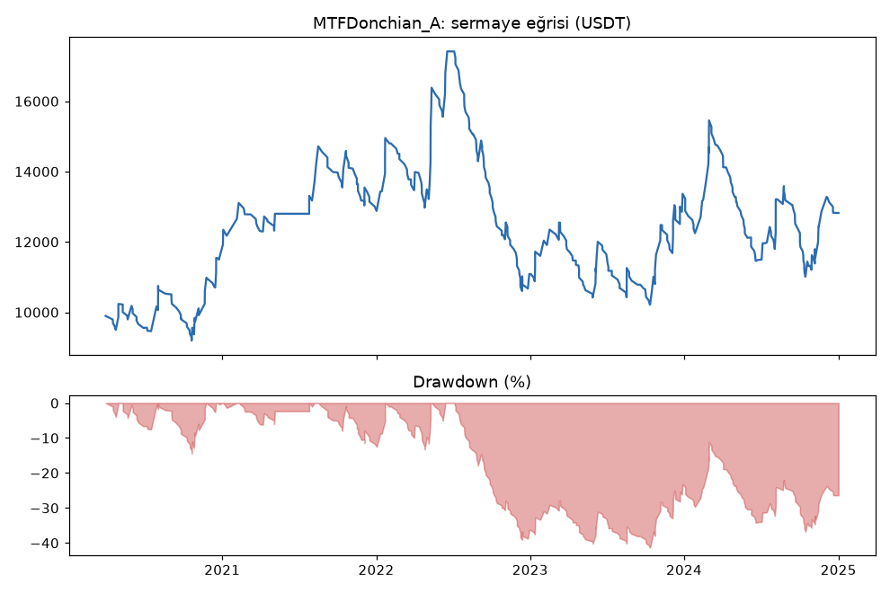
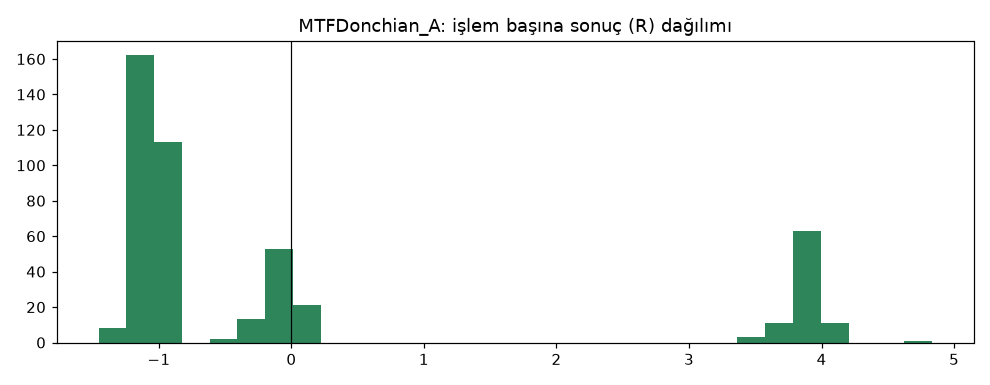
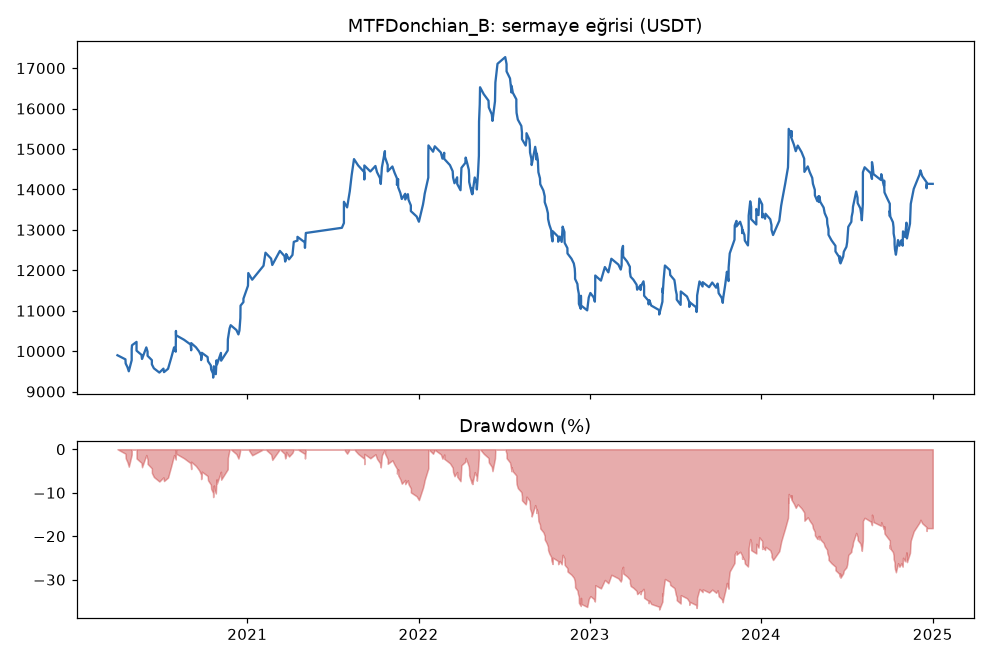
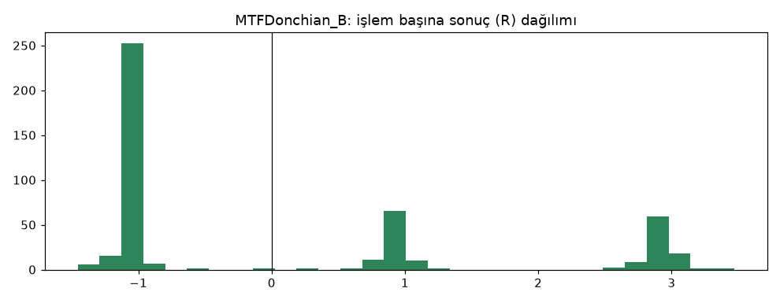
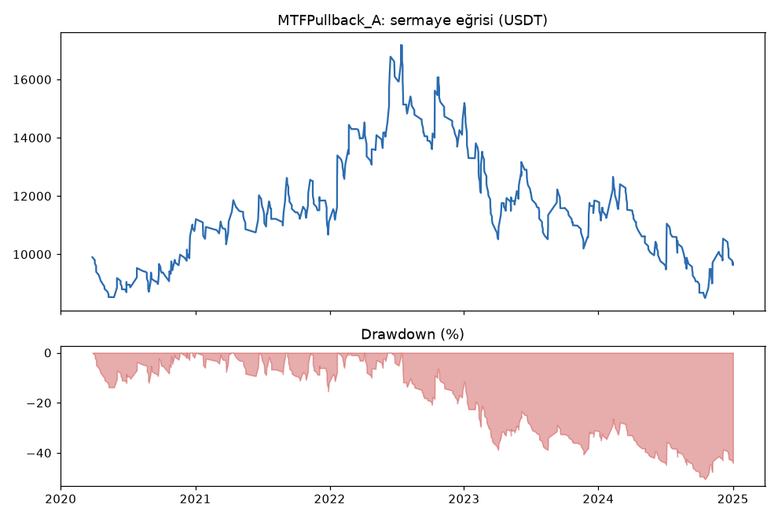
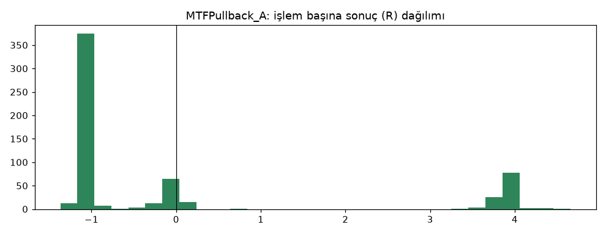
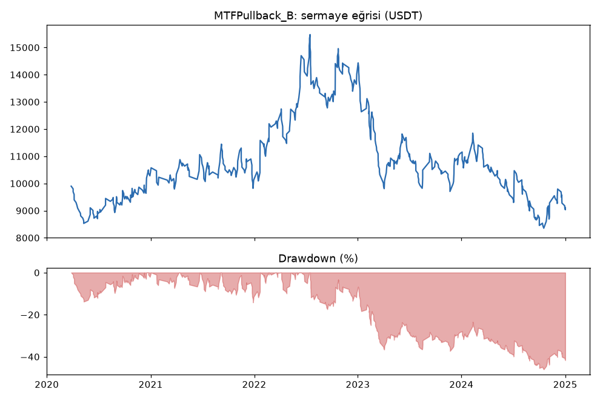
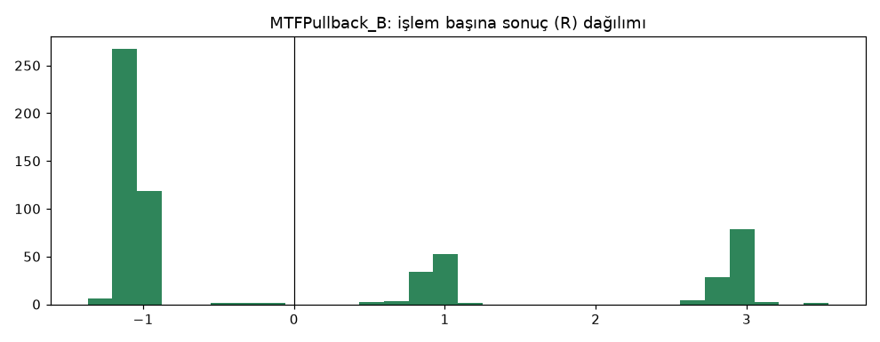
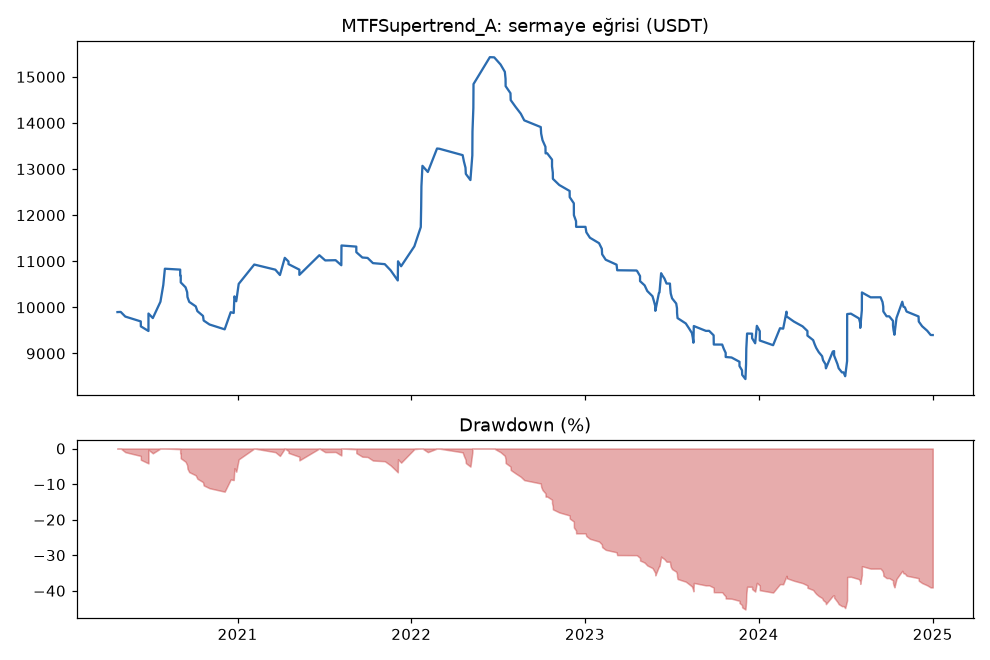
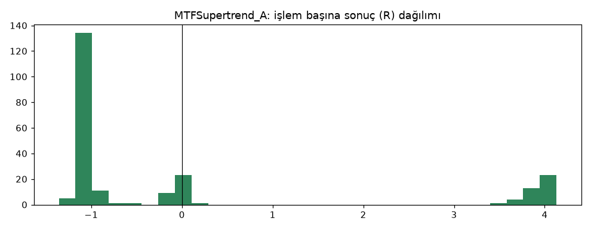
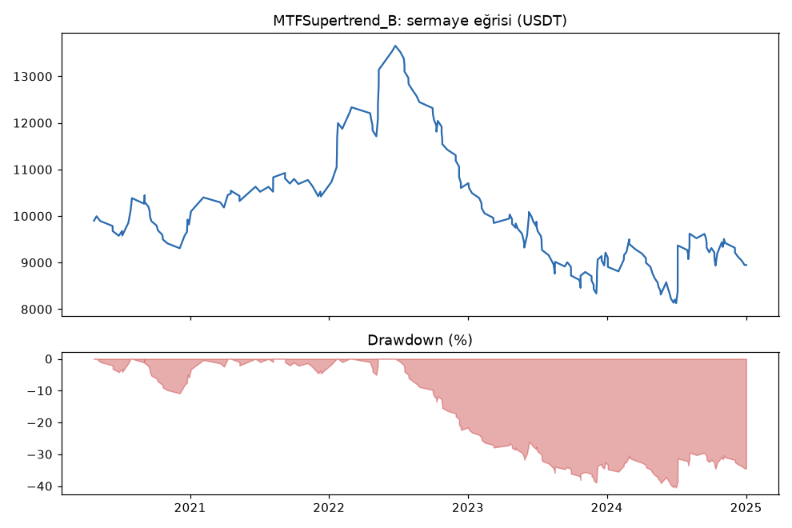
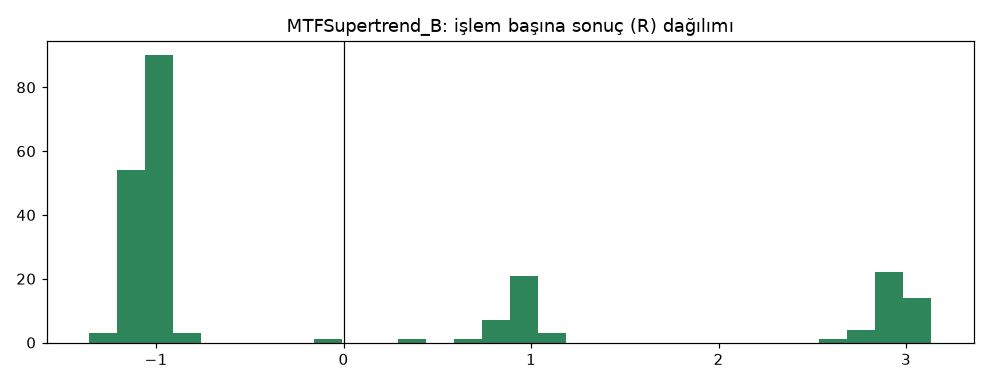
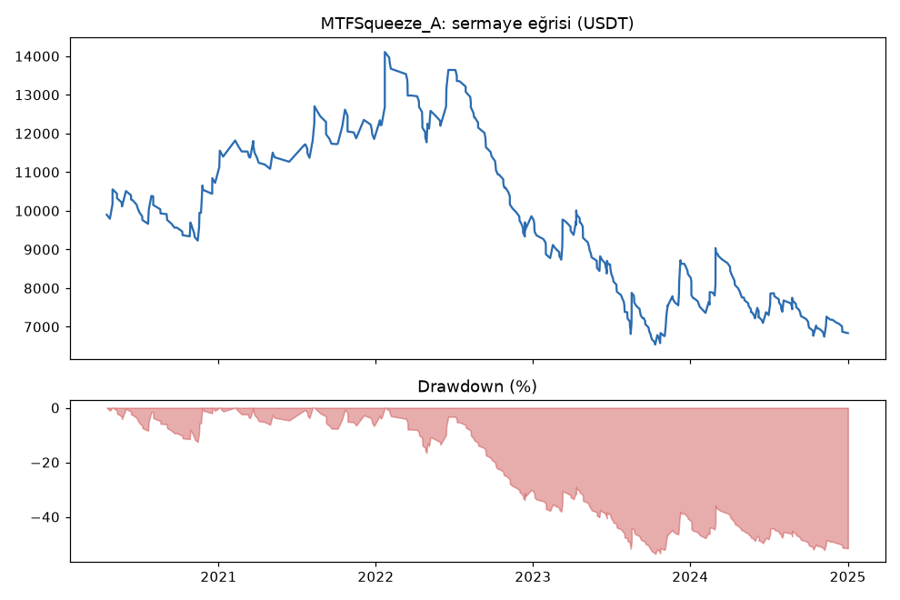
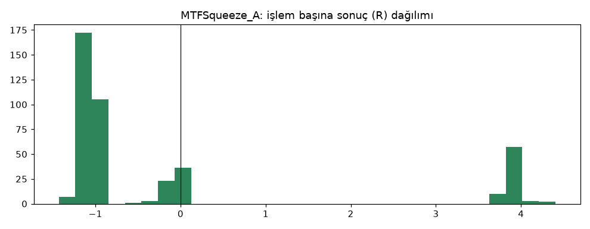
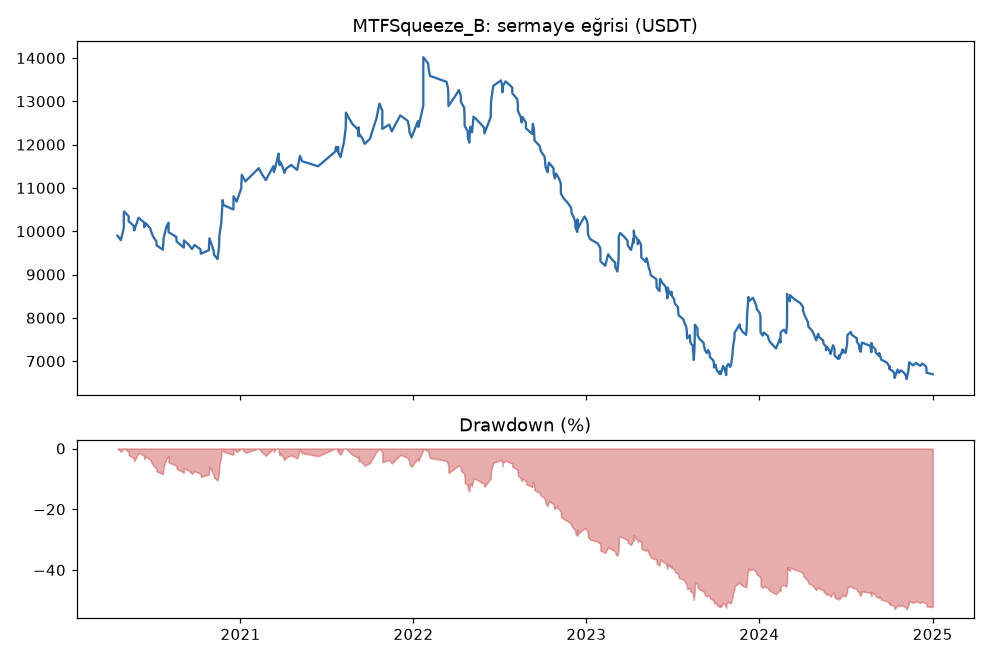
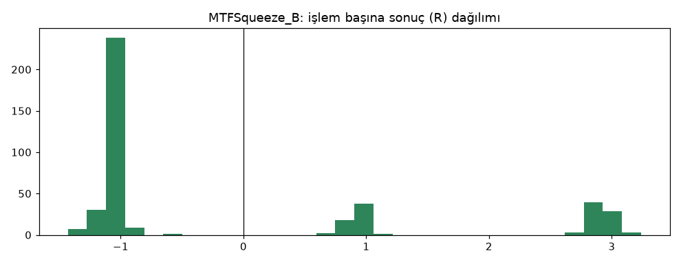

## Veri ve dönem
- Sadece geliştirme verisi. Günlük trend filtresi ve dört tetik test öncesi kartta sabitlendi. Hile testi: beş stratejide bias yok.

## Yorum: güçlü yanlar / şüpheli noktalar
- **Sadece Donchian tetiği kâr üretti:** MTFDonchian_B +0.10R, PF 1.11, 460 işlem. Long +60.3R (PF 1.29), short -14.2R.
- Drawdown %37 (eşik ≤ %25), filtresiz Donchian'a (%38) göre neredeyse aynı.
- Geri çekilme (RSI 40/60) başa baş, Supertrend ve sıkışma kırılımı zararda. Sıkışma stratejisinde short tarafı -50R.
- Günlük trend filtresi tek başına sihirli bir iyileştirme getirmedi.

## Karar: devam / düzelt / emekli
- **MTFDonchian: devam** (TP ızgarası, dayanıklılık, doğrulama).
- **MTFPullback, MTFSupertrend, MTFSqueeze: elendi (aşama 2).**
