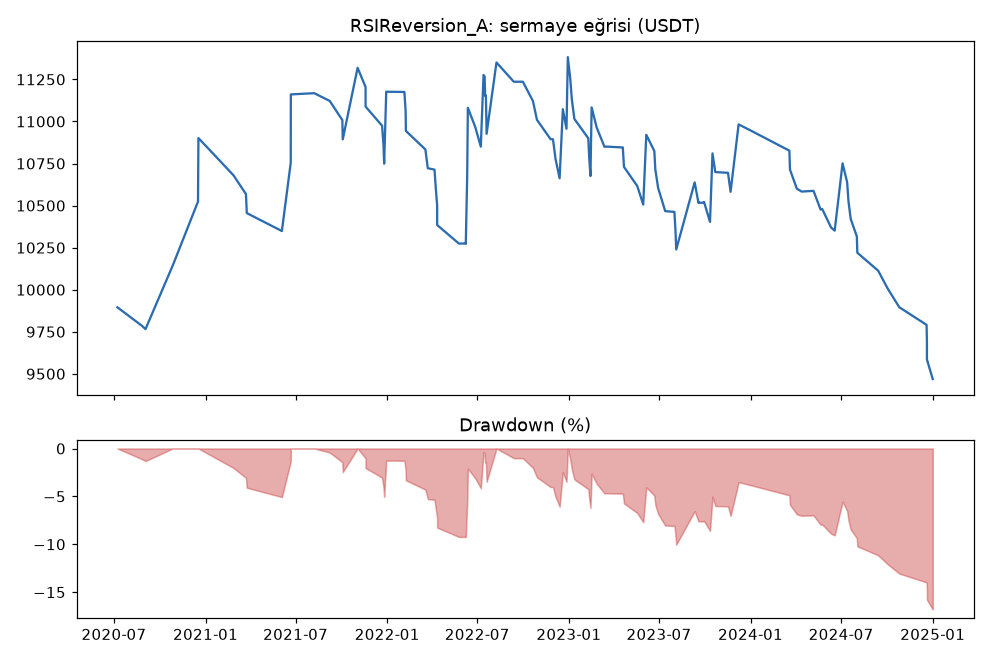
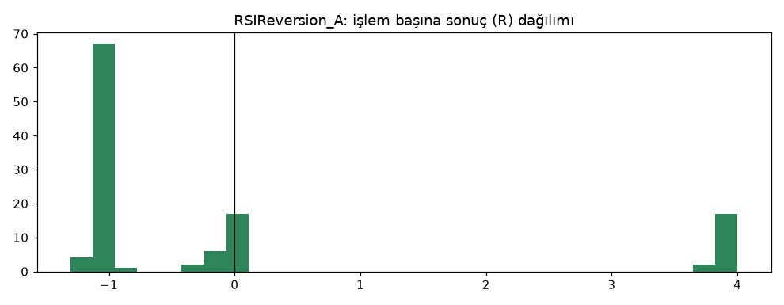
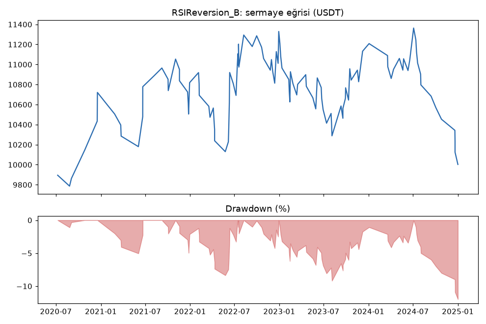
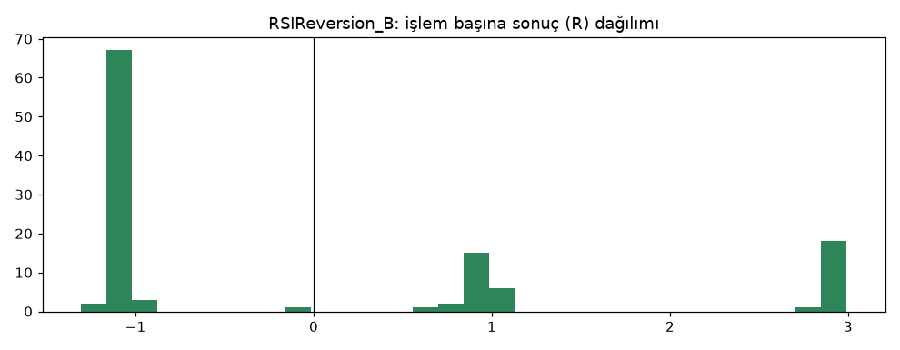

# RSIReversion_A vs RSIReversion_B — ilk_backtest_gelistirme — 2026-10-08

## Özet
- **RSIReversion_A**: 116 işlem, işlem başına ortalama **-0.03R** (maliyet ve funding dahil), net getiri -5.3%, en büyük düşüş 16.8%.
- **RSIReversion_B**: 116 işlem, işlem başına ortalama **0.01R** (maliyet ve funding dahil), net getiri 0.0%, en büyük düşüş 12.0%.
- Aynı dönemde coinleri al-tut (eşit ağırlık): getiri 3572.8%, ortalama en büyük düşüş 84.1%.

## Ayarlar
- Dönem: 2020-06-15 16:00:00 → 2025-01-01 00:00:00
- Coinler: BTC/USDT:USDT, ETH/USDT:USDT, SOL/USDT:USDT, XRP/USDT:USDT, BNB/USDT:USDT, DOGE/USDT:USDT
- Zaman dilimi: 4h
- Yön: long + short
- Mod: futures / isolated
- Kaldıraç: en fazla 3x, likidasyon stop mesafesinin en az 2 katı uzakta (bölüm 7.6)
- Risk: işlem başına sermayenin %1'i (pozisyon büyüklüğü stop mesafesine göre)
- Maliyet: her emir için %0.05 komisyon + %0.05 kayma (= %0.1), funding geçmiş veriden
- Başlangıç sermayesi: 10000 USDT

## Metrikler
| Metrik | RSIReversion_A | RSIReversion_B | Al-tut |
|---|---|---|---|
| Net getiri | -5.3% | 0.0% | 3572.8% |
| Max drawdown | 16.8% | 12.0% | 84.1% |
| Profit factor | 0.94 | 1.00 | — |
| Ortalama R | -0.03 | 0.01 | — |
| İşlem sayısı | 116 | 116 | — |
| Winrate | 24.1% | 37.1% | — |

Winrate tek başına başarı ölçütü değildir; asıl ölçüt ortalama R (expectancy) ve drawdown'dur.

## Long / short ayrımı
| Strateji | Yön | İşlem | Ortalama R | Toplam R | Profit factor |
|---|---|---|---|---|---|
| RSIReversion_A | long | 50 | -0.09 | -4.63 | 0.87 |
| RSIReversion_A | short | 66 | 0.02 | 1.11 | 0.99 |
| RSIReversion_B | long | 50 | -0.07 | -3.29 | 0.90 |
| RSIReversion_B | short | 66 | 0.07 | 4.85 | 1.08 |

## Sinyal istatistikleri
| Strateji | Stop | BE | TP1 sonrası BE | TP2 | Diğer | İptal (bölgeye gelmedi / önce stop) | Toplam funding (USDT) |
|---|---|---|---|---|---|---|---|
| RSIReversion_A | 62.1% | 20.7% | 0.0% | 16.4% | 0.9% | 4.9% | -160.97 |
| RSIReversion_B | 62.1% | 0.0% | 20.7% | 16.4% | 0.9% | 4.9% | -107.83 |

## Coin bazında
| Strateji | Coin | İşlem | Ortalama R | Toplam R | Al-tut getirisi |
|---|---|---|---|---|---|
| RSIReversion_A | BTC/USDT:USDT | 28 | 0.19 | 5.24 | 896.7% |
| RSIReversion_A | ETH/USDT:USDT | 15 | 0.64 | 9.54 | 1343.7% |
| RSIReversion_A | SOL/USDT:USDT | 17 | -0.05 | -0.82 | 5552.9% |
| RSIReversion_A | XRP/USDT:USDT | 20 | -0.25 | -5.06 | 1003.8% |
| RSIReversion_A | BNB/USDT:USDT | 20 | 0.07 | 1.48 | 4214.2% |
| RSIReversion_A | DOGE/USDT:USDT | 16 | -0.87 | -13.91 | 8425.3% |
| RSIReversion_B | BTC/USDT:USDT | 28 | 0.36 | 10.05 | 896.7% |
| RSIReversion_B | ETH/USDT:USDT | 15 | 0.38 | 5.68 | 1343.7% |
| RSIReversion_B | SOL/USDT:USDT | 17 | -0.10 | -1.73 | 5552.9% |
| RSIReversion_B | XRP/USDT:USDT | 20 | -0.10 | -2.03 | 1003.8% |
| RSIReversion_B | BNB/USDT:USDT | 20 | 0.02 | 0.42 | 4214.2% |
| RSIReversion_B | DOGE/USDT:USDT | 16 | -0.68 | -10.84 | 8425.3% |

## Grafikler

## Veri ve dönem
- Sadece geliştirme verisi (2020-01 → 2024-12; ısınma yüzünden işlemler 2020-06'da başlar). Parametreler kartta test öncesi sabitlendi.
- Hile testi: `lookahead-analysis` 45 işlemin 1'inde (ETH, 2023-08-30) "bias" işaretledi, gösterge sapması yok. Aynı işlem veri 04:00, 08:00 ve 12:00'de kesildiğinde aynı giriş ve stopla açıldı; veri tam o işlemin açılış anında kesildiğinde işlem açılamadığı için oluşan bir yanlış alarm olarak değerlendirildi. `recursive-analysis`: 1000 mum ısınmada sapma yok.

## Yorum: güçlü yanlar / şüpheli noktalar
- **Başa baş:** B işlem başına +0.01R, PF 1.00; A -0.03R. Beklenti sıfırdan ayırt edilemiyor.
- **Az işlem:** 5 yılda 116 işlem; RSI 30/70 dönüşü + trend şartı nadir.
- Drawdown düşük (%12-17), ama kazanmayan bir stratejide bunun anlamı yok.
- Long zararda (-3.3R), short hafif kârda (+4.9R). DOGE tek başına -10.8R.

## Karar: devam / düzelt / emekli
**Elendi (aşama 2).** İlk backtest'te beklenti > 0R şartını anlamlı biçimde sağlamadı.
