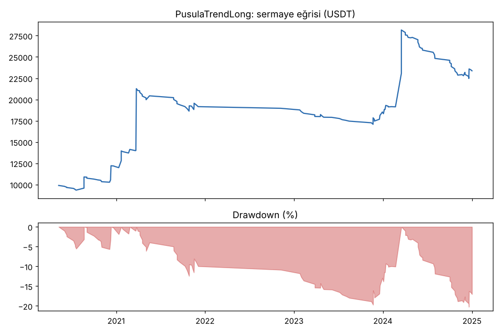
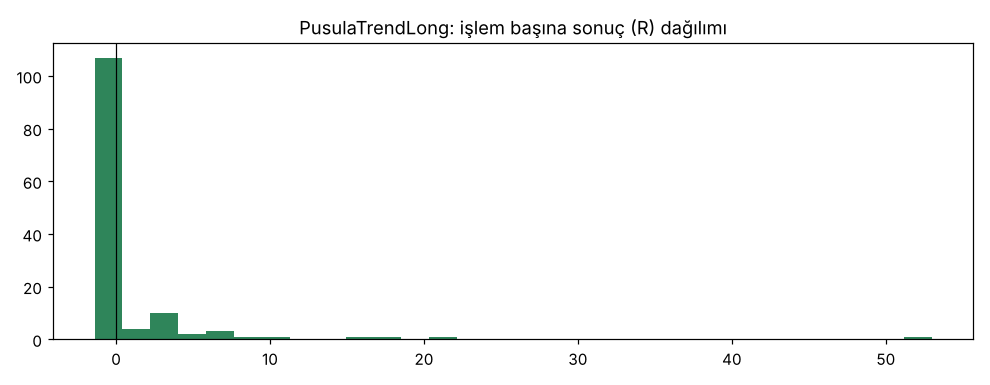

# PusulaTrendLong — tur2_gelistirme_sadece_long — 2026-10-09

## Özet
- **PusulaTrendLong**: 132 işlem, işlem başına ortalama **0.83R** (maliyet ve funding dahil), net getiri 133.7%, en büyük düşüş 20.2%.
- Aynı dönemde coinleri al-tut (eşit ağırlık): getiri 3406.7%, ortalama en büyük düşüş 84.1%.

## Ayarlar
- Dönem: 2020-03-07 16:00:00 → 2025-01-01 00:00:00
- Coinler: BTC/USDT:USDT, ETH/USDT:USDT, SOL/USDT:USDT, XRP/USDT:USDT, BNB/USDT:USDT, DOGE/USDT:USDT
- Zaman dilimi: 4h
- Yön: long + short
- Mod: futures / isolated
- Kaldıraç: en fazla 3x, likidasyon stop mesafesinin en az 2 katı uzakta (bölüm 7.6)
- Risk: işlem başına sermayenin %1'i (pozisyon büyüklüğü stop mesafesine göre)
- Maliyet: her emir için %0.05 komisyon + %0.05 kayma (= %0.1), funding geçmiş veriden
- Başlangıç sermayesi: 10000 USDT

## Metrikler
| Metrik | PusulaTrendLong | Al-tut |
|---|---|---|
| Net getiri | 133.7% | 3406.7% |
| Max drawdown | 20.2% | 84.1% |
| Profit factor | 1.87 | — |
| Ortalama R | 0.83 | — |
| İşlem sayısı | 132 | — |
| Winrate | 24.2% | — |

Winrate tek başına başarı ölçütü değildir; asıl ölçüt ortalama R (expectancy) ve drawdown'dur.

## Long / short ayrımı
| Strateji | Yön | İşlem | Ortalama R | Toplam R | Profit factor |
|---|---|---|---|---|---|
| PusulaTrendLong | long | 132 | 0.83 | 109.52 | 1.87 |
| PusulaTrendLong | short | 0 | — | 0.00 | — |

## Sinyal istatistikleri
| Strateji | Stop | BE | TP1 sonrası BE | TP2 | Diğer | İptal (bölgeye gelmedi / önce stop) | Toplam funding (USDT) |
|---|---|---|---|---|---|---|---|
| PusulaTrendLong | 43.2% | 11.4% | 0.0% | 0.0% | 45.5% | 7.0% | -4584.94 |

## Coin bazında
| Strateji | Coin | İşlem | Ortalama R | Toplam R | Al-tut getirisi |
|---|---|---|---|---|---|
| PusulaTrendLong | BTC/USDT:USDT | 33 | 1.48 | 48.70 | 954.4% |
| PusulaTrendLong | ETH/USDT:USDT | 33 | 0.25 | 8.29 | 1303.7% |
| PusulaTrendLong | SOL/USDT:USDT | 12 | -0.17 | -1.99 | 5552.9% |
| PusulaTrendLong | XRP/USDT:USDT | 12 | 0.01 | 0.14 | 786.4% |
| PusulaTrendLong | BNB/USDT:USDT | 38 | 0.91 | 34.49 | 3417.7% |
| PusulaTrendLong | DOGE/USDT:USDT | 4 | 4.97 | 19.89 | 8425.3% |

## Grafikler

## Yorum: güçlü yanlar / şüpheli noktalar
- **Sonradan eklendi:** short'ların iki turda da zararda olduğu görüldükten sonra. Bu yüzden bu sonuç "önceden planlanmış" sayılmaz.
- +0.83R, PF 1.87, DD %20.2, 132 işlem: geliştirme eşiklerini geçiyor (> 0R, DD ≤ %25, ≥ 100 işlem).
- Yıllara göre: 2020 +38.4R, 2021 +41.5R, 2022 -1.0R (1 işlem), 2023 +3.4R, 2024 +27.2R.
- Coinler: BTC, ETH, BNB, DOGE artıda; XRP başa baş, SOL -0.17R. Artının büyük kısmı BTC (+48.7R) ve BNB (+34.5R). DOGE'nin 4 işlemi +19.9R: az işlemle büyük katkı, şansa açık.
- Al-tut getirisi (%3407) çok daha yüksek; strateji buna karşı çok daha düşük düşüş (%20'ye karşı %84) sunuyor. Boğa döneminde al-tut'u getiride geçmesi beklenmez.

## Karar: devam / düzelt / emekli
**Devam:** doğrulamada bir kez kontrol edildi (bkz. tur2_dogrulama). Sadece long olduğu için proje sahibinin kararına bağlı.
