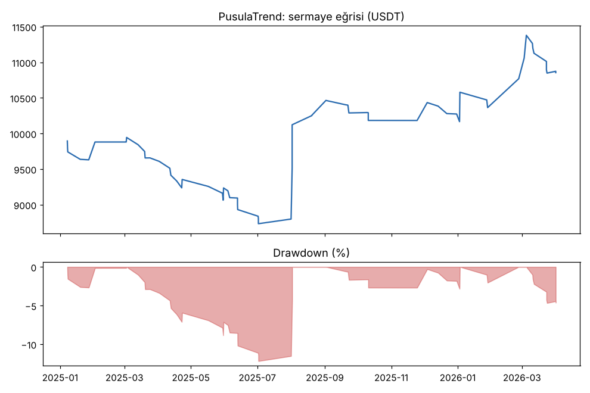
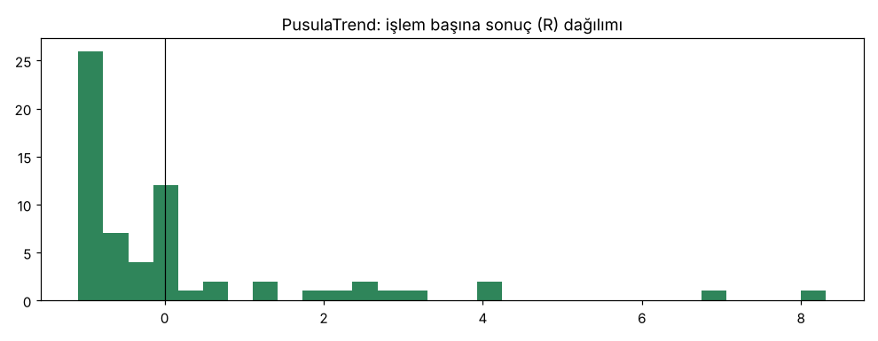
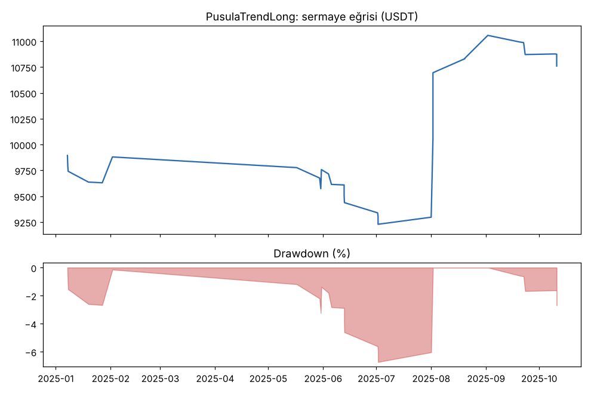
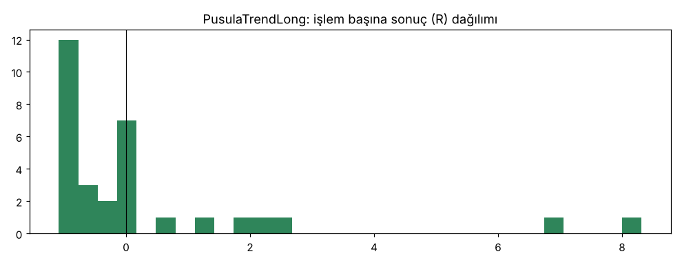

# PusulaTrend vs PusulaTrendLong — tur2_dogrulama — 2026-10-09

## Özet
- **PusulaTrend**: 64 işlem, işlem başına ortalama **0.16R** (maliyet ve funding dahil), net getiri 8.5%, en büyük düşüş 12.7%.
- **PusulaTrendLong**: 31 işlem, işlem başına ortalama **0.28R** (maliyet ve funding dahil), net getiri 7.6%, en büyük düşüş 7.7%.
- Aynı dönemde coinleri al-tut (eşit ağırlık): getiri -40.1%, ortalama en büyük düşüş 64.5%.

## Ayarlar
- Dönem: 2025-01-01 00:00:00 → 2026-04-01 00:00:00
- Coinler: BTC/USDT:USDT, ETH/USDT:USDT, SOL/USDT:USDT, XRP/USDT:USDT, BNB/USDT:USDT, DOGE/USDT:USDT
- Zaman dilimi: 4h
- Yön: long + short
- Mod: futures / isolated
- Kaldıraç: en fazla 3x, likidasyon stop mesafesinin en az 2 katı uzakta (bölüm 7.6)
- Risk: işlem başına sermayenin %1'i (pozisyon büyüklüğü stop mesafesine göre)
- Maliyet: her emir için %0.05 komisyon + %0.05 kayma (= %0.1), funding geçmiş veriden
- Başlangıç sermayesi: 10000 USDT

## Metrikler
| Metrik | PusulaTrend | PusulaTrendLong | Al-tut |
|---|---|---|---|
| Net getiri | 8.5% | 7.6% | -40.1% |
| Max drawdown | 12.7% | 7.7% | 64.5% |
| Profit factor | 1.27 | 1.50 | — |
| Ortalama R | 0.16 | 0.28 | — |
| İşlem sayısı | 64 | 31 | — |
| Winrate | 31.2% | 29.0% | — |

Winrate tek başına başarı ölçütü değildir; asıl ölçüt ortalama R (expectancy) ve drawdown'dur.

## Long / short ayrımı
| Strateji | Yön | İşlem | Ortalama R | Toplam R | Profit factor |
|---|---|---|---|---|---|
| PusulaTrend | long | 31 | 0.28 | 8.70 | 1.49 |
| PusulaTrend | short | 33 | 0.04 | 1.44 | 1.08 |
| PusulaTrendLong | long | 31 | 0.28 | 8.70 | 1.50 |
| PusulaTrendLong | short | 0 | — | 0.00 | — |

## Sinyal istatistikleri
| Strateji | Stop | BE | TP1 sonrası BE | TP2 | Diğer | İptal (bölgeye gelmedi / önce stop) | Toplam funding (USDT) |
|---|---|---|---|---|---|---|---|
| PusulaTrend | 35.9% | 14.1% | 0.0% | 0.0% | 50.0% | 5.9% | -104.33 |
| PusulaTrendLong | 35.5% | 16.1% | 0.0% | 0.0% | 48.4% | 3.1% | -126.11 |

## Coin bazında
| Strateji | Coin | İşlem | Ortalama R | Toplam R | Al-tut getirisi |
|---|---|---|---|---|---|
| PusulaTrend | BTC/USDT:USDT | 17 | 0.05 | 0.86 | -27.4% |
| PusulaTrend | ETH/USDT:USDT | 15 | 0.34 | 5.05 | -37.3% |
| PusulaTrend | SOL/USDT:USDT | 6 | 0.38 | 2.30 | -56.2% |
| PusulaTrend | XRP/USDT:USDT | 8 | -0.16 | -1.31 | -36.0% |
| PusulaTrend | BNB/USDT:USDT | 15 | -0.10 | -1.46 | -12.5% |
| PusulaTrend | DOGE/USDT:USDT | 3 | 1.57 | 4.70 | -71.0% |
| PusulaTrendLong | BTC/USDT:USDT | 8 | 0.02 | 0.16 | -27.4% |
| PusulaTrendLong | ETH/USDT:USDT | 8 | 0.55 | 4.39 | -37.3% |
| PusulaTrendLong | SOL/USDT:USDT | 2 | 0.01 | 0.01 | -56.2% |
| PusulaTrendLong | XRP/USDT:USDT | 3 | 0.32 | 0.95 | -36.0% |
| PusulaTrendLong | BNB/USDT:USDT | 9 | 0.36 | 3.22 | -12.5% |
| PusulaTrendLong | DOGE/USDT:USDT | 1 | -0.04 | -0.04 | -71.0% |

## Grafikler

## Yorum: güçlü yanlar / şüpheli noktalar
- Tek seferlik doğrulama, ayar değiştirilmeden. Bu dönem al-tut -%40 iken iki versiyon da artıda.
- **PusulaTrend:** +0.16R, PF 1.27, DD %12.7, 64 işlem, 6 coinin 4'ü artıda (ETH, SOL, DOGE, BTC hafif). Short'lar burada başa baş (+0.04R): 2025'te -1.7R, 2026'nın ilk 3 ayında +3.1R.
- **PusulaTrendLong:** +0.28R, PF 1.50, DD %7.7, ama sadece 31 işlem: örnek küçük, güven aralığı geniş.
- Geliştirmeye göre ortalama R çok düştü (+0.83R'den +0.28R'ye). Bu dönem düşüş ağırlıklı olduğu için long fırsatı az; yine de artıda kalması önemli.
- Uyarı: bu doğrulama dönemi daha önce Donchian stratejilerinde kullanıldı; Pusula'nın tasarımı o sonuçları bilerek yapıldı. Tamamen temiz test kasa testidir.

## Karar: devam / düzelt / emekli
- **PusulaTrend:** doğrulama eşiklerini geçti (PF 1.27 ≥ 1.2, DD %12.7), ama geliştirmede DD %31 olduğu için tam geçmiş sayılmaz.
- **PusulaTrendLong:** iki dönemde de geçti, ancak doğrulamada 31 işlem az ve versiyon sonradan eklendi.
- Sıradaki adım (proje sahibi seçecek): hangi versiyonun kasa testine (son 6 ay, bir kez) gireceği.
