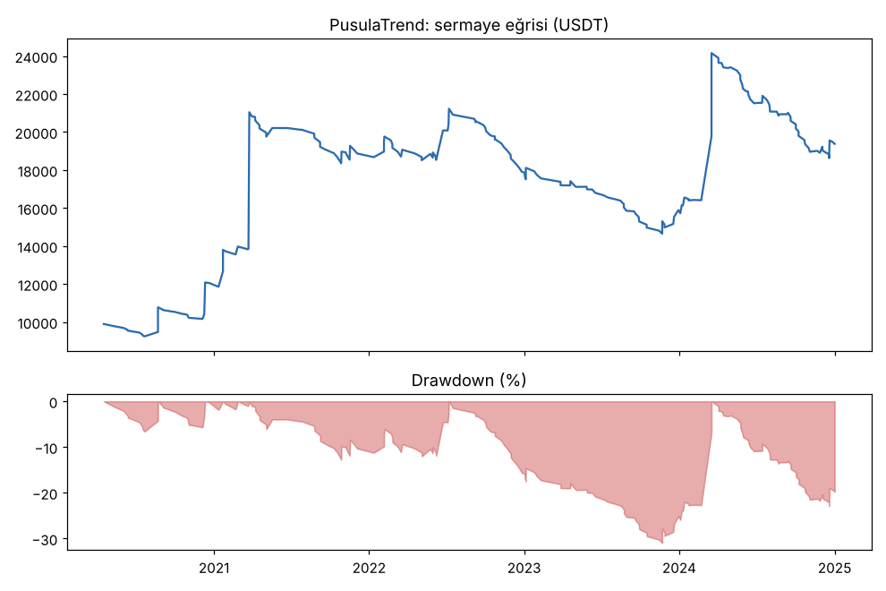
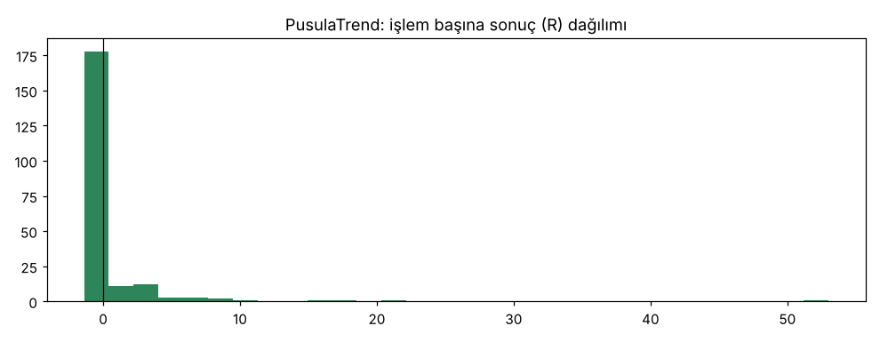
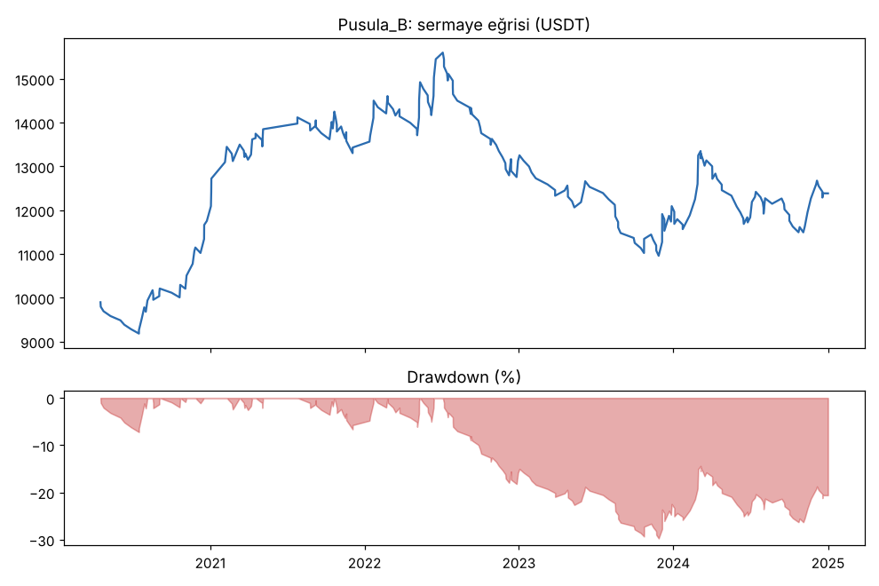
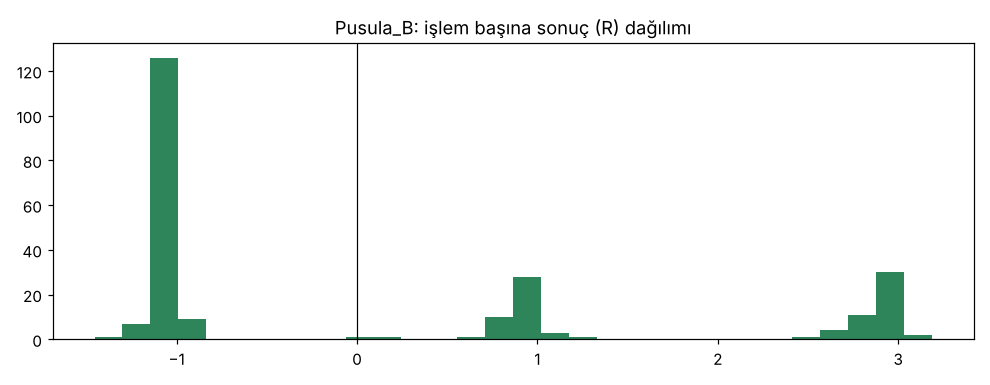

# PusulaTrend vs Pusula_B — tur2_gelistirme_max3 — 2026-10-09

## Özet
- **PusulaTrend**: 214 işlem, işlem başına ortalama **0.43R** (maliyet ve funding dahil), net getiri 93.8%, en büyük düşüş 31.0%.
- **Pusula_B**: 236 işlem, işlem başına ortalama **0.11R** (maliyet ve funding dahil), net getiri 23.9%, en büyük düşüş 29.8%.
- Aynı dönemde coinleri al-tut (eşit ağırlık): getiri 3406.7%, ortalama en büyük düşüş 84.1%.

## Ayarlar
- Dönem: 2020-03-07 16:00:00 → 2025-01-01 00:00:00
- Coinler: BTC/USDT:USDT, ETH/USDT:USDT, SOL/USDT:USDT, XRP/USDT:USDT, BNB/USDT:USDT, DOGE/USDT:USDT
- Zaman dilimi: 4h
- Yön: long + short
- Mod: futures / isolated
- Kaldıraç: en fazla 3x, likidasyon stop mesafesinin en az 2 katı uzakta (bölüm 7.6)
- Risk: işlem başına sermayenin %1'i (pozisyon büyüklüğü stop mesafesine göre)
- Maliyet: her emir için %0.05 komisyon + %0.05 kayma (= %0.1), funding geçmiş veriden
- Başlangıç sermayesi: 10000 USDT

## Metrikler
| Metrik | PusulaTrend | Pusula_B | Al-tut |
|---|---|---|---|
| Net getiri | 93.8% | 23.9% | 3406.7% |
| Max drawdown | 31.0% | 29.8% | 84.1% |
| Profit factor | 1.40 | 1.12 | — |
| Ortalama R | 0.43 | 0.11 | — |
| İşlem sayısı | 214 | 236 | — |
| Winrate | 25.2% | 39.0% | — |

Winrate tek başına başarı ölçütü değildir; asıl ölçüt ortalama R (expectancy) ve drawdown'dur.

## Long / short ayrımı
| Strateji | Yön | İşlem | Ortalama R | Toplam R | Profit factor |
|---|---|---|---|---|---|
| PusulaTrend | long | 132 | 0.83 | 109.52 | 1.89 |
| PusulaTrend | short | 82 | -0.22 | -17.77 | 0.65 |
| Pusula_B | long | 150 | 0.20 | 29.33 | 1.24 |
| Pusula_B | short | 86 | -0.03 | -2.60 | 0.95 |

## Sinyal istatistikleri
| Strateji | Stop | BE | TP1 sonrası BE | TP2 | Diğer | İptal (bölgeye gelmedi / önce stop) | Toplam funding (USDT) |
|---|---|---|---|---|---|---|---|
| PusulaTrend | 44.9% | 12.6% | 0.0% | 0.0% | 42.5% | 8.2% | -4422.62 |
| Pusula_B | 60.6% | 0.0% | 18.6% | 20.3% | 0.4% | 7.1% | -1197.98 |

## Coin bazında
| Strateji | Coin | İşlem | Ortalama R | Toplam R | Al-tut getirisi |
|---|---|---|---|---|---|
| PusulaTrend | BTC/USDT:USDT | 57 | 0.72 | 41.09 | 954.4% |
| PusulaTrend | ETH/USDT:USDT | 44 | 0.01 | 0.63 | 1303.7% |
| PusulaTrend | SOL/USDT:USDT | 23 | 0.03 | 0.77 | 5552.9% |
| PusulaTrend | XRP/USDT:USDT | 25 | -0.26 | -6.54 | 786.4% |
| PusulaTrend | BNB/USDT:USDT | 52 | 0.69 | 36.04 | 3417.7% |
| PusulaTrend | DOGE/USDT:USDT | 13 | 1.52 | 19.76 | 8425.3% |
| Pusula_B | BTC/USDT:USDT | 70 | 0.10 | 6.65 | 954.4% |
| Pusula_B | ETH/USDT:USDT | 46 | -0.02 | -0.78 | 1303.7% |
| Pusula_B | SOL/USDT:USDT | 23 | 0.08 | 1.88 | 5552.9% |
| Pusula_B | XRP/USDT:USDT | 33 | -0.27 | -9.06 | 786.4% |
| Pusula_B | BNB/USDT:USDT | 47 | 0.29 | 13.66 | 3417.7% |
| Pusula_B | DOGE/USDT:USDT | 17 | 0.85 | 14.38 | 8425.3% |

## Grafikler

## Ek testler (aynı dönem)
| Test | İşlem | Ortalama R | PF | Max DD | Not |
|---|---|---|---|---|---|
| PusulaTrend, en fazla 5 işlem | 244 | +0.49 | 1.46 | %33.7 | Long +130.8R, short -10.0R |
| PusulaTrend, en fazla 3 işlem, **maliyet x2** | 214 | +0.39 | 1.33 | %33.4 | Kırılgan değil |
| **PusulaTrendLong** (sonradan eklendi, short yok) | 132 | **+0.83** | **1.87** | **%20.2** | Rapor: [tur2_gelistirme_sadece_long](../2026-10-09_PusulaTrendLong_tur2_gelistirme_sadece_long/rapor.md) |
| PusulaTrendLong ±%20 parametre | 128-136 | +0.72 ile +1.45 | 1.69-2.61 | %16.6-22.8 | 8 komşunun 8'i artıda: [dayanıklılık](../2026-10-09_pusula_trend_long_dayaniklilik/parametre_komsulari.md) |
| Hile (lookahead) testi, PusulaTrend | 20 sinyal | — | — | — | Bias yok |

## Yorum: güçlü yanlar / şüpheli noktalar
- Trend çıkışı büyük fark yarattı: aynı girişlerle +0.11R'den (sabit 2R/4R) +0.43R'ye, PF 1.12'den 1.40'a.
- Long tarafı her yıl artıda: 2020 +38.4R, 2021 +41.5R, 2023 +3.4R, 2024 +27.2R (2022'de sadece 1 long). İlk turdaki "kâr tek yıla bağlı" açığı kapandı.
- Short tarafı yine zararda: 82 işlem, -0.22R, -17.8R. 2022 ayı piyasasında 47 short, -0.06R.
- Düşüş %31.0, eşiğin (%25) üstünde. Sebebi büyük ölçüde short'lar (sadece long versiyonda %20.2, aşağıda).
- 'Diğer' sütunu = trend bozulduğu için çıkış (exit_signal). Funding gideri yüksek (-4.423 USDT), çünkü işlemler uzun tutuluyor; sonuçlara dahil.

## Karar: devam / düzelt / emekli
**PusulaTrend (long + short): geliştirmede düşüş eşiğini geçemedi (%31 > %25).** Ama ilk turdan çok daha iyi, doğrulamaya bakıldı (proje sahibinin "teste devam" talimatı ve sadece long sürümünün eşikleri geçmesi nedeniyle).

