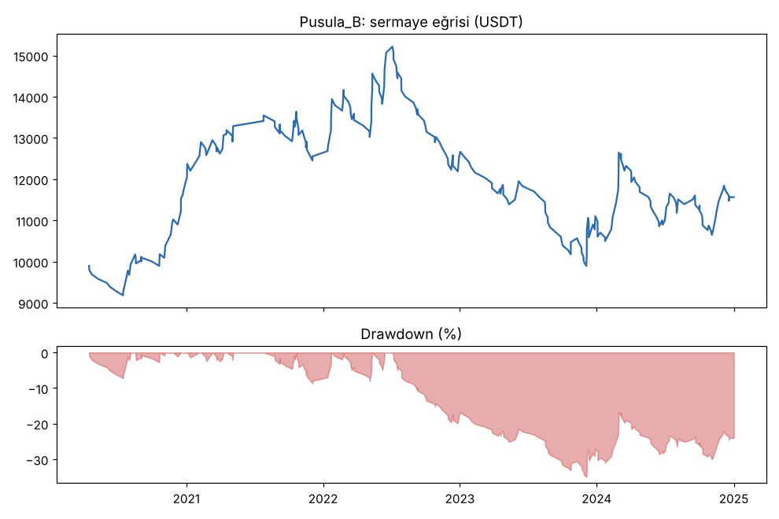
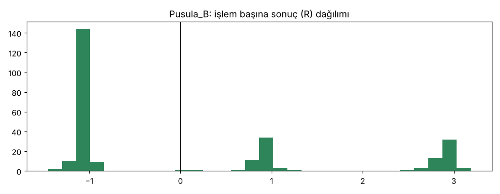
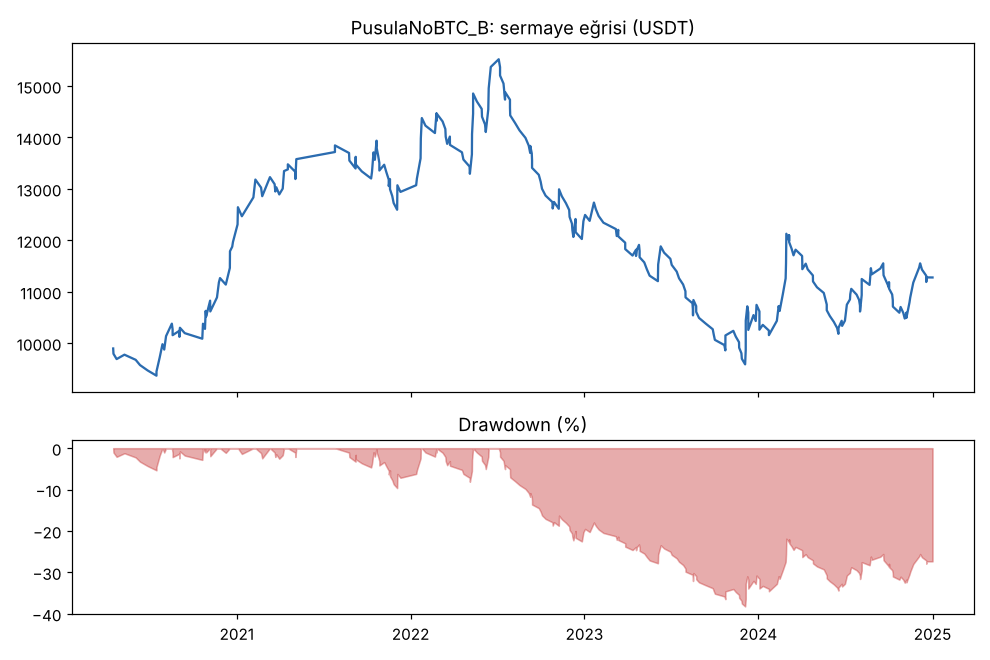
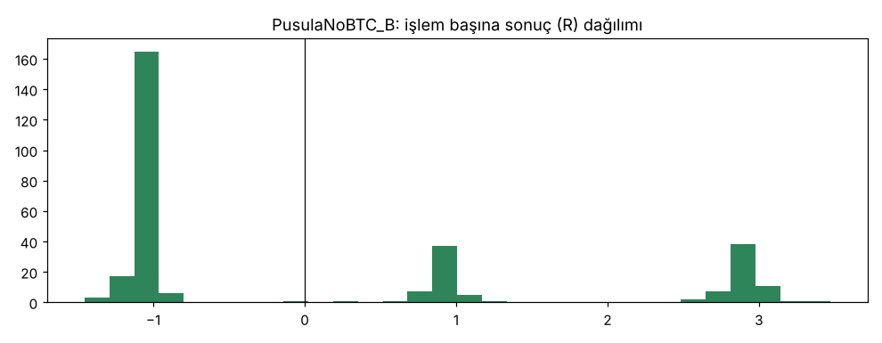

# Pusula_B vs PusulaNoBTC_B — ilk_backtest_gelistirme — 2026-10-09

## Özet
- **Pusula_B**: 269 işlem, işlem başına ortalama **0.08R** (maliyet ve funding dahil), net getiri 15.6%, en büyük düşüş 35.0%.
- **PusulaNoBTC_B**: 304 işlem, işlem başına ortalama **0.06R** (maliyet ve funding dahil), net getiri 12.8%, en büyük düşüş 38.2%.
- Aynı dönemde coinleri al-tut (eşit ağırlık): getiri 3406.7%, ortalama en büyük düşüş 84.1%.

## Ayarlar
- Dönem: 2020-03-07 16:00:00 → 2025-01-01 00:00:00
- Coinler: BTC/USDT:USDT, ETH/USDT:USDT, SOL/USDT:USDT, XRP/USDT:USDT, BNB/USDT:USDT, DOGE/USDT:USDT
- Zaman dilimi: 4h
- Yön: long + short
- Mod: futures / isolated
- Kaldıraç: en fazla 3x, likidasyon stop mesafesinin en az 2 katı uzakta (bölüm 7.6)
- Risk: işlem başına sermayenin %1'i (pozisyon büyüklüğü stop mesafesine göre)
- Maliyet: her emir için %0.05 komisyon + %0.05 kayma (= %0.1), funding geçmiş veriden
- Başlangıç sermayesi: 10000 USDT

## Metrikler
| Metrik | Pusula_B | PusulaNoBTC_B | Al-tut |
|---|---|---|---|
| Net getiri | 15.6% | 12.8% | 3406.7% |
| Max drawdown | 35.0% | 38.2% | 84.1% |
| Profit factor | 1.07 | 1.05 | — |
| Ortalama R | 0.08 | 0.06 | — |
| İşlem sayısı | 269 | 304 | — |
| Winrate | 38.3% | 36.8% | — |

Winrate tek başına başarı ölçütü değildir; asıl ölçüt ortalama R (expectancy) ve drawdown'dur.

## Long / short ayrımı
| Strateji | Yön | İşlem | Ortalama R | Toplam R | Profit factor |
|---|---|---|---|---|---|
| Pusula_B | long | 172 | 0.12 | 21.30 | 1.13 |
| Pusula_B | short | 97 | -0.00 | -0.05 | 0.99 |
| PusulaNoBTC_B | long | 187 | 0.13 | 23.94 | 1.13 |
| PusulaNoBTC_B | short | 117 | -0.04 | -4.58 | 0.94 |

## Sinyal istatistikleri
| Strateji | Stop | BE | TP1 sonrası BE | TP2 | Diğer | İptal (bölgeye gelmedi / önce stop) | Toplam funding (USDT) |
|---|---|---|---|---|---|---|---|
| Pusula_B | 61.3% | 0.0% | 19.0% | 19.3% | 0.4% | 8.2% | -1267.67 |
| PusulaNoBTC_B | 62.8% | 0.0% | 17.1% | 19.7% | 0.3% | 8.2% | -1215.46 |

## Coin bazında
| Strateji | Coin | İşlem | Ortalama R | Toplam R | Al-tut getirisi |
|---|---|---|---|---|---|
| Pusula_B | BTC/USDT:USDT | 73 | 0.05 | 3.54 | 954.4% |
| Pusula_B | ETH/USDT:USDT | 54 | 0.16 | 8.72 | 1303.7% |
| Pusula_B | SOL/USDT:USDT | 27 | 0.13 | 3.59 | 5552.9% |
| Pusula_B | XRP/USDT:USDT | 39 | -0.30 | -11.59 | 786.4% |
| Pusula_B | BNB/USDT:USDT | 55 | 0.12 | 6.86 | 3417.7% |
| Pusula_B | DOGE/USDT:USDT | 21 | 0.48 | 10.13 | 8425.3% |
| PusulaNoBTC_B | BTC/USDT:USDT | 73 | 0.05 | 3.63 | 954.4% |
| PusulaNoBTC_B | ETH/USDT:USDT | 59 | 0.16 | 9.55 | 1303.7% |
| PusulaNoBTC_B | SOL/USDT:USDT | 27 | 0.06 | 1.65 | 5552.9% |
| PusulaNoBTC_B | XRP/USDT:USDT | 52 | -0.28 | -14.80 | 786.4% |
| PusulaNoBTC_B | BNB/USDT:USDT | 65 | 0.13 | 8.32 | 3417.7% |
| PusulaNoBTC_B | DOGE/USDT:USDT | 28 | 0.39 | 11.01 | 8425.3% |

## Grafikler

## Yıllara göre (Pusula_B, toplam R)
| Yıl | Long işlem | Long R | Short işlem | Short R |
|---|---|---|---|---|
| 2020 | 32 | +25.8 | 3 | -3.1 |
| 2021 | 42 | +0.0 | 4 | +6.0 |
| 2022 | 1 | -1.0 | 63 | -1.3 |
| 2023 | 42 | -5.4 | 12 | -8.4 |
| 2024 | 55 | +1.9 | 15 | +6.8 |

## Rejimin kendisi ne söylüyor? (araştırma ölçümü, işlem değil)
6 coin, 2020-2024, her gün kapanışından sonraki 7 günün ortalama getirisi: güçlü yükseliş günlerinde %+4.8, kararsız günlerde %+1.6, güçlü düşüş günlerinde %+1.2 (tüm günler %+2.8). Yani "güçlü yükseliş" ölçüsü ortalamadan iyi, ama "güçlü düşüş" sonrası fiyat ortalamada yine çıkmış. Bu dönemde düşüş rejimi short için avantaj vermiyor. 2022 ayı yılında bile düşüş günlerinin sonrası ortalama sadece %-0.5.

## Yorum: güçlü yanlar / şüpheli noktalar
- Ortalama +0.08R, PF 1.07: eski MTFDonchian_B'den (+0.10R) iyi değil. Drawdown %35 (eşik ≤ %25).
- **Kârın tamamı 2020 long'larından** (+25.8R). 2021-2024 toplamı yaklaşık -1.6R. Yani strateji 2020 sonrası başa baş.
- Sıkı düşüş şartı short'ları düzeltmedi: 2022 ayı piyasasında 63 short, ortalama -0.02R. Aşağı kırılımlar ayı piyasasında da çoğunlukla geri döndü.
- BTC filtresi küçük bir iyileştirme getirdi (+0.08R'ye karşı +0.06R, DD %35'e karşı %38), ama sonucu değiştirmiyor.
- XRP her iki versiyonda da en kötü coin (-0.30R).

## Karar: devam / düzelt / emekli
**Geçemedi (aşama 2).** Drawdown ve profit factor eşiklerin altında, kâr tek bir yıla bağlı. Önceden yazılan plana göre doğrulama verisine bakılmadı (doğrulama ve kasa kullanılmadı). Strateji kodu ve yorum modülü `candidates/` altında kalıyor, çünkü rejim katmanı botun "her an yorum" kısmı için kullanılabilir; işlem sinyali olarak kullanılamaz.

## Karar: devam / düzelt / emekli
_(Claude tarafından yazılır, gerekçesiyle.)_
