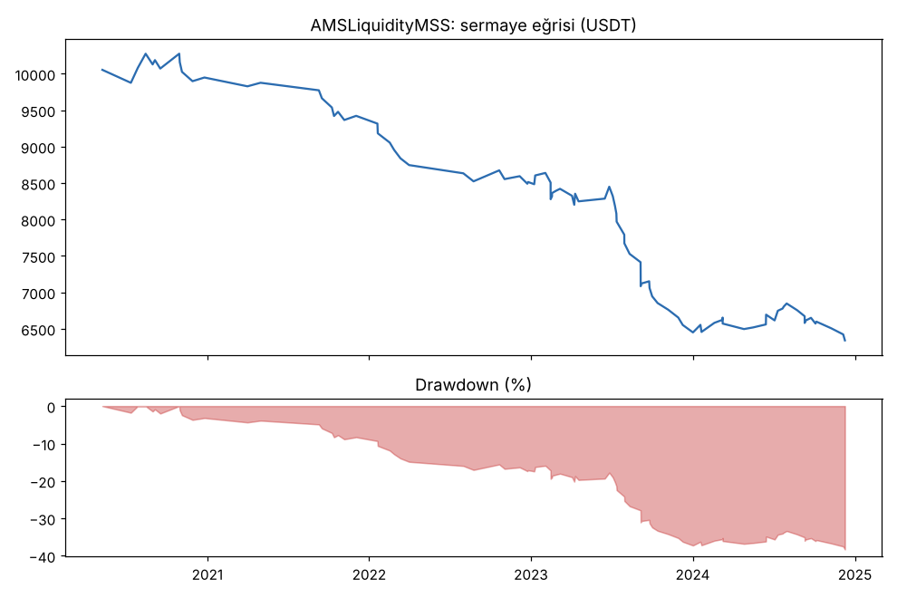
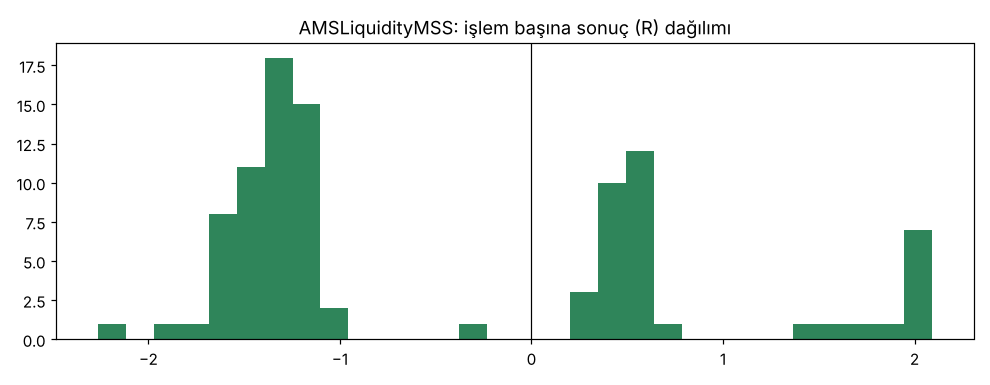

# AMSLiquidityMSS — ilk_backtest — 2026-10-09

## Özet
- **AMSLiquidityMSS**: 95 işlem, işlem başına ortalama **-0.48R** (maliyet ve funding dahil), net getiri -36.6%, en büyük düşüş 38.3%.
- Aynı dönemde coinleri al-tut (eşit ağırlık): getiri 2273.9%, ortalama en büyük düşüş 86.6%.

## Ayarlar
- Dönem: 2020-01-09 08:00:00 → 2025-01-01 00:00:00
- Coinler: BTC/USDT:USDT, ETH/USDT:USDT, ADA/USDT:USDT, SOL/USDT:USDT, XRP/USDT:USDT
- Zaman dilimi: 15m
- Yön: long + short
- Mod: futures / isolated
- Kaldıraç: en fazla 20x, likidasyon stop mesafesinin en az 2 katı uzakta (bölüm 7.6)
- Risk: işlem başına sermayenin %1'i (pozisyon büyüklüğü stop mesafesine göre)
- Maliyet: her emir için %0.05 komisyon + %0.05 kayma (= %0.1), funding geçmiş veriden
- Başlangıç sermayesi: 10000 USDT

## Metrikler
| Metrik | AMSLiquidityMSS | Al-tut |
|---|---|---|
| Net getiri | -36.6% | 2273.9% |
| Max drawdown | 38.3% | 86.6% |
| Profit factor | 0.42 | — |
| Ortalama R | -0.48 | — |
| İşlem sayısı | 95 | — |
| Winrate | 38.9% | — |

Winrate tek başına başarı ölçütü değildir; asıl ölçüt ortalama R (expectancy) ve drawdown'dur.

## Long / short ayrımı
| Strateji | Yön | İşlem | Ortalama R | Toplam R | Profit factor |
|---|---|---|---|---|---|
| AMSLiquidityMSS | long | 48 | -0.40 | -19.25 | 0.51 |
| AMSLiquidityMSS | short | 47 | -0.55 | -25.91 | 0.35 |

## Sinyal istatistikleri
| Strateji | Stop | BE | TP1 sonrası BE | TP2 | Diğer | İptal (bölgeye gelmedi / önce stop) | Toplam funding (USDT) |
|---|---|---|---|---|---|---|---|
| AMSLiquidityMSS | 60.0% | 0.0% | 28.4% | 11.6% | 0.0% | 57.0% | -42.77 |

## Coin bazında
| Strateji | Coin | İşlem | Ortalama R | Toplam R | Al-tut getirisi |
|---|---|---|---|---|---|
| AMSLiquidityMSS | BTC/USDT:USDT | 23 | -0.40 | -9.09 | 1078.7% |
| AMSLiquidityMSS | ETH/USDT:USDT | 38 | -0.72 | -27.44 | 2292.5% |
| AMSLiquidityMSS | ADA/USDT:USDT | 16 | 0.01 | 0.09 | 1479.5% |
| AMSLiquidityMSS | SOL/USDT:USDT | 8 | -0.74 | -5.91 | 5601.2% |
| AMSLiquidityMSS | XRP/USDT:USDT | 10 | -0.28 | -2.81 | 917.7% |

## Grafikler

## Yorum: güçlü yanlar / şüpheli noktalar
- 5 yılda sadece 95 işlem (yılda ~19): kurallar çok seçici. Sinyallerin %57'si dolmadı (fiyat FVG'nin uzak kenarına geri gelmedi ya da önce stopa gitti).
- Dolan işlemlerin %60'ı stop oldu, sadece %12'si 3R hedefine ulaştı. Profit factor 0.42.
- Long ve short ikisi de eksi; ADA dışında her coin eksi (ADA 16 işlemde 0R, şans sınırında). 2020-2024'ün her yılı eksi.
- Stoplar dar (ortanca %0.57): masraflar R'nin önemli kısmını yiyor. Ama masraflar çıkarılsa bile sonuç eksi kalıyor.
- Killzone ve 200 EMA filtreleri işlem sayısını azalttı ama kaliteyi artırmadı.

## Karar: devam / düzelt / emekli
**Geçemedi** (eşikler: PF ≥ 1.2, max DD ≤ %25, ortalama R > 0). Ortalama -0.48R, PF 0.42, DD %38. Doğrulama ve kasa verisi kullanılmadı. Aslan stratejisinin 26 denemesinden daha kötü; parametre oynayarak kurtarmaya çalışmak aşırı uydurma (overfitting) olur.
