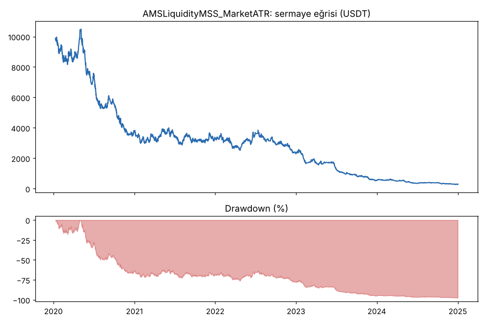
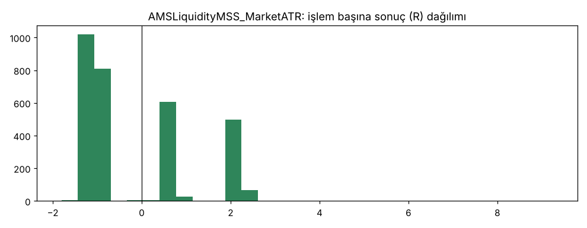

# AMSLiquidityMSS_MarketATR — gemini_tur2 — 2026-10-09

## Özet
- **AMSLiquidityMSS_MarketATR**: 3049 işlem, işlem başına ortalama **-0.11R** (maliyet ve funding dahil), net getiri -97.0%, en büyük düşüş 97.4%.
- Aynı dönemde coinleri al-tut (eşit ağırlık): getiri 2273.9%, ortalama en büyük düşüş 86.6%.

## Ayarlar
- Dönem: 2020-01-09 08:00:00 → 2025-01-01 00:00:00
- Coinler: BTC/USDT:USDT, ETH/USDT:USDT, ADA/USDT:USDT, SOL/USDT:USDT, XRP/USDT:USDT
- Zaman dilimi: 15m
- Yön: long + short
- Mod: futures / isolated
- Kaldıraç: en fazla 20x, likidasyon stop mesafesinin en az 2 katı uzakta (bölüm 7.6)
- Risk: işlem başına sermayenin %1'i (pozisyon büyüklüğü stop mesafesine göre)
- Maliyet: her emir için %0.05 komisyon + %0.05 kayma (= %0.1), funding geçmiş veriden
- Başlangıç sermayesi: 10000 USDT

## Metrikler
| Metrik | AMSLiquidityMSS_MarketATR | Al-tut |
|---|---|---|
| Net getiri | -97.0% | 2273.9% |
| Max drawdown | 97.4% | 86.6% |
| Profit factor | 0.84 | — |
| Ortalama R | -0.11 | — |
| İşlem sayısı | 3049 | — |
| Winrate | 39.7% | — |

Winrate tek başına başarı ölçütü değildir; asıl ölçüt ortalama R (expectancy) ve drawdown'dur.

## Long / short ayrımı
| Strateji | Yön | İşlem | Ortalama R | Toplam R | Profit factor |
|---|---|---|---|---|---|
| AMSLiquidityMSS_MarketATR | long | 1505 | -0.11 | -165.62 | 0.87 |
| AMSLiquidityMSS_MarketATR | short | 1544 | -0.10 | -155.27 | 0.82 |

## Sinyal istatistikleri
| Strateji | Stop | BE | TP1 sonrası BE | TP2 | Diğer | İptal (bölgeye gelmedi / önce stop) | Toplam funding (USDT) |
|---|---|---|---|---|---|---|---|
| AMSLiquidityMSS_MarketATR | 60.3% | 0.0% | 20.9% | 18.7% | 0.1% | 0.5% | -209.80 |

## Coin bazında
| Strateji | Coin | İşlem | Ortalama R | Toplam R | Al-tut getirisi |
|---|---|---|---|---|---|
| AMSLiquidityMSS_MarketATR | BTC/USDT:USDT | 592 | -0.17 | -99.97 | 1078.7% |
| AMSLiquidityMSS_MarketATR | ETH/USDT:USDT | 793 | -0.10 | -81.96 | 2292.5% |
| AMSLiquidityMSS_MarketATR | ADA/USDT:USDT | 724 | -0.05 | -36.26 | 1479.5% |
| AMSLiquidityMSS_MarketATR | SOL/USDT:USDT | 201 | -0.12 | -24.22 | 5601.2% |
| AMSLiquidityMSS_MarketATR | XRP/USDT:USDT | 739 | -0.11 | -78.49 | 917.7% |

## Grafikler

## Yorum: güçlü yanlar / şüpheli noktalar
- Gemini'nin 2. tur önerileri: 7/24, 200 EMA yok, yön önceki günün tepe/dibine göre, MSS kapanışında giriş, stop alım ucunun 1 ATR ötesi. Trailing stop TP ızgarasında olmadığı için test edilmedi; çıkış 1.5R (%50) + 3R.
- İşlem sayısı 95'ten 3049'a çıktı, emirlerin neredeyse hepsi doldu. Stop genişledi (ortanca %2.7), masrafın payı azaldı: -0.48R'den -0.11R'ye.
- Ama masraflar çıkarılsa bile yaklaşık -0.02R: girişte avantaj yok. Long ve short, her coin, 2020-2024'ün her yılı eksi.

## Karar: devam / düzelt / emekli
**Geçemedi** (PF 0.84 < 1.2, DD %97 > %25, ortalama R < 0). Doğrulama ve kasa verisi kullanılmadı.
