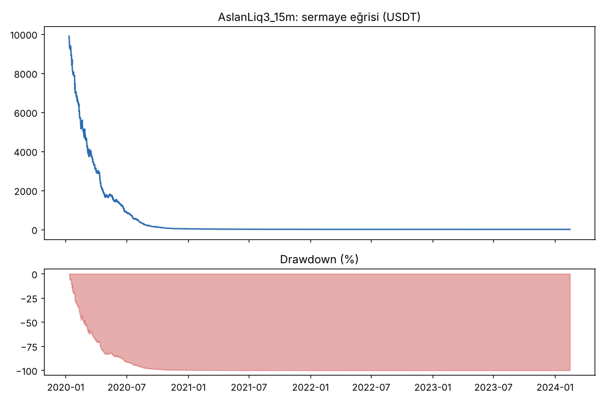
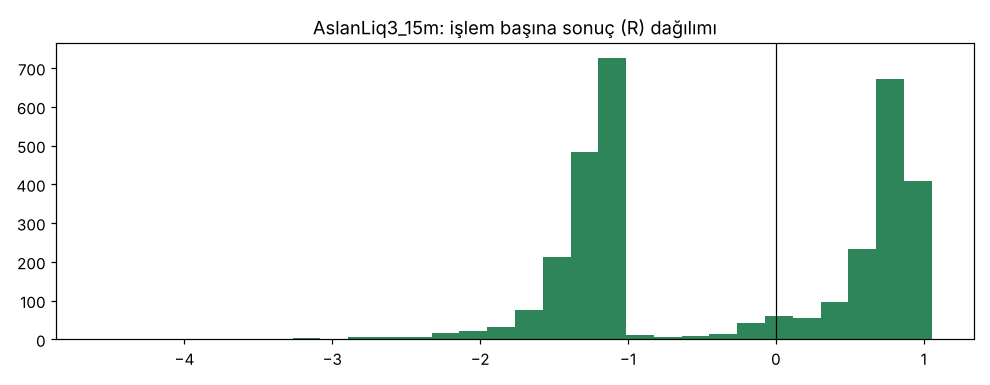
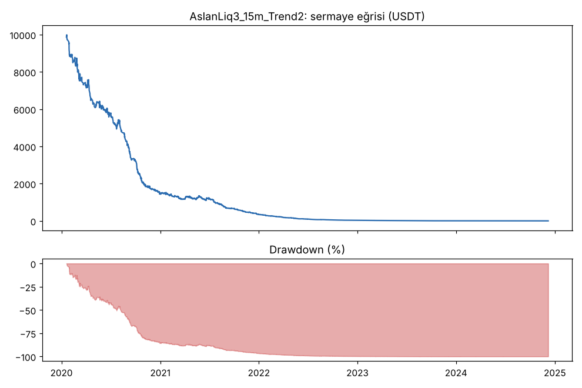
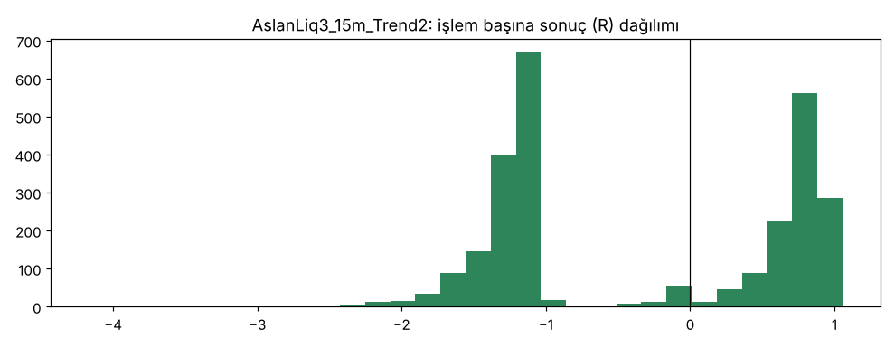
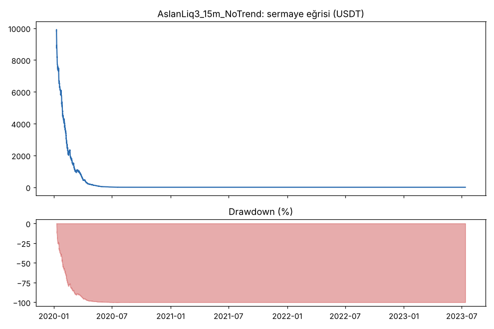
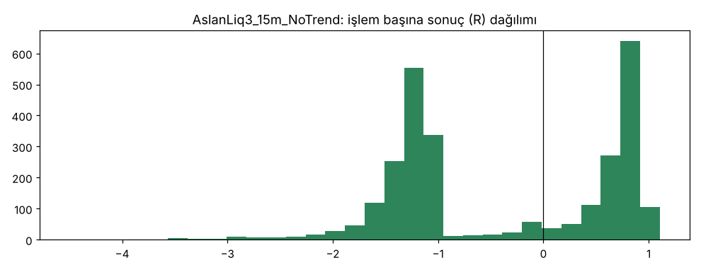

# AslanLiq3_15m vs AslanLiq3_15m_Trend2 vs AslanLiq3_15m_NoTrend — v3_15m — 2026-10-09

## Özet
- **AslanLiq3_15m**: 3200 işlem, işlem başına ortalama **-0.32R** (maliyet ve funding dahil), net getiri -100.0%, en büyük düşüş 100.0%.
- **AslanLiq3_15m_Trend2**: 2701 işlem, işlem başına ortalama **-0.34R** (maliyet ve funding dahil), net getiri -100.0%, en büyük düşüş 100.0%.
- **AslanLiq3_15m_NoTrend**: 2743 işlem, işlem başına ortalama **-0.39R** (maliyet ve funding dahil), net getiri -100.0%, en büyük düşüş 100.0%.
- Aynı dönemde coinleri al-tut (eşit ağırlık): getiri 2273.9%, ortalama en büyük düşüş 86.6%.

## Ayarlar
- Dönem: 2020-01-09 08:00:00 → 2025-01-01 00:00:00
- Coinler: BTC/USDT:USDT, ETH/USDT:USDT, ADA/USDT:USDT, SOL/USDT:USDT, XRP/USDT:USDT
- Zaman dilimi: 15m
- Yön: long + short
- Mod: futures / isolated
- Kaldıraç: en fazla 20x, likidasyon stop mesafesinin en az 2 katı uzakta (bölüm 7.6)
- Risk: işlem başına sermayenin %1'i (pozisyon büyüklüğü stop mesafesine göre)
- Maliyet: her emir için %0.05 komisyon + %0.05 kayma (= %0.1), funding geçmiş veriden
- Başlangıç sermayesi: 10000 USDT

## Metrikler
| Metrik | AslanLiq3_15m | AslanLiq3_15m_Trend2 | AslanLiq3_15m_NoTrend | Al-tut |
|---|---|---|---|---|
| Net getiri | -100.0% | -100.0% | -100.0% | 2273.9% |
| Max drawdown | 100.0% | 100.0% | 100.0% | 86.6% |
| Profit factor | 0.47 | 0.56 | 0.50 | — |
| Ortalama R | -0.32 | -0.34 | -0.39 | — |
| İşlem sayısı | 3200 | 2701 | 2743 | — |
| Winrate | 46.2% | 45.3% | 44.0% | — |

Winrate tek başına başarı ölçütü değildir; asıl ölçüt ortalama R (expectancy) ve drawdown'dur.

## Long / short ayrımı
| Strateji | Yön | İşlem | Ortalama R | Toplam R | Profit factor |
|---|---|---|---|---|---|
| AslanLiq3_15m | long | 1829 | -0.34 | -616.17 | 0.39 |
| AslanLiq3_15m | short | 1371 | -0.31 | -421.62 | 0.59 |
| AslanLiq3_15m_Trend2 | long | 1472 | -0.40 | -582.50 | 0.51 |
| AslanLiq3_15m_Trend2 | short | 1229 | -0.27 | -329.02 | 0.63 |
| AslanLiq3_15m_NoTrend | long | 1504 | -0.36 | -536.29 | 0.49 |
| AslanLiq3_15m_NoTrend | short | 1239 | -0.42 | -521.55 | 0.52 |

## Sinyal istatistikleri
| Strateji | Stop | BE | TP1 sonrası BE | TP2 | Diğer | İptal (bölgeye gelmedi / önce stop) | Toplam funding (USDT) |
|---|---|---|---|---|---|---|---|
| AslanLiq3_15m | 49.2% | 1.9% | 0.0% | 48.9% | 0.0% | 0.7% | -92.89 |
| AslanLiq3_15m_Trend2 | 51.6% | 1.8% | 0.0% | 46.6% | 0.0% | 0.5% | -53.66 |
| AslanLiq3_15m_NoTrend | 49.8% | 2.2% | 0.0% | 48.1% | 0.0% | 1.2% | 3.98 |

## Coin bazında
| Strateji | Coin | İşlem | Ortalama R | Toplam R | Al-tut getirisi |
|---|---|---|---|---|---|
| AslanLiq3_15m | BTC/USDT:USDT | 441 | -0.47 | -205.12 | 1078.7% |
| AslanLiq3_15m | ETH/USDT:USDT | 890 | -0.33 | -292.19 | 2292.5% |
| AslanLiq3_15m | ADA/USDT:USDT | 826 | -0.29 | -237.47 | 1479.5% |
| AslanLiq3_15m | SOL/USDT:USDT | 266 | -0.14 | -37.37 | 5601.2% |
| AslanLiq3_15m | XRP/USDT:USDT | 777 | -0.34 | -265.64 | 917.7% |
| AslanLiq3_15m_Trend2 | BTC/USDT:USDT | 471 | -0.40 | -189.16 | 1078.7% |
| AslanLiq3_15m_Trend2 | ETH/USDT:USDT | 561 | -0.34 | -193.08 | 2292.5% |
| AslanLiq3_15m_Trend2 | ADA/USDT:USDT | 691 | -0.33 | -230.21 | 1479.5% |
| AslanLiq3_15m_Trend2 | SOL/USDT:USDT | 439 | -0.23 | -99.54 | 5601.2% |
| AslanLiq3_15m_Trend2 | XRP/USDT:USDT | 539 | -0.37 | -199.53 | 917.7% |
| AslanLiq3_15m_NoTrend | BTC/USDT:USDT | 701 | -0.46 | -321.22 | 1078.7% |
| AslanLiq3_15m_NoTrend | ETH/USDT:USDT | 674 | -0.33 | -225.09 | 2292.5% |
| AslanLiq3_15m_NoTrend | ADA/USDT:USDT | 692 | -0.30 | -206.07 | 1479.5% |
| AslanLiq3_15m_NoTrend | SOL/USDT:USDT | 3 | -1.35 | -4.06 | 5601.2% |
| AslanLiq3_15m_NoTrend | XRP/USDT:USDT | 673 | -0.45 | -301.40 | 917.7% |

## Grafikler

## Yorum: güçlü yanlar / şüpheli noktalar
_(Claude tarafından rakamlara bakılarak yazılır.)_

## Karar: devam / düzelt / emekli
_(Claude tarafından yazılır, gerekçesiyle.)_
