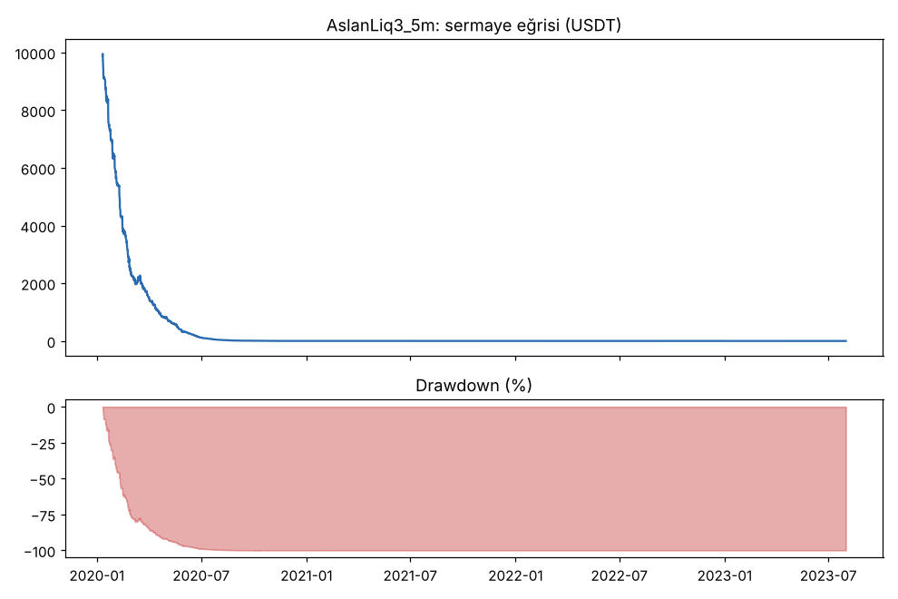
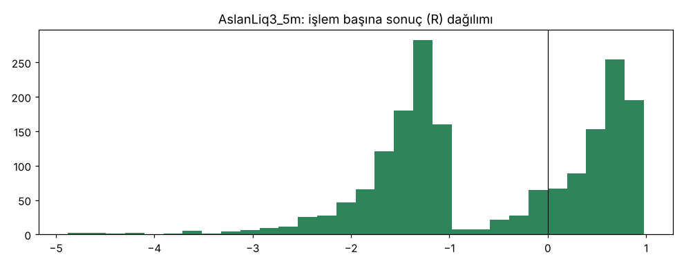
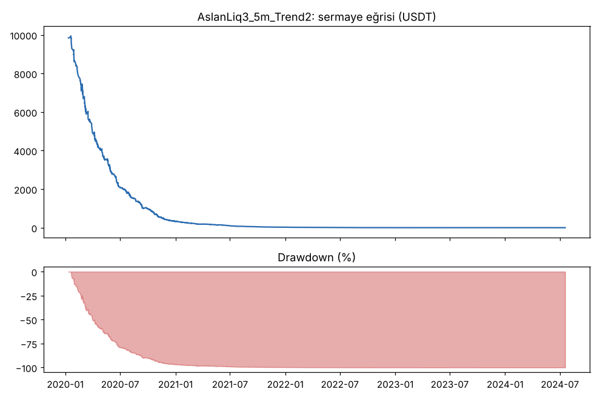
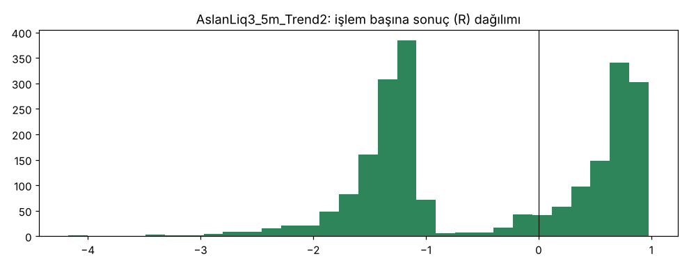
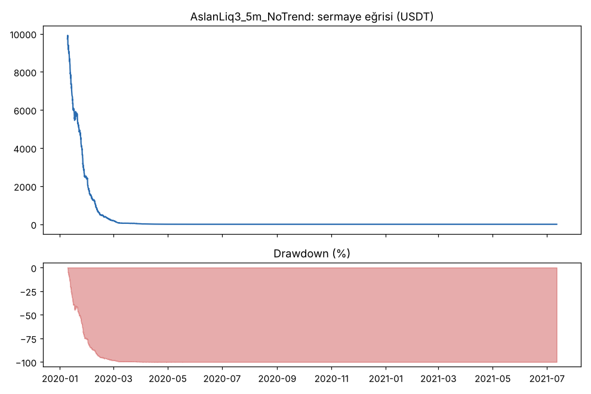
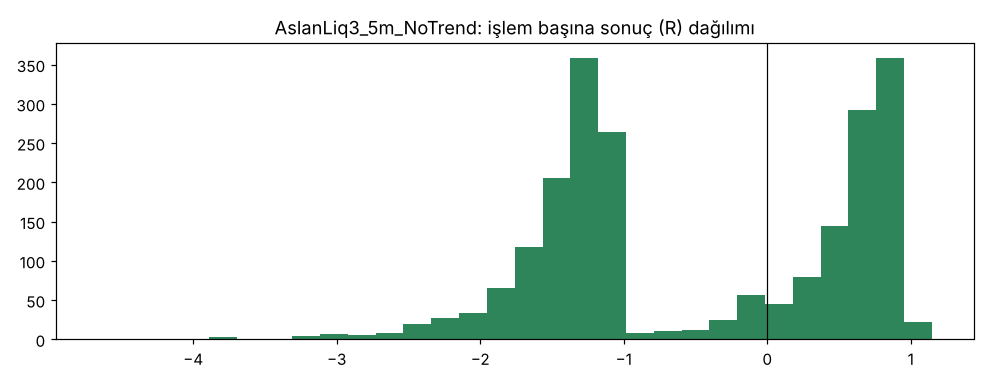

# AslanLiq3_5m vs AslanLiq3_5m_Trend2 vs AslanLiq3_5m_NoTrend — v3_5m — 2026-10-09

## Özet
- **AslanLiq3_5m**: 1838 işlem, işlem başına ortalama **-0.58R** (maliyet ve funding dahil), net getiri -100.0%, en büyük düşüş 100.0%.
- **AslanLiq3_5m_Trend2**: 2211 işlem, işlem başına ortalama **-0.45R** (maliyet ve funding dahil), net getiri -100.0%, en büyük düşüş 100.0%.
- **AslanLiq3_5m_NoTrend**: 2172 işlem, işlem başına ortalama **-0.48R** (maliyet ve funding dahil), net getiri -100.0%, en büyük düşüş 100.0%.
- Aynı dönemde coinleri al-tut (eşit ağırlık): getiri 2278.7%, ortalama en büyük düşüş 86.8%.

## Ayarlar
- Dönem: 2020-01-09 08:00:00 → 2025-01-01 00:00:00
- Coinler: BTC/USDT:USDT, ETH/USDT:USDT, ADA/USDT:USDT, SOL/USDT:USDT, XRP/USDT:USDT
- Zaman dilimi: 5m
- Yön: long + short
- Mod: futures / isolated
- Kaldıraç: en fazla 20x, likidasyon stop mesafesinin en az 2 katı uzakta (bölüm 7.6)
- Risk: işlem başına sermayenin %1'i (pozisyon büyüklüğü stop mesafesine göre)
- Maliyet: her emir için %0.05 komisyon + %0.05 kayma (= %0.1), funding geçmiş veriden
- Başlangıç sermayesi: 10000 USDT

## Metrikler
| Metrik | AslanLiq3_5m | AslanLiq3_5m_Trend2 | AslanLiq3_5m_NoTrend | Al-tut |
|---|---|---|---|---|
| Net getiri | -100.0% | -100.0% | -100.0% | 2278.7% |
| Max drawdown | 100.0% | 100.0% | 100.0% | 86.8% |
| Profit factor | 0.33 | 0.35 | 0.34 | — |
| Ortalama R | -0.58 | -0.45 | -0.48 | — |
| İşlem sayısı | 1838 | 2211 | 2172 | — |
| Winrate | 41.2% | 44.1% | 43.3% | — |

Winrate tek başına başarı ölçütü değildir; asıl ölçüt ortalama R (expectancy) ve drawdown'dur.

## Long / short ayrımı
| Strateji | Yön | İşlem | Ortalama R | Toplam R | Profit factor |
|---|---|---|---|---|---|
| AslanLiq3_5m | long | 1025 | -0.59 | -605.54 | 0.32 |
| AslanLiq3_5m | short | 813 | -0.57 | -461.07 | 0.33 |
| AslanLiq3_5m_Trend2 | long | 1284 | -0.47 | -601.77 | 0.35 |
| AslanLiq3_5m_Trend2 | short | 927 | -0.44 | -403.55 | 0.35 |
| AslanLiq3_5m_NoTrend | long | 1161 | -0.49 | -569.99 | 0.33 |
| AslanLiq3_5m_NoTrend | short | 1011 | -0.47 | -477.40 | 0.34 |

## Sinyal istatistikleri
| Strateji | Stop | BE | TP1 sonrası BE | TP2 | Diğer | İptal (bölgeye gelmedi / önce stop) | Toplam funding (USDT) |
|---|---|---|---|---|---|---|---|
| AslanLiq3_5m | 49.6% | 2.5% | 0.0% | 47.9% | 0.0% | 1.3% | -10.08 |
| AslanLiq3_5m_Trend2 | 50.9% | 1.9% | 0.0% | 47.1% | 0.0% | 0.9% | -7.66 |
| AslanLiq3_5m_NoTrend | 50.3% | 2.1% | 0.0% | 47.7% | 0.0% | 1.5% | 20.09 |

## Coin bazında
| Strateji | Coin | İşlem | Ortalama R | Toplam R | Al-tut getirisi |
|---|---|---|---|---|---|
| AslanLiq3_5m | BTC/USDT:USDT | 383 | -0.75 | -286.60 | 1077.7% |
| AslanLiq3_5m | ETH/USDT:USDT | 484 | -0.50 | -240.83 | 2286.1% |
| AslanLiq3_5m | ADA/USDT:USDT | 465 | -0.53 | -246.96 | 1476.1% |
| AslanLiq3_5m | SOL/USDT:USDT | 53 | -0.44 | -23.38 | 5642.5% |
| AslanLiq3_5m | XRP/USDT:USDT | 453 | -0.59 | -268.84 | 911.3% |
| AslanLiq3_5m_Trend2 | BTC/USDT:USDT | 376 | -0.58 | -216.57 | 1077.7% |
| AslanLiq3_5m_Trend2 | ETH/USDT:USDT | 502 | -0.47 | -237.25 | 2286.1% |
| AslanLiq3_5m_Trend2 | ADA/USDT:USDT | 635 | -0.42 | -263.95 | 1476.1% |
| AslanLiq3_5m_Trend2 | SOL/USDT:USDT | 207 | -0.24 | -49.38 | 5642.5% |
| AslanLiq3_5m_Trend2 | XRP/USDT:USDT | 491 | -0.49 | -238.18 | 911.3% |
| AslanLiq3_5m_NoTrend | BTC/USDT:USDT | 507 | -0.55 | -278.03 | 1077.7% |
| AslanLiq3_5m_NoTrend | ETH/USDT:USDT | 618 | -0.46 | -285.29 | 2286.1% |
| AslanLiq3_5m_NoTrend | ADA/USDT:USDT | 454 | -0.44 | -201.53 | 1476.1% |
| AslanLiq3_5m_NoTrend | SOL/USDT:USDT | 2 | -2.07 | -4.13 | 5642.5% |
| AslanLiq3_5m_NoTrend | XRP/USDT:USDT | 591 | -0.47 | -278.41 | 911.3% |

## Grafikler

## Yorum: güçlü yanlar / şüpheli noktalar
_(Claude tarafından rakamlara bakılarak yazılır.)_

## Karar: devam / düzelt / emekli
_(Claude tarafından yazılır, gerekçesiyle.)_
