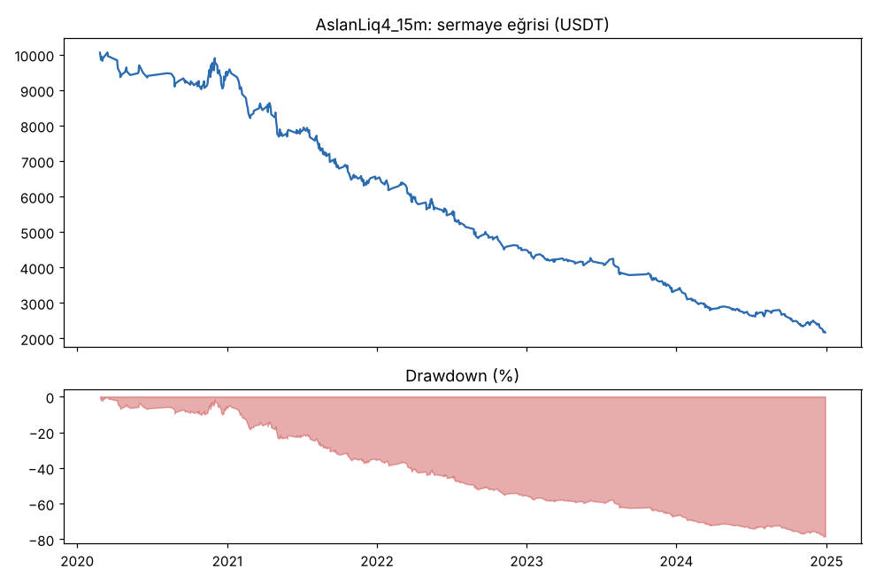
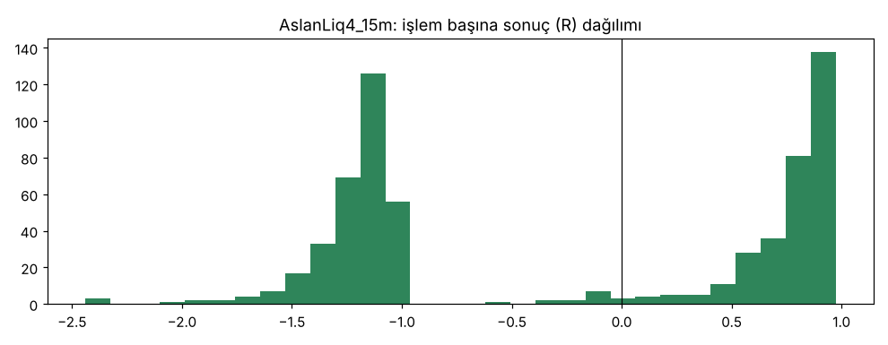
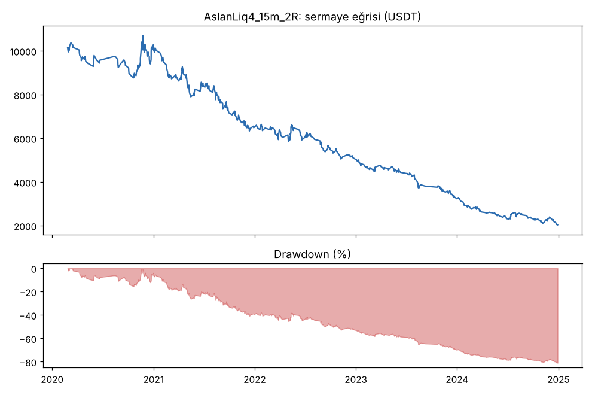
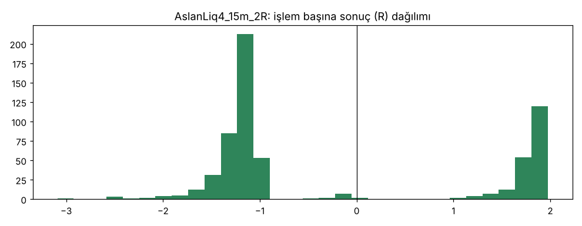

# AslanLiq4_15m vs AslanLiq4_15m_2R — v4_15m — 2026-10-09

## Özet
- **AslanLiq4_15m**: 643 işlem, işlem başına ortalama **-0.24R** (maliyet ve funding dahil), net getiri -78.3%, en büyük düşüş 78.5%.
- **AslanLiq4_15m_2R**: 621 işlem, işlem başına ortalama **-0.25R** (maliyet ve funding dahil), net getiri -79.6%, en büyük düşüş 81.0%.
- Aynı dönemde coinleri al-tut (eşit ağırlık): getiri 2273.9%, ortalama en büyük düşüş 86.6%.

## Ayarlar
- Dönem: 2020-01-09 08:00:00 → 2025-01-01 00:00:00
- Coinler: BTC/USDT:USDT, ETH/USDT:USDT, ADA/USDT:USDT, SOL/USDT:USDT, XRP/USDT:USDT
- Zaman dilimi: 15m
- Yön: long + short
- Mod: futures / isolated
- Kaldıraç: en fazla 20x, likidasyon stop mesafesinin en az 2 katı uzakta (bölüm 7.6)
- Risk: işlem başına sermayenin %1'i (pozisyon büyüklüğü stop mesafesine göre)
- Maliyet: her emir için %0.05 komisyon + %0.05 kayma (= %0.1), funding geçmiş veriden
- Başlangıç sermayesi: 10000 USDT

## Metrikler
| Metrik | AslanLiq4_15m | AslanLiq4_15m_2R | Al-tut |
|---|---|---|---|
| Net getiri | -78.3% | -79.6% | 2273.9% |
| Max drawdown | 78.5% | 81.0% | 86.6% |
| Profit factor | 0.64 | 0.73 | — |
| Ortalama R | -0.24 | -0.25 | — |
| İşlem sayısı | 643 | 621 | — |
| Winrate | 48.2% | 32.2% | — |

Winrate tek başına başarı ölçütü değildir; asıl ölçüt ortalama R (expectancy) ve drawdown'dur.

## Long / short ayrımı
| Strateji | Yön | İşlem | Ortalama R | Toplam R | Profit factor |
|---|---|---|---|---|---|
| AslanLiq4_15m | long | 385 | -0.24 | -94.20 | 0.62 |
| AslanLiq4_15m | short | 258 | -0.22 | -57.38 | 0.67 |
| AslanLiq4_15m_2R | long | 369 | -0.21 | -78.72 | 0.71 |
| AslanLiq4_15m_2R | short | 252 | -0.30 | -75.76 | 0.75 |

## Sinyal istatistikleri
| Strateji | Stop | BE | TP1 sonrası BE | TP2 | Diğer | İptal (bölgeye gelmedi / önce stop) | Toplam funding (USDT) |
|---|---|---|---|---|---|---|---|
| AslanLiq4_15m | 49.6% | 1.4% | 0.0% | 49.0% | 0.0% | 0.6% | -171.66 |
| AslanLiq4_15m_2R | 66.0% | 1.9% | 0.0% | 32.0% | 0.0% | 0.6% | -250.81 |

## Coin bazında
| Strateji | Coin | İşlem | Ortalama R | Toplam R | Al-tut getirisi |
|---|---|---|---|---|---|
| AslanLiq4_15m | BTC/USDT:USDT | 138 | -0.29 | -39.63 | 1078.7% |
| AslanLiq4_15m | ETH/USDT:USDT | 144 | -0.34 | -48.79 | 2292.5% |
| AslanLiq4_15m | ADA/USDT:USDT | 122 | -0.05 | -5.90 | 1479.5% |
| AslanLiq4_15m | SOL/USDT:USDT | 114 | -0.24 | -27.68 | 5601.2% |
| AslanLiq4_15m | XRP/USDT:USDT | 125 | -0.24 | -29.57 | 917.7% |
| AslanLiq4_15m_2R | BTC/USDT:USDT | 133 | -0.28 | -37.17 | 1078.7% |
| AslanLiq4_15m_2R | ETH/USDT:USDT | 138 | -0.34 | -46.92 | 2292.5% |
| AslanLiq4_15m_2R | ADA/USDT:USDT | 116 | 0.02 | 2.81 | 1479.5% |
| AslanLiq4_15m_2R | SOL/USDT:USDT | 112 | -0.22 | -24.59 | 5601.2% |
| AslanLiq4_15m_2R | XRP/USDT:USDT | 122 | -0.40 | -48.61 | 917.7% |

## Grafikler

## Yorum: güçlü yanlar / şüpheli noktalar
_(Claude tarafından rakamlara bakılarak yazılır.)_

## Karar: devam / düzelt / emekli
_(Claude tarafından yazılır, gerekçesiyle.)_
