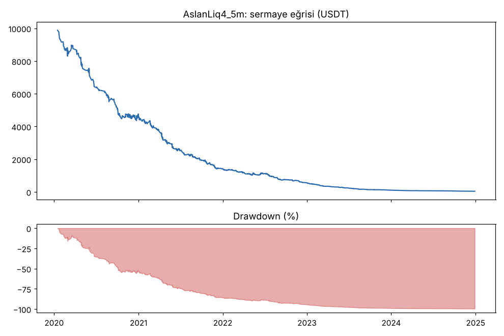
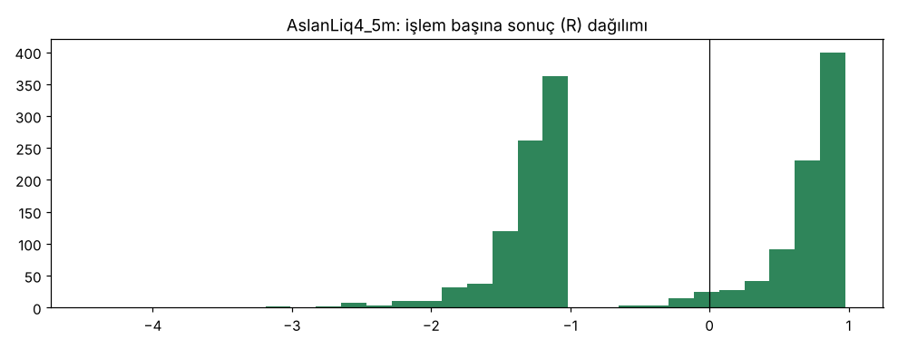
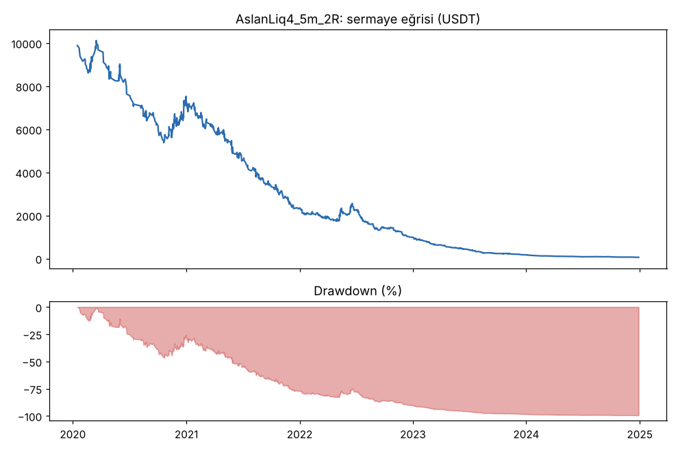
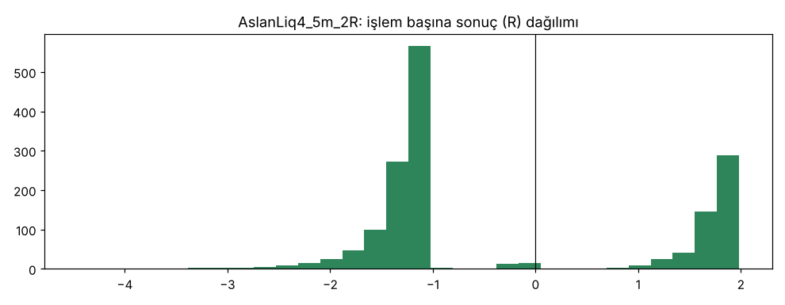

# AslanLiq4_5m vs AslanLiq4_5m_2R — v4_5m — 2026-10-09

## Özet
- **AslanLiq4_5m**: 1692 işlem, işlem başına ortalama **-0.33R** (maliyet ve funding dahil), net getiri -99.6%, en büyük düşüş 99.6%.
- **AslanLiq4_5m_2R**: 1588 işlem, işlem başına ortalama **-0.32R** (maliyet ve funding dahil), net getiri -99.4%, en büyük düşüş 99.4%.
- Aynı dönemde coinleri al-tut (eşit ağırlık): getiri 2278.7%, ortalama en büyük düşüş 86.8%.

## Ayarlar
- Dönem: 2020-01-09 08:00:00 → 2025-01-01 00:00:00
- Coinler: BTC/USDT:USDT, ETH/USDT:USDT, ADA/USDT:USDT, SOL/USDT:USDT, XRP/USDT:USDT
- Zaman dilimi: 5m
- Yön: long + short
- Mod: futures / isolated
- Kaldıraç: en fazla 20x, likidasyon stop mesafesinin en az 2 katı uzakta (bölüm 7.6)
- Risk: işlem başına sermayenin %1'i (pozisyon büyüklüğü stop mesafesine göre)
- Maliyet: her emir için %0.05 komisyon + %0.05 kayma (= %0.1), funding geçmiş veriden
- Başlangıç sermayesi: 10000 USDT

## Metrikler
| Metrik | AslanLiq4_5m | AslanLiq4_5m_2R | Al-tut |
|---|---|---|---|
| Net getiri | -99.6% | -99.4% | 2278.7% |
| Max drawdown | 99.6% | 99.4% | 86.8% |
| Profit factor | 0.55 | 0.72 | — |
| Ortalama R | -0.33 | -0.32 | — |
| İşlem sayısı | 1692 | 1588 | — |
| Winrate | 47.2% | 32.2% | — |

Winrate tek başına başarı ölçütü değildir; asıl ölçüt ortalama R (expectancy) ve drawdown'dur.

## Long / short ayrımı
| Strateji | Yön | İşlem | Ortalama R | Toplam R | Profit factor |
|---|---|---|---|---|---|
| AslanLiq4_5m | long | 965 | -0.33 | -315.75 | 0.50 |
| AslanLiq4_5m | short | 727 | -0.32 | -235.88 | 0.63 |
| AslanLiq4_5m_2R | long | 904 | -0.35 | -312.72 | 0.63 |
| AslanLiq4_5m_2R | short | 684 | -0.29 | -195.45 | 0.88 |

## Sinyal istatistikleri
| Strateji | Stop | BE | TP1 sonrası BE | TP2 | Diğer | İptal (bölgeye gelmedi / önce stop) | Toplam funding (USDT) |
|---|---|---|---|---|---|---|---|
| AslanLiq4_5m | 50.2% | 0.9% | 0.0% | 48.9% | 0.0% | 0.6% | -173.85 |
| AslanLiq4_5m_2R | 65.9% | 1.8% | 0.0% | 32.3% | 0.0% | 0.7% | -390.19 |

## Coin bazında
| Strateji | Coin | İşlem | Ortalama R | Toplam R | Al-tut getirisi |
|---|---|---|---|---|---|
| AslanLiq4_5m | BTC/USDT:USDT | 378 | -0.53 | -202.21 | 1077.7% |
| AslanLiq4_5m | ETH/USDT:USDT | 431 | -0.39 | -166.14 | 2286.1% |
| AslanLiq4_5m | ADA/USDT:USDT | 306 | -0.23 | -69.90 | 1476.1% |
| AslanLiq4_5m | SOL/USDT:USDT | 249 | -0.09 | -23.39 | 5642.5% |
| AslanLiq4_5m | XRP/USDT:USDT | 328 | -0.27 | -89.99 | 911.3% |
| AslanLiq4_5m_2R | BTC/USDT:USDT | 361 | -0.55 | -199.60 | 1077.7% |
| AslanLiq4_5m_2R | ETH/USDT:USDT | 383 | -0.42 | -161.85 | 2286.1% |
| AslanLiq4_5m_2R | ADA/USDT:USDT | 288 | -0.22 | -63.15 | 1476.1% |
| AslanLiq4_5m_2R | SOL/USDT:USDT | 248 | -0.08 | -18.65 | 5642.5% |
| AslanLiq4_5m_2R | XRP/USDT:USDT | 308 | -0.21 | -64.92 | 911.3% |

## Grafikler

## Yorum: güçlü yanlar / şüpheli noktalar
_(Claude tarafından rakamlara bakılarak yazılır.)_

## Karar: devam / düzelt / emekli
_(Claude tarafından yazılır, gerekçesiyle.)_
