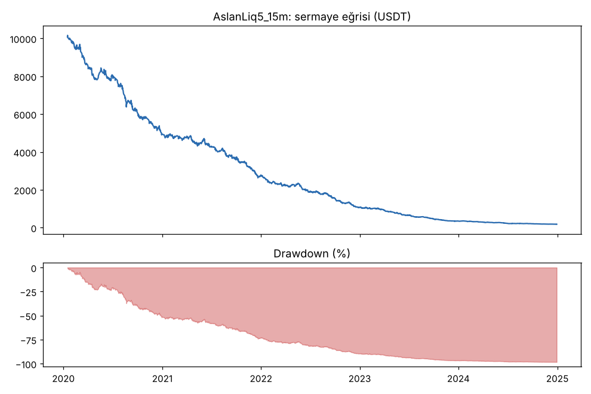
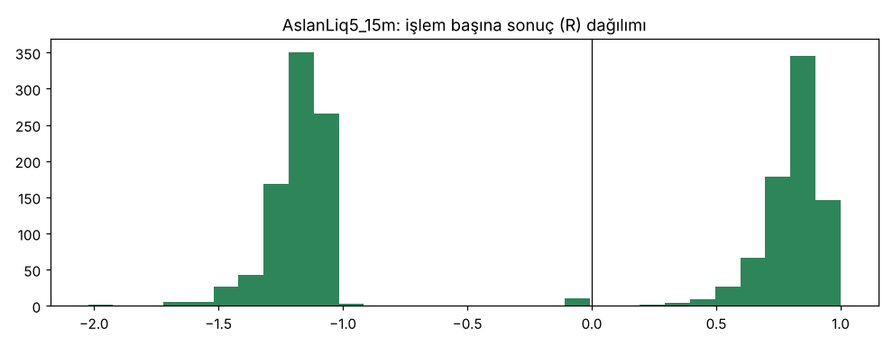
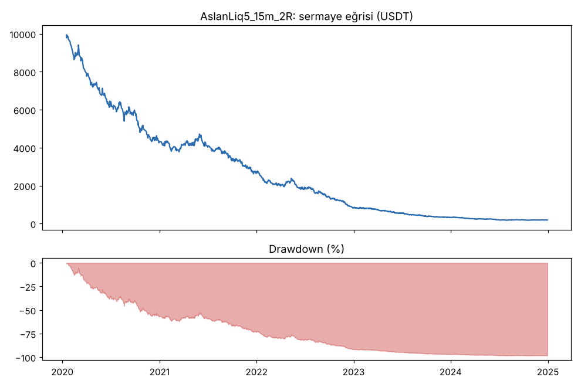
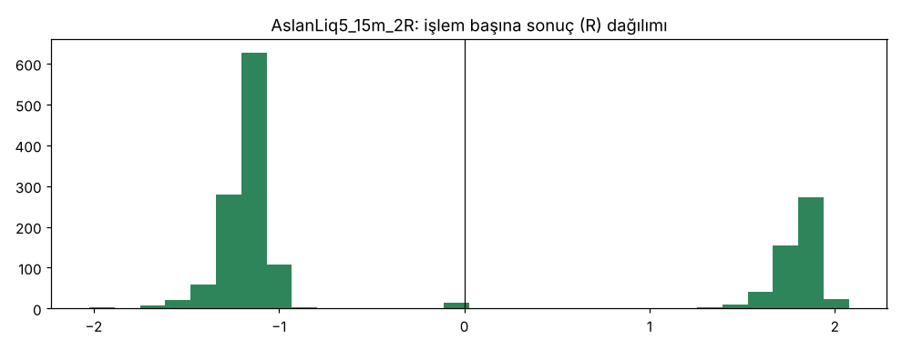

# AslanLiq5_15m vs AslanLiq5_15m_2R — v5_15m — 2026-10-09

## Özet
- **AslanLiq5_15m**: 1658 işlem, işlem başına ortalama **-0.24R** (maliyet ve funding dahil), net getiri -98.2%, en büyük düşüş 98.2%.
- **AslanLiq5_15m_2R**: 1625 işlem, işlem başına ortalama **-0.24R** (maliyet ve funding dahil), net getiri -98.2%, en büyük düşüş 98.3%.
- Aynı dönemde coinleri al-tut (eşit ağırlık): getiri 2273.9%, ortalama en büyük düşüş 86.6%.

## Ayarlar
- Dönem: 2020-01-09 08:00:00 → 2025-01-01 00:00:00
- Coinler: BTC/USDT:USDT, ETH/USDT:USDT, ADA/USDT:USDT, SOL/USDT:USDT, XRP/USDT:USDT
- Zaman dilimi: 15m
- Yön: long + short
- Mod: futures / isolated
- Kaldıraç: en fazla 20x, likidasyon stop mesafesinin en az 2 katı uzakta (bölüm 7.6)
- Risk: işlem başına sermayenin %1'i (pozisyon büyüklüğü stop mesafesine göre)
- Maliyet: her emir için %0.05 komisyon + %0.05 kayma (= %0.1), funding geçmiş veriden
- Başlangıç sermayesi: 10000 USDT

## Metrikler
| Metrik | AslanLiq5_15m | AslanLiq5_15m_2R | Al-tut |
|---|---|---|---|
| Net getiri | -98.2% | -98.2% | 2273.9% |
| Max drawdown | 98.2% | 98.3% | 86.6% |
| Profit factor | 0.62 | 0.67 | — |
| Ortalama R | -0.24 | -0.24 | — |
| İşlem sayısı | 1658 | 1625 | — |
| Winrate | 46.8% | 31.1% | — |

Winrate tek başına başarı ölçütü değildir; asıl ölçüt ortalama R (expectancy) ve drawdown'dur.

## Long / short ayrımı
| Strateji | Yön | İşlem | Ortalama R | Toplam R | Profit factor |
|---|---|---|---|---|---|
| AslanLiq5_15m | long | 838 | -0.27 | -222.44 | 0.62 |
| AslanLiq5_15m | short | 820 | -0.22 | -181.32 | 0.62 |
| AslanLiq5_15m_2R | long | 821 | -0.33 | -267.39 | 0.61 |
| AslanLiq5_15m_2R | short | 804 | -0.16 | -128.70 | 0.74 |

## Sinyal istatistikleri
| Strateji | Stop | BE | TP1 sonrası BE | TP2 | Diğer | İptal (bölgeye gelmedi / önce stop) | Toplam funding (USDT) |
|---|---|---|---|---|---|---|---|
| AslanLiq5_15m | 52.6% | 0.5% | 0.0% | 46.9% | 0.0% | 0.2% | -65.47 |
| AslanLiq5_15m_2R | 68.1% | 0.9% | 0.0% | 31.1% | 0.0% | 0.2% | -92.03 |

## Coin bazında
| Strateji | Coin | İşlem | Ortalama R | Toplam R | Al-tut getirisi |
|---|---|---|---|---|---|
| AslanLiq5_15m | BTC/USDT:USDT | 376 | -0.26 | -97.90 | 1078.7% |
| AslanLiq5_15m | ETH/USDT:USDT | 358 | -0.27 | -94.97 | 2292.5% |
| AslanLiq5_15m | ADA/USDT:USDT | 335 | -0.26 | -86.07 | 1479.5% |
| AslanLiq5_15m | SOL/USDT:USDT | 275 | -0.24 | -66.79 | 5601.2% |
| AslanLiq5_15m | XRP/USDT:USDT | 314 | -0.18 | -58.03 | 917.7% |
| AslanLiq5_15m_2R | BTC/USDT:USDT | 365 | -0.34 | -125.53 | 1078.7% |
| AslanLiq5_15m_2R | ETH/USDT:USDT | 355 | -0.23 | -82.79 | 2292.5% |
| AslanLiq5_15m_2R | ADA/USDT:USDT | 332 | -0.20 | -65.41 | 1479.5% |
| AslanLiq5_15m_2R | SOL/USDT:USDT | 271 | -0.27 | -74.34 | 5601.2% |
| AslanLiq5_15m_2R | XRP/USDT:USDT | 302 | -0.16 | -48.03 | 917.7% |

## Grafikler

## Yorum: güçlü yanlar / şüpheli noktalar
_(Claude tarafından rakamlara bakılarak yazılır.)_

## Karar: devam / düzelt / emekli
_(Claude tarafından yazılır, gerekçesiyle.)_
