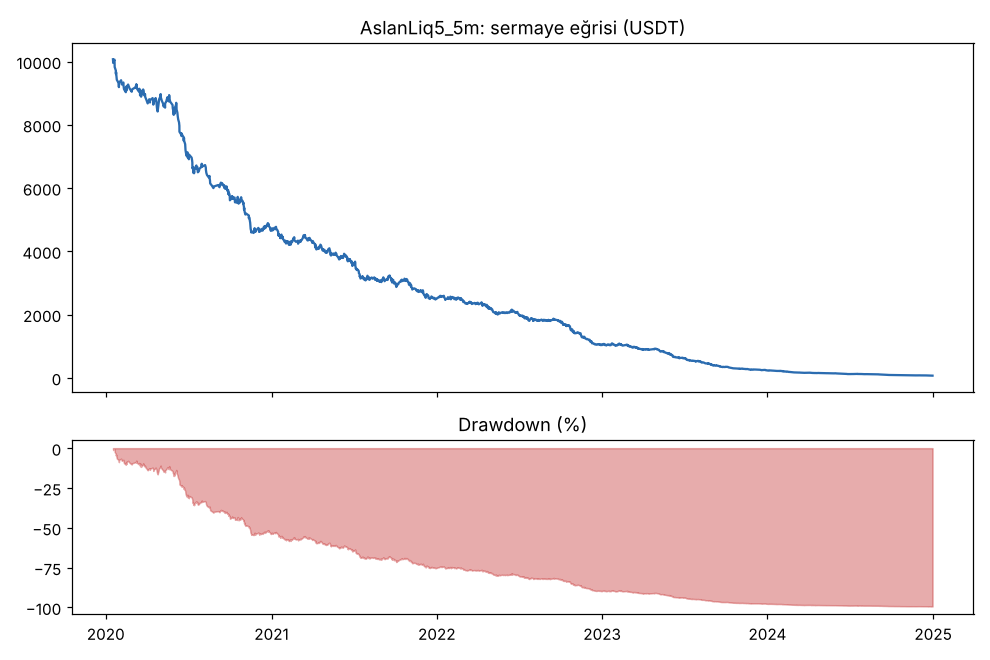
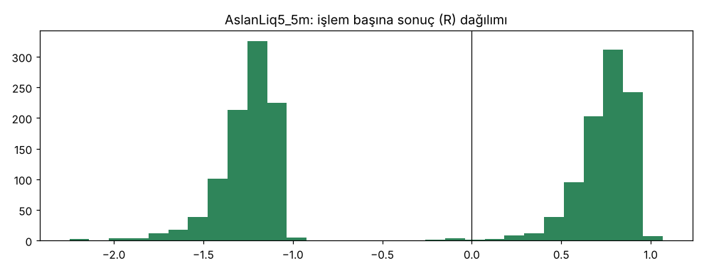
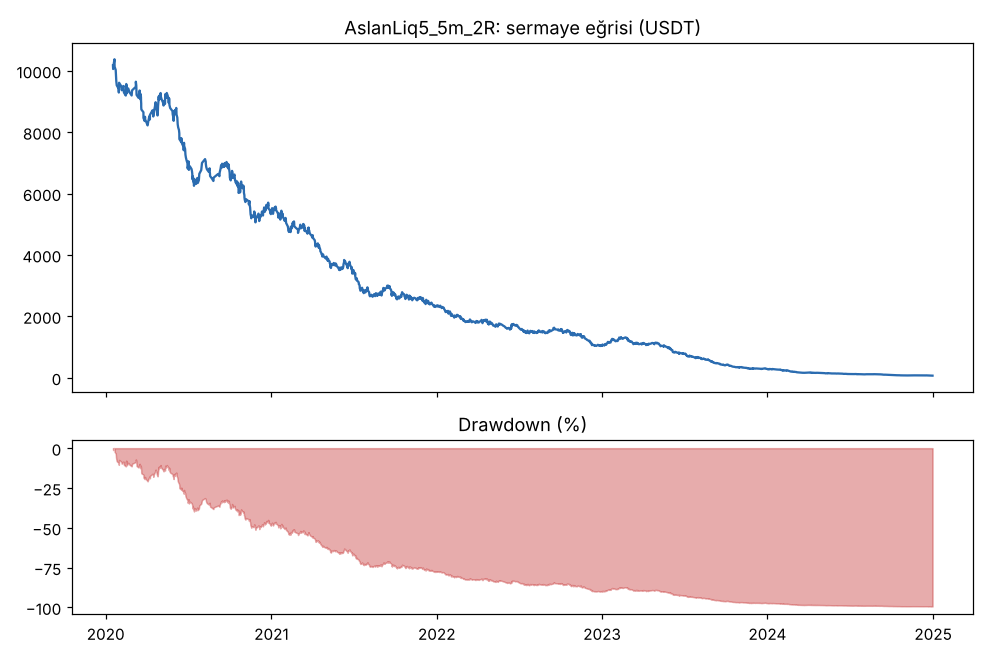
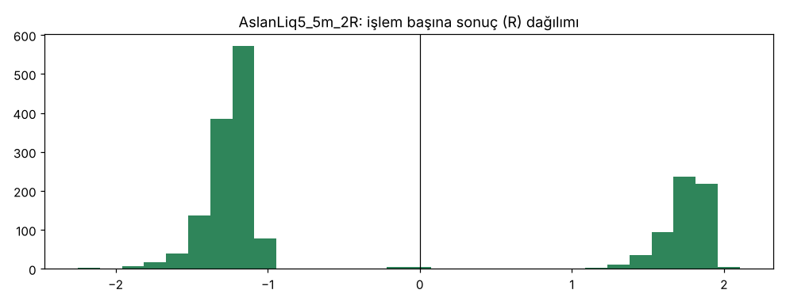

# AslanLiq5_5m vs AslanLiq5_5m_2R — v5_5m — 2026-10-09

## Özet
- **AslanLiq5_5m**: 1878 işlem, işlem başına ortalama **-0.27R** (maliyet ve funding dahil), net getiri -99.3%, en büyük düşüş 99.3%.
- **AslanLiq5_5m_2R**: 1851 işlem, işlem başına ortalama **-0.27R** (maliyet ve funding dahil), net getiri -99.3%, en büyük düşüş 99.4%.
- Aynı dönemde coinleri al-tut (eşit ağırlık): getiri 2278.7%, ortalama en büyük düşüş 86.8%.

## Ayarlar
- Dönem: 2020-01-09 08:00:00 → 2025-01-01 00:00:00
- Coinler: BTC/USDT:USDT, ETH/USDT:USDT, ADA/USDT:USDT, SOL/USDT:USDT, XRP/USDT:USDT
- Zaman dilimi: 5m
- Yön: long + short
- Mod: futures / isolated
- Kaldıraç: en fazla 20x, likidasyon stop mesafesinin en az 2 katı uzakta (bölüm 7.6)
- Risk: işlem başına sermayenin %1'i (pozisyon büyüklüğü stop mesafesine göre)
- Maliyet: her emir için %0.05 komisyon + %0.05 kayma (= %0.1), funding geçmiş veriden
- Başlangıç sermayesi: 10000 USDT

## Metrikler
| Metrik | AslanLiq5_5m | AslanLiq5_5m_2R | Al-tut |
|---|---|---|---|
| Net getiri | -99.3% | -99.3% | 2278.7% |
| Max drawdown | 99.3% | 99.4% | 86.8% |
| Profit factor | 0.64 | 0.73 | — |
| Ortalama R | -0.27 | -0.27 | — |
| İşlem sayısı | 1878 | 1851 | — |
| Winrate | 49.0% | 32.6% | — |

Winrate tek başına başarı ölçütü değildir; asıl ölçüt ortalama R (expectancy) ve drawdown'dur.

## Long / short ayrımı
| Strateji | Yön | İşlem | Ortalama R | Toplam R | Profit factor |
|---|---|---|---|---|---|
| AslanLiq5_5m | long | 975 | -0.28 | -270.37 | 0.71 |
| AslanLiq5_5m | short | 903 | -0.26 | -236.60 | 0.57 |
| AslanLiq5_5m_2R | long | 958 | -0.28 | -265.84 | 0.80 |
| AslanLiq5_5m_2R | short | 893 | -0.26 | -232.99 | 0.65 |

## Sinyal istatistikleri
| Strateji | Stop | BE | TP1 sonrası BE | TP2 | Diğer | İptal (bölgeye gelmedi / önce stop) | Toplam funding (USDT) |
|---|---|---|---|---|---|---|---|
| AslanLiq5_5m | 50.6% | 0.3% | 0.0% | 49.1% | 0.0% | 0.5% | -148.46 |
| AslanLiq5_5m_2R | 66.8% | 0.5% | 0.0% | 32.6% | 0.0% | 0.4% | -283.83 |

## Coin bazında
| Strateji | Coin | İşlem | Ortalama R | Toplam R | Al-tut getirisi |
|---|---|---|---|---|---|
| AslanLiq5_5m | BTC/USDT:USDT | 429 | -0.38 | -162.44 | 1077.7% |
| AslanLiq5_5m | ETH/USDT:USDT | 397 | -0.26 | -103.76 | 2286.1% |
| AslanLiq5_5m | ADA/USDT:USDT | 361 | -0.27 | -96.48 | 1476.1% |
| AslanLiq5_5m | SOL/USDT:USDT | 324 | -0.16 | -53.21 | 5642.5% |
| AslanLiq5_5m | XRP/USDT:USDT | 367 | -0.25 | -91.07 | 911.3% |
| AslanLiq5_5m_2R | BTC/USDT:USDT | 421 | -0.35 | -146.85 | 1077.7% |
| AslanLiq5_5m_2R | ETH/USDT:USDT | 390 | -0.31 | -120.42 | 2286.1% |
| AslanLiq5_5m_2R | ADA/USDT:USDT | 359 | -0.25 | -88.20 | 1476.1% |
| AslanLiq5_5m_2R | SOL/USDT:USDT | 324 | -0.20 | -64.03 | 5642.5% |
| AslanLiq5_5m_2R | XRP/USDT:USDT | 357 | -0.22 | -79.32 | 911.3% |

## Grafikler

## Yorum: güçlü yanlar / şüpheli noktalar
_(Claude tarafından rakamlara bakılarak yazılır.)_

## Karar: devam / düzelt / emekli
_(Claude tarafından yazılır, gerekçesiyle.)_
