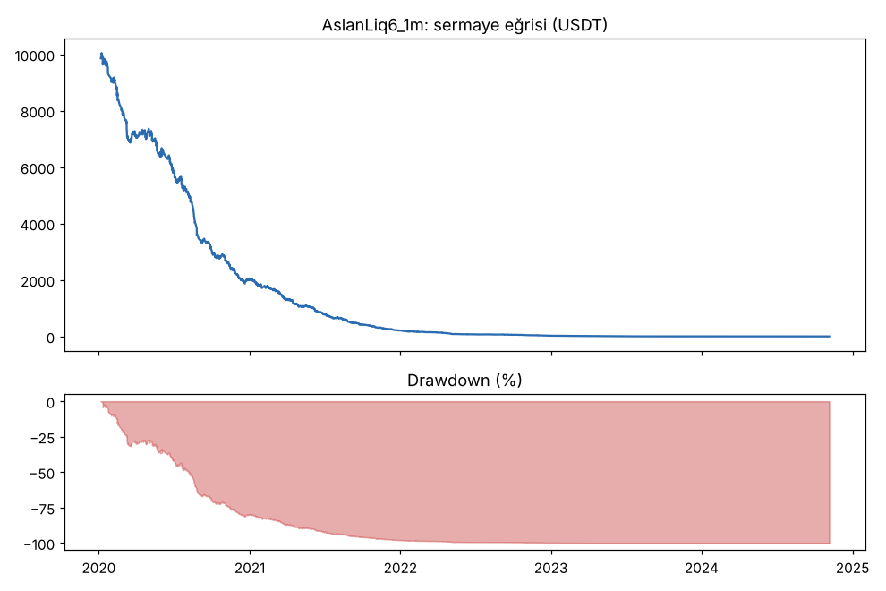
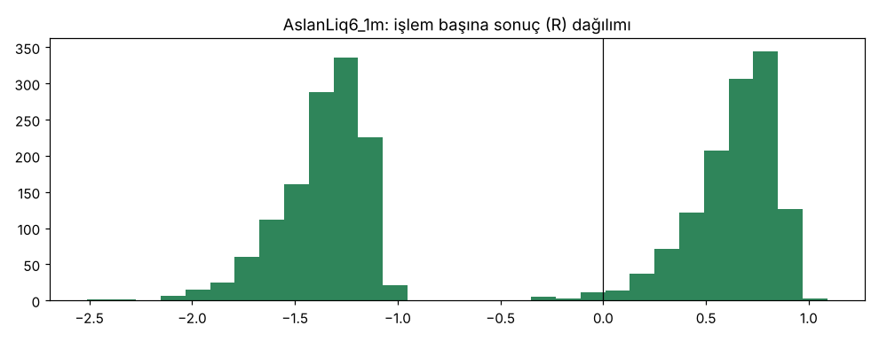

# AslanLiq6_1m — v6_1m — 2026-10-09

## Özet
- **AslanLiq6_1m**: 2508 işlem, işlem başına ortalama **-0.37R** (maliyet ve funding dahil), net getiri -100.0%, en büyük düşüş 100.0%.
- Aynı dönemde coinleri al-tut (eşit ağırlık): getiri 2358.2%, ortalama en büyük düşüş 87.0%.

## Ayarlar
- Dönem: 2020-01-02 16:00:00 → 2025-01-01 00:00:00
- Coinler: BTC/USDT:USDT, ETH/USDT:USDT, ADA/USDT:USDT, SOL/USDT:USDT, XRP/USDT:USDT
- Zaman dilimi: 1m
- Yön: long + short
- Mod: futures / isolated
- Kaldıraç: en fazla 20x, likidasyon stop mesafesinin en az 2 katı uzakta (bölüm 7.6)
- Risk: işlem başına sermayenin %1'i (pozisyon büyüklüğü stop mesafesine göre)
- Maliyet: her emir için %0.05 komisyon + %0.05 kayma (= %0.1), funding geçmiş veriden
- Başlangıç sermayesi: 10000 USDT

## Metrikler
| Metrik | AslanLiq6_1m | Al-tut |
|---|---|---|
| Net getiri | -100.0% | 2358.2% |
| Max drawdown | 100.0% | 87.0% |
| Profit factor | 0.52 | — |
| Ortalama R | -0.37 | — |
| İşlem sayısı | 2508 | — |
| Winrate | 49.2% | — |

Winrate tek başına başarı ölçütü değildir; asıl ölçüt ortalama R (expectancy) ve drawdown'dur.

## Long / short ayrımı
| Strateji | Yön | İşlem | Ortalama R | Toplam R | Profit factor |
|---|---|---|---|---|---|
| AslanLiq6_1m | long | 1309 | -0.33 | -431.78 | 0.58 |
| AslanLiq6_1m | short | 1199 | -0.42 | -498.17 | 0.44 |

## Sinyal istatistikleri
| Strateji | Stop | BE | TP1 sonrası BE | TP2 | Diğer | İptal (bölgeye gelmedi / önce stop) | Toplam funding (USDT) |
|---|---|---|---|---|---|---|---|
| AslanLiq6_1m | 50.0% | 0.1% | 0.0% | 49.8% | 0.0% | 1.5% | -153.20 |

## Coin bazında
| Strateji | Coin | İşlem | Ortalama R | Toplam R | Al-tut getirisi |
|---|---|---|---|---|---|
| AslanLiq6_1m | BTC/USDT:USDT | 490 | -0.41 | -201.94 | 1213.3% |
| AslanLiq6_1m | ETH/USDT:USDT | 591 | -0.48 | -282.00 | 2477.4% |
| AslanLiq6_1m | ADA/USDT:USDT | 512 | -0.35 | -177.81 | 1451.2% |
| AslanLiq6_1m | SOL/USDT:USDT | 343 | -0.23 | -79.13 | 5690.8% |
| AslanLiq6_1m | XRP/USDT:USDT | 572 | -0.33 | -189.07 | 958.2% |

## Grafikler

## Yorum: güçlü yanlar / şüpheli noktalar
_(Claude tarafından rakamlara bakılarak yazılır.)_

## Karar: devam / düzelt / emekli
_(Claude tarafından yazılır, gerekçesiyle.)_
