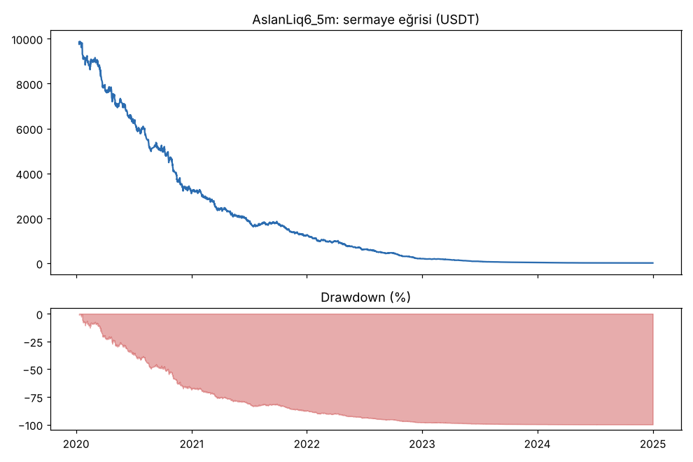
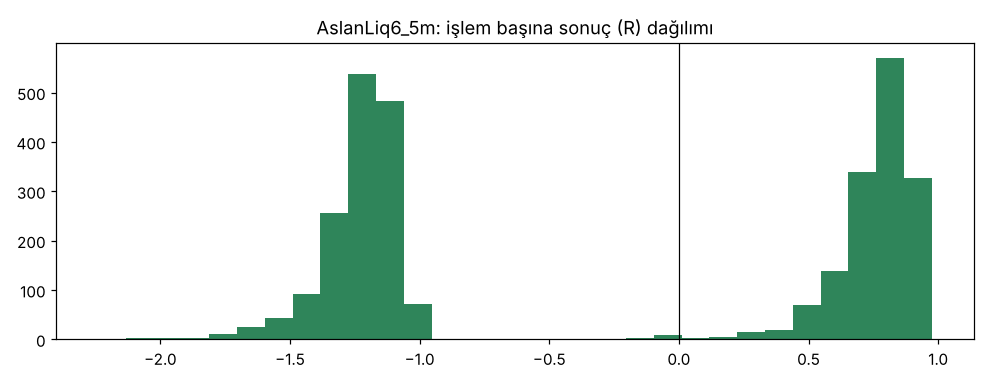

# AslanLiq6_5m — v6_5m — 2026-10-09

## Özet
- **AslanLiq6_5m**: 3022 işlem, işlem başına ortalama **-0.25R** (maliyet ve funding dahil), net getiri -99.9%, en büyük düşüş 99.9%.
- Aynı dönemde coinleri al-tut (eşit ağırlık): getiri 2278.7%, ortalama en büyük düşüş 86.8%.

## Ayarlar
- Dönem: 2020-01-09 08:00:00 → 2025-01-01 00:00:00
- Coinler: BTC/USDT:USDT, ETH/USDT:USDT, ADA/USDT:USDT, SOL/USDT:USDT, XRP/USDT:USDT
- Zaman dilimi: 5m
- Yön: long + short
- Mod: futures / isolated
- Kaldıraç: en fazla 20x, likidasyon stop mesafesinin en az 2 katı uzakta (bölüm 7.6)
- Risk: işlem başına sermayenin %1'i (pozisyon büyüklüğü stop mesafesine göre)
- Maliyet: her emir için %0.05 komisyon + %0.05 kayma (= %0.1), funding geçmiş veriden
- Başlangıç sermayesi: 10000 USDT

## Metrikler
| Metrik | AslanLiq6_5m | Al-tut |
|---|---|---|
| Net getiri | -99.9% | 2278.7% |
| Max drawdown | 99.9% | 86.8% |
| Profit factor | 0.67 | — |
| Ortalama R | -0.25 | — |
| İşlem sayısı | 3022 | — |
| Winrate | 49.2% | — |

Winrate tek başına başarı ölçütü değildir; asıl ölçüt ortalama R (expectancy) ve drawdown'dur.

## Long / short ayrımı
| Strateji | Yön | İşlem | Ortalama R | Toplam R | Profit factor |
|---|---|---|---|---|---|
| AslanLiq6_5m | long | 1598 | -0.23 | -369.20 | 0.75 |
| AslanLiq6_5m | short | 1424 | -0.26 | -371.86 | 0.59 |

## Sinyal istatistikleri
| Strateji | Stop | BE | TP1 sonrası BE | TP2 | Diğer | İptal (bölgeye gelmedi / önce stop) | Toplam funding (USDT) |
|---|---|---|---|---|---|---|---|
| AslanLiq6_5m | 50.4% | 0.3% | 0.0% | 49.3% | 0.0% | 0.6% | -168.65 |

## Coin bazında
| Strateji | Coin | İşlem | Ortalama R | Toplam R | Al-tut getirisi |
|---|---|---|---|---|---|
| AslanLiq6_5m | BTC/USDT:USDT | 571 | -0.33 | -186.06 | 1077.7% |
| AslanLiq6_5m | ETH/USDT:USDT | 704 | -0.27 | -193.08 | 2286.1% |
| AslanLiq6_5m | ADA/USDT:USDT | 654 | -0.26 | -167.57 | 1476.1% |
| AslanLiq6_5m | SOL/USDT:USDT | 435 | -0.14 | -62.26 | 5642.5% |
| AslanLiq6_5m | XRP/USDT:USDT | 658 | -0.20 | -132.09 | 911.3% |

## Grafikler

## Yorum: güçlü yanlar / şüpheli noktalar
_(Claude tarafından rakamlara bakılarak yazılır.)_

## Karar: devam / düzelt / emekli
_(Claude tarafından yazılır, gerekçesiyle.)_
