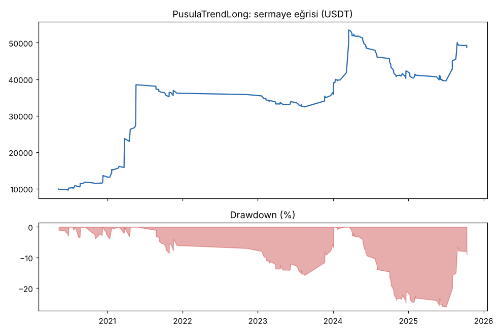
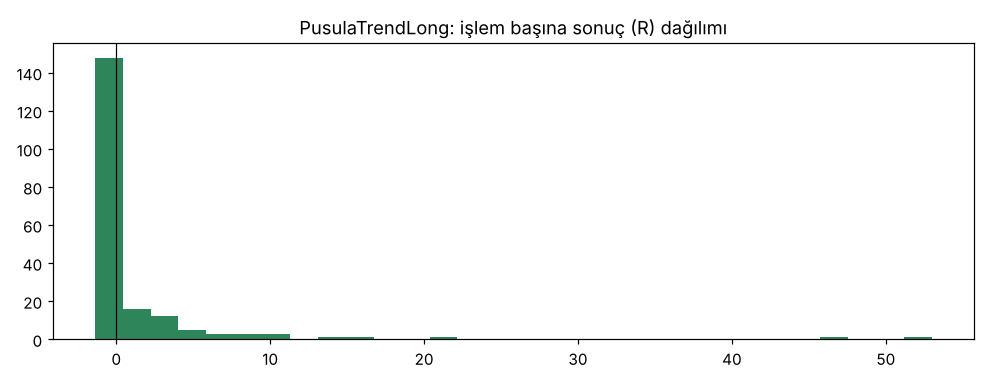

# PusulaTrendLong — genis_liste_16coin_2020_2026mart — 2026-10-09

## Özet
- **PusulaTrendLong**: 195 işlem, işlem başına ortalama **1.02R** (maliyet ve funding dahil), net getiri 387.2%, en büyük düşüş 26.1%.
- Aynı dönemde coinleri al-tut (eşit ağırlık): getiri 756.8%, ortalama en büyük düşüş 88.6%.

## Ayarlar
- Dönem: 2020-03-07 16:00:00 → 2026-04-01 00:00:00
- Coinler: BTC/USDT:USDT, ETH/USDT:USDT, SOL/USDT:USDT, XRP/USDT:USDT, BNB/USDT:USDT, DOGE/USDT:USDT, ADA/USDT:USDT, LINK/USDT:USDT, LTC/USDT:USDT, DOT/USDT:USDT, AVAX/USDT:USDT, TRX/USDT:USDT, ATOM/USDT:USDT, BCH/USDT:USDT, ETC/USDT:USDT, XLM/USDT:USDT
- Zaman dilimi: 4h
- Yön: long + short
- Mod: futures / isolated
- Kaldıraç: en fazla 3x, likidasyon stop mesafesinin en az 2 katı uzakta (bölüm 7.6)
- Risk: işlem başına sermayenin %1'i (pozisyon büyüklüğü stop mesafesine göre)
- Maliyet: her emir için %0.05 komisyon + %0.05 kayma (= %0.1), funding geçmiş veriden
- Başlangıç sermayesi: 10000 USDT

## Metrikler
| Metrik | PusulaTrendLong | Al-tut |
|---|---|---|
| Net getiri | 387.2% | 756.8% |
| Max drawdown | 26.1% | 88.6% |
| Profit factor | 2.07 | — |
| Ortalama R | 1.02 | — |
| İşlem sayısı | 195 | — |
| Winrate | 28.7% | — |

Winrate tek başına başarı ölçütü değildir; asıl ölçüt ortalama R (expectancy) ve drawdown'dur.

## Long / short ayrımı
| Strateji | Yön | İşlem | Ortalama R | Toplam R | Profit factor |
|---|---|---|---|---|---|
| PusulaTrendLong | long | 195 | 1.02 | 198.79 | 2.07 |
| PusulaTrendLong | short | 0 | — | 0.00 | — |

## Sinyal istatistikleri
| Strateji | Stop | BE | TP1 sonrası BE | TP2 | Diğer | İptal (bölgeye gelmedi / önce stop) | Toplam funding (USDT) |
|---|---|---|---|---|---|---|---|
| PusulaTrendLong | 37.4% | 12.8% | 0.0% | 0.0% | 49.7% | 5.3% | -8290.10 |

## Coin bazında
| Strateji | Coin | İşlem | Ortalama R | Toplam R | Al-tut getirisi |
|---|---|---|---|---|---|
| PusulaTrendLong | BTC/USDT:USDT | 34 | 1.61 | 54.64 | 665.8% |
| PusulaTrendLong | ETH/USDT:USDT | 28 | 0.81 | 22.68 | 779.6% |
| PusulaTrendLong | SOL/USDT:USDT | 8 | -0.37 | -2.98 | 2377.0% |
| PusulaTrendLong | XRP/USDT:USDT | 7 | -0.13 | -0.90 | 467.1% |
| PusulaTrendLong | BNB/USDT:USDT | 37 | 1.05 | 38.97 | 2976.9% |
| PusulaTrendLong | DOGE/USDT:USDT | 3 | 0.29 | 0.87 | 2372.1% |
| PusulaTrendLong | ADA/USDT:USDT | 5 | 2.72 | 13.58 | 398.7% |
| PusulaTrendLong | LINK/USDT:USDT | 6 | 0.74 | 4.45 | 97.2% |
| PusulaTrendLong | LTC/USDT:USDT | 13 | -0.35 | -4.53 | -10.9% |
| PusulaTrendLong | DOT/USDT:USDT | 2 | -0.54 | -1.08 | -63.2% |
| PusulaTrendLong | AVAX/USDT:USDT | 4 | -1.04 | -4.18 | 118.9% |
| PusulaTrendLong | TRX/USDT:USDT | 32 | 0.88 | 28.29 | 1751.6% |
| PusulaTrendLong | ATOM/USDT:USDT | 2 | -1.04 | -2.07 | -53.8% |
| PusulaTrendLong | BCH/USDT:USDT | 8 | 0.35 | 2.80 | 39.5% |
| PusulaTrendLong | ETC/USDT:USDT | 2 | 25.41 | 50.83 | 3.8% |
| PusulaTrendLong | XLM/USDT:USDT | 4 | -0.65 | -2.59 | 189.2% |

## Grafikler

## Yorum: güçlü yanlar / şüpheli noktalar
- 16 coin birlikte (Seviye 1 + yeni 10), en fazla 3 açık işlem, 2020-01 → 2026-03. Kasa dönemi dahil değil; 2025-2026 bölümü daha önce görüldü.
- +1.02R, 195 işlem, net +%387, DD %26.1. Bootstrap: ortalamanın sıfır altında olma olasılığı ~%0, rastgele sıralamada medyan DD %13.
- En iyi 10 işlem çıkarılınca bile toplam ≈ 0 (+0.5R): 6 coinlik listede bu -42.8R idi. Daha çok coin, kârı daha az şansa bağlı yapıyor.
- En fazla 6 açık işlemle: +0.65R, DD %32.5. 3 işlem sınırı daha iyi.

## Karar: devam / düzelt / emekli
**Devam.** Geniş coin listesi bu strateji için daha sağlıklı. DD %26 sınırın biraz üstünde; Seviye 2'de (dinamik evren) tekrar ele alınmalı.
