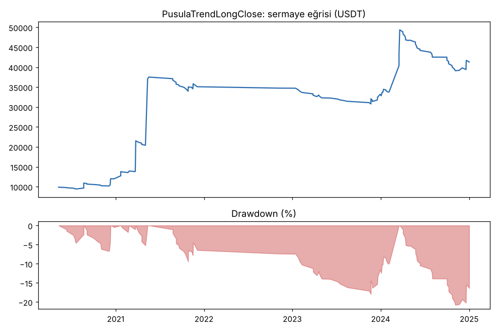
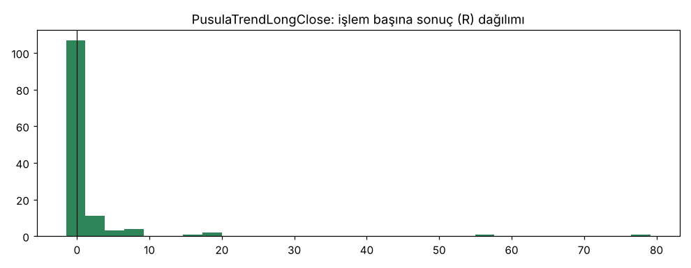
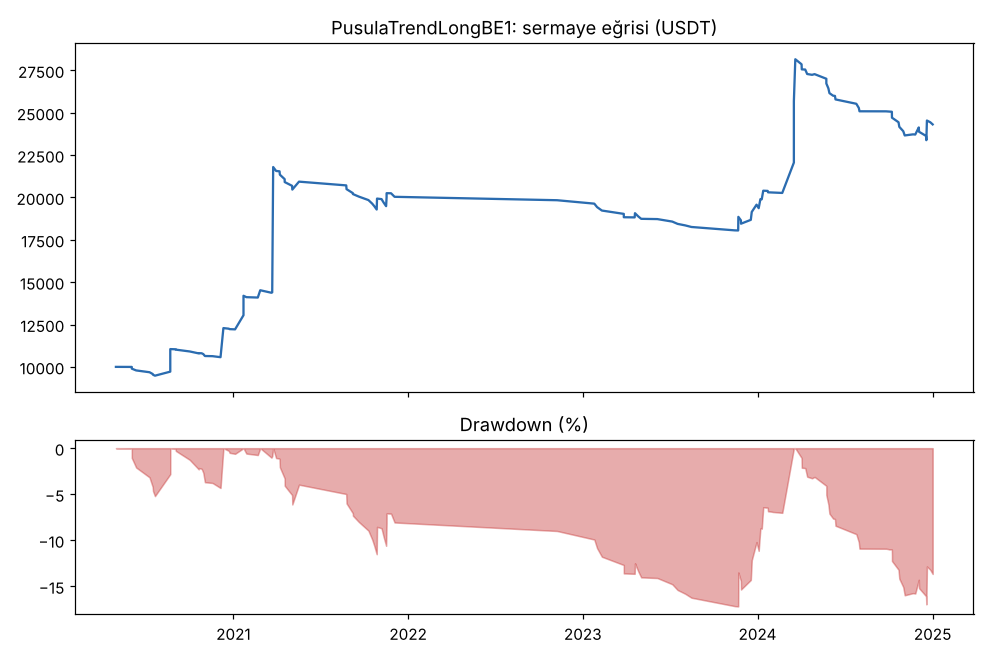
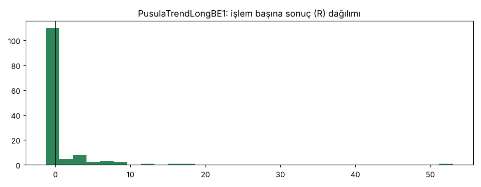

# PusulaTrendLongClose vs PusulaTrendLongBE1 — tur3_gelistirme_denemeler — 2026-10-09

## Özet
- **PusulaTrendLongClose**: 130 işlem, işlem başına ortalama **1.44R** (maliyet ve funding dahil), net getiri 312.8%, en büyük düşüş 20.8%.
- **PusulaTrendLongBE1**: 134 işlem, işlem başına ortalama **0.83R** (maliyet ve funding dahil), net getiri 143.1%, en büyük düşüş 17.0%.
- Aynı dönemde coinleri al-tut (eşit ağırlık): getiri 3406.7%, ortalama en büyük düşüş 84.1%.

## Ayarlar
- Dönem: 2020-03-07 16:00:00 → 2025-01-01 00:00:00
- Coinler: BTC/USDT:USDT, ETH/USDT:USDT, SOL/USDT:USDT, XRP/USDT:USDT, BNB/USDT:USDT, DOGE/USDT:USDT
- Zaman dilimi: 4h
- Yön: long + short
- Mod: futures / isolated
- Kaldıraç: en fazla 3x, likidasyon stop mesafesinin en az 2 katı uzakta (bölüm 7.6)
- Risk: işlem başına sermayenin %1'i (pozisyon büyüklüğü stop mesafesine göre)
- Maliyet: her emir için %0.05 komisyon + %0.05 kayma (= %0.1), funding geçmiş veriden
- Başlangıç sermayesi: 10000 USDT

## Metrikler
| Metrik | PusulaTrendLongClose | PusulaTrendLongBE1 | Al-tut |
|---|---|---|---|
| Net getiri | 312.8% | 143.1% | 3406.7% |
| Max drawdown | 20.8% | 17.0% | 84.1% |
| Profit factor | 2.24 | 2.06 | — |
| Ortalama R | 1.44 | 0.83 | — |
| İşlem sayısı | 130 | 134 | — |
| Winrate | 26.2% | 22.4% | — |

Winrate tek başına başarı ölçütü değildir; asıl ölçüt ortalama R (expectancy) ve drawdown'dur.

## Long / short ayrımı
| Strateji | Yön | İşlem | Ortalama R | Toplam R | Profit factor |
|---|---|---|---|---|---|
| PusulaTrendLongClose | long | 130 | 1.44 | 187.33 | 2.24 |
| PusulaTrendLongClose | short | 0 | — | 0.00 | — |
| PusulaTrendLongBE1 | long | 134 | 0.83 | 110.92 | 2.06 |
| PusulaTrendLongBE1 | short | 0 | — | 0.00 | — |

## Sinyal istatistikleri
| Strateji | Stop | BE | TP1 sonrası BE | TP2 | Diğer | İptal (bölgeye gelmedi / önce stop) | Toplam funding (USDT) |
|---|---|---|---|---|---|---|---|
| PusulaTrendLongClose | 43.1% | 8.5% | 0.0% | 0.0% | 48.5% | 0.8% | -6330.95 |
| PusulaTrendLongBE1 | 35.8% | 26.9% | 0.0% | 0.0% | 37.3% | 7.6% | -4194.00 |

## Coin bazında
| Strateji | Coin | İşlem | Ortalama R | Toplam R | Al-tut getirisi |
|---|---|---|---|---|---|
| PusulaTrendLongClose | BTC/USDT:USDT | 34 | 1.28 | 43.65 | 954.4% |
| PusulaTrendLongClose | ETH/USDT:USDT | 33 | 0.28 | 9.38 | 1303.7% |
| PusulaTrendLongClose | SOL/USDT:USDT | 11 | -0.21 | -2.33 | 5552.9% |
| PusulaTrendLongClose | XRP/USDT:USDT | 9 | 0.20 | 1.79 | 786.4% |
| PusulaTrendLongClose | BNB/USDT:USDT | 38 | 1.46 | 55.48 | 3417.7% |
| PusulaTrendLongClose | DOGE/USDT:USDT | 5 | 15.87 | 79.36 | 8425.3% |
| PusulaTrendLongBE1 | BTC/USDT:USDT | 33 | 0.95 | 31.31 | 954.4% |
| PusulaTrendLongBE1 | ETH/USDT:USDT | 33 | 0.26 | 8.63 | 1303.7% |
| PusulaTrendLongBE1 | SOL/USDT:USDT | 12 | -0.18 | -2.16 | 5552.9% |
| PusulaTrendLongBE1 | XRP/USDT:USDT | 12 | 0.10 | 1.17 | 786.4% |
| PusulaTrendLongBE1 | BNB/USDT:USDT | 39 | 1.34 | 52.07 | 3417.7% |
| PusulaTrendLongBE1 | DOGE/USDT:USDT | 5 | 3.98 | 19.90 | 8425.3% |

## Grafikler

## Yorum: güçlü yanlar / şüpheli noktalar
- Geliştirme verisinde (6 coin) denenen iki değişiklik. Ana sürüm (PusulaTrendLong): +0.83R, DD %20.2.
- **Kapanıştan giriş** (+1.44R): farkın neredeyse tamamı tek işlem (DOGE 2021-04, +79R). Yeni coinlerde +0.92R (ana sürüm +1.05R).
- **1R'de BE** (+0.83R, DD %17.0): yeni coinlerde +0.41R'ye düştü.
- Ayrıca **iki vitesli çıkış** (4R kârdan sonra 4h kanal kırılınca çık): geliştirmede +0.69R (PusulaTrendLong2), daha kötü.

## Karar: devam / düzelt / emekli
**Üçü de elendi.** Geliştirmede iyi görünen değişikliklerin yeni coinlerde tutmaması, çok deneme yapmanın tehlikesini gösteriyor.
