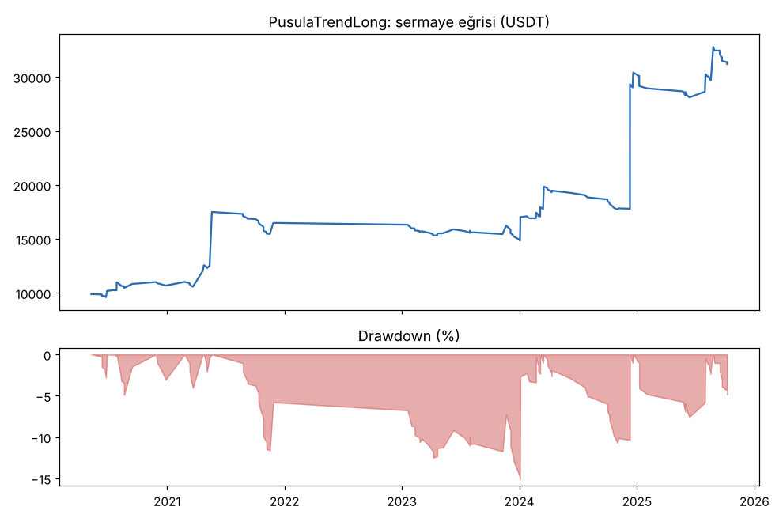
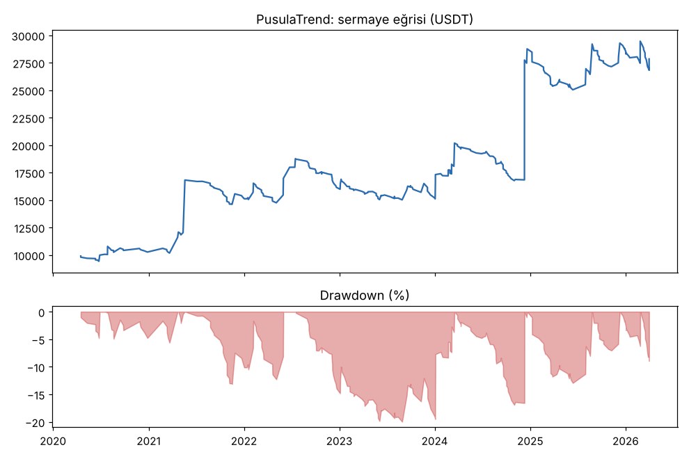
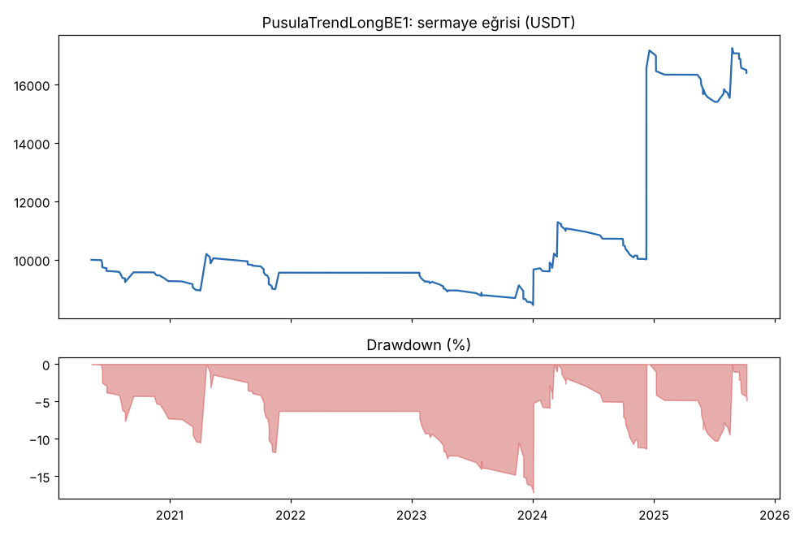
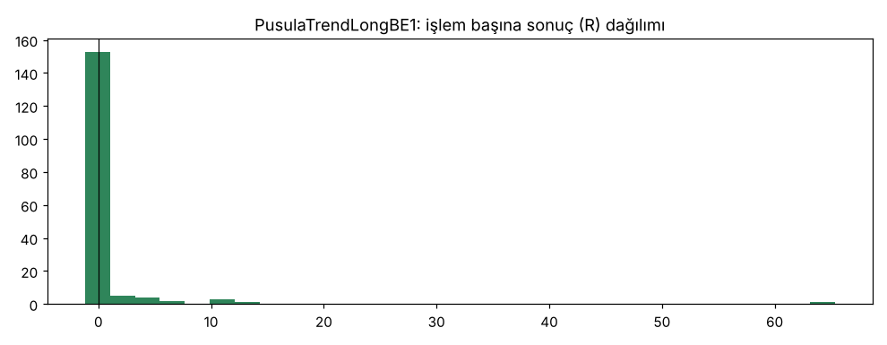
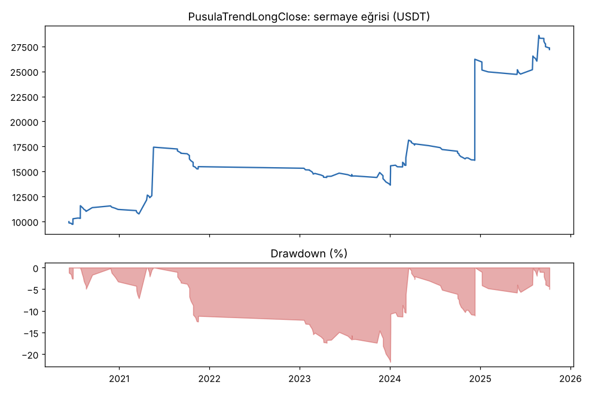
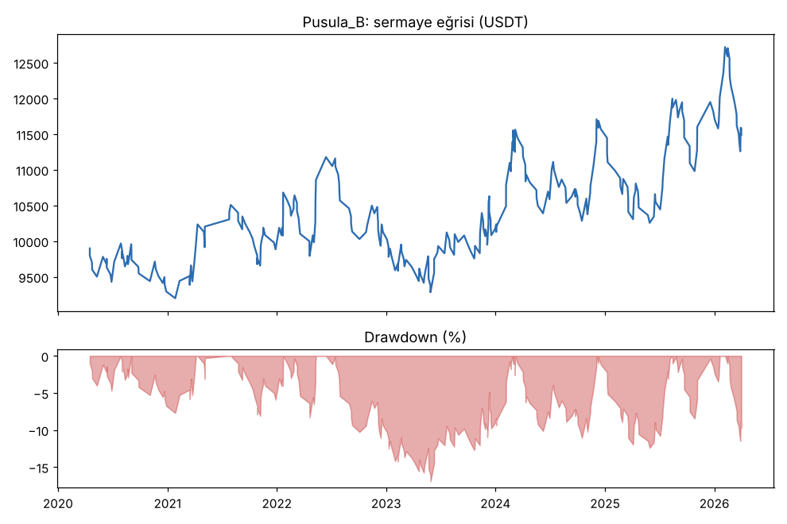
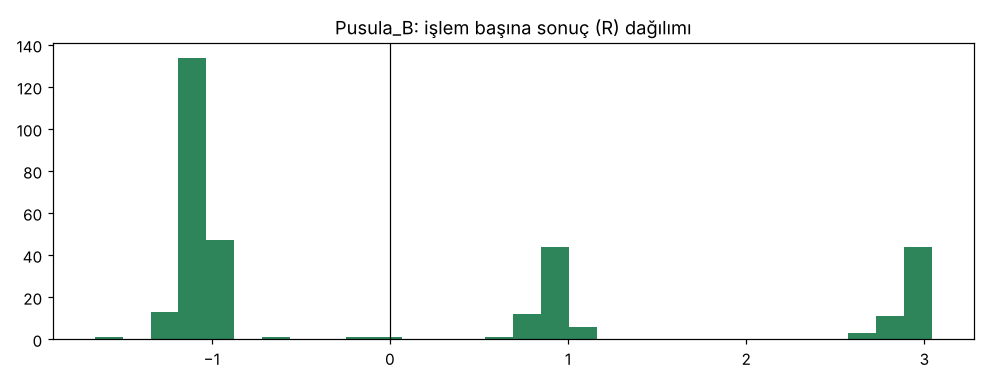

# PusulaTrendLong vs PusulaTrend vs PusulaTrendLongBE1 vs PusulaTrendLongClose vs Pusula_B — yeni_coinler_2020_2026mart — 2026-10-09

## Özet
- **PusulaTrendLong**: 144 işlem, işlem başına ortalama **1.05R** (maliyet ve funding dahil), net getiri 212.0%, en büyük düşüş 15.1%.
- **PusulaTrend**: 292 işlem, işlem başına ortalama **0.49R** (maliyet ve funding dahil), net getiri 178.4%, en büyük düşüş 20.0%.
- **PusulaTrendLongBE1**: 169 işlem, işlem başına ortalama **0.41R** (maliyet ve funding dahil), net getiri 64.0%, en büyük düşüş 10.3%.
- **PusulaTrendLongClose**: 142 işlem, işlem başına ortalama **0.92R** (maliyet ve funding dahil), net getiri 171.9%, en büyük düşüş 21.8%.
- **Pusula_B**: 319 işlem, işlem başına ortalama **0.06R** (maliyet ve funding dahil), net getiri 14.9%, en büyük düşüş 16.9%.
- Aynı dönemde coinleri al-tut (eşit ağırlık): getiri 247.1%, ortalama en büyük düşüş 91.3%.

## Ayarlar
- Dönem: 2020-03-07 16:00:00 → 2026-04-01 00:00:00
- Coinler: ADA/USDT:USDT, LINK/USDT:USDT, LTC/USDT:USDT, DOT/USDT:USDT, AVAX/USDT:USDT, TRX/USDT:USDT, ATOM/USDT:USDT, BCH/USDT:USDT, ETC/USDT:USDT, XLM/USDT:USDT
- Zaman dilimi: 4h
- Yön: long + short
- Mod: futures / isolated
- Kaldıraç: en fazla 3x, likidasyon stop mesafesinin en az 2 katı uzakta (bölüm 7.6)
- Risk: işlem başına sermayenin %1'i (pozisyon büyüklüğü stop mesafesine göre)
- Maliyet: her emir için %0.05 komisyon + %0.05 kayma (= %0.1), funding geçmiş veriden
- Başlangıç sermayesi: 10000 USDT

## Metrikler
| Metrik | PusulaTrendLong | PusulaTrend | PusulaTrendLongBE1 | PusulaTrendLongClose | Pusula_B | Al-tut |
|---|---|---|---|---|---|---|
| Net getiri | 212.0% | 178.4% | 64.0% | 171.9% | 14.9% | 247.1% |
| Max drawdown | 15.1% | 20.0% | 10.3% | 21.8% | 16.9% | 91.3% |
| Profit factor | 2.38 | 1.56 | 1.68 | 2.25 | 1.07 | — |
| Ortalama R | 1.05 | 0.49 | 0.41 | 0.92 | 0.06 | — |
| İşlem sayısı | 144 | 292 | 169 | 142 | 319 | — |
| Winrate | 25.0% | 26.7% | 15.4% | 23.2% | 37.9% | — |

Winrate tek başına başarı ölçütü değildir; asıl ölçüt ortalama R (expectancy) ve drawdown'dur.

## Long / short ayrımı
| Strateji | Yön | İşlem | Ortalama R | Toplam R | Profit factor |
|---|---|---|---|---|---|
| PusulaTrendLong | long | 144 | 1.05 | 151.63 | 2.38 |
| PusulaTrendLong | short | 0 | — | 0.00 | — |
| PusulaTrend | long | 144 | 1.05 | 151.63 | 2.37 |
| PusulaTrend | short | 148 | -0.05 | -7.96 | 0.86 |
| PusulaTrendLongBE1 | long | 169 | 0.41 | 70.08 | 1.68 |
| PusulaTrendLongBE1 | short | 0 | — | 0.00 | — |
| PusulaTrendLongClose | long | 142 | 0.92 | 131.20 | 2.25 |
| PusulaTrendLongClose | short | 0 | — | 0.00 | — |
| Pusula_B | long | 173 | 0.11 | 19.05 | 1.16 |
| Pusula_B | short | 146 | -0.01 | -0.88 | 0.97 |

## Sinyal istatistikleri
| Strateji | Stop | BE | TP1 sonrası BE | TP2 | Diğer | İptal (bölgeye gelmedi / önce stop) | Toplam funding (USDT) |
|---|---|---|---|---|---|---|---|
| PusulaTrendLong | 43.8% | 12.5% | 0.0% | 0.0% | 43.8% | 5.9% | -2655.92 |
| PusulaTrend | 42.8% | 12.0% | 0.0% | 0.0% | 45.2% | 10.4% | -3114.64 |
| PusulaTrendLongBE1 | 37.9% | 34.3% | 0.0% | 0.0% | 27.8% | 6.6% | -1402.01 |
| PusulaTrendLongClose | 43.7% | 15.5% | 0.0% | 0.0% | 40.8% | 0.0% | -2171.02 |
| Pusula_B | 61.1% | 0.0% | 19.7% | 18.2% | 0.9% | 9.9% | -1216.10 |

## Coin bazında
| Strateji | Coin | İşlem | Ortalama R | Toplam R | Al-tut getirisi |
|---|---|---|---|---|---|
| PusulaTrendLong | ADA/USDT:USDT | 10 | 0.96 | 9.57 | 398.7% |
| PusulaTrendLong | LINK/USDT:USDT | 19 | 0.41 | 7.76 | 97.2% |
| PusulaTrendLong | LTC/USDT:USDT | 19 | -0.44 | -8.42 | -10.9% |
| PusulaTrendLong | DOT/USDT:USDT | 8 | -0.11 | -0.85 | -63.2% |
| PusulaTrendLong | AVAX/USDT:USDT | 11 | -0.03 | -0.31 | 118.9% |
| PusulaTrendLong | TRX/USDT:USDT | 39 | 0.63 | 24.76 | 1751.6% |
| PusulaTrendLong | ATOM/USDT:USDT | 5 | -1.02 | -5.11 | -53.8% |
| PusulaTrendLong | BCH/USDT:USDT | 14 | 1.20 | 16.85 | 39.5% |
| PusulaTrendLong | ETC/USDT:USDT | 10 | 4.73 | 47.32 | 3.8% |
| PusulaTrendLong | XLM/USDT:USDT | 9 | 6.67 | 60.06 | 189.2% |
| PusulaTrend | ADA/USDT:USDT | 30 | 0.50 | 14.92 | 398.7% |
| PusulaTrend | LINK/USDT:USDT | 37 | 0.15 | 5.56 | 97.2% |
| PusulaTrend | LTC/USDT:USDT | 27 | -0.21 | -5.66 | -10.9% |
| PusulaTrend | DOT/USDT:USDT | 29 | 0.01 | 0.31 | -63.2% |
| PusulaTrend | AVAX/USDT:USDT | 21 | -0.33 | -6.96 | 118.9% |
| PusulaTrend | TRX/USDT:USDT | 53 | 0.41 | 21.87 | 1751.6% |
| PusulaTrend | ATOM/USDT:USDT | 19 | -0.39 | -7.34 | -53.8% |
| PusulaTrend | BCH/USDT:USDT | 33 | 0.43 | 14.22 | 39.5% |
| PusulaTrend | ETC/USDT:USDT | 24 | 1.91 | 45.78 | 3.8% |
| PusulaTrend | XLM/USDT:USDT | 19 | 3.21 | 60.98 | 189.2% |
| PusulaTrendLongBE1 | ADA/USDT:USDT | 11 | 0.34 | 3.77 | 398.7% |
| PusulaTrendLongBE1 | LINK/USDT:USDT | 23 | -0.23 | -5.40 | 97.2% |
| PusulaTrendLongBE1 | LTC/USDT:USDT | 24 | -0.47 | -11.37 | -10.9% |
| PusulaTrendLongBE1 | DOT/USDT:USDT | 10 | -0.11 | -1.14 | -63.2% |
| PusulaTrendLongBE1 | AVAX/USDT:USDT | 11 | -0.02 | -0.21 | 118.9% |
| PusulaTrendLongBE1 | TRX/USDT:USDT | 45 | 0.61 | 27.62 | 1751.6% |
| PusulaTrendLongBE1 | ATOM/USDT:USDT | 7 | -0.88 | -6.17 | -53.8% |
| PusulaTrendLongBE1 | BCH/USDT:USDT | 16 | 0.42 | 6.71 | 39.5% |
| PusulaTrendLongBE1 | ETC/USDT:USDT | 11 | -0.34 | -3.71 | 3.8% |
| PusulaTrendLongBE1 | XLM/USDT:USDT | 11 | 5.45 | 59.99 | 189.2% |
| PusulaTrendLongClose | ADA/USDT:USDT | 10 | 0.96 | 9.60 | 398.7% |
| PusulaTrendLongClose | LINK/USDT:USDT | 17 | 0.30 | 5.15 | 97.2% |
| PusulaTrendLongClose | LTC/USDT:USDT | 20 | -0.27 | -5.50 | -10.9% |
| PusulaTrendLongClose | DOT/USDT:USDT | 10 | -0.31 | -3.15 | -63.2% |
| PusulaTrendLongClose | AVAX/USDT:USDT | 9 | -0.66 | -5.94 | 118.9% |
| PusulaTrendLongClose | TRX/USDT:USDT | 40 | 0.56 | 22.31 | 1751.6% |
| PusulaTrendLongClose | ATOM/USDT:USDT | 5 | -1.04 | -5.18 | -53.8% |
| PusulaTrendLongClose | BCH/USDT:USDT | 13 | 1.17 | 15.27 | 39.5% |
| PusulaTrendLongClose | ETC/USDT:USDT | 9 | 4.67 | 41.99 | 3.8% |
| PusulaTrendLongClose | XLM/USDT:USDT | 9 | 6.29 | 56.65 | 189.2% |
| Pusula_B | ADA/USDT:USDT | 37 | 0.34 | 12.42 | 398.7% |
| Pusula_B | LINK/USDT:USDT | 39 | -0.18 | -7.08 | 97.2% |
| Pusula_B | LTC/USDT:USDT | 33 | -0.37 | -12.34 | -10.9% |
| Pusula_B | DOT/USDT:USDT | 31 | -0.04 | -1.17 | -63.2% |
| Pusula_B | AVAX/USDT:USDT | 19 | -0.21 | -3.93 | 118.9% |
| Pusula_B | TRX/USDT:USDT | 61 | 0.27 | 16.48 | 1751.6% |
| Pusula_B | ATOM/USDT:USDT | 23 | -0.03 | -0.71 | -53.8% |
| Pusula_B | BCH/USDT:USDT | 33 | 0.15 | 4.86 | 39.5% |
| Pusula_B | ETC/USDT:USDT | 19 | 0.49 | 9.40 | 3.8% |
| Pusula_B | XLM/USDT:USDT | 24 | 0.01 | 0.26 | 189.2% |

## Grafikler

## Yorum: güçlü yanlar / şüpheli noktalar
- **Pusula'nın tasarımında hiç kullanılmayan 10 coin** (ADA, LINK, LTC, DOT, AVAX, TRX, ATOM, BCH, ETC, XLM), 2020-01 → 2026-03, kurallar değiştirilmeden. Kasa dönemi (2026-04 sonrası) dahil değil.
- **PusulaTrendLong:** +1.05R, PF 2.38, DD %15.1, 144 işlem, net +%212. Yıllara göre long R: 2020 +7.5, 2021 +59.6, 2023 +4.3, 2024 +76.3, 2025 +4.0 (2022'de işlem yok). 10 coinin 6'sı artıda (ADA, LINK, TRX, BCH, ETC, XLM; DOT/AVAX başa baş, LTC ve ATOM eksi).
- **PusulaTrend (long+short):** +0.49R, PF 1.56, DD %20.0. Short'lar yine başa baş: 148 işlem, -0.05R (2022'de +0.19R, diğer yıllarda eksi).
- Geliştirmede denenen üç "iyileştirme" bu coinlerde tutmadı: 1R'de BE +0.41R (ana sürüm +1.05R), kapanıştan giriş +0.92R.
- Şüpheli nokta: kâr yine birkaç büyük trendde toplanıyor (en iyi 5 işlem +149R, toplam +152R). XLM ve ETC'nin büyük kısmı birkaç işlemden.
- Hayatta kalma yanılgısı: coinler bugün hâlâ listede olanlardan seçildi; o yüzden sonuç biraz iyimser olabilir.

## Karar: devam / düzelt / emekli
**Ana bulgu: trend çıkışlı long çekirdeği, hiç görmediği coinlerde de çalışıyor.** Geliştirmede seçilen ek iyileştirmeler (BE 1R, kapanıştan giriş) elendi. Short tarafı üç ayrı testte de avantaj göstermedi.
