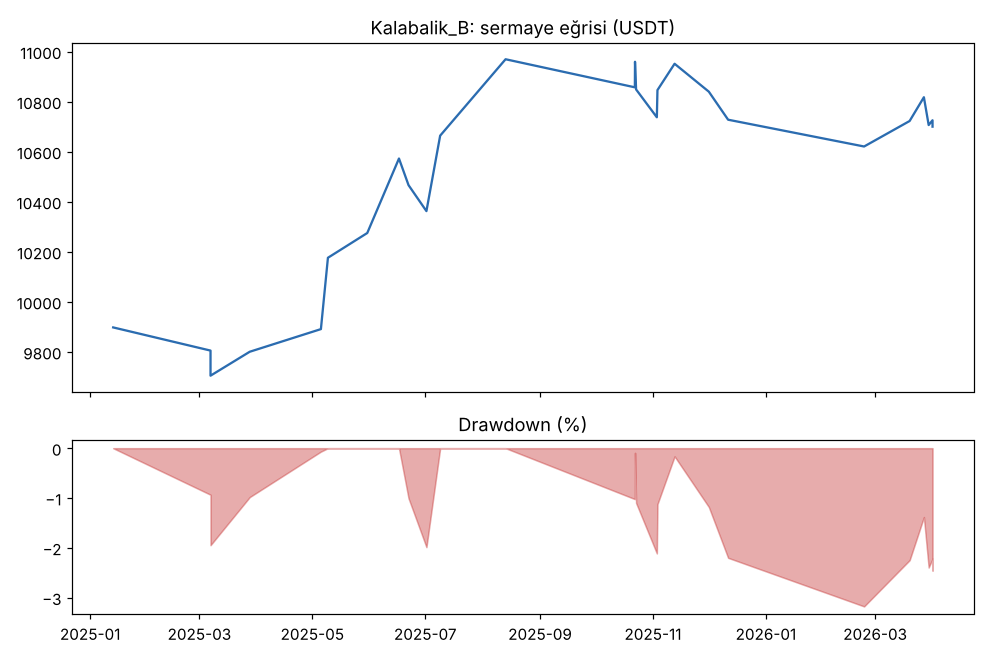
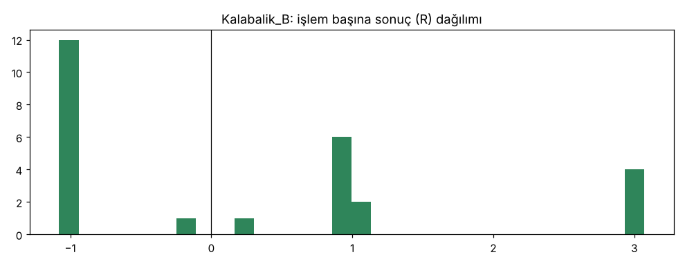

# Kalabalik_B — dogrulama_16coin — 2026-10-10

## Özet
- **Kalabalik_B**: 26 işlem, işlem başına ortalama **0.29R** (maliyet ve funding dahil), net getiri 7.0%, en büyük düşüş 3.2%.
- Aynı dönemde coinleri al-tut (eşit ağırlık): getiri -45.8%, ortalama en büyük düşüş 66.6%.

## Ayarlar
- Dönem: 2025-01-01 00:00:00 → 2026-04-01 00:00:00
- Coinler: BTC/USDT:USDT, ETH/USDT:USDT, SOL/USDT:USDT, XRP/USDT:USDT, BNB/USDT:USDT, DOGE/USDT:USDT, ADA/USDT:USDT, LINK/USDT:USDT, LTC/USDT:USDT, DOT/USDT:USDT, AVAX/USDT:USDT, TRX/USDT:USDT, ATOM/USDT:USDT, BCH/USDT:USDT, ETC/USDT:USDT, XLM/USDT:USDT
- Zaman dilimi: 4h
- Yön: long + short
- Mod: futures / isolated
- Kaldıraç: en fazla 3x, likidasyon stop mesafesinin en az 2 katı uzakta (bölüm 7.6)
- Risk: işlem başına sermayenin %1'i (pozisyon büyüklüğü stop mesafesine göre)
- Maliyet: her emir için %0.05 komisyon + %0.05 kayma (= %0.1), funding geçmiş veriden
- Başlangıç sermayesi: 10000 USDT

## Metrikler
| Metrik | Kalabalik_B | Al-tut |
|---|---|---|
| Net getiri | 7.0% | -45.8% |
| Max drawdown | 3.2% | 66.6% |
| Profit factor | 1.54 | — |
| Ortalama R | 0.29 | — |
| İşlem sayısı | 26 | — |
| Winrate | 50.0% | — |

Winrate tek başına başarı ölçütü değildir; asıl ölçüt ortalama R (expectancy) ve drawdown'dur.

## Long / short ayrımı
| Strateji | Yön | İşlem | Ortalama R | Toplam R | Profit factor |
|---|---|---|---|---|---|
| Kalabalik_B | long | 26 | 0.29 | 7.49 | 1.54 |
| Kalabalik_B | short | 0 | — | 0.00 | — |

## Sinyal istatistikleri
| Strateji | Stop | BE | TP1 sonrası BE | TP2 | Diğer | İptal (bölgeye gelmedi / önce stop) | Toplam funding (USDT) |
|---|---|---|---|---|---|---|---|
| Kalabalik_B | 46.2% | 0.0% | 30.8% | 15.4% | 7.7% | 18.8% | 26.63 |

## Coin bazında
| Strateji | Coin | İşlem | Ortalama R | Toplam R | Al-tut getirisi |
|---|---|---|---|---|---|
| Kalabalik_B | BTC/USDT:USDT | 3 | 0.28 | 0.85 | -27.4% |
| Kalabalik_B | ETH/USDT:USDT | 0 | — | 0.00 | -37.3% |
| Kalabalik_B | SOL/USDT:USDT | 4 | 1.51 | 6.03 | -56.2% |
| Kalabalik_B | XRP/USDT:USDT | 4 | -0.04 | -0.14 | -36.0% |
| Kalabalik_B | BNB/USDT:USDT | 0 | — | 0.00 | -12.5% |
| Kalabalik_B | DOGE/USDT:USDT | 2 | -1.04 | -2.07 | -71.0% |
| Kalabalik_B | ADA/USDT:USDT | 0 | — | 0.00 | -71.2% |
| Kalabalik_B | LINK/USDT:USDT | 0 | — | 0.00 | -56.0% |
| Kalabalik_B | LTC/USDT:USDT | 1 | 0.18 | 0.18 | -48.1% |
| Kalabalik_B | DOT/USDT:USDT | 2 | -1.01 | -2.02 | -81.1% |
| Kalabalik_B | AVAX/USDT:USDT | 0 | — | 0.00 | -74.9% |
| Kalabalik_B | TRX/USDT:USDT | 0 | — | 0.00 | 23.5% |
| Kalabalik_B | ATOM/USDT:USDT | 3 | -0.35 | -1.04 | -72.6% |
| Kalabalik_B | BCH/USDT:USDT | 3 | 1.01 | 3.02 | 6.3% |
| Kalabalik_B | ETC/USDT:USDT | 2 | 0.37 | 0.74 | -67.6% |
| Kalabalik_B | XLM/USDT:USDT | 2 | 0.97 | 1.94 | -50.0% |

## Grafikler

## Yorum: güçlü yanlar / şüpheli noktalar
26 işlem, hepsi long: 2025'te funding hiç 'aşırı kalabalık long' seviyesine çıkmadı. Al-tut -%46 iken strateji +%7. Örnek küçük.

## Karar: devam / düzelt / emekli
Geçti; kasa testine bir kez girdi.
