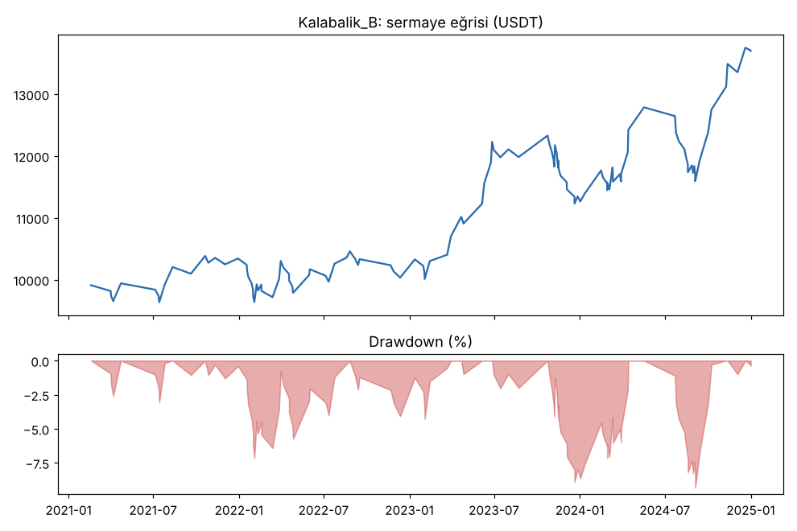
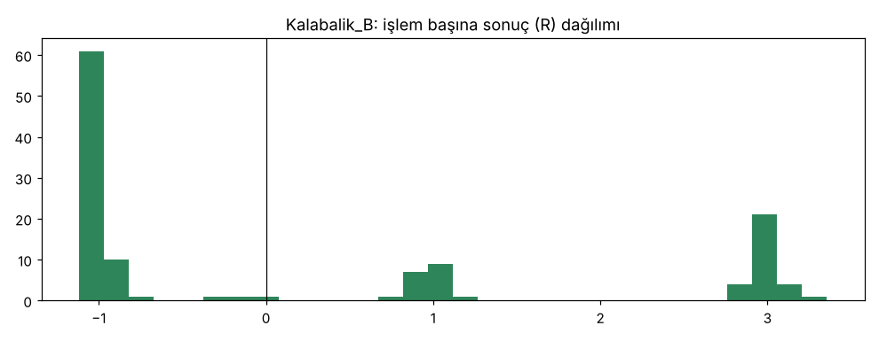

# Kalabalik_B — ilk_backtest_gelistirme_16coin — 2026-10-10

## Özet
- **Kalabalik_B**: 123 işlem, işlem başına ortalama **0.28R** (maliyet ve funding dahil), net getiri 37.0%, en büyük düşüş 9.3%.
- Aynı dönemde coinleri al-tut (eşit ağırlık): getiri 1597.1%, ortalama en büyük düşüş 87.9%.

## Ayarlar
- Dönem: 2020-03-07 16:00:00 → 2025-01-01 00:00:00
- Coinler: BTC/USDT:USDT, ETH/USDT:USDT, SOL/USDT:USDT, XRP/USDT:USDT, BNB/USDT:USDT, DOGE/USDT:USDT, ADA/USDT:USDT, LINK/USDT:USDT, LTC/USDT:USDT, DOT/USDT:USDT, AVAX/USDT:USDT, TRX/USDT:USDT, ATOM/USDT:USDT, BCH/USDT:USDT, ETC/USDT:USDT, XLM/USDT:USDT
- Zaman dilimi: 4h
- Yön: long + short
- Mod: futures / isolated
- Kaldıraç: en fazla 3x, likidasyon stop mesafesinin en az 2 katı uzakta (bölüm 7.6)
- Risk: işlem başına sermayenin %1'i (pozisyon büyüklüğü stop mesafesine göre)
- Maliyet: her emir için %0.05 komisyon + %0.05 kayma (= %0.1), funding geçmiş veriden
- Başlangıç sermayesi: 10000 USDT

## Metrikler
| Metrik | Kalabalik_B | Al-tut |
|---|---|---|
| Net getiri | 37.0% | 1597.1% |
| Max drawdown | 9.3% | 87.9% |
| Profit factor | 1.46 | — |
| Ortalama R | 0.28 | — |
| İşlem sayısı | 123 | — |
| Winrate | 39.0% | — |

Winrate tek başına başarı ölçütü değildir; asıl ölçüt ortalama R (expectancy) ve drawdown'dur.

## Long / short ayrımı
| Strateji | Yön | İşlem | Ortalama R | Toplam R | Profit factor |
|---|---|---|---|---|---|
| Kalabalik_B | long | 78 | 0.38 | 29.98 | 1.71 |
| Kalabalik_B | short | 45 | 0.09 | 4.04 | 1.11 |

## Sinyal istatistikleri
| Strateji | Stop | BE | TP1 sonrası BE | TP2 | Diğer | İptal (bölgeye gelmedi / önce stop) | Toplam funding (USDT) |
|---|---|---|---|---|---|---|---|
| Kalabalik_B | 59.3% | 0.0% | 14.6% | 24.4% | 1.6% | 13.4% | 474.36 |

## Coin bazında
| Strateji | Coin | İşlem | Ortalama R | Toplam R | Al-tut getirisi |
|---|---|---|---|---|---|
| Kalabalik_B | BTC/USDT:USDT | 13 | 0.38 | 4.91 | 954.4% |
| Kalabalik_B | ETH/USDT:USDT | 8 | -0.50 | -3.97 | 1303.7% |
| Kalabalik_B | SOL/USDT:USDT | 6 | -0.50 | -3.00 | 5552.9% |
| Kalabalik_B | XRP/USDT:USDT | 7 | 0.12 | 0.84 | 786.4% |
| Kalabalik_B | BNB/USDT:USDT | 15 | -0.20 | -3.01 | 3417.7% |
| Kalabalik_B | DOGE/USDT:USDT | 5 | -0.07 | -0.35 | 8425.3% |
| Kalabalik_B | ADA/USDT:USDT | 5 | 0.66 | 3.28 | 1631.2% |
| Kalabalik_B | LINK/USDT:USDT | 5 | 0.98 | 4.89 | 348.7% |
| Kalabalik_B | LTC/USDT:USDT | 6 | 0.28 | 1.69 | 71.7% |
| Kalabalik_B | DOT/USDT:USDT | 10 | -0.01 | -0.08 | 94.5% |
| Kalabalik_B | AVAX/USDT:USDT | 1 | 1.08 | 1.08 | 770.3% |
| Kalabalik_B | TRX/USDT:USDT | 10 | 1.27 | 12.70 | 1398.8% |
| Kalabalik_B | ATOM/USDT:USDT | 3 | 1.03 | 3.08 | 68.5% |
| Kalabalik_B | BCH/USDT:USDT | 11 | 0.08 | 0.83 | 31.3% |
| Kalabalik_B | ETC/USDT:USDT | 5 | 0.58 | 2.90 | 220.3% |
| Kalabalik_B | XLM/USDT:USDT | 13 | 0.63 | 8.22 | 478.0% |

## Grafikler

## Yorum: güçlü yanlar / şüpheli noktalar
Kâr birkaç büyük TP2'ye bağlı (en iyi 10 işlem +31R / toplam +34R). Short'lar zayıf (+0.09R). 2022 long'ları eksi. Düşüş çok küçük (%9).

## Karar: devam / düzelt / emekli
Önceden konan eşikleri geçti → doğrulamaya bir kez bakıldı.
