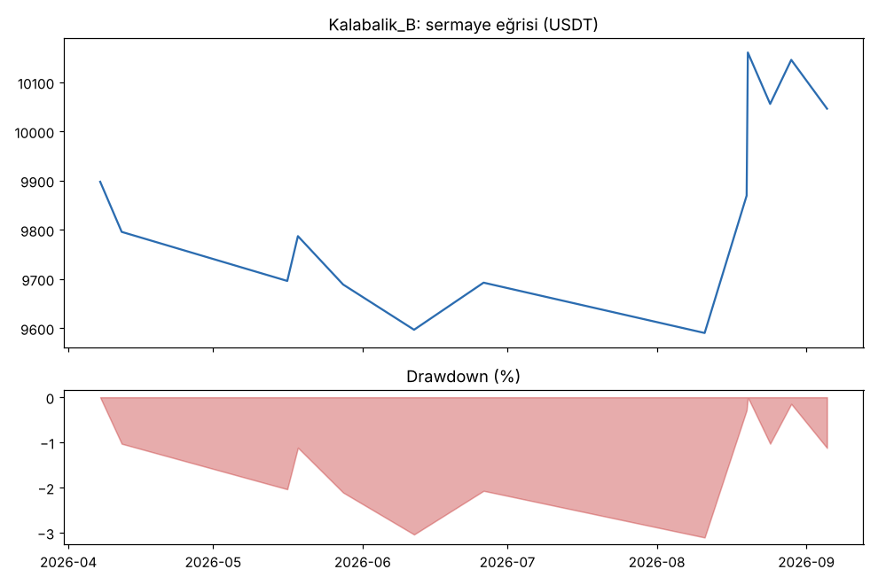
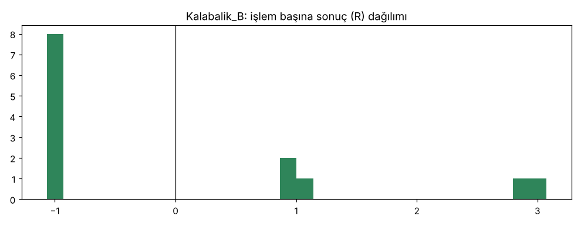

# Kalabalik_B — kasa_16coin — 2026-10-10

## Özet
- **Kalabalik_B**: 13 işlem, işlem başına ortalama **0.05R** (maliyet ve funding dahil), net getiri 0.5%, en büyük düşüş 4.1%.
- Aynı dönemde coinleri al-tut (eşit ağırlık): getiri 17.0%, ortalama en büyük düşüş 39.2%.

## Ayarlar
- Dönem: 2026-04-01 00:00:00 → 2026-10-01 00:00:00
- Coinler: BTC/USDT:USDT, ETH/USDT:USDT, SOL/USDT:USDT, XRP/USDT:USDT, BNB/USDT:USDT, DOGE/USDT:USDT, ADA/USDT:USDT, LINK/USDT:USDT, LTC/USDT:USDT, DOT/USDT:USDT, AVAX/USDT:USDT, TRX/USDT:USDT, ATOM/USDT:USDT, BCH/USDT:USDT, ETC/USDT:USDT, XLM/USDT:USDT
- Zaman dilimi: 4h
- Yön: long + short
- Mod: futures / isolated
- Kaldıraç: en fazla 3x, likidasyon stop mesafesinin en az 2 katı uzakta (bölüm 7.6)
- Risk: işlem başına sermayenin %1'i (pozisyon büyüklüğü stop mesafesine göre)
- Maliyet: her emir için %0.05 komisyon + %0.05 kayma (= %0.1), funding geçmiş veriden
- Başlangıç sermayesi: 10000 USDT

## Metrikler
| Metrik | Kalabalik_B | Al-tut |
|---|---|---|
| Net getiri | 0.5% | 17.0% |
| Max drawdown | 4.1% | 39.2% |
| Profit factor | 1.06 | — |
| Ortalama R | 0.05 | — |
| İşlem sayısı | 13 | — |
| Winrate | 38.5% | — |

Winrate tek başına başarı ölçütü değildir; asıl ölçüt ortalama R (expectancy) ve drawdown'dur.

## Long / short ayrımı
| Strateji | Yön | İşlem | Ortalama R | Toplam R | Profit factor |
|---|---|---|---|---|---|
| Kalabalik_B | long | 10 | 0.18 | 1.80 | 1.27 |
| Kalabalik_B | short | 3 | -0.38 | -1.14 | 0.44 |

## Sinyal istatistikleri
| Strateji | Stop | BE | TP1 sonrası BE | TP2 | Diğer | İptal (bölgeye gelmedi / önce stop) | Toplam funding (USDT) |
|---|---|---|---|---|---|---|---|
| Kalabalik_B | 61.5% | 0.0% | 23.1% | 15.4% | 0.0% | 18.8% | 18.16 |

## Coin bazında
| Strateji | Coin | İşlem | Ortalama R | Toplam R | Al-tut getirisi |
|---|---|---|---|---|---|
| Kalabalik_B | BTC/USDT:USDT | 3 | -0.38 | -1.14 | 22.9% |
| Kalabalik_B | ETH/USDT:USDT | 2 | 0.95 | 1.90 | 28.2% |
| Kalabalik_B | SOL/USDT:USDT | 1 | 3.07 | 3.07 | 42.3% |
| Kalabalik_B | XRP/USDT:USDT | 1 | -1.07 | -1.07 | 11.3% |
| Kalabalik_B | BNB/USDT:USDT | 0 | — | 0.00 | 24.8% |
| Kalabalik_B | DOGE/USDT:USDT | 0 | — | 0.00 | 3.6% |
| Kalabalik_B | ADA/USDT:USDT | 0 | — | 0.00 | 2.2% |
| Kalabalik_B | LINK/USDT:USDT | 0 | — | 0.00 | 64.5% |
| Kalabalik_B | LTC/USDT:USDT | 1 | -1.00 | -1.00 | 24.9% |
| Kalabalik_B | DOT/USDT:USDT | 1 | -1.04 | -1.04 | -0.6% |
| Kalabalik_B | AVAX/USDT:USDT | 0 | — | 0.00 | 24.2% |
| Kalabalik_B | TRX/USDT:USDT | 3 | 0.32 | 0.95 | 7.0% |
| Kalabalik_B | ATOM/USDT:USDT | 0 | — | 0.00 | 4.9% |
| Kalabalik_B | BCH/USDT:USDT | 1 | -1.02 | -1.02 | -33.4% |
| Kalabalik_B | ETC/USDT:USDT | 0 | — | 0.00 | 10.4% |
| Kalabalik_B | XLM/USDT:USDT | 0 | — | 0.00 | 34.8% |

## Grafikler

## Yorum: güçlü yanlar / şüpheli noktalar
13 işlem, +0.05R: kâğıt üstünde eşiğin üstünde ama başa baş. 3 short'un üçü de zararda.

## Karar: devam / düzelt / emekli
'active' yapılmadı. Kurallar değişmeden ileriye dönük kağıt takibe alınır (aylık).
