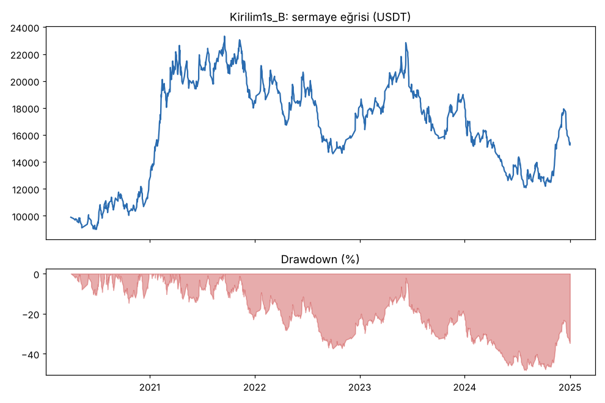
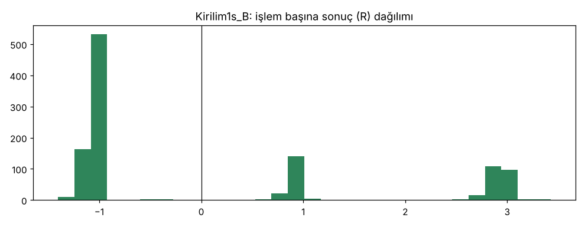
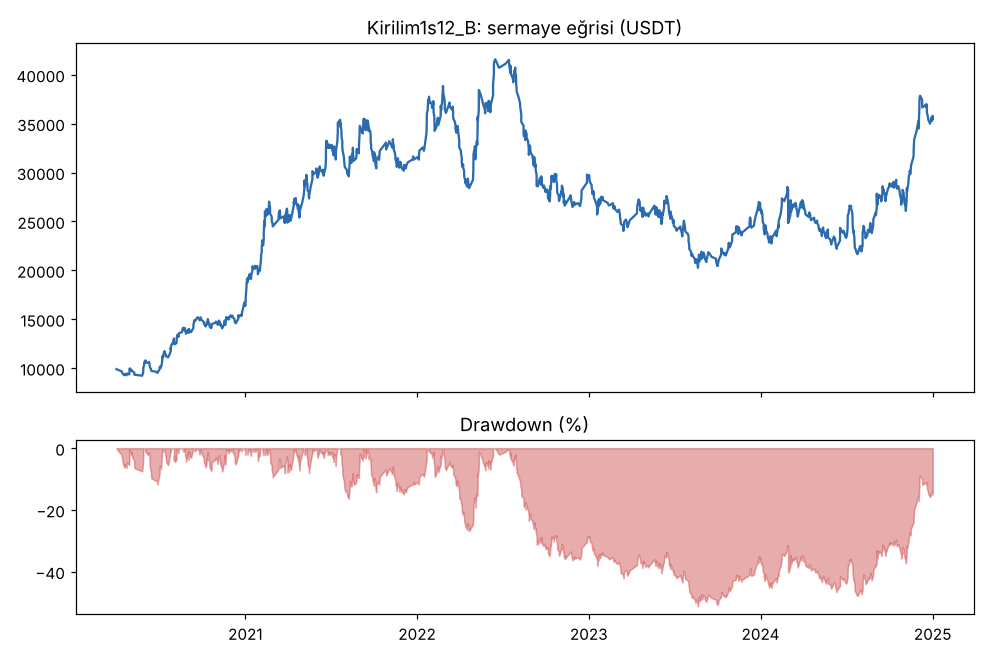
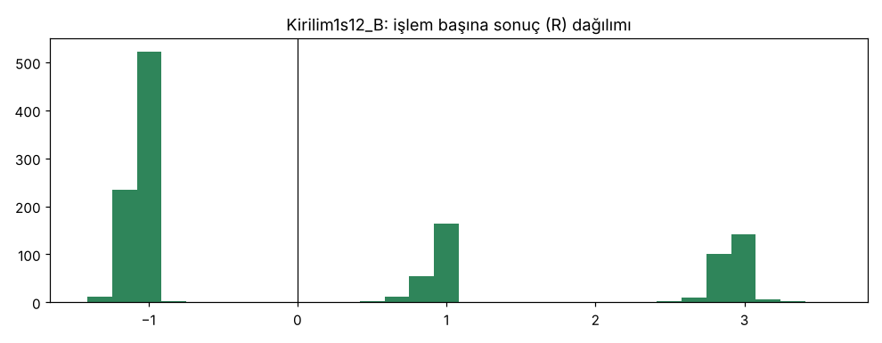
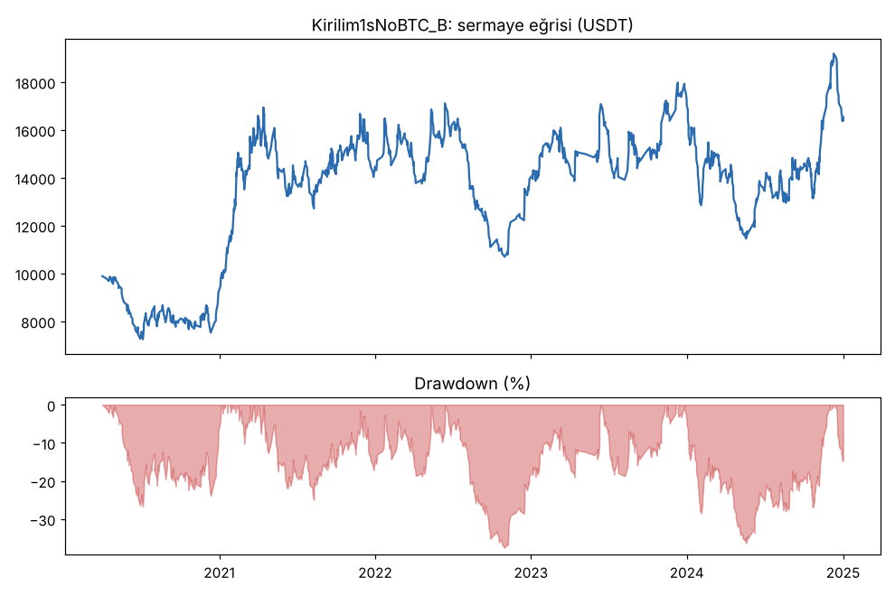
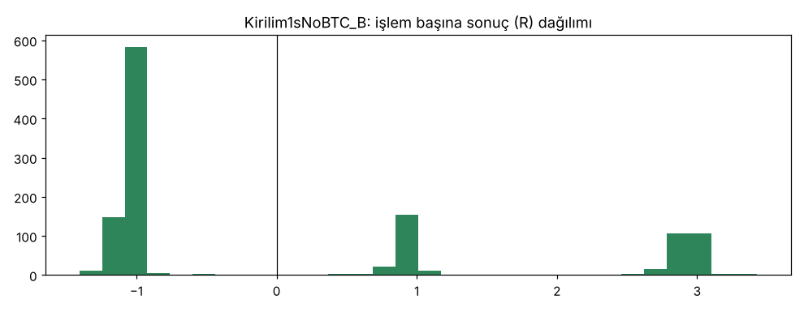

# Kirilim1s_B vs Kirilim1s12_B vs Kirilim1sNoBTC_B — gelistirme_36coin — 2026-10-10

## GUO'ya not
- **Kâr var mı?** Çok az. Masraf ve funding sonrası işlem başına +0.06R (5 yılda kasa +%53), ama yolda kasa %48 düştü. Masraf iki katına çıkınca kâr sıfırlanıyor (+0.006R, net -%17). Long tarafı artıda (+0.12R), short tarafı eksi (-0.04R).
- **Günde kaç işlem?** 36 coinde günde 0.6 işlem (5 yılda 1112). Hedef 1-3 idi, tutmadı: sinyal çok, ama işlemler ortalama 3.5 gün sürdüğü için 3 işlem yuvası hep dolu.
- **Karar:** geçme şartlarını sağlamadı (PF 1.04 < 1.2, düşüş %48 > %25). Emekliye ayrıldı; doğrulama ve kasa verisine bakılmadı. Pusula ve demo bundan etkilenmiyor.
- **Sonraki adım:** 1 saatlik grafikte trend yönünde kırılımın masraf öncesi küçük bir avantajı var (+0.12R), geri çekilmede (Nabız) hiç yoktu. Günde 1-3 işlem için asıl engel 3 işlem sınırı ve uzun süren işlemler; bunu çözmeden sık işlem hedefi bu kurallarla tutmaz. Yeni fikir ayrı kartla, kurallar önceden sabitlenerek denenmeli.

## Özet
- **Kirilim1s_B**: 1112 işlem, işlem başına ortalama **0.06R** (maliyet ve funding dahil), net getiri 52.6%, en büyük düşüş 48.2%.
- **Kirilim1s12_B**: 1270 işlem, işlem başına ortalama **0.12R** (maliyet ve funding dahil), net getiri 254.9%, en büyük düşüş 51.3%.
- **Kirilim1sNoBTC_B**: 1180 işlem, işlem başına ortalama **0.06R** (maliyet ve funding dahil), net getiri 65.4%, en büyük düşüş 36.3%.
- Aynı dönemde coinleri al-tut (eşit ağırlık): getiri 814.7%, ortalama en büyük düşüş 92.4%.

## Ayarlar
- Dönem: 2020-01-17 16:00:00 → 2025-01-01 00:00:00
- Coinler: BTC/USDT:USDT, ETH/USDT:USDT, SOL/USDT:USDT, XRP/USDT:USDT, BNB/USDT:USDT, DOGE/USDT:USDT, ADA/USDT:USDT, LINK/USDT:USDT, LTC/USDT:USDT, DOT/USDT:USDT, AVAX/USDT:USDT, TRX/USDT:USDT, ATOM/USDT:USDT, BCH/USDT:USDT, ETC/USDT:USDT, XLM/USDT:USDT, FIL/USDT:USDT, UNI/USDT:USDT, AAVE/USDT:USDT, NEAR/USDT:USDT, ALGO/USDT:USDT, XTZ/USDT:USDT, THETA/USDT:USDT, VET/USDT:USDT, ICP/USDT:USDT, SAND/USDT:USDT, MANA/USDT:USDT, AXS/USDT:USDT, EGLD/USDT:USDT, HBAR/USDT:USDT, CHZ/USDT:USDT, ENJ/USDT:USDT, ZEC/USDT:USDT, DASH/USDT:USDT, NEO/USDT:USDT, IOTA/USDT:USDT
- Zaman dilimi: 1h
- Yön: long + short
- Mod: futures / isolated
- Kaldıraç: en fazla 3x, likidasyon stop mesafesinin en az 2 katı uzakta (bölüm 7.6)
- Risk: işlem başına sermayenin %1'i (pozisyon büyüklüğü stop mesafesine göre)
- Maliyet: her emir için %0.05 komisyon + %0.05 kayma (= %0.1), funding geçmiş veriden
- Başlangıç sermayesi: 10000 USDT

## Metrikler
| Metrik | Kirilim1s_B | Kirilim1s12_B | Kirilim1sNoBTC_B | Al-tut |
|---|---|---|---|---|
| Net getiri | 52.6% | 254.9% | 65.4% | 814.7% |
| Max drawdown | 48.2% | 51.3% | 36.3% | 92.4% |
| Profit factor | 1.04 | 1.12 | 1.06 | — |
| Ortalama R | 0.06 | 0.12 | 0.06 | — |
| İşlem sayısı | 1112 | 1270 | 1180 | — |
| Winrate | 36.0% | 39.2% | 36.4% | — |

Winrate tek başına başarı ölçütü değildir; asıl ölçüt ortalama R (expectancy) ve drawdown'dur.

## Long / short ayrımı
| Strateji | Yön | İşlem | Ortalama R | Toplam R | Profit factor |
|---|---|---|---|---|---|
| Kirilim1s_B | long | 694 | 0.12 | 82.58 | 1.11 |
| Kirilim1s_B | short | 418 | -0.04 | -14.71 | 0.93 |
| Kirilim1s12_B | long | 763 | 0.15 | 111.25 | 1.12 |
| Kirilim1s12_B | short | 507 | 0.09 | 47.29 | 1.11 |
| Kirilim1sNoBTC_B | long | 689 | 0.10 | 70.90 | 1.09 |
| Kirilim1sNoBTC_B | short | 491 | 0.01 | 3.51 | 1.02 |

## Sinyal istatistikleri
| Strateji | Stop | BE | TP1 sonrası BE | TP2 | Diğer | İptal (bölgeye gelmedi / önce stop) | Toplam funding (USDT) |
|---|---|---|---|---|---|---|---|
| Kirilim1s_B | 63.8% | 0.0% | 15.4% | 20.6% | 0.3% | 8.4% | -4108.23 |
| Kirilim1s12_B | 60.6% | 0.0% | 18.3% | 20.8% | 0.2% | 8.2% | -6169.90 |
| Kirilim1sNoBTC_B | 63.5% | 0.0% | 16.3% | 20.0% | 0.3% | 8.7% | -2616.89 |

## Coin bazında
| Strateji | Coin | İşlem | Ortalama R | Toplam R | Al-tut getirisi |
|---|---|---|---|---|---|
| Kirilim1s_B | BTC/USDT:USDT | 111 | 0.02 | 2.55 | 962.4% |
| Kirilim1s_B | ETH/USDT:USDT | 74 | 0.18 | 13.15 | 1877.1% |
| Kirilim1s_B | SOL/USDT:USDT | 52 | 0.06 | 2.90 | 5616.2% |
| Kirilim1s_B | XRP/USDT:USDT | 23 | -0.12 | -2.66 | 795.7% |
| Kirilim1s_B | BNB/USDT:USDT | 67 | 0.14 | 9.52 | 2729.1% |
| Kirilim1s_B | DOGE/USDT:USDT | 34 | 0.08 | 2.64 | 8497.3% |
| Kirilim1s_B | ADA/USDT:USDT | 50 | -0.15 | -7.50 | 1474.4% |
| Kirilim1s_B | LINK/USDT:USDT | 47 | 0.08 | 3.79 | 638.9% |
| Kirilim1s_B | LTC/USDT:USDT | 30 | -0.13 | -4.04 | 71.3% |
| Kirilim1s_B | DOT/USDT:USDT | 35 | 0.34 | 11.85 | 97.0% |
| Kirilim1s_B | AVAX/USDT:USDT | 18 | 0.50 | 9.08 | 784.8% |
| Kirilim1s_B | TRX/USDT:USDT | 69 | 0.33 | 22.43 | 1343.8% |
| Kirilim1s_B | ATOM/USDT:USDT | 26 | 0.09 | 2.23 | 36.2% |
| Kirilim1s_B | BCH/USDT:USDT | 26 | 0.00 | 0.05 | 23.6% |
| Kirilim1s_B | ETC/USDT:USDT | 27 | 0.20 | 5.37 | 119.2% |
| Kirilim1s_B | XLM/USDT:USDT | 30 | 0.06 | 1.82 | 443.3% |
| Kirilim1s_B | FIL/USDT:USDT | 17 | 0.11 | 1.80 | -90.1% |
| Kirilim1s_B | UNI/USDT:USDT | 23 | -0.53 | -12.30 | 144.8% |
| Kirilim1s_B | AAVE/USDT:USDT | 17 | 0.01 | 0.23 | 660.5% |
| Kirilim1s_B | NEAR/USDT:USDT | 14 | -0.48 | -6.72 | 346.9% |
| Kirilim1s_B | ALGO/USDT:USDT | 20 | 0.36 | 7.25 | 45.0% |
| Kirilim1s_B | XTZ/USDT:USDT | 30 | -0.20 | -5.86 | -41.1% |
| Kirilim1s_B | THETA/USDT:USDT | 29 | 0.04 | 1.28 | 422.7% |
| Kirilim1s_B | VET/USDT:USDT | 23 | 0.51 | 11.71 | 467.8% |
| Kirilim1s_B | ICP/USDT:USDT | 12 | 0.12 | 1.46 | -97.8% |
| Kirilim1s_B | SAND/USDT:USDT | 11 | 0.03 | 0.35 | 483.8% |
| Kirilim1s_B | MANA/USDT:USDT | 6 | 0.28 | 1.71 | -54.2% |
| Kirilim1s_B | AXS/USDT:USDT | 18 | -0.16 | -2.90 | 1192.5% |
| Kirilim1s_B | EGLD/USDT:USDT | 15 | 0.16 | 2.34 | 159.7% |
| Kirilim1s_B | HBAR/USDT:USDT | 22 | 0.13 | 2.86 | -18.6% |
| Kirilim1s_B | CHZ/USDT:USDT | 16 | 0.08 | 1.32 | 278.4% |
| Kirilim1s_B | ENJ/USDT:USDT | 16 | -0.09 | -1.48 | 19.2% |
| Kirilim1s_B | ZEC/USDT:USDT | 32 | 0.10 | 3.06 | -13.2% |
| Kirilim1s_B | DASH/USDT:USDT | 23 | -0.19 | -4.46 | -66.0% |
| Kirilim1s_B | NEO/USDT:USDT | 27 | -0.26 | -7.12 | -3.2% |
| Kirilim1s_B | IOTA/USDT:USDT | 22 | 0.01 | 0.20 | -17.1% |
| Kirilim1s12_B | BTC/USDT:USDT | 136 | 0.10 | 13.14 | 962.4% |
| Kirilim1s12_B | ETH/USDT:USDT | 83 | 0.41 | 34.39 | 1877.1% |
| Kirilim1s12_B | SOL/USDT:USDT | 63 | 0.17 | 10.83 | 5616.2% |
| Kirilim1s12_B | XRP/USDT:USDT | 44 | -0.03 | -1.15 | 795.7% |
| Kirilim1s12_B | BNB/USDT:USDT | 80 | 0.23 | 18.12 | 2729.1% |
| Kirilim1s12_B | DOGE/USDT:USDT | 33 | -0.14 | -4.62 | 8497.3% |
| Kirilim1s12_B | ADA/USDT:USDT | 42 | -0.08 | -3.49 | 1474.4% |
| Kirilim1s12_B | LINK/USDT:USDT | 51 | 0.11 | 5.52 | 638.9% |
| Kirilim1s12_B | LTC/USDT:USDT | 55 | -0.09 | -5.14 | 71.3% |
| Kirilim1s12_B | DOT/USDT:USDT | 38 | 0.71 | 26.81 | 97.0% |
| Kirilim1s12_B | AVAX/USDT:USDT | 29 | 0.23 | 6.70 | 784.8% |
| Kirilim1s12_B | TRX/USDT:USDT | 66 | 0.15 | 9.98 | 1343.8% |
| Kirilim1s12_B | ATOM/USDT:USDT | 32 | 0.48 | 15.21 | 36.2% |
| Kirilim1s12_B | BCH/USDT:USDT | 33 | -0.17 | -5.55 | 23.6% |
| Kirilim1s12_B | ETC/USDT:USDT | 24 | 0.69 | 16.44 | 119.2% |
| Kirilim1s12_B | XLM/USDT:USDT | 34 | 0.68 | 23.14 | 443.3% |
| Kirilim1s12_B | FIL/USDT:USDT | 20 | 0.45 | 8.92 | -90.1% |
| Kirilim1s12_B | UNI/USDT:USDT | 27 | -0.40 | -10.68 | 144.8% |
| Kirilim1s12_B | AAVE/USDT:USDT | 20 | 0.04 | 0.80 | 660.5% |
| Kirilim1s12_B | NEAR/USDT:USDT | 25 | -0.33 | -8.32 | 346.9% |
| Kirilim1s12_B | ALGO/USDT:USDT | 28 | 0.18 | 4.94 | 45.0% |
| Kirilim1s12_B | XTZ/USDT:USDT | 24 | 0.01 | 0.17 | -41.1% |
| Kirilim1s12_B | THETA/USDT:USDT | 26 | -0.19 | -4.90 | 422.7% |
| Kirilim1s12_B | VET/USDT:USDT | 16 | 0.33 | 5.22 | 467.8% |
| Kirilim1s12_B | ICP/USDT:USDT | 15 | 0.94 | 14.09 | -97.8% |
| Kirilim1s12_B | SAND/USDT:USDT | 15 | -0.27 | -4.00 | 483.8% |
| Kirilim1s12_B | MANA/USDT:USDT | 5 | -0.26 | -1.29 | -54.2% |
| Kirilim1s12_B | AXS/USDT:USDT | 20 | 0.14 | 2.72 | 1192.5% |
| Kirilim1s12_B | EGLD/USDT:USDT | 25 | 0.31 | 7.84 | 159.7% |
| Kirilim1s12_B | HBAR/USDT:USDT | 20 | 0.05 | 1.02 | -18.6% |
| Kirilim1s12_B | CHZ/USDT:USDT | 19 | -0.23 | -4.36 | 278.4% |
| Kirilim1s12_B | ENJ/USDT:USDT | 9 | 0.29 | 2.58 | 19.2% |
| Kirilim1s12_B | ZEC/USDT:USDT | 35 | 0.00 | 0.10 | -13.2% |
| Kirilim1s12_B | DASH/USDT:USDT | 24 | -0.38 | -9.16 | -66.0% |
| Kirilim1s12_B | NEO/USDT:USDT | 25 | -0.04 | -0.90 | -3.2% |
| Kirilim1s12_B | IOTA/USDT:USDT | 29 | -0.23 | -6.59 | -17.1% |
| Kirilim1sNoBTC_B | BTC/USDT:USDT | 105 | 0.10 | 10.76 | 962.4% |
| Kirilim1sNoBTC_B | ETH/USDT:USDT | 63 | 0.40 | 25.27 | 1877.1% |
| Kirilim1sNoBTC_B | SOL/USDT:USDT | 45 | 0.23 | 10.49 | 5616.2% |
| Kirilim1sNoBTC_B | XRP/USDT:USDT | 47 | -0.26 | -12.44 | 795.7% |
| Kirilim1sNoBTC_B | BNB/USDT:USDT | 66 | 0.22 | 14.58 | 2729.1% |
| Kirilim1sNoBTC_B | DOGE/USDT:USDT | 43 | 0.03 | 1.46 | 8497.3% |
| Kirilim1sNoBTC_B | ADA/USDT:USDT | 57 | -0.01 | -0.59 | 1474.4% |
| Kirilim1sNoBTC_B | LINK/USDT:USDT | 46 | 0.16 | 7.50 | 638.9% |
| Kirilim1sNoBTC_B | LTC/USDT:USDT | 33 | -0.09 | -3.07 | 71.3% |
| Kirilim1sNoBTC_B | DOT/USDT:USDT | 32 | 0.72 | 23.17 | 97.0% |
| Kirilim1sNoBTC_B | AVAX/USDT:USDT | 20 | -0.27 | -5.31 | 784.8% |
| Kirilim1sNoBTC_B | TRX/USDT:USDT | 73 | 0.39 | 28.57 | 1343.8% |
| Kirilim1sNoBTC_B | ATOM/USDT:USDT | 31 | 0.10 | 3.17 | 36.2% |
| Kirilim1sNoBTC_B | BCH/USDT:USDT | 26 | -0.08 | -2.03 | 23.6% |
| Kirilim1sNoBTC_B | ETC/USDT:USDT | 27 | -0.10 | -2.80 | 119.2% |
| Kirilim1sNoBTC_B | XLM/USDT:USDT | 31 | -0.36 | -11.11 | 443.3% |
| Kirilim1sNoBTC_B | FIL/USDT:USDT | 21 | -0.01 | -0.13 | -90.1% |
| Kirilim1sNoBTC_B | UNI/USDT:USDT | 22 | -0.41 | -9.07 | 144.8% |
| Kirilim1sNoBTC_B | AAVE/USDT:USDT | 24 | 0.22 | 5.21 | 660.5% |
| Kirilim1sNoBTC_B | NEAR/USDT:USDT | 20 | -0.64 | -12.86 | 346.9% |
| Kirilim1sNoBTC_B | ALGO/USDT:USDT | 23 | 0.44 | 10.20 | 45.0% |
| Kirilim1sNoBTC_B | XTZ/USDT:USDT | 32 | -0.12 | -3.82 | -41.1% |
| Kirilim1sNoBTC_B | THETA/USDT:USDT | 31 | 0.22 | 6.79 | 422.7% |
| Kirilim1sNoBTC_B | VET/USDT:USDT | 20 | 0.64 | 12.85 | 467.8% |
| Kirilim1sNoBTC_B | ICP/USDT:USDT | 12 | -0.21 | -2.57 | -97.8% |
| Kirilim1sNoBTC_B | SAND/USDT:USDT | 13 | 0.02 | 0.23 | 483.8% |
| Kirilim1sNoBTC_B | MANA/USDT:USDT | 9 | 0.08 | 0.75 | -54.2% |
| Kirilim1sNoBTC_B | AXS/USDT:USDT | 14 | 0.50 | 6.95 | 1192.5% |
| Kirilim1sNoBTC_B | EGLD/USDT:USDT | 16 | 0.10 | 1.58 | 159.7% |
| Kirilim1sNoBTC_B | HBAR/USDT:USDT | 17 | -0.11 | -1.82 | -18.6% |
| Kirilim1sNoBTC_B | CHZ/USDT:USDT | 18 | -0.27 | -4.77 | 278.4% |
| Kirilim1sNoBTC_B | ENJ/USDT:USDT | 15 | -0.04 | -0.53 | 19.2% |
| Kirilim1sNoBTC_B | ZEC/USDT:USDT | 43 | -0.23 | -9.76 | -13.2% |
| Kirilim1sNoBTC_B | DASH/USDT:USDT | 33 | -0.27 | -8.85 | -66.0% |
| Kirilim1sNoBTC_B | NEO/USDT:USDT | 26 | -0.15 | -3.93 | -3.2% |
| Kirilim1sNoBTC_B | IOTA/USDT:USDT | 26 | 0.01 | 0.32 | -17.1% |

## Ek ölçümler (aynı geliştirme dönemi, aynı kurallar)
| Test | İşlem | Günde | Ortalama R | PF | Long R (işlem), PF | Short R (işlem), PF | Net | Max DD |
|---|---|---|---|---|---|---|---|---|
| Kirilim1s_B (ana, maliyet %0.1) | 1112 | 0.61 | +0.06 | 1.04 | +0.12 (694), 1.11 | -0.04 (418), 0.93 | +%52.6 | %48.2 |
| Kirilim1s_B masraf x2 (`--fee 0.002`) | 1112 | 0.61 | +0.006 | 0.98 | +0.07 (694), 1.07 | -0.10 (418), 0.85 | -%16.8 | %65.2 |
| Kirilim1s_B masrafsız (`--fee 0`, teşhis, kartta önceden yazıldı) | 1112 | 0.61 | +0.12 | 1.11 | +0.17 (694), 1.17 | +0.03 (418), 1.02 | +%178.5 | %37.9 |
| Kirilim1s12_B (kanal 12, teşhis) | 1270 | 0.70 | +0.12 | 1.12 | +0.15 (763), 1.12 | +0.09 (507), 1.11 | +%254.9 | %51.3 |
| Kirilim1sNoBTC_B (BTC filtresi yok, teşhis) | 1180 | 0.65 | +0.06 | 1.06 | +0.10 (689), 1.09 | +0.01 (491), 1.02 | +%65.4 | %36.3 |

Günde işlem = işlem sayısı / dönemdeki gün (1810). Rejim puanı 90 günlük geçmiş istediği için ilk işlem 2020-04-01'de; o tarihten sayınca ana sürümde günde 0.64.

- Yıl bazında (ana sürüm, işlem başı R): 2020 +0.16 (180), 2021 +0.16 (287), 2022 +0.01 (200), 2023 +0.02 (200), 2024 -0.04 (242). Kâr ilk iki yıldan; Nabız'daki gibi her yıl zayıflıyor.
- Yıl ve yön: long 2020 +0.26, 2021 +0.22, 2022 -0.72 (18 işlem), 2023 +0.14, 2024 -0.07; short 2020 -0.57, 2021 -0.08, 2022 +0.08 (182 işlem), 2023 -0.17, 2024 +0.01.
- Coin bazında: 36 coinden 26'sı artıda (eşik %50 sağlandı).
- En iyi 10 işlem çıkarılınca toplam +67.9R → +36.6R (kâr birkaç işleme bağlı değil, ama ortalama çok ince).
- Medyan stop mesafesi %4.7, ortalama işlem süresi 84 saat (3.5 gün). Masraf (giriş + çıkış ≈ %0.2, TP1'de ek emir) işlem başına ≈0.06R yiyor: masrafsız +0.12R → masraflı +0.06R.
- Funding: 5 yılda -4108 USDT; neredeyse tamamı long'lar (-4124 USDT), çünkü trend yönünde girilen long'lar kalabalıkla aynı tarafta. Short'lar ≈0.
- İşlem sıklığı neden düşük: Freqtrade 3 işlem sınırı doluyken gelen yaklaşık 15 bin sinyali reddetti (`rejected_signals`; bu sayı yer olmadığı için alınamayan tekrar eden sinyalleri de içerir). Sinyal sayısı hedefin çok üstünde; darboğaz yuva sayısı × işlem süresi (3 yuva / 3.5 gün ≈ günde en fazla 0.85 işlem).
- Hile testi (lookahead-analysis, BTC/ETH/SOL/DOGE, 2021, 30 sinyal): geleceği görme yok.
- Al-tut (36 coin eşit ağırlık) aynı dönemde +%815, ortalama en büyük düşüş %92. Strateji çok daha az getiri verdi; düşüşü daha küçük (%48) ama yine eşiğin (%25) çok üstünde.

## Grafikler

## Yorum: güçlü yanlar / şüpheli noktalar
Güçlü yan: Nabız'dan farklı olarak tetikte masraf öncesi küçük bir avantaj var (+0.12R, long +0.17R) ve coinlerin %72'si artıda; yani 1 saatlik grafikte trend yönünde kırılım, geri çekilmeden almaktan daha iyi. Zayıf yanlar: avantaj masraf + funding'e karşı çok ince (+0.06R), masraf x2'de sıfır; PF 1.04 ve düşüş %48 eşiklerin çok uzağında; kârın çoğu 2020-2021'den, 2024'te eksi; short tarafı eksi. İşlem sıklığı hedefi (günde 1-3) tutmadı: 3 işlem sınırı ve 3.5 günlük ortalama işlem süresi günde ~0.6-0.85 işlemle sınırlıyor.
Teşhis varyantları: 12 mumluk kanal daha iyi görünüyor (+0.12R, short da artıda) ama düşüşü daha büyük (%51) ve kart gereği bu turda ana sürüm yerine geçmez; BTC filtresini kaldırmak düşüşü azaltıp (%36) ortalamayı değiştirmedi. Hiçbiri eşikleri geçmiyor.

## Karar: devam / düzelt / emekli
**Emekli.** Ana sürüm (`Kirilim1s_B`) maliyet ve funding sonrası > 0R şartını kıl payı sağladı (+0.06R), coinlerin %72'si artıda ve işlem sayısı ≥ 100; ama PF 1.04 < 1.2, DD %48 > %25, masraf x2'de PF 0.98 ve net eksi ("kırılgan"), al-tutun çok gerisinde. Kartta önceden yazıldığı gibi doğrulama sadece geçerse yapılacaktı; yapılmadı. Kasa verisine dokunulmadı. Kurallar ve varyantlar sonuca bakıp değiştirilmedi.
