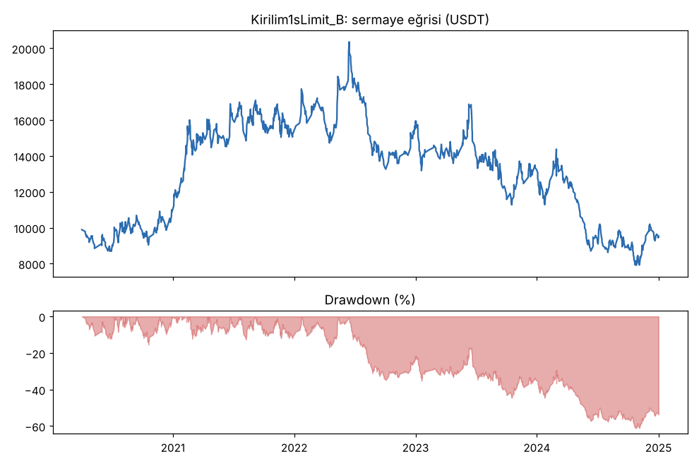
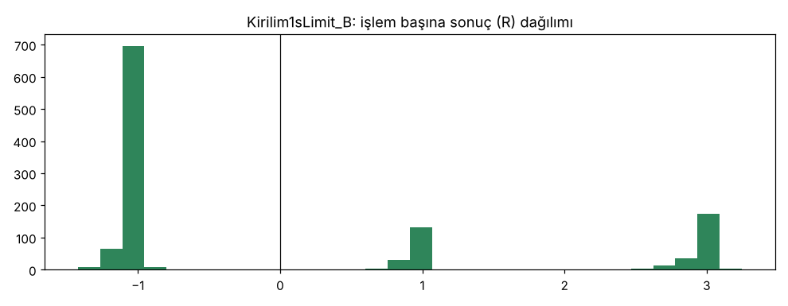
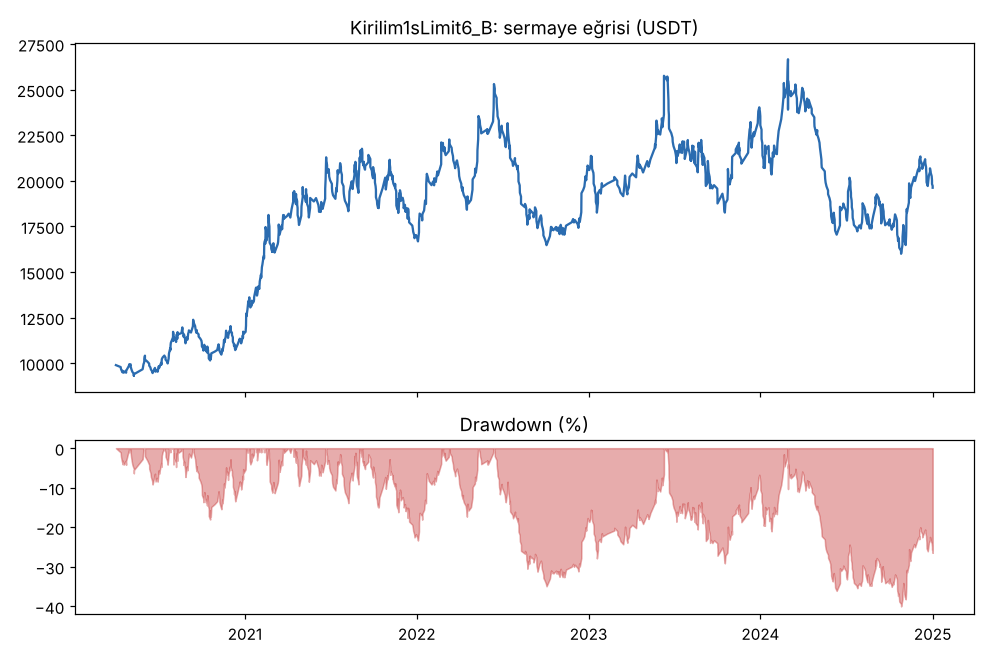
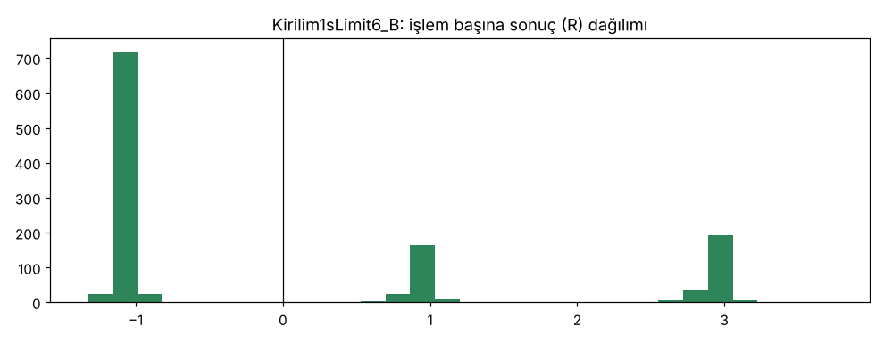
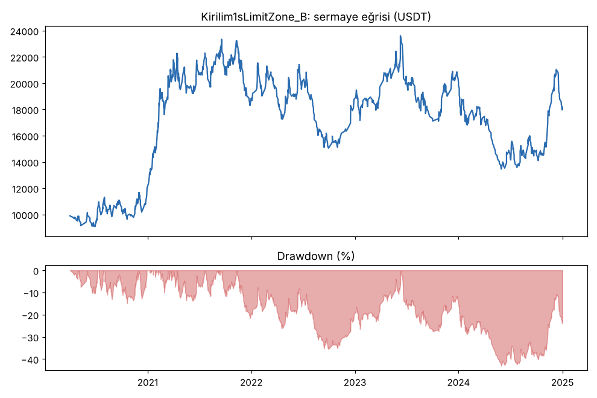
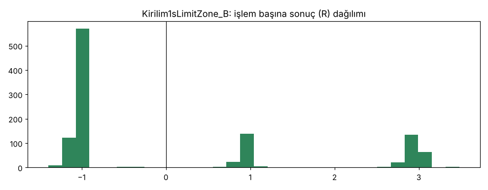
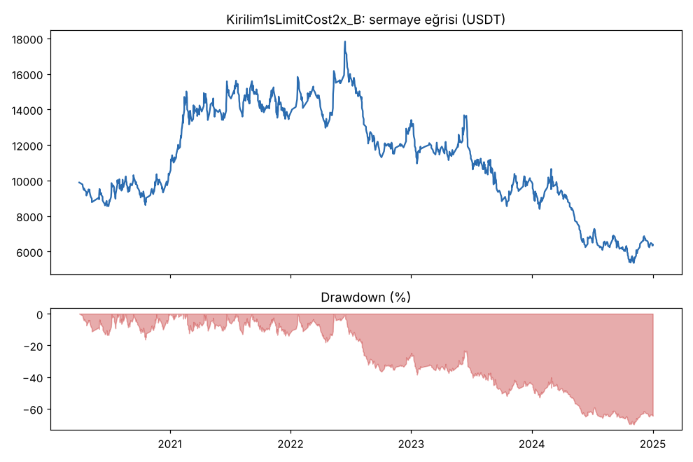
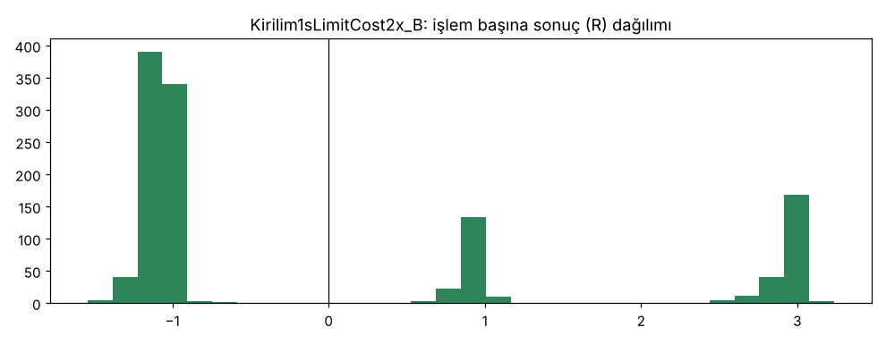
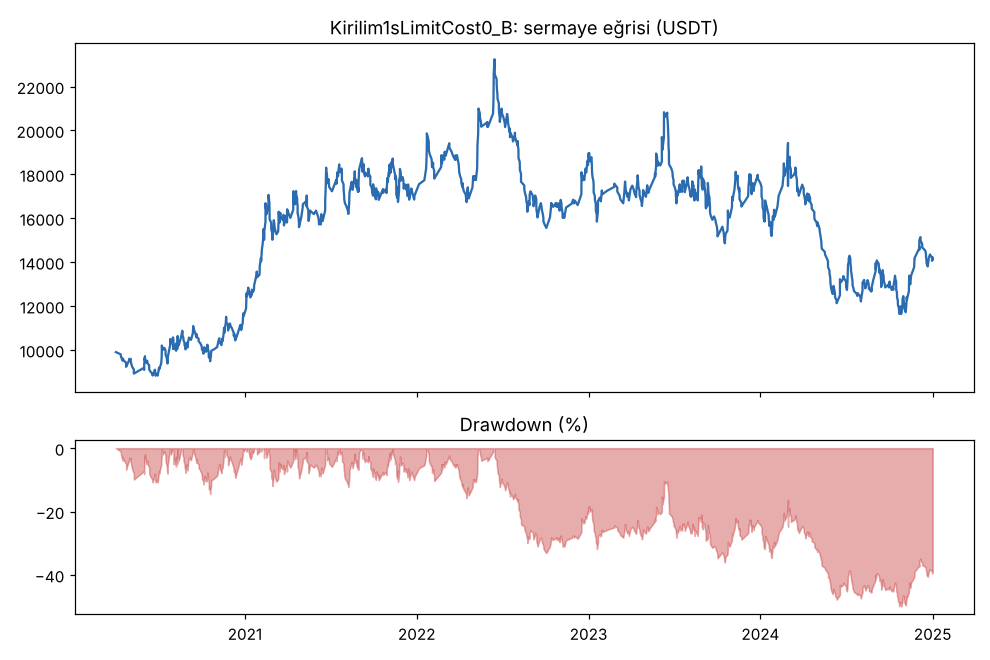
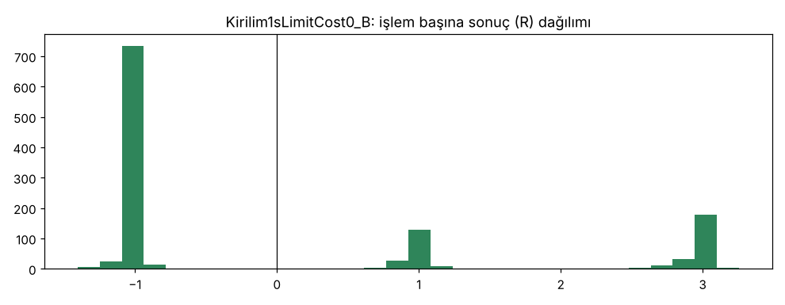

# Kirilim1sLimit (kuyruk 1c): limit emirle giriş — geliştirme 2020-2024, 36 coin — 2026-10-10

## GUO'ya not
- **Kâr var mı?** Yok. Limit emirle girmek masrafı azalttı (işlem başına ~0.06R'den ~0.03R'ye), ama kârı daha çok azalttı: ana sürüm masraf ve funding sonrası işlem başına **+0.02R**, 5 yılda kasa **-%5**, yolda düşüş **%61**.
- **Neden?** Kırılan seviyeye konan limit emir en çok kötü giden kırılımlarda doluyor. İyi kırılımlar geri gelmeden gidiyor, emir dolmuyor. Dolmayan sinyaller eski stratejide en iyi işlemlerdi (+0.44R), dolanlar ≈0R.
- **Günde kaç işlem?** 0.65 (5 yılda 1183). Hedef 1-3 idi, yine tutmadı. Emirlerin %70'i doldu.
- **Düşük ücretli borsa senaryosu** (her emir %0.03, MEXC benzeri): +0.03R, PF 1.01. O da yetmiyor. Sorun ücretten çok sinyalin avantajının küçük olması.
- **Karar ve sonraki adım:** Geçemedi, emekliye ayrıldı. Doğrulama ve kasa verisine bakılmadı. Bu kırılım sinyalinden masrafı düşürerek kâr çıkmıyor. Sık işlem için yeni bir giriş fikri gerekiyor; yeni kartla, kurallar önceden sabitlenerek.

## Ne test edildi
- Sinyaller Kırılım1s_B ile birebir aynı: günlük Pusula puanı ±3, BTC ±1, 1h kapanış önceki 24 mumun tepesini/dibini ilk kez geçiyor (`cards/kirilim1s_limit.md`).
- **Ana sürüm `Kirilim1sLimit_B`:** kırılan seviyeye (eski 24 saatlik tepe/dip) limit emir, 3 saat geçerli. Stop ve hedefler bu fiyattan, ortak modülle (1.5 ATR / 10 mum salınım, Model B 2R/4R). En fazla 3 işlem.
- Varyantlar (önceden yazıldı): `Kirilim1sLimit6_B` (6 saat geçerli), `Kirilim1sLimitZone_B` (Kırılım1s_B'nin kendi giriş fiyatı, sadece yeni ücret modeli).
- Teşhis: masraf x2 (`Kirilim1sLimitCost2x_B`), masrafsız (`Kirilim1sLimitCost0_B`) ve ana oturumun sonradan istediği "düşük ücretli borsa" senaryosu (`Kirilim1sLimitLowFee_B`, her emir %0.03). Bu senaryo sonuçlara bakılmadan eklendi ve karar için kullanılmadı.

## Maliyet modeli
- **Projede bugüne kadar:** `config/base.json` `fee: 0.001`, yani her emirde (giriş, TP1, TP2, stop) %0.05 taker komisyon + %0.05 kayma = %0.1. Emir tipine bakılmıyor. Not: Kırılım1s_B de zaten limit emirle giriyordu (ortak modül, bölge ortası), ama ona da taker + kayma yazılıyordu.
- **Bu testte, Bitget USDT-M yayımlanan oranlar (VIP 0):** limit giriş maker %0.02 (kayma yok), TP1/TP2 limit maker %0.02, stop (piyasa emri) taker %0.06 + kayma %0.05 = %0.11. Emir konduğu anda limit fiyatı zaten geçilmişse giriş taker sayıldı (%0.11). Bu, girişlerin %0.9'unda oldu.
- **Dolum kuralı:** Freqtrade'in limit emir mekaniği kullanıldı (`custom_entry_price`, `unfilledtimeout`, önce stopa değerse iptal). Freqtrade normalde dokunuşta doldurur. Burada daha sıkı kural uygulandı: fiyat limitin **en az 1 tick ve en az %0.02 ötesinde** işlem görmeli. Dolum fiyatı yine limit fiyatı. Aynı kural TP limitlerine de uygulandı. Stop'a uygulanmadı, o piyasa emri.
- Freqtrade bir işlemde tek giriş ve tek çıkış ücret oranı tutuyor. TP1 (maker) sonrası stop (taker) gelirse çıkış ücreti iki emrin tutarına göre ağırlıklı yazıldı, toplam ücret birebir doğru. Uygulama: `strategies/retired/kirilim1s_limit.py` içinde Freqtrade'in dolum kararına küçük bir sarmalayıcı. Sadece bu stratejiye etki ediyor.
- Funding: geçmiş Binance funding verisinden, değişiklik yok.

## Ana tablo (geliştirme 2020-01 → 2024-12, 36 coin, en fazla 3 işlem, funding dahil)
| Test | İşlem | Günde | Dolma oranı | Ortalama R | PF | Long R (işlem), PF | Short R (işlem), PF | Net | Max DD |
|---|---|---|---|---|---|---|---|---|---|
| **Kirilim1sLimit_B (ana, Bitget ücretleri)** | 1183 | 0.65 | %70.1 (1183/1687) | **+0.018** | **1.00** | +0.044 (746), 1.03 | -0.026 (437), 0.95 | -%5.2 | **%61.2** |
| Ana, masraf x2 (maker %0.04, stop %0.22) | 1183 | 0.65 | %70.1 | -0.016 | 0.96 | +0.013 (746), 1.00 | -0.064 (437), 0.90 | -%36.5 | %70.0 |
| Ana, düşük ücretli borsa senaryosu (her emir %0.03) | 1183 | 0.65 | %70.1 | +0.033 | 1.01 | +0.057 (746), 1.04 | -0.008 (437), 0.97 | +%13.0 | %56.4 |
| Ana, masrafsız (teşhis, funding dahil) | 1183 | 0.65 | %70.1 | +0.052 | 1.03 | +0.075 (746), 1.06 | +0.013 (437), 1.00 | +%41.3 | %49.9 |
| Kirilim1sLimit6_B (6 saat geçerli) | 1216 | 0.67 | %76.4 (1216/1592) | +0.079 | 1.06 | +0.123 (751), 1.11 | +0.009 (465), 0.99 | +%96.2 | %40.0 |
| Kirilim1sLimitZone_B (Kırılım1s_B girişi, yeni ücret) | 1102 | 0.61 | %89.9 (1102/1226) | +0.077 | 1.06 | +0.129 (682), 1.13 | -0.008 (420), 0.97 | +%79.8 | %43.0 |
| *Kıyas: Kirilim1s_B (eski, her emir %0.1)* | *1112* | *0.61* | *%91.6* | *+0.06* | *1.04* | *+0.12 (694), 1.11* | *-0.04 (418), 0.93* | *+%52.6* | *%48.2* |
| *Kıyas: Kirilim1s_B masrafsız* | *1112* | *0.61* | | *+0.12* | *1.11* | | | *+%178.5* | *%37.9* |
| Al-tut (36 coin eşit ağırlık) | — | — | — | — | — | — | — | +%814.7 | %92.4 (ort.) |

- Günde işlem = işlem / 1810 gün. Dolma oranı = dolan / konan emir (konan = dolan + süresi dolan + önce stopa değdiği için iptal). Freqtrade bu sayıyı yöne göre ayırmıyor. Yön ayrımı aşağıdaki kısıtsız teşhiste var: long %72, short %65.
- 3 işlem sınırı dolu olduğu için yaklaşık 16 bin sinyal emre dönüşemedi (`rejected_signals`). Bekleyen limit emir de bir yuva tutuyor.
- **Masraf işlem başına:** ana sürümde ≈0.034R (masrafsız +0.052 → masraflı +0.018). Kırılım1s_B'de ≈0.06R idi. Yani masraf gerçekten ~%45 düştü.
- **Ama masraf öncesi avantaj da düştü:** +0.12R'den (Kırılım1s_B) +0.05R'ye. Bunun sebebi ters seçim (aşağıda).
- Yıl bazında (ana): 2020 +0.07, 2021 +0.14, 2022 +0.04, 2023 -0.05, 2024 -0.10 R/işlem. Kâr ilk iki yıldan geliyor, son iki yıl eksi (Kırılım1s'teki gibi).
- Coin bazında: 36 coinden 16'sı artıda (eşik %50: **sağlanmadı**). En iyi 10 işlem çıkarılınca toplam +21.6R → -9.5R.
- Funding: -3267 USDT, neredeyse tamamı long'larda (-3232). Ödenen komisyon ≈5046 USDT.
- Hile testi (lookahead-analysis, BTC/ETH/SOL/DOGE, 2021, 30 sinyal): **geleceği görme yok**.

## Dolma oranı ve ters seçim (kısıtsız teşhis, karta önceden yazıldı)
Yuva sınırı olmadan, 2020-2024'teki tüm sinyaller (masraf öncesi R, ortak modülün referans simülatörü, aynı mumda stop ve hedef varsa önce stop):

| Yön | Sinyal | Seviyedeki limit doldu (3 saat / 6 saat) | Kırılım1s_B girişinin R'si, tümü | ... limit **dolan** sinyallerde | ... limit **dolmayan** sinyallerde | Limit girişin kendi R'si (dolanlar) |
|---|---|---|---|---|---|---|
| long | 11090 | %71.9 / %78.3 | +0.111 | **+0.022** (7534) | **+0.442** (2031) | +0.101 |
| short | 9582 | %65.0 / %73.2 | +0.078 | **-0.005** (5935) | **+0.299** (2226) | +0.071 |
| hepsi | 20672 | %68.7 / %75.9 | +0.096 | +0.010 | +0.367 | +0.088 |

- **Ters seçim açık ve büyük.** Fiyatın kırılan seviyeye geri döndüğü sinyaller (limit doluyor) eski girişle bile ≈0R. Geri dönmeden giden sinyaller +0.37-0.44R. Avantajın neredeyse tamamı limitin kaçırdığı sinyallerde. TP2'ye ulaşma oranı da öyle: dolanlarda %18, dolmayanlarda %24-26.
- Limit giriş daha iyi fiyat veriyor. Bu yüzden dolanlarda R'si eski girişten iyi (+0.10'a karşı +0.02). Ama bu, kaçan en iyi işlemleri telafi etmiyor.
- Limit seviye çoğu zaman kapanışa yakın (medyan uzaklık 0.14R), bu yüzden ~%70 doluyor. Dolmayan %30 ise tam olarak en güçlü kırılımlar.
- Yuva sınırlı backtestte etki daha da sert: masraf öncesi +0.05R (kısıtsızda +0.09R). Dolmayan emir 3 saat boyunca bir yuvayı boşuna tutuyor ve o arada gelen sinyaller reddediliyor.

## Varyantlar hakkında (karar ana sürüme göre)
- `Kirilim1sLimitZone_B` sadece ücret modelini değiştiriyor: +0.077R. Kırılım1s_B'nin +0.06R'sinden biraz iyi, ama PF 1.06 ve DD %43, eşiklerin çok uzağında. Ucuz ücret tek başına stratejiyi kurtarmıyor.
- `Kirilim1sLimit6_B` (+0.079R, DD %40) 3 saatlik ana sürümden iyi görünüyor. 6 saatte daha fazla iyi kırılım da sonunda geri test ediyor. Yine de eşiklerin çok altında ve önceden yazıldığı gibi ana sürümün yerine geçmez.
- Hiçbir sürüm PF ≥ 1.2 veya DD ≤ %25'e yaklaşmıyor.

## Ayrıntılı tablolar (scripts/make_report.py çıktısı)

### Özet
- **Kirilim1sLimit_B**: 1183 işlem, işlem başına ortalama **0.02R** (maliyet ve funding dahil), net getiri -5.2%, en büyük düşüş 61.2%.
- **Kirilim1sLimit6_B**: 1216 işlem, işlem başına ortalama **0.08R** (maliyet ve funding dahil), net getiri 96.2%, en büyük düşüş 40.0%.
- **Kirilim1sLimitZone_B**: 1102 işlem, işlem başına ortalama **0.08R** (maliyet ve funding dahil), net getiri 79.8%, en büyük düşüş 43.0%.
- **Kirilim1sLimitCost2x_B**: 1183 işlem, işlem başına ortalama **-0.02R** (maliyet ve funding dahil), net getiri -36.5%, en büyük düşüş 70.0%.
- **Kirilim1sLimitCost0_B**: 1183 işlem, işlem başına ortalama **0.05R** (maliyet ve funding dahil), net getiri 41.3%, en büyük düşüş 49.9%.
- Aynı dönemde coinleri al-tut (eşit ağırlık): getiri 814.7%, ortalama en büyük düşüş 92.4%.

### Ayarlar
- Dönem: 2020-01-17 16:00:00 → 2025-01-01 00:00:00
- Coinler: BTC/USDT:USDT, ETH/USDT:USDT, SOL/USDT:USDT, XRP/USDT:USDT, BNB/USDT:USDT, DOGE/USDT:USDT, ADA/USDT:USDT, LINK/USDT:USDT, LTC/USDT:USDT, DOT/USDT:USDT, AVAX/USDT:USDT, TRX/USDT:USDT, ATOM/USDT:USDT, BCH/USDT:USDT, ETC/USDT:USDT, XLM/USDT:USDT, FIL/USDT:USDT, UNI/USDT:USDT, AAVE/USDT:USDT, NEAR/USDT:USDT, ALGO/USDT:USDT, XTZ/USDT:USDT, THETA/USDT:USDT, VET/USDT:USDT, ICP/USDT:USDT, SAND/USDT:USDT, MANA/USDT:USDT, AXS/USDT:USDT, EGLD/USDT:USDT, HBAR/USDT:USDT, CHZ/USDT:USDT, ENJ/USDT:USDT, ZEC/USDT:USDT, DASH/USDT:USDT, NEO/USDT:USDT, IOTA/USDT:USDT
- Zaman dilimi: 1h
- Yön: long + short
- Mod: futures / isolated
- Kaldıraç: en fazla 3x, likidasyon stop mesafesinin en az 2 katı uzakta (bölüm 7.6)
- Risk: işlem başına sermayenin %1'i (pozisyon büyüklüğü stop mesafesine göre)
- Maliyet: emir tipine göre (Bitget): limit giriş ve TP maker %0.02, stop taker %0.06 + kayma %0.05; Cost2x iki katı, Cost0 sıfır; funding geçmiş veriden. (Kırılım1s_B'deki sabit %0.1 değil.)
- Başlangıç sermayesi: 10000 USDT

### Metrikler
| Metrik | Kirilim1sLimit_B | Kirilim1sLimit6_B | Kirilim1sLimitZone_B | Kirilim1sLimitCost2x_B | Kirilim1sLimitCost0_B | Al-tut |
|---|---|---|---|---|---|---|
| Net getiri | -5.2% | 96.2% | 79.8% | -36.5% | 41.3% | 814.7% |
| Max drawdown | 61.2% | 40.0% | 43.0% | 70.0% | 49.9% | 92.4% |
| Profit factor | 1.00 | 1.06 | 1.06 | 0.96 | 1.03 | — |
| Ortalama R | 0.02 | 0.08 | 0.08 | -0.02 | 0.05 | — |
| İşlem sayısı | 1183 | 1216 | 1102 | 1183 | 1183 | — |
| Winrate | 33.9% | 36.4% | 35.8% | 33.9% | 33.9% | — |

Winrate tek başına başarı ölçütü değildir; asıl ölçüt ortalama R (expectancy) ve drawdown'dur.

### Long / short ayrımı
| Strateji | Yön | İşlem | Ortalama R | Toplam R | Profit factor |
|---|---|---|---|---|---|
| Kirilim1sLimit_B | long | 746 | 0.04 | 32.81 | 1.03 |
| Kirilim1sLimit_B | short | 437 | -0.03 | -11.21 | 0.95 |
| Kirilim1sLimit6_B | long | 751 | 0.12 | 92.02 | 1.11 |
| Kirilim1sLimit6_B | short | 465 | 0.01 | 4.20 | 0.99 |
| Kirilim1sLimitZone_B | long | 682 | 0.13 | 87.90 | 1.13 |
| Kirilim1sLimitZone_B | short | 420 | -0.01 | -3.28 | 0.97 |
| Kirilim1sLimitCost2x_B | long | 746 | 0.01 | 9.74 | 1.00 |
| Kirilim1sLimitCost2x_B | short | 437 | -0.06 | -28.17 | 0.90 |
| Kirilim1sLimitCost0_B | long | 746 | 0.07 | 55.80 | 1.06 |
| Kirilim1sLimitCost0_B | short | 437 | 0.01 | 5.78 | 1.00 |

### Sinyal istatistikleri
| Strateji | Stop | BE | TP1 sonrası BE | TP2 | Diğer | İptal (limit dolmadı / önce stop) | Toplam funding (USDT) |
|---|---|---|---|---|---|---|---|
| Kirilim1sLimit_B | 65.9% | 0.0% | 14.5% | 19.4% | 0.2% | 29.9% | -3266.92 |
| Kirilim1sLimit6_B | 63.3% | 0.0% | 16.6% | 19.8% | 0.2% | 23.6% | -4096.32 |
| Kirilim1sLimitZone_B | 64.0% | 0.0% | 15.4% | 20.3% | 0.3% | 10.1% | -4200.20 |
| Kirilim1sLimitCost2x_B | 65.9% | 0.0% | 14.5% | 19.4% | 0.2% | 29.9% | -2919.80 |
| Kirilim1sLimitCost0_B | 65.9% | 0.0% | 14.5% | 19.4% | 0.2% | 29.9% | -3689.31 |

### Coin bazında
| Strateji | Coin | İşlem | Ortalama R | Toplam R | Al-tut getirisi |
|---|---|---|---|---|---|
| Kirilim1sLimit_B | BTC/USDT:USDT | 111 | -0.05 | -5.19 | 962.4% |
| Kirilim1sLimit_B | ETH/USDT:USDT | 75 | -0.19 | -14.56 | 1877.1% |
| Kirilim1sLimit_B | SOL/USDT:USDT | 53 | -0.02 | -1.30 | 5616.2% |
| Kirilim1sLimit_B | XRP/USDT:USDT | 30 | 0.16 | 4.76 | 795.7% |
| Kirilim1sLimit_B | BNB/USDT:USDT | 69 | 0.13 | 9.03 | 2729.1% |
| Kirilim1sLimit_B | DOGE/USDT:USDT | 34 | -0.33 | -11.36 | 8497.3% |
| Kirilim1sLimit_B | ADA/USDT:USDT | 45 | 0.15 | 6.54 | 1474.4% |
| Kirilim1sLimit_B | LINK/USDT:USDT | 41 | 0.22 | 9.07 | 638.9% |
| Kirilim1sLimit_B | LTC/USDT:USDT | 34 | -0.23 | -7.92 | 71.3% |
| Kirilim1sLimit_B | DOT/USDT:USDT | 36 | -0.01 | -0.30 | 97.0% |
| Kirilim1sLimit_B | AVAX/USDT:USDT | 25 | -0.08 | -1.90 | 784.8% |
| Kirilim1sLimit_B | TRX/USDT:USDT | 74 | 0.35 | 25.76 | 1343.8% |
| Kirilim1sLimit_B | ATOM/USDT:USDT | 31 | -0.22 | -6.95 | 36.2% |
| Kirilim1sLimit_B | BCH/USDT:USDT | 27 | -0.39 | -10.58 | 23.6% |
| Kirilim1sLimit_B | ETC/USDT:USDT | 23 | 0.60 | 13.73 | 119.2% |
| Kirilim1sLimit_B | XLM/USDT:USDT | 36 | 0.07 | 2.35 | 443.3% |
| Kirilim1sLimit_B | FIL/USDT:USDT | 19 | 0.64 | 12.14 | -90.1% |
| Kirilim1sLimit_B | UNI/USDT:USDT | 28 | -0.25 | -7.11 | 144.8% |
| Kirilim1sLimit_B | AAVE/USDT:USDT | 14 | 0.11 | 1.55 | 660.5% |
| Kirilim1sLimit_B | NEAR/USDT:USDT | 16 | -0.30 | -4.75 | 346.9% |
| Kirilim1sLimit_B | ALGO/USDT:USDT | 24 | 0.46 | 11.06 | 45.0% |
| Kirilim1sLimit_B | XTZ/USDT:USDT | 28 | -0.49 | -13.61 | -41.1% |
| Kirilim1sLimit_B | THETA/USDT:USDT | 32 | -0.08 | -2.52 | 422.7% |
| Kirilim1sLimit_B | VET/USDT:USDT | 19 | 0.57 | 10.75 | 467.8% |
| Kirilim1sLimit_B | ICP/USDT:USDT | 19 | 0.34 | 6.55 | -97.8% |
| Kirilim1sLimit_B | SAND/USDT:USDT | 15 | -0.25 | -3.72 | 483.8% |
| Kirilim1sLimit_B | MANA/USDT:USDT | 12 | -0.36 | -4.36 | -54.2% |
| Kirilim1sLimit_B | AXS/USDT:USDT | 17 | 0.25 | 4.23 | 1192.5% |
| Kirilim1sLimit_B | EGLD/USDT:USDT | 26 | 0.20 | 5.30 | 159.7% |
| Kirilim1sLimit_B | HBAR/USDT:USDT | 27 | 0.16 | 4.21 | -18.6% |
| Kirilim1sLimit_B | CHZ/USDT:USDT | 18 | -0.04 | -0.71 | 278.4% |
| Kirilim1sLimit_B | ENJ/USDT:USDT | 13 | -0.26 | -3.40 | 19.2% |
| Kirilim1sLimit_B | ZEC/USDT:USDT | 35 | 0.15 | 5.32 | -13.2% |
| Kirilim1sLimit_B | DASH/USDT:USDT | 27 | -0.22 | -5.97 | -66.0% |
| Kirilim1sLimit_B | NEO/USDT:USDT | 26 | -0.12 | -3.20 | -3.2% |
| Kirilim1sLimit_B | IOTA/USDT:USDT | 24 | -0.06 | -1.35 | -17.1% |
| Kirilim1sLimit6_B | BTC/USDT:USDT | 114 | 0.14 | 16.31 | 962.4% |
| Kirilim1sLimit6_B | ETH/USDT:USDT | 71 | 0.31 | 21.93 | 1877.1% |
| Kirilim1sLimit6_B | SOL/USDT:USDT | 61 | 0.17 | 10.47 | 5616.2% |
| Kirilim1sLimit6_B | XRP/USDT:USDT | 29 | -0.01 | -0.19 | 795.7% |
| Kirilim1sLimit6_B | BNB/USDT:USDT | 65 | 0.12 | 7.63 | 2729.1% |
| Kirilim1sLimit6_B | DOGE/USDT:USDT | 39 | -0.16 | -6.41 | 8497.3% |
| Kirilim1sLimit6_B | ADA/USDT:USDT | 45 | 0.02 | 0.78 | 1474.4% |
| Kirilim1sLimit6_B | LINK/USDT:USDT | 36 | 0.35 | 12.77 | 638.9% |
| Kirilim1sLimit6_B | LTC/USDT:USDT | 36 | -0.28 | -10.00 | 71.3% |
| Kirilim1sLimit6_B | DOT/USDT:USDT | 36 | 0.32 | 11.68 | 97.0% |
| Kirilim1sLimit6_B | AVAX/USDT:USDT | 24 | -0.03 | -0.76 | 784.8% |
| Kirilim1sLimit6_B | TRX/USDT:USDT | 79 | 0.31 | 24.71 | 1343.8% |
| Kirilim1sLimit6_B | ATOM/USDT:USDT | 29 | -0.10 | -2.80 | 36.2% |
| Kirilim1sLimit6_B | BCH/USDT:USDT | 36 | -0.17 | -6.03 | 23.6% |
| Kirilim1sLimit6_B | ETC/USDT:USDT | 23 | 0.26 | 5.91 | 119.2% |
| Kirilim1sLimit6_B | XLM/USDT:USDT | 31 | 0.05 | 1.69 | 443.3% |
| Kirilim1sLimit6_B | FIL/USDT:USDT | 18 | 0.75 | 13.44 | -90.1% |
| Kirilim1sLimit6_B | UNI/USDT:USDT | 27 | -0.30 | -8.10 | 144.8% |
| Kirilim1sLimit6_B | AAVE/USDT:USDT | 18 | 0.20 | 3.51 | 660.5% |
| Kirilim1sLimit6_B | NEAR/USDT:USDT | 23 | -0.43 | -9.95 | 346.9% |
| Kirilim1sLimit6_B | ALGO/USDT:USDT | 24 | 0.55 | 13.31 | 45.0% |
| Kirilim1sLimit6_B | XTZ/USDT:USDT | 34 | -0.35 | -11.90 | -41.1% |
| Kirilim1sLimit6_B | THETA/USDT:USDT | 37 | -0.11 | -3.93 | 422.7% |
| Kirilim1sLimit6_B | VET/USDT:USDT | 19 | 0.46 | 8.79 | 467.8% |
| Kirilim1sLimit6_B | ICP/USDT:USDT | 18 | 0.20 | 3.56 | -97.8% |
| Kirilim1sLimit6_B | SAND/USDT:USDT | 18 | -0.37 | -6.63 | 483.8% |
| Kirilim1sLimit6_B | MANA/USDT:USDT | 12 | -0.38 | -4.51 | -54.2% |
| Kirilim1sLimit6_B | AXS/USDT:USDT | 16 | 0.21 | 3.30 | 1192.5% |
| Kirilim1sLimit6_B | EGLD/USDT:USDT | 26 | 0.35 | 9.20 | 159.7% |
| Kirilim1sLimit6_B | HBAR/USDT:USDT | 26 | 0.12 | 3.21 | -18.6% |
| Kirilim1sLimit6_B | CHZ/USDT:USDT | 15 | -0.09 | -1.31 | 278.4% |
| Kirilim1sLimit6_B | ENJ/USDT:USDT | 18 | 0.30 | 5.42 | 19.2% |
| Kirilim1sLimit6_B | ZEC/USDT:USDT | 36 | 0.05 | 1.94 | -13.2% |
| Kirilim1sLimit6_B | DASH/USDT:USDT | 30 | -0.17 | -5.15 | -66.0% |
| Kirilim1sLimit6_B | NEO/USDT:USDT | 29 | -0.30 | -8.60 | -3.2% |
| Kirilim1sLimit6_B | IOTA/USDT:USDT | 18 | 0.16 | 2.95 | -17.1% |
| Kirilim1sLimitZone_B | BTC/USDT:USDT | 108 | 0.05 | 5.23 | 962.4% |
| Kirilim1sLimitZone_B | ETH/USDT:USDT | 75 | 0.14 | 10.24 | 1877.1% |
| Kirilim1sLimitZone_B | SOL/USDT:USDT | 50 | 0.12 | 5.99 | 5616.2% |
| Kirilim1sLimitZone_B | XRP/USDT:USDT | 23 | -0.01 | -0.27 | 795.7% |
| Kirilim1sLimitZone_B | BNB/USDT:USDT | 64 | 0.17 | 10.67 | 2729.1% |
| Kirilim1sLimitZone_B | DOGE/USDT:USDT | 34 | 0.10 | 3.55 | 8497.3% |
| Kirilim1sLimitZone_B | ADA/USDT:USDT | 50 | -0.22 | -10.82 | 1474.4% |
| Kirilim1sLimitZone_B | LINK/USDT:USDT | 45 | 0.16 | 6.99 | 638.9% |
| Kirilim1sLimitZone_B | LTC/USDT:USDT | 32 | 0.02 | 0.49 | 71.3% |
| Kirilim1sLimitZone_B | DOT/USDT:USDT | 34 | 0.41 | 13.77 | 97.0% |
| Kirilim1sLimitZone_B | AVAX/USDT:USDT | 18 | 0.52 | 9.44 | 784.8% |
| Kirilim1sLimitZone_B | TRX/USDT:USDT | 69 | 0.31 | 21.69 | 1343.8% |
| Kirilim1sLimitZone_B | ATOM/USDT:USDT | 26 | 0.11 | 2.86 | 36.2% |
| Kirilim1sLimitZone_B | BCH/USDT:USDT | 25 | 0.07 | 1.72 | 23.6% |
| Kirilim1sLimitZone_B | ETC/USDT:USDT | 27 | 0.22 | 6.01 | 119.2% |
| Kirilim1sLimitZone_B | XLM/USDT:USDT | 31 | 0.05 | 1.54 | 443.3% |
| Kirilim1sLimitZone_B | FIL/USDT:USDT | 17 | 0.13 | 2.27 | -90.1% |
| Kirilim1sLimitZone_B | UNI/USDT:USDT | 23 | -0.51 | -11.78 | 144.8% |
| Kirilim1sLimitZone_B | AAVE/USDT:USDT | 16 | 0.10 | 1.64 | 660.5% |
| Kirilim1sLimitZone_B | NEAR/USDT:USDT | 15 | -0.63 | -9.52 | 346.9% |
| Kirilim1sLimitZone_B | ALGO/USDT:USDT | 20 | 0.38 | 7.67 | 45.0% |
| Kirilim1sLimitZone_B | XTZ/USDT:USDT | 29 | -0.28 | -8.20 | -41.1% |
| Kirilim1sLimitZone_B | THETA/USDT:USDT | 28 | 0.04 | 1.11 | 422.7% |
| Kirilim1sLimitZone_B | VET/USDT:USDT | 24 | 0.56 | 13.42 | 467.8% |
| Kirilim1sLimitZone_B | ICP/USDT:USDT | 12 | 0.14 | 1.73 | -97.8% |
| Kirilim1sLimitZone_B | SAND/USDT:USDT | 11 | 0.05 | 0.60 | 483.8% |
| Kirilim1sLimitZone_B | MANA/USDT:USDT | 6 | 0.30 | 1.83 | -54.2% |
| Kirilim1sLimitZone_B | AXS/USDT:USDT | 18 | -0.14 | -2.57 | 1192.5% |
| Kirilim1sLimitZone_B | EGLD/USDT:USDT | 18 | 0.30 | 5.39 | 159.7% |
| Kirilim1sLimitZone_B | HBAR/USDT:USDT | 20 | 0.17 | 3.44 | -18.6% |
| Kirilim1sLimitZone_B | CHZ/USDT:USDT | 16 | 0.10 | 1.60 | 278.4% |
| Kirilim1sLimitZone_B | ENJ/USDT:USDT | 15 | -0.00 | -0.03 | 19.2% |
| Kirilim1sLimitZone_B | ZEC/USDT:USDT | 32 | 0.12 | 3.74 | -13.2% |
| Kirilim1sLimitZone_B | DASH/USDT:USDT | 23 | -0.17 | -3.92 | -66.0% |
| Kirilim1sLimitZone_B | NEO/USDT:USDT | 27 | -0.24 | -6.55 | -3.2% |
| Kirilim1sLimitZone_B | IOTA/USDT:USDT | 21 | -0.30 | -6.35 | -17.1% |
| Kirilim1sLimitCost2x_B | BTC/USDT:USDT | 111 | -0.10 | -10.57 | 962.4% |
| Kirilim1sLimitCost2x_B | ETH/USDT:USDT | 75 | -0.24 | -17.75 | 1877.1% |
| Kirilim1sLimitCost2x_B | SOL/USDT:USDT | 53 | -0.05 | -2.70 | 5616.2% |
| Kirilim1sLimitCost2x_B | XRP/USDT:USDT | 30 | 0.13 | 3.85 | 795.7% |
| Kirilim1sLimitCost2x_B | BNB/USDT:USDT | 69 | 0.09 | 6.01 | 2729.1% |
| Kirilim1sLimitCost2x_B | DOGE/USDT:USDT | 34 | -0.37 | -12.44 | 8497.3% |
| Kirilim1sLimitCost2x_B | ADA/USDT:USDT | 45 | 0.12 | 5.32 | 1474.4% |
| Kirilim1sLimitCost2x_B | LINK/USDT:USDT | 41 | 0.19 | 7.84 | 638.9% |
| Kirilim1sLimitCost2x_B | LTC/USDT:USDT | 34 | -0.26 | -8.82 | 71.3% |
| Kirilim1sLimitCost2x_B | DOT/USDT:USDT | 36 | -0.04 | -1.46 | 97.0% |
| Kirilim1sLimitCost2x_B | AVAX/USDT:USDT | 25 | -0.10 | -2.61 | 784.8% |
| Kirilim1sLimitCost2x_B | TRX/USDT:USDT | 74 | 0.30 | 22.04 | 1343.8% |
| Kirilim1sLimitCost2x_B | ATOM/USDT:USDT | 31 | -0.25 | -7.90 | 36.2% |
| Kirilim1sLimitCost2x_B | BCH/USDT:USDT | 27 | -0.43 | -11.65 | 23.6% |
| Kirilim1sLimitCost2x_B | ETC/USDT:USDT | 23 | 0.57 | 13.13 | 119.2% |
| Kirilim1sLimitCost2x_B | XLM/USDT:USDT | 36 | 0.03 | 1.08 | 443.3% |
| Kirilim1sLimitCost2x_B | FIL/USDT:USDT | 19 | 0.61 | 11.67 | -90.1% |
| Kirilim1sLimitCost2x_B | UNI/USDT:USDT | 28 | -0.29 | -8.10 | 144.8% |
| Kirilim1sLimitCost2x_B | AAVE/USDT:USDT | 14 | 0.09 | 1.26 | 660.5% |
| Kirilim1sLimitCost2x_B | NEAR/USDT:USDT | 16 | -0.33 | -5.20 | 346.9% |
| Kirilim1sLimitCost2x_B | ALGO/USDT:USDT | 24 | 0.43 | 10.35 | 45.0% |
| Kirilim1sLimitCost2x_B | XTZ/USDT:USDT | 28 | -0.52 | -14.46 | -41.1% |
| Kirilim1sLimitCost2x_B | THETA/USDT:USDT | 32 | -0.11 | -3.48 | 422.7% |
| Kirilim1sLimitCost2x_B | VET/USDT:USDT | 19 | 0.54 | 10.19 | 467.8% |
| Kirilim1sLimitCost2x_B | ICP/USDT:USDT | 19 | 0.32 | 6.02 | -97.8% |
| Kirilim1sLimitCost2x_B | SAND/USDT:USDT | 15 | -0.28 | -4.17 | 483.8% |
| Kirilim1sLimitCost2x_B | MANA/USDT:USDT | 12 | -0.39 | -4.65 | -54.2% |
| Kirilim1sLimitCost2x_B | AXS/USDT:USDT | 17 | 0.22 | 3.81 | 1192.5% |
| Kirilim1sLimitCost2x_B | EGLD/USDT:USDT | 26 | 0.18 | 4.60 | 159.7% |
| Kirilim1sLimitCost2x_B | HBAR/USDT:USDT | 27 | 0.13 | 3.52 | -18.6% |
| Kirilim1sLimitCost2x_B | CHZ/USDT:USDT | 18 | -0.06 | -1.07 | 278.4% |
| Kirilim1sLimitCost2x_B | ENJ/USDT:USDT | 13 | -0.29 | -3.76 | 19.2% |
| Kirilim1sLimitCost2x_B | ZEC/USDT:USDT | 35 | 0.13 | 4.44 | -13.2% |
| Kirilim1sLimitCost2x_B | DASH/USDT:USDT | 27 | -0.25 | -6.80 | -66.0% |
| Kirilim1sLimitCost2x_B | NEO/USDT:USDT | 26 | -0.15 | -3.94 | -3.2% |
| Kirilim1sLimitCost2x_B | IOTA/USDT:USDT | 24 | -0.08 | -2.03 | -17.1% |
| Kirilim1sLimitCost0_B | BTC/USDT:USDT | 111 | 0.00 | 0.01 | 962.4% |
| Kirilim1sLimitCost0_B | ETH/USDT:USDT | 75 | -0.15 | -11.37 | 1877.1% |
| Kirilim1sLimitCost0_B | SOL/USDT:USDT | 53 | 0.00 | 0.15 | 5616.2% |
| Kirilim1sLimitCost0_B | XRP/USDT:USDT | 30 | 0.19 | 5.66 | 795.7% |
| Kirilim1sLimitCost0_B | BNB/USDT:USDT | 69 | 0.17 | 12.03 | 2729.1% |
| Kirilim1sLimitCost0_B | DOGE/USDT:USDT | 34 | -0.30 | -10.28 | 8497.3% |
| Kirilim1sLimitCost0_B | ADA/USDT:USDT | 45 | 0.17 | 7.76 | 1474.4% |
| Kirilim1sLimitCost0_B | LINK/USDT:USDT | 41 | 0.25 | 10.30 | 638.9% |
| Kirilim1sLimitCost0_B | LTC/USDT:USDT | 34 | -0.21 | -7.02 | 71.3% |
| Kirilim1sLimitCost0_B | DOT/USDT:USDT | 36 | 0.02 | 0.86 | 97.0% |
| Kirilim1sLimitCost0_B | AVAX/USDT:USDT | 25 | -0.05 | -1.21 | 784.8% |
| Kirilim1sLimitCost0_B | TRX/USDT:USDT | 74 | 0.40 | 29.48 | 1343.8% |
| Kirilim1sLimitCost0_B | ATOM/USDT:USDT | 31 | -0.19 | -6.00 | 36.2% |
| Kirilim1sLimitCost0_B | BCH/USDT:USDT | 27 | -0.35 | -9.51 | 23.6% |
| Kirilim1sLimitCost0_B | ETC/USDT:USDT | 23 | 0.62 | 14.33 | 119.2% |
| Kirilim1sLimitCost0_B | XLM/USDT:USDT | 36 | 0.10 | 3.61 | 443.3% |
| Kirilim1sLimitCost0_B | FIL/USDT:USDT | 19 | 0.66 | 12.61 | -90.1% |
| Kirilim1sLimitCost0_B | UNI/USDT:USDT | 28 | -0.22 | -6.15 | 144.8% |
| Kirilim1sLimitCost0_B | AAVE/USDT:USDT | 14 | 0.14 | 1.92 | 660.5% |
| Kirilim1sLimitCost0_B | NEAR/USDT:USDT | 16 | -0.27 | -4.29 | 346.9% |
| Kirilim1sLimitCost0_B | ALGO/USDT:USDT | 24 | 0.49 | 11.78 | 45.0% |
| Kirilim1sLimitCost0_B | XTZ/USDT:USDT | 28 | -0.46 | -12.76 | -41.1% |
| Kirilim1sLimitCost0_B | THETA/USDT:USDT | 32 | -0.05 | -1.57 | 422.7% |
| Kirilim1sLimitCost0_B | VET/USDT:USDT | 19 | 0.59 | 11.30 | 467.8% |
| Kirilim1sLimitCost0_B | ICP/USDT:USDT | 19 | 0.37 | 7.11 | -97.8% |
| Kirilim1sLimitCost0_B | SAND/USDT:USDT | 15 | -0.22 | -3.28 | 483.8% |
| Kirilim1sLimitCost0_B | MANA/USDT:USDT | 12 | -0.34 | -4.06 | -54.2% |
| Kirilim1sLimitCost0_B | AXS/USDT:USDT | 17 | 0.27 | 4.66 | 1192.5% |
| Kirilim1sLimitCost0_B | EGLD/USDT:USDT | 26 | 0.23 | 6.03 | 159.7% |
| Kirilim1sLimitCost0_B | HBAR/USDT:USDT | 27 | 0.18 | 4.89 | -18.6% |
| Kirilim1sLimitCost0_B | CHZ/USDT:USDT | 18 | -0.02 | -0.35 | 278.4% |
| Kirilim1sLimitCost0_B | ENJ/USDT:USDT | 13 | -0.23 | -3.05 | 19.2% |
| Kirilim1sLimitCost0_B | ZEC/USDT:USDT | 35 | 0.18 | 6.21 | -13.2% |
| Kirilim1sLimitCost0_B | DASH/USDT:USDT | 27 | -0.19 | -5.13 | -66.0% |
| Kirilim1sLimitCost0_B | NEO/USDT:USDT | 26 | -0.09 | -2.45 | -3.2% |
| Kirilim1sLimitCost0_B | IOTA/USDT:USDT | 24 | -0.03 | -0.68 | -17.1% |

### Grafikler

## Yorum: güçlü yanlar / şüpheli noktalar
Güçlü yan: ücret modeli işe yaradı. Masraf işlem başına ~0.06R'den ~0.03R'ye indi. Dolum kuralı kötümser (fiyat limitin içinden geçmeli), sonuçlar iyimser dolumla şişirilmedi.
Zayıf yan: kırılan seviyeye limit koymak tam olarak yanlış işlemleri seçiyor. Geri test edilen kırılımlar ≈0R, kaçanlar en kârlıları. Masraf öncesi avantaj +0.12R'den +0.05R'ye düştü. Short tarafı yine eksi. Son iki yıl eksi. Coinlerin sadece %44'ü artıda. Düşük ücretli borsa varsayımıyla bile (+0.03R, PF 1.01) eşiklerin çok altında.
Belirsizlikler: Freqtrade TP1 sonrası stop'ta ücreti iki emrin ağırlıklı ortalamasıyla yazıyor (toplam doğru). Emir konduğu anda zaten geçilmiş limit, açılış yerine limit fiyatından dolduruluyor (kötümser, %0.9 işlem). 1 saatlik mumda mum içi sıra bilinmiyor; aynı mumda dolum ve stop varsa önce dolum sayılıyor (Freqtrade'in sırası).

## Karar: devam / düzelt / emekli
**Emekli.** Ana sürüm (`Kirilim1sLimit_B`) maliyet ve funding sonrası > 0R şartını kıl payı sağladı (+0.018R) ve ≥ 100 işlem var. Ama PF 1.00 < 1.2, DD %61 > %25, coinlerin %44'ü artıda (< %50), masraf x2'de eksi (kırılgan) ve al-tutun çok gerisinde. Doğrulama sadece geçerse yapılacaktı, yapılmadı. Kasaya dokunulmadı. Kurallar, oranlar ve varyantlar sonuca bakıp değiştirilmedi. Kod `strategies/retired/kirilim1s_limit.py`.
