# momentum_5m — ilk eleme (geliştirme 2022-2024, 16 coin, 5m) — 2026-10-10

## GUO'ya not
- **Şansı hak ediyor mu?** Hayır. Normal masrafla (komisyon + kayma + funding) 3 yılda işlem başına ortalama **+0.01R**; kâr/zarar oranı (PF) **1.01**, yolda kasa **%54** düştü. İlk eleme şartı PF ≥ 1.1 ve düşüş ≤ %35 idi; ikisi de tutmadı.
- **Kârlı mı?** Masrafsız hesapta küçük bir avantaj var (+0.14R), ama işlem başına masraf (~0.13R) bunun neredeyse hepsini yiyor. Masraf iki katına çıkınca kasa sıfırlanıyor (-0.13R). Short tarafı biraz artıda (+0.06R), long tarafı eksi (-0.05R). Coin sırası ters çevrilince bu küçük artı da kayboluyor (-0.003R).
- **Günde kaç işlem?** 16 coinde günde **~15 işlem** (5 yuvayla). Bir işlem ortalama 7.5 saat sürüyor; yani pratikte "scalp" değil.
- **Sonraki adım:** Normal masrafla kâğıt üstü teste (paper trading) gönderilmeye uygun değil. Strateji **beklemede**: sadece çok düşük komisyonlu bir borsa varsayımında (%0.03/emir) ilk aşamayı geçiyor; devam edip etmemek senin kararın. Doğrulama ve kasa verisine bakılmadı.

## Ne test edildi
- Kural: proje sahibinin videodan getirdiği kurallar birebir (kart: [`cards/momentum_5m.md`](../../cards/momentum_5m.md)). Ortak işlem yönetimi modülü **kullanılmadı**.
  - Long: SMA(mum boyu,10) > SMA(mum boyu,50), kapanış > 20 mum önceki kapanış, kapanış > önceki 20 mumun en yüksek kapanışı, yeşil mum. Short: aynası (önceki 20 mumun en düşük **kapanışı**, kırmızı mum).
  - Giriş: sinyal mumundan sonraki mumun açılışı. Stop %1.5, hedef %3 (fiyat, girişten), mum içinde; aynı mumda ikisi birden olursa önce stop. Başka çıkış yok. Kaldıraç 1x, coin başına 1 işlem.
  - 1R = %1.5. R = net kâr (masraf + funding dahil) / (işlem büyüklüğü × %1.5).
- Coinler: `config/pairs_wide16.json` (BTC, ETH, SOL, XRP, BNB, DOGE, ADA, LINK, LTC, DOT, AVAX, TRX, ATOM, BCH, ETC, XLM).
- Dönem: 2022-01-01 → 2024-12-31 (`--timerange 20220101-20250101`), 5m mum. Gösterge ısınması için veri 2021-12'den.
- Kasa 10000 USDT, `stake_amount: unlimited`, en fazla 5 açık işlem → her işlem kasanın ~%20'si (bileşik). Bir stop kasanın ~%0.3'ü.
- Maliyet: emir başına %0.1 (%0.05 komisyon + %0.05 kayma, `fee: 0.001`), giriş + çıkış = %0.2 = **0.133R** işlem başına. Funding geçmiş veriden.
- Veri: data.binance.vision, `research/data/fetch_binance_vision.py` fonksiyonlarıyla sadece 5m mumlar (2021-12 → 2024-12). 16 coinde hepsi 324576 mum, eksik mum yok. Funding ve mark verisi zaten vardı (değiştirilmedi).
- Hile testi (lookahead-analysis, BTC/ETH/SOL, 2023-01, 30 sinyal): `Momentum5m` ve `Momentum5mLows` için **geleceği görme yok**.
- Hedef fiyat notu: Freqtrade'in `minimal_roi` değeri masraf düşülmüş net kâr üzerinden çalışır (%3 net ≈ %3.2 fiyat). Kurala sadık kalmak için `custom_roi` ile hedef tam giriş × 1.03 (short × 0.97) yapıldı; testle doğrulandı. Bu yüzden farklı masraf koşularında işlemler aynıdır (aynı 16700 işlem), sadece masraf değişir.

## Özet tablo (ana sürüm `Momentum5m`, 5 yuva)
| Koşu | İşlem | Günde | Kazanan | Ort. R | PF | Max DD | Net | Artıdaki coin | Artı yıl |
|---|---|---|---|---|---|---|---|---|---|
| **Normal masraf (%0.1/emir)** | 16700 | 15.2 | 38.0% | **+0.010** | **1.01** | **54.2%** | +17.6% | 10/16 | 2/3 |
| Masraf x2 (%0.2/emir) | 15746 | 14.4 | 37.8% | -0.129 | 0.78 | 99.8% | -99.8% | 0/16 | 0/3 |
| Düşük masraflı borsa (%0.03/emir, teşhis) | 16700 | 15.2 | 38.0% | +0.103 | 1.15 | 27.4% (FT: 14.6%) | +11436% | 14/16 | 3/3 |
| Masrafsız (teşhis) | 16700 | 15.2 | 38.0% | +0.143 | 1.20 | 22.8% (FT: 13.1%) | +82679% | 14/16 | 3/3 |

Net getiriler bileşiktir (her işlem kasanın ~%20'si), bu yüzden düşük masraflı koşularda rakamlar uçuk görünür; asıl ölçüt ortalama R ve PF'dir. Max DD: kapanan işlemlerden kurulan kasa eğrisi; Freqtrade'in kendi hesabı farklıysa parantezde. Masraf x2'de kasa erimiş olduğu için son dönemde işlemler çok küçük ve bir kısmı açılamadı (15746 işlem).

### Long / short (normal masraf)
| Taraf | İşlem | Günde | Kazanan | Ort. R | PF | Toplam R | Funding (USDT) |
|---|---|---|---|---|---|---|---|
| Long | 7914 | 7.2 | 36.2% | **-0.047** | 0.94 | -369 | -645 |
| Short | 8786 | 8.0 | 39.7% | **+0.060** | 1.07 | +531 | +512 |

Masraf x2: long -0.187R / short -0.078R. Düşük masraf: long +0.047R / short +0.154R. Masrafsız: long +0.087R / short +0.194R.

### Yıllara göre (normal masraf, ortalama R)
| Yıl | Toplam | Long | Short | Net (USDT) | Al-tut (eşit ağırlık) |
|---|---|---|---|---|---|
| 2022 | -0.009 | -0.077 | +0.053 | -3036 | -67.8% |
| 2023 | +0.032 | +0.000 | +0.061 | +2309 | +148.4% |
| 2024 | +0.020 | -0.037 | +0.070 | +2484 | +80.1% |

### Al-tut kıyası
Aynı 16 coini 2022-01-01'de alıp 2024 sonuna kadar tutmak (eşit ağırlık): **+%20.3**, coin başına ortalama en büyük düşüş %78. Strateji normal masrafla +%17.6 ve %54 düşüş: getiri benzer, düşüş biraz daha az, ama 16700 işlemle ve masraf x2'de sıfırlanarak. Al-tut'u belirgin şekilde geçmiyor.

### Önceden belirlenen varyantlar (teşhis, normal masraf)
| Varyant | İşlem | Günde | Ort. R | PF | Max DD | Long R | Short R | Artıdaki coin |
|---|---|---|---|---|---|---|---|---|
| `Momentum5mLows` (short kırılımı dip/low ile, kaynaktaki gibi) | 16373 | 14.9 | -0.047 | 0.90 | 92.9% | -0.081 | -0.012 | 2/16 |
| Sınırsız işlem (`--max-open-trades 16`, her işlem kasanın 1/16'sı) | 48335 | 44.1 | -0.110 | 0.85 | 99.3% | -0.120 | -0.101 | 0/16 |

Önemli: tüm sinyaller alınınca (sınırsız, 48335 işlem) sonuç **-0.11R** (masrafsız ≈ +0.02R). Yani ana sürümdeki küçük artı, 5 yuva dolu iken hangi sinyallerin alındığına (sıraya) bağlı; kuralların kendisinin sağlam bir avantajı yok (aşağıda ayrıntı ve sıralama testi). Kaynaktaki "dip" (low) hali de daha kötü.

### Neden 16 yuva (-0.110R) 5 yuvadan (+0.010R) bu kadar kötü?
- 5 yuva neredeyse hep dolu (5 yuvalı koşudaki işlemlerin %63'ü, 4 işlem zaten açıkken açıldı). Yuva doluyken gelen sinyal atlanır; o coin boşta kaldığı için aynı hareketin **daha sonraki** bir sinyaliyle girer. 16 yuvada ise her coin hareketin **ilk** sinyalinde girer ve sonraki sinyalleri kaçırır (coin başına 1 işlem).
- Rakamlarla (normal masraf, işlem bazında eşleştirme): iki koşuda ortak 6847 işlem -0.054R. Sadece 5 yuvada olan 9853 işlem (16 yuvada coin meşgul olduğu için alınamayanlar) **+0.054R**. Sadece 16 yuvada olan 41488 işlem **-0.120R**. Yani 5 yuvadaki küçük artı, yuva sınırının tesadüfen "ilk" sinyalleri eleyip "geç" sinyalleri almasından geliyor.
- **Sıralama testi (tek ek koşu, teşhis):** aynı ana sürüm, aynı 5 yuva, sadece coin listesi ters sırada (aynı mumda birden çok sinyal olunca Freqtrade listedeki sıraya göre yuva veriyor). Sonuç: 17851 işlem, **-0.003R**, PF 0.98, DD %70.5, net -%37.9, 5/16 coin artıda (long -0.065R, short +0.052R). Yalnızca sıranın değişmesi +0.010R'yi eksiye çeviriyor: ana sürümdeki artı büyük ölçüde **"ilk gelen alır" sıralama etkisi**, kuralların sağlam bir avantajı değil.

## İlk eleme şartları (normal masraf, ana sürüm)
| Şart | Eşik | Sonuç | Geçti mi? |
|---|---|---|---|
| Ortalama R | > 0 | +0.010R | evet (sınırda) |
| Profit factor | ≥ 1.1 | 1.01 | **hayır** |
| Max drawdown | ≤ %35 | %54.2 | **hayır** |
| Artıda biten coin | ≥ 8/16 | 10/16 | evet |
| Artı yıl | ≥ 2/3 | 2/3 (2022 eksi) | evet |
| (bilgi) Masraf x2 | > 0R | -0.129R | kırılgan |

**Sonuç: normal masrafla ilk elemeyi geçemedi.** Proje sahibinin talimatıyla kod emekliye ayrılmadı; `strategies/candidates/momentum_5m.py` altında **beklemede** (sadece düşük komisyon varsayımında ilk aşama şartlarını geçiyor: +0.103R, PF 1.15, DD %27, 14/16 coin, 3/3 yıl). Karar proje sahibinin. Doğrulama (2025+) yapılmadı, kasa verisine (2026-04 sonrası) dokunulmadı.

## Yorum
- Kuralların masraf öncesi küçük bir avantajı var (5 yuvayla +0.14R, tüm sinyallerle ≈ +0.02R). İşlem başına %0.2 masraf 0.133R ettiği için 1.5%/3% gibi dar hedeflerde masraf avantajın tamamını yiyor.
- Short tarafı her yıl artıda (+0.05/+0.06/+0.07R), long tarafı 2022 ve 2024'te eksi. Long'lar funding ödüyor, short'lar alıyor.
- "Düşük masraflı borsa" koşusu (%0.03/emir, kayma yok sayılmış gibi) iyi görünüyor (+0.10R, PF 1.15), ama bu gerçekçi değil: 5 dakikalık grafikte piyasa emriyle kaymasız işlem varsayımı iyimser. Sadece teşhistir; karar normal masrafa göredir.
- Sinyal çok bol: 5 yuva dolu olduğu için 320 bin sinyal alınamadı. Hangi sinyalin alındığı tesadüfe bağlı; sınırsız koşudaki -0.11R bunun uyarısı.
- Ortalama işlem süresi 7.5 saat; %1.5/%3 hedefler 5 dakikalık mumlar için geniş, işlemler "scalp" kadar kısa değil.

## Nasıl çalıştırıldı
```
FT_LOCAL=1 FT_OFFLINE=1 ./scripts/ft.sh lookahead-analysis --strategy-list Momentum5m Momentum5mLows --timeframe 5m \
    --timerange 20230101-20230201 --pairs BTC/USDT:USDT ETH/USDT:USDT SOL/USDT:USDT --minimum-trade-amount 10 --targeted-trade-amount 30
FT_LOCAL=1 FT_OFFLINE=1 ./scripts/ft.sh backtesting -c config/pairs_wide16.json --strategy-list Momentum5m Momentum5mLows \
    --timeframe 5m --timerange 20220101-20250101 --cache none --export trades --breakdown year
# aynı komut --strategy Momentum5m ile: --fee 0.002 / --fee 0.0003 / --fee 0 / --max-open-trades 16
# sıralama testi: coin listesi ters sırada ek bir -c config (geçici, scratch), diğer her şey aynı
python research/reports/momentum_5m_analysis.py --out results/2026-10-10_momentum_5m_gelistirme_16coin --run normal=... --run masraf_x2=... ...
```
Her koşu tek süreç, 16 coin birlikte (bellek ~4 GB, koşu başına 7-17 dk). Ham sayılar: `ozet.json`.

# Ayrıntılar (tüm koşular)

### normal — `Momentum5m`

| Taraf | İşlem | Günde | Kazanan | Ort. R | Toplam R | PF | Max DD (kasa) | Max DD (R) | Net | Funding (USDT) | Ort. süre (dk) |
|---|---|---|---|---|---|---|---|---|---|---|---|
| toplam | 16700 | 15.24 | 38.0% | 0.010 | 161.6 | 1.01 | 54.2% | 231.2 | 17.6% | -133 | 457 |
| long | 7914 | 7.22 | 36.2% | -0.047 | -369.4 | 0.94 | — | 432.9 | -91.8% | -645 | 474 |
| short | 8786 | 8.02 | 39.7% | 0.060 | 530.9 | 1.07 | — | 142.0 | 109.3% | 512 | 441 |

(Freqtrade'in kendi hesapladığı hesap düşüşü: 54.2%. Kasa DD'si long ve short birlikte işlediği için sadece toplamda verilir; taraf bazında düşüş, kümülatif R eğrisinin zirveden en büyük düşüşü (R) olarak verilir. Net %, işlemlerin USDT kâr/zararının başlangıç kasasına (10000) oranıdır.)

| Yıl | Taraf | İşlem | Ort. R | PF | Net (USDT) |
|---|---|---|---|---|---|
| 2022 | toplam | 7545 | -0.009 | 0.97 | -3036 |
| 2022 | long | 3608 | -0.077 | 0.87 | -6882 |
| 2022 | short | 3937 | 0.053 | 1.07 | 3846 |
| 2023 | toplam | 3662 | 0.032 | 1.04 | 2309 |
| 2023 | long | 1759 | 0.000 | 1.00 | 65 |
| 2023 | short | 1903 | 0.061 | 1.08 | 2243 |
| 2024 | toplam | 5493 | 0.020 | 1.02 | 2484 |
| 2024 | long | 2547 | -0.037 | 0.96 | -2363 |
| 2024 | short | 2946 | 0.070 | 1.07 | 4846 |

| Coin | İşlem | Ort. R | Long ort. R | Short ort. R | Toplam R | Net (USDT) |
|---|---|---|---|---|---|---|
| BTC | 1387 | -0.020 | 0.036 | -0.070 | -27.7 | -946 |
| ETH | 1723 | 0.005 | 0.003 | 0.006 | 8.0 | 183 |
| SOL | 1988 | -0.050 | -0.029 | -0.067 | -98.9 | -3838 |
| XRP | 1499 | -0.020 | -0.070 | 0.020 | -30.7 | -725 |
| BNB | 1268 | 0.028 | 0.015 | 0.039 | 35.7 | 940 |
| DOGE | 1292 | 0.034 | -0.093 | 0.143 | 44.5 | 1584 |
| ADA | 1046 | 0.092 | 0.018 | 0.161 | 96.2 | 2258 |
| LINK | 990 | 0.023 | -0.121 | 0.158 | 22.8 | 821 |
| LTC | 821 | 0.002 | -0.056 | 0.060 | 2.0 | -401 |
| DOT | 768 | 0.014 | -0.115 | 0.139 | 10.8 | 189 |
| AVAX | 733 | 0.052 | -0.087 | 0.203 | 38.0 | 725 |
| TRX | 762 | 0.065 | 0.134 | -0.002 | 49.7 | 1502 |
| ATOM | 702 | 0.036 | -0.145 | 0.239 | 25.0 | 357 |
| BCH | 623 | -0.010 | -0.098 | 0.077 | -6.3 | -268 |
| ETC | 486 | 0.046 | -0.131 | 0.235 | 22.3 | 657 |
| XLM | 612 | -0.049 | -0.197 | 0.100 | -30.0 | -1280 |

Artıda biten coin: **10/16**.

| Taraf | force_exit | roi | stop_loss |
|---|---|---|---|
| long | 2 (0%) | 2868 (36%) | 5044 (64%) |
| short | 3 (0%) | 3483 (40%) | 5300 (60%) |

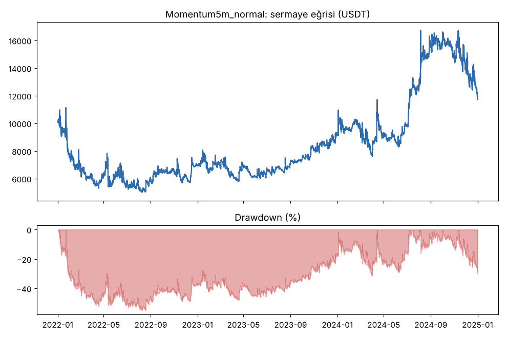
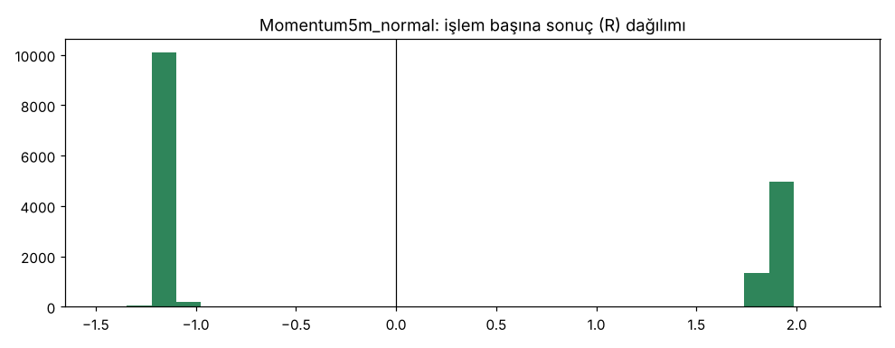


### normal — `Momentum5mLows`

| Taraf | İşlem | Günde | Kazanan | Ort. R | Toplam R | PF | Max DD (kasa) | Max DD (R) | Net | Funding (USDT) | Ort. süre (dk) |
|---|---|---|---|---|---|---|---|---|---|---|---|
| toplam | 16373 | 14.94 | 36.2% | -0.047 | -771.7 | 0.90 | 92.9% | 799.0 | -92.3% | -30 | 462 |
| long | 8420 | 7.68 | 35.1% | -0.081 | -679.9 | 0.84 | — | 690.6 | -80.5% | -81 | 477 |
| short | 7953 | 7.26 | 37.3% | -0.012 | -91.9 | 0.97 | — | 208.3 | -11.8% | 51 | 446 |

(Freqtrade'in kendi hesapladığı hesap düşüşü: 92.9%. Kasa DD'si long ve short birlikte işlediği için sadece toplamda verilir; taraf bazında düşüş, kümülatif R eğrisinin zirveden en büyük düşüşü (R) olarak verilir. Net %, işlemlerin USDT kâr/zararının başlangıç kasasına (10000) oranıdır.)

| Yıl | Taraf | İşlem | Ort. R | PF | Net (USDT) |
|---|---|---|---|---|---|
| 2022 | toplam | 7480 | -0.063 | 0.89 | -7872 |
| 2022 | long | 3858 | -0.111 | 0.81 | -7042 |
| 2022 | short | 3622 | -0.013 | 0.97 | -831 |
| 2023 | toplam | 3534 | -0.028 | 0.95 | -626 |
| 2023 | long | 1830 | -0.024 | 0.97 | -214 |
| 2023 | short | 1704 | -0.033 | 0.93 | -412 |
| 2024 | toplam | 5359 | -0.037 | 0.95 | -735 |
| 2024 | long | 2732 | -0.076 | 0.89 | -793 |
| 2024 | short | 2627 | 0.005 | 1.01 | 59 |

| Coin | İşlem | Ort. R | Long ort. R | Short ort. R | Toplam R | Net (USDT) |
|---|---|---|---|---|---|---|
| BTC | 1349 | -0.057 | -0.025 | -0.089 | -76.8 | -1128 |
| ETH | 1636 | -0.020 | -0.042 | 0.001 | -32.5 | -522 |
| SOL | 1880 | -0.059 | -0.045 | -0.071 | -110.4 | -871 |
| XRP | 1491 | -0.064 | -0.082 | -0.046 | -94.7 | -666 |
| BNB | 1188 | 0.000 | -0.003 | 0.002 | 0.1 | 302 |
| DOGE | 1257 | -0.055 | -0.124 | 0.019 | -69.5 | -1019 |
| ADA | 1089 | -0.061 | -0.133 | 0.017 | -66.4 | -524 |
| LINK | 1000 | -0.088 | -0.138 | -0.034 | -87.8 | -1254 |
| LTC | 827 | -0.050 | -0.058 | -0.041 | -41.2 | -199 |
| DOT | 736 | -0.030 | -0.062 | 0.009 | -21.8 | -516 |
| AVAX | 714 | 0.033 | -0.063 | 0.151 | 23.8 | 132 |
| TRX | 766 | 0.027 | 0.063 | -0.016 | 20.8 | -230 |
| ATOM | 706 | -0.064 | -0.133 | 0.025 | -45.1 | -650 |
| BCH | 616 | -0.090 | -0.174 | 0.013 | -55.3 | -417 |
| ETC | 520 | -0.147 | -0.275 | 0.037 | -76.5 | -976 |
| XLM | 598 | -0.064 | -0.170 | 0.060 | -38.5 | -696 |

Artıda biten coin: **2/16**.

| Taraf | force_exit | roi | stop_loss |
|---|---|---|---|
| long | 2 (0%) | 2956 (35%) | 5462 (65%) |
| short | 3 (0%) | 2962 (37%) | 4988 (63%) |

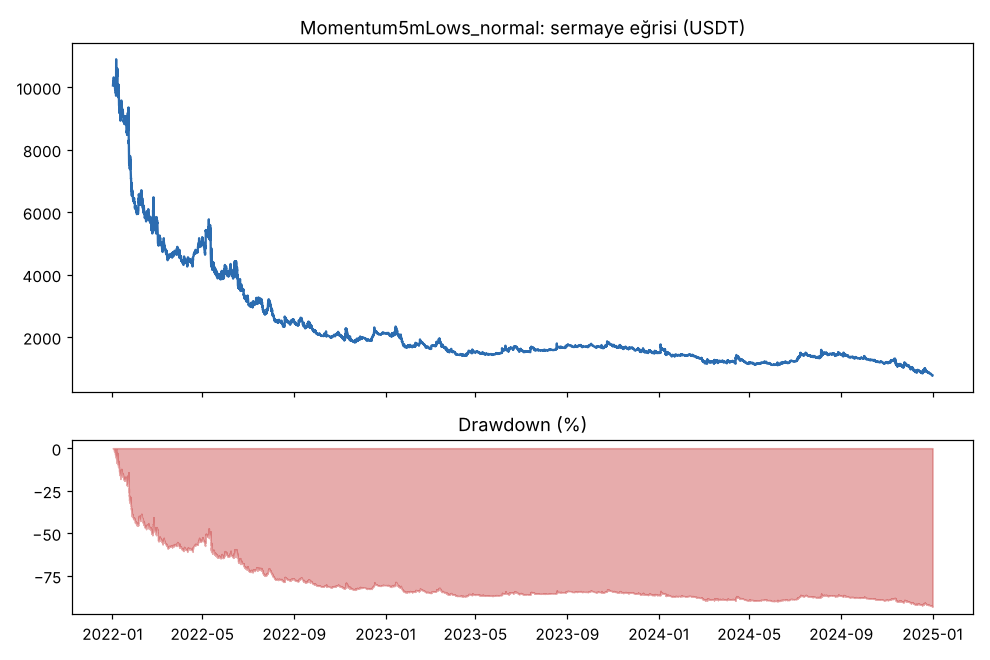
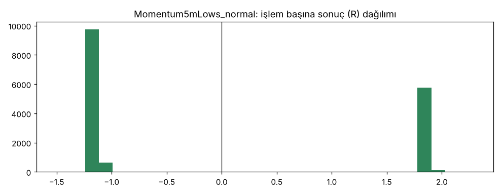


### masraf_x2 — `Momentum5m`

| Taraf | İşlem | Günde | Kazanan | Ort. R | Toplam R | PF | Max DD (kasa) | Max DD (R) | Net | Funding (USDT) | Ort. süre (dk) |
|---|---|---|---|---|---|---|---|---|---|---|---|
| toplam | 15746 | 14.37 | 37.8% | -0.129 | -2036.9 | 0.78 | 99.8% | 2056.3 | -99.8% | 3 | 466 |
| long | 7385 | 6.74 | 36.0% | -0.187 | -1381.0 | 0.65 | — | 1390.5 | -76.5% | -3 | 478 |
| short | 8361 | 7.63 | 39.5% | -0.078 | -655.9 | 0.90 | — | 703.6 | -23.3% | 6 | 455 |

(Freqtrade'in kendi hesapladığı hesap düşüşü: 99.8%. Kasa DD'si long ve short birlikte işlediği için sadece toplamda verilir; taraf bazında düşüş, kümülatif R eğrisinin zirveden en büyük düşüşü (R) olarak verilir. Net %, işlemlerin USDT kâr/zararının başlangıç kasasına (10000) oranıdır.)

| Yıl | Taraf | İşlem | Ort. R | PF | Net (USDT) |
|---|---|---|---|---|---|
| 2022 | toplam | 7545 | -0.142 | 0.77 | -9630 |
| 2022 | long | 3608 | -0.210 | 0.65 | -7433 |
| 2022 | short | 3937 | -0.080 | 0.90 | -2197 |
| 2023 | toplam | 3701 | -0.113 | 0.84 | -260 |
| 2023 | long | 1787 | -0.149 | 0.81 | -155 |
| 2023 | short | 1914 | -0.080 | 0.87 | -105 |
| 2024 | toplam | 4500 | -0.121 | 0.85 | -88 |
| 2024 | long | 1990 | -0.180 | 0.77 | -63 |
| 2024 | short | 2510 | -0.074 | 0.92 | -25 |

| Coin | İşlem | Ort. R | Long ort. R | Short ort. R | Toplam R | Net (USDT) |
|---|---|---|---|---|---|---|
| BTC | 856 | -0.169 | -0.136 | -0.199 | -144.7 | -959 |
| ETH | 1693 | -0.135 | -0.142 | -0.130 | -229.3 | -667 |
| SOL | 1246 | -0.149 | -0.123 | -0.171 | -186.3 | -934 |
| XRP | 1525 | -0.164 | -0.188 | -0.146 | -250.2 | -906 |
| BNB | 1246 | -0.097 | -0.094 | -0.099 | -120.4 | -270 |
| DOGE | 1407 | -0.136 | -0.198 | -0.087 | -191.7 | -603 |
| ADA | 1195 | -0.043 | -0.107 | 0.016 | -50.8 | -508 |
| LINK | 1057 | -0.121 | -0.275 | 0.018 | -127.5 | -639 |
| LTC | 849 | -0.133 | -0.196 | -0.076 | -112.9 | -348 |
| DOT | 811 | -0.110 | -0.264 | 0.038 | -89.1 | -777 |
| AVAX | 530 | -0.057 | -0.176 | 0.071 | -30.4 | -481 |
| TRX | 711 | -0.102 | -0.022 | -0.172 | -72.3 | -316 |
| ATOM | 771 | -0.104 | -0.280 | 0.087 | -80.5 | -669 |
| BCH | 655 | -0.207 | -0.305 | -0.108 | -135.5 | -400 |
| ETC | 539 | -0.114 | -0.234 | 0.022 | -61.5 | -641 |
| XLM | 655 | -0.235 | -0.394 | -0.067 | -153.6 | -860 |

Artıda biten coin: **0/16**.

| Taraf | roi | stop_loss |
|---|---|---|
| long | 2658 (36%) | 4727 (64%) |
| short | 3300 (39%) | 5061 (61%) |

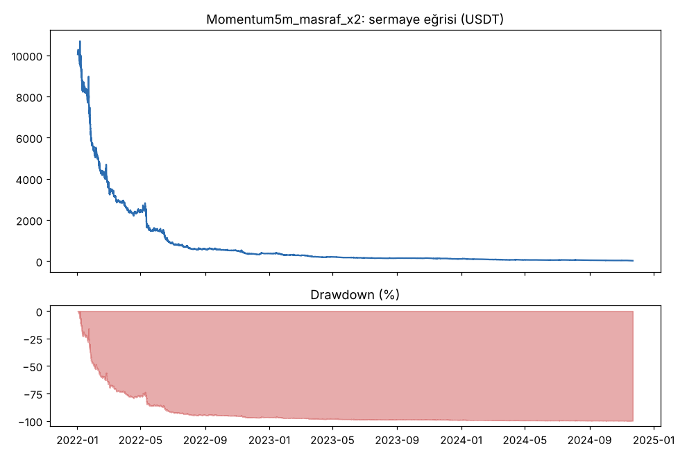
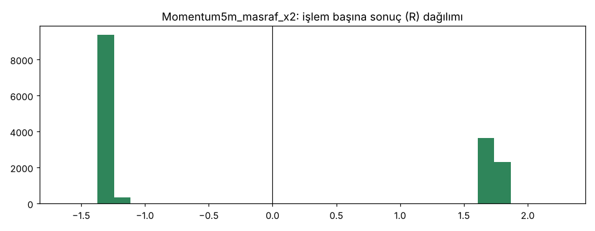


### dusuk_masraf_0.0003 — `Momentum5m`

| Taraf | İşlem | Günde | Kazanan | Ort. R | Toplam R | PF | Max DD (kasa) | Max DD (R) | Net | Funding (USDT) | Ort. süre (dk) |
|---|---|---|---|---|---|---|---|---|---|---|---|
| toplam | 16700 | 15.24 | 38.0% | 0.103 | 1719.5 | 1.15 | 27.4% | 103.3 | 11436.1% | -6356 | 457 |
| long | 7914 | 7.22 | 36.2% | 0.047 | 369.7 | 1.11 | — | 158.8 | 4254.6% | -29225 | 474 |
| short | 8786 | 8.02 | 39.7% | 0.154 | 1349.8 | 1.18 | — | 69.7 | 7181.4% | 22869 | 441 |

(Freqtrade'in kendi hesapladığı hesap düşüşü: 14.6%. Kasa DD'si long ve short birlikte işlediği için sadece toplamda verilir; taraf bazında düşüş, kümülatif R eğrisinin zirveden en büyük düşüşü (R) olarak verilir. Net %, işlemlerin USDT kâr/zararının başlangıç kasasına (10000) oranıdır.)

| Yıl | Taraf | İşlem | Ort. R | PF | Net (USDT) |
|---|---|---|---|---|---|
| 2022 | toplam | 7545 | 0.084 | 1.15 | 45361 |
| 2022 | long | 3608 | 0.017 | 1.05 | 7491 |
| 2022 | short | 3937 | 0.146 | 1.24 | 37871 |
| 2023 | toplam | 3662 | 0.125 | 1.21 | 146263 |
| 2023 | long | 1759 | 0.094 | 1.16 | 53363 |
| 2023 | short | 1903 | 0.155 | 1.26 | 92900 |
| 2024 | toplam | 5493 | 0.114 | 1.14 | 951984 |
| 2024 | long | 2547 | 0.057 | 1.11 | 364611 |
| 2024 | short | 2946 | 0.163 | 1.17 | 587373 |

| Coin | İşlem | Ort. R | Long ort. R | Short ort. R | Toplam R | Net (USDT) |
|---|---|---|---|---|---|---|
| BTC | 1387 | 0.073 | 0.130 | 0.023 | 101.8 | 54906 |
| ETH | 1723 | 0.098 | 0.096 | 0.099 | 168.8 | 109793 |
| SOL | 1988 | 0.044 | 0.065 | 0.026 | 86.7 | -55048 |
| XRP | 1499 | 0.073 | 0.023 | 0.113 | 109.2 | 43922 |
| BNB | 1268 | 0.121 | 0.108 | 0.132 | 154.0 | 110956 |
| DOGE | 1292 | 0.128 | 0.000 | 0.236 | 165.0 | 190556 |
| ADA | 1046 | 0.185 | 0.112 | 0.255 | 193.7 | 157489 |
| LINK | 990 | 0.116 | -0.027 | 0.251 | 115.1 | 128692 |
| LTC | 821 | 0.096 | 0.037 | 0.153 | 78.6 | 36735 |
| DOT | 768 | 0.107 | -0.021 | 0.232 | 82.4 | 83695 |
| AVAX | 733 | 0.145 | 0.006 | 0.296 | 106.3 | 64084 |
| TRX | 762 | 0.159 | 0.228 | 0.092 | 120.9 | 119464 |
| ATOM | 702 | 0.129 | -0.052 | 0.332 | 90.5 | 50206 |
| BCH | 623 | 0.083 | -0.004 | 0.170 | 51.8 | 22368 |
| ETC | 486 | 0.139 | -0.037 | 0.328 | 67.7 | 53761 |
| XLM | 612 | 0.044 | -0.103 | 0.193 | 27.1 | -27969 |

Artıda biten coin: **14/16**.

| Taraf | force_exit | roi | stop_loss |
|---|---|---|---|
| long | 2 (0%) | 2868 (36%) | 5044 (64%) |
| short | 3 (0%) | 3483 (40%) | 5300 (60%) |

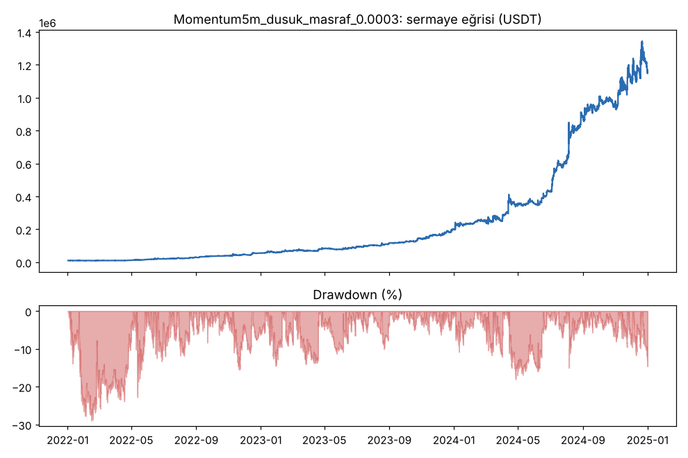
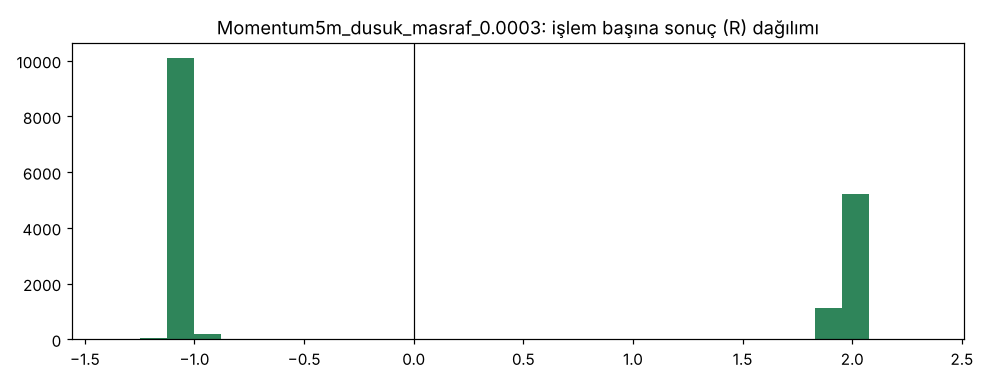


### masrafsiz — `Momentum5m`

| Taraf | İşlem | Günde | Kazanan | Ort. R | Toplam R | PF | Max DD (kasa) | Max DD (R) | Net | Funding (USDT) | Ort. süre (dk) |
|---|---|---|---|---|---|---|---|---|---|---|---|
| toplam | 16700 | 15.24 | 38.0% | 0.143 | 2387.2 | 1.20 | 22.8% | 84.6 | 82678.7% | -34868 | 457 |
| long | 7914 | 7.22 | 36.2% | 0.087 | 686.5 | 1.18 | — | 103.5 | 35579.6% | -159895 | 474 |
| short | 8786 | 8.02 | 39.7% | 0.194 | 1700.7 | 1.22 | — | 62.7 | 47099.1% | 125027 | 441 |

(Freqtrade'in kendi hesapladığı hesap düşüşü: 13.1%. Kasa DD'si long ve short birlikte işlediği için sadece toplamda verilir; taraf bazında düşüş, kümülatif R eğrisinin zirveden en büyük düşüşü (R) olarak verilir. Net %, işlemlerin USDT kâr/zararının başlangıç kasasına (10000) oranıdır.)

| Yıl | Taraf | İşlem | Ort. R | PF | Net (USDT) |
|---|---|---|---|---|---|
| 2022 | toplam | 7545 | 0.124 | 1.23 | 124390 |
| 2022 | long | 3608 | 0.057 | 1.13 | 33987 |
| 2022 | short | 3937 | 0.186 | 1.33 | 90403 |
| 2023 | toplam | 3662 | 0.165 | 1.29 | 619170 |
| 2023 | long | 1759 | 0.134 | 1.24 | 241169 |
| 2023 | short | 1903 | 0.195 | 1.35 | 378002 |
| 2024 | toplam | 5493 | 0.154 | 1.20 | 7524311 |
| 2024 | long | 2547 | 0.097 | 1.17 | 3282803 |
| 2024 | short | 2946 | 0.203 | 1.22 | 4241508 |

| Coin | İşlem | Ort. R | Long ort. R | Short ort. R | Toplam R | Net (USDT) |
|---|---|---|---|---|---|---|
| BTC | 1387 | 0.113 | 0.170 | 0.063 | 157.3 | 426395 |
| ETH | 1723 | 0.138 | 0.136 | 0.139 | 237.7 | 787385 |
| SOL | 1988 | 0.084 | 0.105 | 0.066 | 166.2 | -96946 |
| XRP | 1499 | 0.113 | 0.063 | 0.153 | 169.1 | 324539 |
| BNB | 1268 | 0.161 | 0.148 | 0.172 | 204.7 | 743079 |
| DOGE | 1292 | 0.168 | 0.040 | 0.276 | 216.7 | 1294918 |
| ADA | 1046 | 0.225 | 0.152 | 0.295 | 235.6 | 1031498 |
| LINK | 990 | 0.156 | 0.013 | 0.291 | 154.7 | 882741 |
| LTC | 821 | 0.136 | 0.077 | 0.193 | 111.5 | 345291 |
| DOT | 768 | 0.147 | 0.019 | 0.272 | 113.1 | 628197 |
| AVAX | 733 | 0.185 | 0.046 | 0.336 | 135.6 | 435163 |
| TRX | 762 | 0.199 | 0.268 | 0.132 | 151.3 | 800065 |
| ATOM | 702 | 0.169 | -0.012 | 0.372 | 118.5 | 309576 |
| BCH | 623 | 0.123 | 0.036 | 0.210 | 76.7 | 178796 |
| ETC | 486 | 0.179 | 0.003 | 0.368 | 87.1 | 290037 |
| XLM | 612 | 0.084 | -0.063 | 0.233 | 51.5 | -112863 |

Artıda biten coin: **14/16**.

| Taraf | force_exit | roi | stop_loss |
|---|---|---|---|
| long | 2 (0%) | 2868 (36%) | 5044 (64%) |
| short | 3 (0%) | 3483 (40%) | 5300 (60%) |

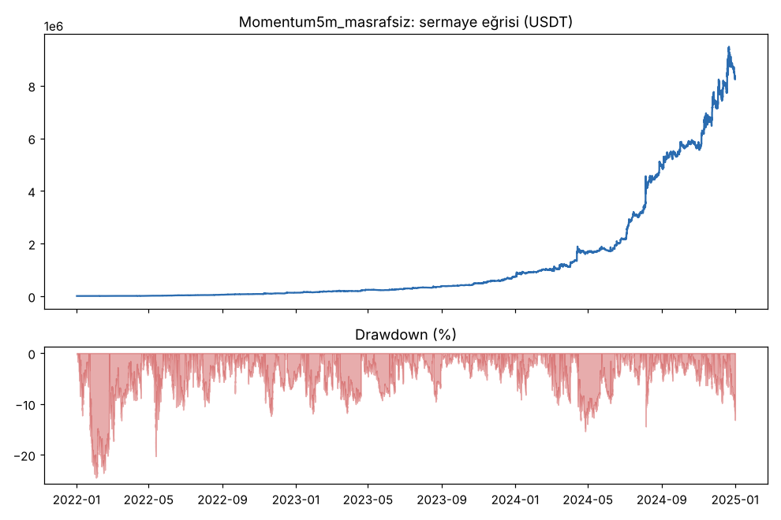
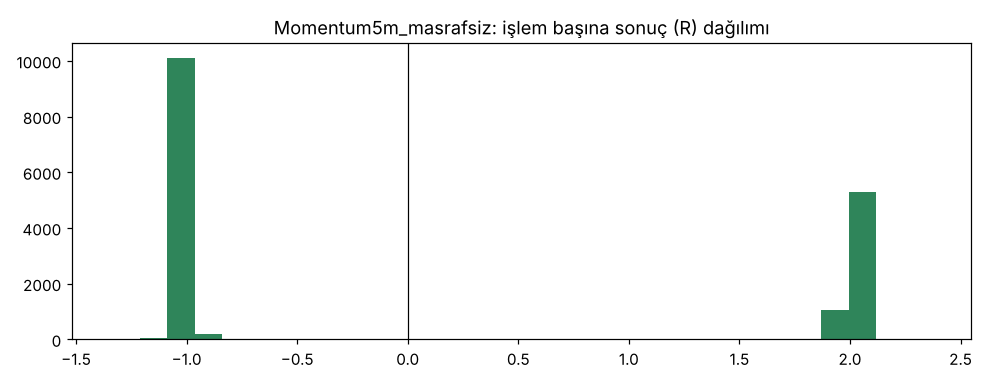


### sinirsiz_16 — `Momentum5m`

| Taraf | İşlem | Günde | Kazanan | Ort. R | Toplam R | PF | Max DD (kasa) | Max DD (R) | Net | Funding (USDT) | Ort. süre (dk) |
|---|---|---|---|---|---|---|---|---|---|---|---|
| toplam | 48335 | 44.10 | 34.0% | -0.110 | -5329.2 | 0.85 | 99.3% | 5381.8 | -99.3% | -11 | 409 |
| long | 23273 | 21.23 | 33.8% | -0.120 | -2792.7 | 0.80 | — | 2875.8 | -64.0% | -3 | 416 |
| short | 25062 | 22.87 | 34.3% | -0.101 | -2536.5 | 0.90 | — | 2655.2 | -35.3% | -8 | 402 |

(Freqtrade'in kendi hesapladığı hesap düşüşü: 99.3%. Kasa DD'si long ve short birlikte işlediği için sadece toplamda verilir; taraf bazında düşüş, kümülatif R eğrisinin zirveden en büyük düşüşü (R) olarak verilir. Net %, işlemlerin USDT kâr/zararının başlangıç kasasına (10000) oranıdır.)

| Yıl | Taraf | İşlem | Ort. R | PF | Net (USDT) |
|---|---|---|---|---|---|
| 2022 | toplam | 22484 | -0.110 | 0.85 | -9045 |
| 2022 | long | 10873 | -0.149 | 0.80 | -6075 |
| 2022 | short | 11611 | -0.074 | 0.91 | -2970 |
| 2023 | toplam | 12462 | -0.139 | 0.80 | -758 |
| 2023 | long | 6060 | -0.112 | 0.85 | -265 |
| 2023 | short | 6402 | -0.165 | 0.75 | -493 |
| 2024 | toplam | 13389 | -0.083 | 0.88 | -128 |
| 2024 | long | 6340 | -0.078 | 0.88 | -60 |
| 2024 | short | 7049 | -0.087 | 0.88 | -68 |

| Coin | İşlem | Ort. R | Long ort. R | Short ort. R | Toplam R | Net (USDT) |
|---|---|---|---|---|---|---|
| BTC | 982 | -0.094 | -0.075 | -0.112 | -92.4 | -352 |
| ETH | 2419 | -0.047 | -0.070 | -0.026 | -113.6 | -259 |
| SOL | 2943 | -0.162 | -0.196 | -0.130 | -478.0 | -898 |
| XRP | 3081 | -0.097 | -0.103 | -0.091 | -298.5 | -567 |
| BNB | 2077 | -0.107 | -0.084 | -0.127 | -221.9 | -354 |
| DOGE | 4190 | -0.126 | -0.156 | -0.097 | -527.6 | -986 |
| ADA | 3517 | -0.105 | -0.132 | -0.078 | -367.7 | -441 |
| LINK | 3908 | -0.096 | -0.097 | -0.094 | -373.4 | -698 |
| LTC | 3085 | -0.129 | -0.157 | -0.105 | -399.3 | -642 |
| DOT | 3541 | -0.126 | -0.139 | -0.114 | -445.5 | -547 |
| AVAX | 2774 | -0.088 | -0.106 | -0.072 | -245.4 | -526 |
| TRX | 1590 | -0.009 | 0.041 | -0.059 | -13.9 | -121 |
| ATOM | 3959 | -0.123 | -0.135 | -0.113 | -488.8 | -1132 |
| BCH | 3520 | -0.125 | -0.110 | -0.139 | -438.6 | -528 |
| ETC | 3905 | -0.127 | -0.132 | -0.122 | -496.1 | -1089 |
| XLM | 2844 | -0.116 | -0.125 | -0.106 | -328.5 | -793 |

Artıda biten coin: **0/16**.

| Taraf | roi | stop_loss |
|---|---|---|
| long | 7859 (34%) | 15414 (66%) |
| short | 8592 (34%) | 16470 (66%) |

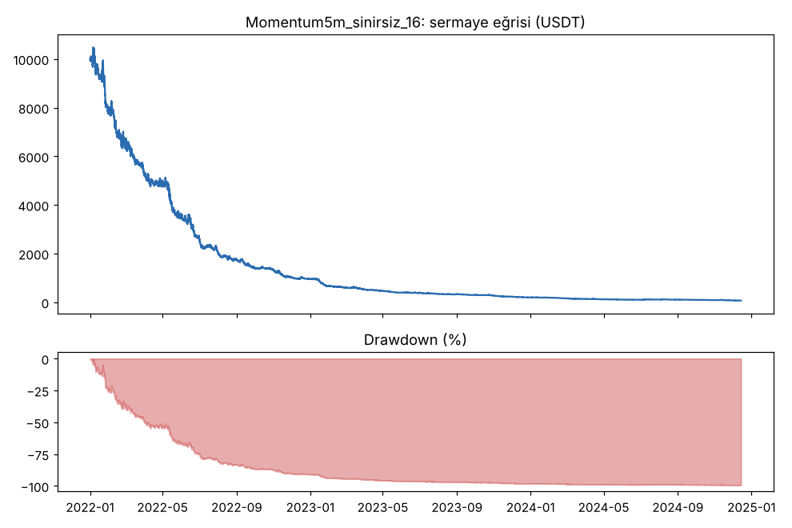
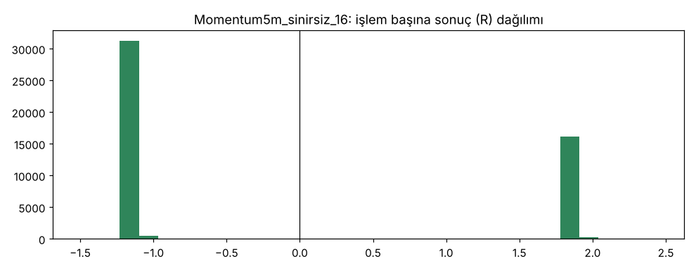


### Al-tut (aynı dönem, aynı coinler)

| Coin | Al-tut getirisi | Al-tut max DD |
|---|---|---|
| BTC | 102.0% | 67.7% |
| ETH | -9.5% | 77.2% |
| SOL | 11.0% | 95.5% |
| XRP | 150.2% | 68.2% |
| BNB | 36.9% | 65.4% |
| DOGE | 85.4% | 76.1% |
| ADA | -35.7% | 85.8% |
| LINK | 2.2% | 82.8% |
| LTC | -29.5% | 73.7% |
| DOT | -75.2% | 88.3% |
| AVAX | -67.6% | 92.6% |
| TRX | 237.4% | 50.9% |
| ATOM | -81.1% | 91.8% |
| BCH | 0.6% | 80.6% |
| ETC | -26.6% | 76.0% |
| XLM | 24.9% | 76.2% |
| **Eşit ağırlık ortalama** | **20.3%** | 78.0% (ortalama) |

Yıllara göre eşit ağırlıklı al-tut: 2022: -67.8%, 2023: 148.4%, 2024: 80.1%
