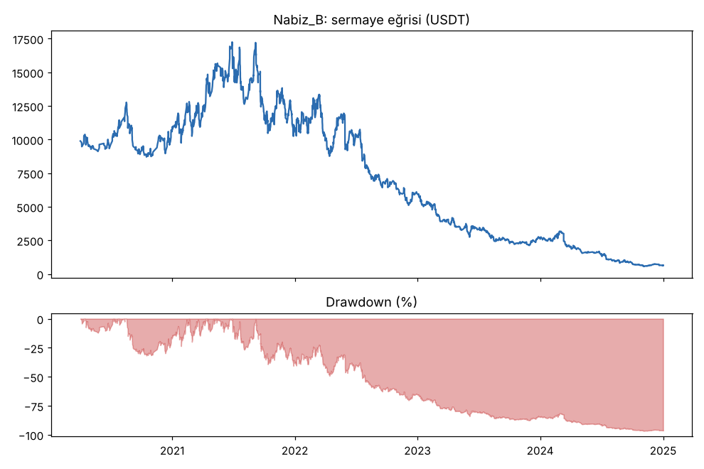
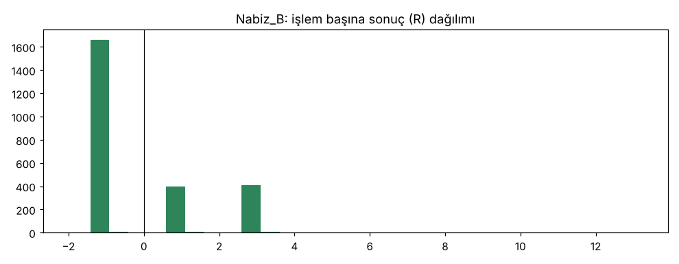
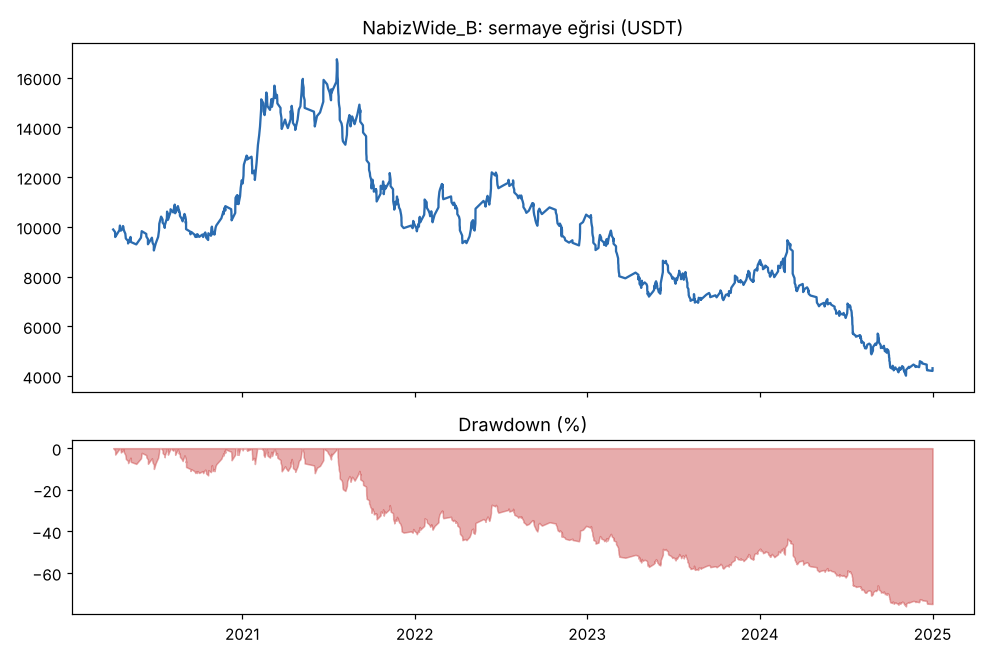
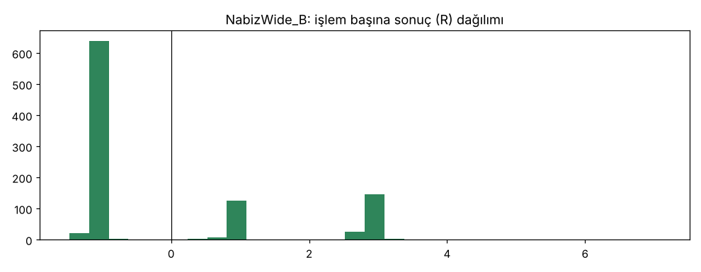

# Nabiz_B vs NabizWide_B — gelistirme_36coin — 2026-10-10

## GUO'ya not
- **Nerdeyiz:** Kuyruğun 1. maddesi, hızlı (1 saatlik) strateji adayı "Nabız" test edildi. Fikir: günlük trend güçlüyken, 1 saatlik grafikteki kısa geri çekilme bitince trend yönünde gir.
- **İşlem sıklığı hedefi tuttu:** 36 coinde günde ortalama 1.4 işlem.
- **Ama kâr yok, zarar var:** masraf ve funding sonrası işlem başına -0.09R, 5 yılda kasa %93 eridi. Long da (-0.07R) short da (-0.11R) eksi.
- **Masrafsız bile kâr yok** (≈0R): yani sorun sadece masraf değil, 1 saatlik geri çekilmede bir avantaj yok. Üstüne masraf eklenince eksiye düşüyor.
- **Karar:** elendi (emekliye ayrıldı). Doğrulama ve kasa verisine hiç bakılmadı. Pusula ve demo bundan etkilenmiyor.
- Kuyruğa yeni ve farklı bir hızlı fikir eklendi: geri çekilme yerine kırılım (Pusula'nın 1 saatlik grafikte de kârlı çıkan tetiği), sabit hedefle.

## Özet
- **Nabiz_B**: 2509 işlem, işlem başına ortalama **-0.09R** (maliyet ve funding dahil), net getiri -93.4%, en büyük düşüş 96.8%.
- **NabizWide_B**: 980 işlem, işlem başına ortalama **-0.07R** (maliyet ve funding dahil), net getiri -56.8%, en büyük düşüş 76.0%.
- Aynı dönemde coinleri al-tut (eşit ağırlık): getiri 814.7%, ortalama en büyük düşüş 92.4%.

## Ayarlar
- Dönem: 2020-01-17 16:00:00 → 2025-01-01 00:00:00
- Coinler: BTC/USDT:USDT, ETH/USDT:USDT, SOL/USDT:USDT, XRP/USDT:USDT, BNB/USDT:USDT, DOGE/USDT:USDT, ADA/USDT:USDT, LINK/USDT:USDT, LTC/USDT:USDT, DOT/USDT:USDT, AVAX/USDT:USDT, TRX/USDT:USDT, ATOM/USDT:USDT, BCH/USDT:USDT, ETC/USDT:USDT, XLM/USDT:USDT, FIL/USDT:USDT, UNI/USDT:USDT, AAVE/USDT:USDT, NEAR/USDT:USDT, ALGO/USDT:USDT, XTZ/USDT:USDT, THETA/USDT:USDT, VET/USDT:USDT, ICP/USDT:USDT, SAND/USDT:USDT, MANA/USDT:USDT, AXS/USDT:USDT, EGLD/USDT:USDT, HBAR/USDT:USDT, CHZ/USDT:USDT, ENJ/USDT:USDT, ZEC/USDT:USDT, DASH/USDT:USDT, NEO/USDT:USDT, IOTA/USDT:USDT
- Zaman dilimi: 1h
- Yön: long + short
- Mod: futures / isolated
- Kaldıraç: en fazla 3x, likidasyon stop mesafesinin en az 2 katı uzakta (bölüm 7.6)
- Risk: işlem başına sermayenin %1'i (pozisyon büyüklüğü stop mesafesine göre)
- Maliyet: her emir için %0.05 komisyon + %0.05 kayma (= %0.1), funding geçmiş veriden
- Başlangıç sermayesi: 10000 USDT

## Metrikler
| Metrik | Nabiz_B | NabizWide_B | Al-tut |
|---|---|---|---|
| Net getiri | -93.4% | -56.8% | 814.7% |
| Max drawdown | 96.8% | 76.0% | 92.4% |
| Profit factor | 0.93 | 0.91 | — |
| Ortalama R | -0.09 | -0.07 | — |
| İşlem sayısı | 2509 | 980 | — |
| Winrate | 33.2% | 32.0% | — |

Winrate tek başına başarı ölçütü değildir; asıl ölçüt ortalama R (expectancy) ve drawdown'dur.

## Long / short ayrımı
| Strateji | Yön | İşlem | Ortalama R | Toplam R | Profit factor |
|---|---|---|---|---|---|
| Nabiz_B | long | 1405 | -0.07 | -99.56 | 0.99 |
| Nabiz_B | short | 1104 | -0.11 | -125.05 | 0.86 |
| NabizWide_B | long | 633 | -0.11 | -68.11 | 0.88 |
| NabizWide_B | short | 347 | 0.01 | 3.89 | 0.99 |

## Sinyal istatistikleri
| Strateji | Stop | BE | TP1 sonrası BE | TP2 | Diğer | İptal (bölgeye gelmedi / önce stop) | Toplam funding (USDT) |
|---|---|---|---|---|---|---|---|
| Nabiz_B | 66.7% | 0.0% | 16.3% | 16.9% | 0.1% | 6.9% | -2844.64 |
| NabizWide_B | 67.9% | 0.0% | 13.9% | 18.1% | 0.2% | 7.8% | -2519.73 |

## Coin bazında
| Strateji | Coin | İşlem | Ortalama R | Toplam R | Al-tut getirisi |
|---|---|---|---|---|---|
| Nabiz_B | BTC/USDT:USDT | 192 | 0.09 | 16.78 | 962.4% |
| Nabiz_B | ETH/USDT:USDT | 135 | -0.08 | -11.24 | 1877.1% |
| Nabiz_B | SOL/USDT:USDT | 148 | -0.01 | -1.30 | 5616.2% |
| Nabiz_B | XRP/USDT:USDT | 96 | -0.30 | -28.96 | 795.7% |
| Nabiz_B | BNB/USDT:USDT | 133 | -0.17 | -22.65 | 2729.1% |
| Nabiz_B | DOGE/USDT:USDT | 86 | -0.02 | -1.44 | 8497.3% |
| Nabiz_B | ADA/USDT:USDT | 98 | -0.22 | -21.77 | 1474.4% |
| Nabiz_B | LINK/USDT:USDT | 97 | -0.28 | -27.02 | 638.9% |
| Nabiz_B | LTC/USDT:USDT | 91 | -0.04 | -3.94 | 71.3% |
| Nabiz_B | DOT/USDT:USDT | 75 | 0.21 | 15.48 | 97.0% |
| Nabiz_B | AVAX/USDT:USDT | 82 | -0.21 | -16.86 | 784.8% |
| Nabiz_B | TRX/USDT:USDT | 121 | 0.19 | 23.45 | 1343.8% |
| Nabiz_B | ATOM/USDT:USDT | 82 | -0.44 | -35.86 | 36.2% |
| Nabiz_B | BCH/USDT:USDT | 71 | -0.27 | -19.29 | 23.6% |
| Nabiz_B | ETC/USDT:USDT | 54 | -0.03 | -1.67 | 119.2% |
| Nabiz_B | XLM/USDT:USDT | 62 | 0.11 | 6.98 | 443.3% |
| Nabiz_B | FIL/USDT:USDT | 58 | 0.16 | 9.42 | -90.1% |
| Nabiz_B | UNI/USDT:USDT | 46 | 0.23 | 10.38 | 144.8% |
| Nabiz_B | AAVE/USDT:USDT | 54 | -0.17 | -8.93 | 660.5% |
| Nabiz_B | NEAR/USDT:USDT | 59 | -0.26 | -15.61 | 346.9% |
| Nabiz_B | ALGO/USDT:USDT | 53 | -0.18 | -9.53 | 45.0% |
| Nabiz_B | XTZ/USDT:USDT | 56 | 0.05 | 2.90 | -41.1% |
| Nabiz_B | THETA/USDT:USDT | 48 | 0.13 | 6.02 | 422.7% |
| Nabiz_B | VET/USDT:USDT | 44 | -0.18 | -8.01 | 467.8% |
| Nabiz_B | ICP/USDT:USDT | 51 | -0.13 | -6.84 | -97.8% |
| Nabiz_B | SAND/USDT:USDT | 34 | 0.11 | 3.72 | 483.8% |
| Nabiz_B | MANA/USDT:USDT | 29 | -0.32 | -9.34 | -54.2% |
| Nabiz_B | AXS/USDT:USDT | 35 | 0.11 | 3.69 | 1192.5% |
| Nabiz_B | EGLD/USDT:USDT | 51 | 0.18 | 9.08 | 159.7% |
| Nabiz_B | HBAR/USDT:USDT | 39 | -0.16 | -6.41 | -18.6% |
| Nabiz_B | CHZ/USDT:USDT | 29 | -0.73 | -21.27 | 278.4% |
| Nabiz_B | ENJ/USDT:USDT | 29 | -0.29 | -8.28 | 19.2% |
| Nabiz_B | ZEC/USDT:USDT | 56 | -0.37 | -20.93 | -13.2% |
| Nabiz_B | DASH/USDT:USDT | 31 | -0.24 | -7.52 | -66.0% |
| Nabiz_B | NEO/USDT:USDT | 51 | 0.01 | 0.48 | -3.2% |
| Nabiz_B | IOTA/USDT:USDT | 33 | -0.56 | -18.34 | -17.1% |
| NabizWide_B | BTC/USDT:USDT | 102 | 0.19 | 19.24 | 962.4% |
| NabizWide_B | ETH/USDT:USDT | 68 | 0.11 | 7.60 | 1877.1% |
| NabizWide_B | SOL/USDT:USDT | 70 | -0.17 | -11.84 | 5616.2% |
| NabizWide_B | XRP/USDT:USDT | 47 | -0.59 | -27.90 | 795.7% |
| NabizWide_B | BNB/USDT:USDT | 64 | -0.19 | -12.29 | 2729.1% |
| NabizWide_B | DOGE/USDT:USDT | 37 | -0.04 | -1.47 | 8497.3% |
| NabizWide_B | ADA/USDT:USDT | 37 | 0.23 | 8.60 | 1474.4% |
| NabizWide_B | LINK/USDT:USDT | 22 | -0.02 | -0.33 | 638.9% |
| NabizWide_B | LTC/USDT:USDT | 33 | -0.09 | -3.09 | 71.3% |
| NabizWide_B | DOT/USDT:USDT | 26 | -0.07 | -1.81 | 97.0% |
| NabizWide_B | AVAX/USDT:USDT | 28 | -0.41 | -11.53 | 784.8% |
| NabizWide_B | TRX/USDT:USDT | 51 | 0.14 | 7.25 | 1343.8% |
| NabizWide_B | ATOM/USDT:USDT | 30 | -0.74 | -22.05 | 36.2% |
| NabizWide_B | BCH/USDT:USDT | 29 | -0.14 | -3.99 | 23.6% |
| NabizWide_B | ETC/USDT:USDT | 23 | 0.16 | 3.65 | 119.2% |
| NabizWide_B | XLM/USDT:USDT | 23 | 0.30 | 6.85 | 443.3% |
| NabizWide_B | FIL/USDT:USDT | 22 | -0.40 | -8.73 | -90.1% |
| NabizWide_B | UNI/USDT:USDT | 18 | 0.16 | 2.92 | 144.8% |
| NabizWide_B | AAVE/USDT:USDT | 19 | -0.04 | -0.77 | 660.5% |
| NabizWide_B | NEAR/USDT:USDT | 15 | -0.25 | -3.81 | 346.9% |
| NabizWide_B | ALGO/USDT:USDT | 21 | 0.11 | 2.22 | 45.0% |
| NabizWide_B | XTZ/USDT:USDT | 17 | 0.37 | 6.21 | -41.1% |
| NabizWide_B | THETA/USDT:USDT | 15 | -0.38 | -5.68 | 422.7% |
| NabizWide_B | VET/USDT:USDT | 13 | -0.15 | -1.91 | 467.8% |
| NabizWide_B | ICP/USDT:USDT | 17 | -0.10 | -1.78 | -97.8% |
| NabizWide_B | SAND/USDT:USDT | 13 | -0.15 | -1.94 | 483.8% |
| NabizWide_B | MANA/USDT:USDT | 2 | 0.96 | 1.92 | -54.2% |
| NabizWide_B | AXS/USDT:USDT | 12 | 1.04 | 12.51 | 1192.5% |
| NabizWide_B | EGLD/USDT:USDT | 20 | -0.24 | -4.71 | 159.7% |
| NabizWide_B | HBAR/USDT:USDT | 11 | 0.40 | 4.43 | -18.6% |
| NabizWide_B | CHZ/USDT:USDT | 10 | -1.05 | -10.51 | 278.4% |
| NabizWide_B | ENJ/USDT:USDT | 8 | 0.64 | 5.09 | 19.2% |
| NabizWide_B | ZEC/USDT:USDT | 23 | -0.18 | -4.20 | -13.2% |
| NabizWide_B | DASH/USDT:USDT | 9 | -1.04 | -9.38 | -66.0% |
| NabizWide_B | NEO/USDT:USDT | 14 | -0.23 | -3.23 | -3.2% |
| NabizWide_B | IOTA/USDT:USDT | 11 | 0.02 | 0.26 | -17.1% |

## Ek ölçümler (aynı geliştirme dönemi, aynı kurallar)
| Test | İşlem | Günde | Ortalama R | Long R (işlem) | Short R (işlem) | Net | Max DD |
|---|---|---|---|---|---|---|---|
| Nabiz_B (ana, maliyet %0.1) | 2509 | 1.39 | -0.09 | -0.07 (1405), PF 0.99 | -0.11 (1104), PF 0.86 | -%93.4 | %96.8 |
| NabizWide_B (stop 3 ATR, teşhis) | 980 | 0.54 | -0.07 | -0.11 (633), PF 0.88 | +0.01 (347), PF 0.99 | -%56.8 | %76.0 |
| Nabiz_B masraf x2 (`--fee 0.002`) | 2234 | 1.23 | -0.15 | -0.08 (1209) | -0.23 (1025) | -%97.6 | %99.2 |
| Nabiz_B masrafsız (`--fee 0`, sadece teşhis, kartta yoktu) | 2523 | 1.39 | +0.01 | +0.02 (1419) | -0.01 (1104) | -%27.2 | %78.1 |

- Yıl bazında (ana sürüm, işlem başı R): 2020 +0.05, 2021 +0.03, 2022 -0.09, 2023 -0.16, 2024 -0.23. Her yıl kötüleşiyor.
- En iyi 10 işlem çıkarılınca toplam -224.6R → -273.1R.
- Medyan stop mesafesi %2.3 (geniş varyantta %4.4). Masraf (giriş + çıkış ≈ %0.2) işlem başına ≈0.09R yiyor; masrafsız sonuç ≈0R olduğu için masraf düşse de kâr çıkmazdı.
- Funding: long'lar 5 yılda ≈3000 USDT funding ödedi (long tarafı kalabalıkken trend yönünde girildiği için), short'lar ≈190 USDT aldı.
- Masrafsız testte bile net getiri eksi (-%27): ortalama ≈0R'de funding ve kayıp serileri kasayı eritiyor.
- Hile testi (lookahead-analysis, BTC/ETH/SOL/DOGE 2021, 30 sinyal): geleceği görme yok.
- Al-tut (36 coin eşit ağırlık) aynı dönemde +%815, ortalama en büyük düşüş %92. Strateji hem daha az getiri hem benzer/daha büyük düşüş verdi.

## Grafikler

## Yorum: güçlü yanlar / şüpheli noktalar
İşlem sıklığı hedefi (günde ~1) sağlandı, ama giriş tetiğinde avantaj yok: masraf öncesi ≈0R. Güçlü yanı yok. Şüpheli/olumsuz: 36 coinin sadece 12'si artıda (geniş stopta 14), sonuç yıldan yıla kötüleşiyor, short tarafı açıkça zararda. Stopu genişletmek (NabizWide_B) masrafın payını yarıya indirdi ama sonucu kurtarmadı. 3 işlem sınırı nedeniyle listede önde olan coinler daha çok işlem aldı (BTC 192, IOTA 37); bu sıralama etkisi sonucu açıklamaz, çünkü coinlerin çoğu eksi.

## Karar: devam / düzelt / emekli
**Emekli.** Eşiklerin hiçbiri sağlanmadı: ortalama R < 0 (-0.09R), DD %97 > %25, artıda coin oranı %33 < %50, al-tutun gerisinde, masraf x2'de -0.15R. Önceden kartta yazıldığı gibi doğrulama sadece geçerse yapılacaktı; yapılmadı. Kasa verisine dokunulmadı. Kurallar sonuca bakıp değiştirilmedi.
