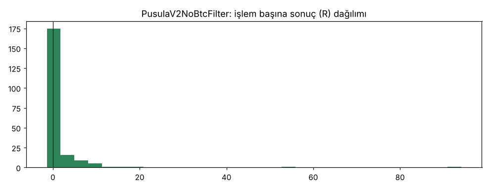

# PusulaV2 vs PusulaV2NoBtcFilter — cikarma1_wide16 — 2026-10-10

## Özet
- **PusulaV2**: 210 işlem, işlem başına ortalama **1.20R** (maliyet ve funding dahil), net getiri 561.0%, en büyük düşüş 26.1%.
- **PusulaV2NoBtcFilter**: 210 işlem, işlem başına ortalama **1.20R** (maliyet ve funding dahil), net getiri 560.2%, en büyük düşüş 26.1%.
- Aynı dönemde coinleri al-tut (eşit ağırlık): getiri 931.5%, ortalama en büyük düşüş 89.2%.

## Ayarlar
- Dönem: 2020-03-07 16:00:00 → 2026-10-01 00:00:00
- Coinler: BTC/USDT:USDT, ETH/USDT:USDT, SOL/USDT:USDT, XRP/USDT:USDT, BNB/USDT:USDT, DOGE/USDT:USDT, ADA/USDT:USDT, LINK/USDT:USDT, LTC/USDT:USDT, DOT/USDT:USDT, AVAX/USDT:USDT, TRX/USDT:USDT, ATOM/USDT:USDT, BCH/USDT:USDT, ETC/USDT:USDT, XLM/USDT:USDT
- Zaman dilimi: 4h
- Yön: long + short
- Mod: futures / isolated
- Kaldıraç: en fazla 3x, likidasyon stop mesafesinin en az 2 katı uzakta (bölüm 7.6)
- Risk: işlem başına sermayenin %1'i (pozisyon büyüklüğü stop mesafesine göre)
- Maliyet: her emir için %0.05 komisyon + %0.05 kayma (= %0.1), funding geçmiş veriden
- Başlangıç sermayesi: 10000 USDT

## Metrikler
| Metrik | PusulaV2 | PusulaV2NoBtcFilter | Al-tut |
|---|---|---|---|
| Net getiri | 561.0% | 560.2% | 931.5% |
| Max drawdown | 26.1% | 26.1% | 89.2% |
| Profit factor | 2.07 | 2.07 | — |
| Ortalama R | 1.20 | 1.20 | — |
| İşlem sayısı | 210 | 210 | — |
| Winrate | 30.5% | 30.0% | — |

Winrate tek başına başarı ölçütü değildir; asıl ölçüt ortalama R (expectancy) ve drawdown'dur.

## Long / short ayrımı
| Strateji | Yön | İşlem | Ortalama R | Toplam R | Profit factor |
|---|---|---|---|---|---|
| PusulaV2 | long | 210 | 1.20 | 253.04 | 2.07 |
| PusulaV2 | short | 0 | — | 0.00 | — |
| PusulaV2NoBtcFilter | long | 210 | 1.20 | 252.90 | 2.07 |
| PusulaV2NoBtcFilter | short | 0 | — | 0.00 | — |

## Sinyal istatistikleri
| Strateji | Stop | BE | TP1 sonrası BE | TP2 | Diğer | İptal (bölgeye gelmedi / önce stop) | Toplam funding (USDT) |
|---|---|---|---|---|---|---|---|
| PusulaV2 | 37.6% | 11.9% | 0.0% | 0.0% | 50.5% | 5.8% | -10431.51 |
| PusulaV2NoBtcFilter | 37.6% | 11.9% | 0.0% | 0.0% | 50.5% | 5.8% | -10419.59 |

## Coin bazında
| Strateji | Coin | İşlem | Ortalama R | Toplam R | Al-tut getirisi |
|---|---|---|---|---|---|
| PusulaV2 | BTC/USDT:USDT | 36 | 1.47 | 52.88 | 841.1% |
| PusulaV2 | ETH/USDT:USDT | 30 | 0.88 | 26.30 | 1027.8% |
| PusulaV2 | SOL/USDT:USDT | 8 | -0.37 | -2.98 | 3424.0% |
| PusulaV2 | XRP/USDT:USDT | 7 | 0.20 | 1.38 | 531.4% |
| PusulaV2 | BNB/USDT:USDT | 41 | 0.95 | 39.04 | 3739.0% |
| PusulaV2 | DOGE/USDT:USDT | 4 | -0.04 | -0.17 | 2460.3% |
| PusulaV2 | ADA/USDT:USDT | 5 | 2.72 | 13.58 | 409.9% |
| PusulaV2 | LINK/USDT:USDT | 7 | 0.49 | 3.42 | 224.4% |
| PusulaV2 | LTC/USDT:USDT | 14 | -0.28 | -3.92 | 11.3% |
| PusulaV2 | DOT/USDT:USDT | 2 | -0.54 | -1.08 | -63.4% |
| PusulaV2 | AVAX/USDT:USDT | 5 | 0.03 | 0.17 | 171.8% |
| PusulaV2 | TRX/USDT:USDT | 34 | 0.84 | 28.39 | 1881.6% |
| PusulaV2 | ATOM/USDT:USDT | 2 | -1.04 | -2.07 | -51.5% |
| PusulaV2 | BCH/USDT:USDT | 8 | 0.35 | 2.80 | -7.2% |
| PusulaV2 | ETC/USDT:USDT | 3 | 32.63 | 97.89 | 14.6% |
| PusulaV2 | XLM/USDT:USDT | 4 | -0.65 | -2.59 | 289.8% |
| PusulaV2NoBtcFilter | BTC/USDT:USDT | 36 | 1.47 | 52.88 | 841.1% |
| PusulaV2NoBtcFilter | ETH/USDT:USDT | 30 | 0.88 | 26.30 | 1027.8% |
| PusulaV2NoBtcFilter | SOL/USDT:USDT | 8 | -0.37 | -2.98 | 3424.0% |
| PusulaV2NoBtcFilter | XRP/USDT:USDT | 7 | 0.20 | 1.38 | 531.4% |
| PusulaV2NoBtcFilter | BNB/USDT:USDT | 41 | 0.95 | 38.90 | 3739.0% |
| PusulaV2NoBtcFilter | DOGE/USDT:USDT | 4 | -0.04 | -0.17 | 2460.3% |
| PusulaV2NoBtcFilter | ADA/USDT:USDT | 5 | 2.72 | 13.58 | 409.9% |
| PusulaV2NoBtcFilter | LINK/USDT:USDT | 7 | 0.49 | 3.42 | 224.4% |
| PusulaV2NoBtcFilter | LTC/USDT:USDT | 14 | -0.28 | -3.92 | 11.3% |
| PusulaV2NoBtcFilter | DOT/USDT:USDT | 2 | -0.54 | -1.08 | -63.4% |
| PusulaV2NoBtcFilter | AVAX/USDT:USDT | 5 | 0.03 | 0.17 | 171.8% |
| PusulaV2NoBtcFilter | TRX/USDT:USDT | 34 | 0.84 | 28.39 | 1881.6% |
| PusulaV2NoBtcFilter | ATOM/USDT:USDT | 2 | -1.04 | -2.07 | -51.5% |
| PusulaV2NoBtcFilter | BCH/USDT:USDT | 8 | 0.35 | 2.80 | -7.2% |
| PusulaV2NoBtcFilter | ETC/USDT:USDT | 3 | 32.63 | 97.89 | 14.6% |
| PusulaV2NoBtcFilter | XLM/USDT:USDT | 4 | -0.65 | -2.59 | 289.8% |

## Grafikler

## Yorum: güçlü yanlar / şüpheli noktalar
_(Claude tarafından rakamlara bakılarak yazılır.)_

## Karar: devam / düzelt / emekli
_(Claude tarafından yazılır, gerekçesiyle.)_
