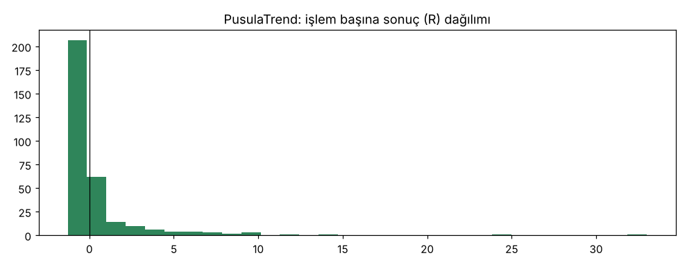
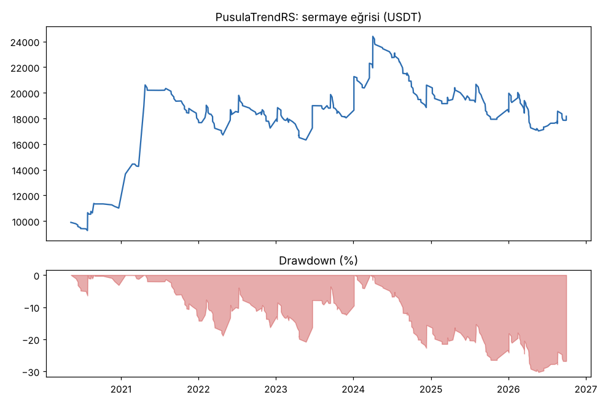

# PusulaTrend vs PusulaTrendRS — tur1_zayif_coin_short_new20 — 2026-10-10

## Özet
- **PusulaTrend**: 319 işlem, işlem başına ortalama **0.27R** (maliyet ve funding dahil), net getiri 92.1%, en büyük düşüş 27.3%.
- **PusulaTrendRS**: 319 işlem, işlem başına ortalama **0.26R** (maliyet ve funding dahil), net getiri 81.7%, en büyük düşüş 30.2%.
- Aynı dönemde coinleri al-tut (eşit ağırlık): getiri 194.7%, ortalama en büyük düşüş 97.6%.

## Ayarlar
- Dönem: 2020-04-11 00:00:00 → 2026-09-30 20:00:00
- Coinler: FIL/USDT:USDT, UNI/USDT:USDT, AAVE/USDT:USDT, NEAR/USDT:USDT, ALGO/USDT:USDT, XTZ/USDT:USDT, THETA/USDT:USDT, VET/USDT:USDT, ICP/USDT:USDT, SAND/USDT:USDT, MANA/USDT:USDT, AXS/USDT:USDT, EGLD/USDT:USDT, HBAR/USDT:USDT, CHZ/USDT:USDT, ENJ/USDT:USDT, ZEC/USDT:USDT, DASH/USDT:USDT, NEO/USDT:USDT, IOTA/USDT:USDT
- Zaman dilimi: 4h
- Yön: long + short
- Mod: futures / isolated
- Kaldıraç: en fazla 3x, likidasyon stop mesafesinin en az 2 katı uzakta (bölüm 7.6)
- Risk: işlem başına sermayenin %1'i (pozisyon büyüklüğü stop mesafesine göre)
- Maliyet: her emir için %0.05 komisyon + %0.05 kayma (= %0.1), funding geçmiş veriden
- Başlangıç sermayesi: 10000 USDT

## Metrikler
| Metrik | PusulaTrend | PusulaTrendRS | Al-tut |
|---|---|---|---|
| Net getiri | 92.1% | 81.7% | 194.7% |
| Max drawdown | 27.3% | 30.2% | 97.6% |
| Profit factor | 1.26 | 1.23 | — |
| Ortalama R | 0.27 | 0.26 | — |
| İşlem sayısı | 319 | 319 | — |
| Winrate | 26.6% | 25.7% | — |

Winrate tek başına başarı ölçütü değildir; asıl ölçüt ortalama R (expectancy) ve drawdown'dur.

## Long / short ayrımı
| Strateji | Yön | İşlem | Ortalama R | Toplam R | Profit factor |
|---|---|---|---|---|---|
| PusulaTrend | long | 150 | 0.44 | 66.49 | 1.38 |
| PusulaTrend | short | 169 | 0.12 | 20.97 | 1.14 |
| PusulaTrendRS | long | 150 | 0.44 | 66.49 | 1.39 |
| PusulaTrendRS | short | 169 | 0.09 | 15.19 | 1.07 |

## Sinyal istatistikleri
| Strateji | Stop | BE | TP1 sonrası BE | TP2 | Diğer | İptal (bölgeye gelmedi / önce stop) | Toplam funding (USDT) |
|---|---|---|---|---|---|---|---|
| PusulaTrend | 47.6% | 13.5% | 0.0% | 0.0% | 38.9% | 7.8% | -3323.89 |
| PusulaTrendRS | 48.6% | 14.1% | 0.0% | 0.0% | 37.3% | 6.7% | -3329.31 |

## Coin bazında
| Strateji | Coin | İşlem | Ortalama R | Toplam R | Al-tut getirisi |
|---|---|---|---|---|---|
| PusulaTrend | FIL/USDT:USDT | 13 | 2.08 | 26.99 | -97.9% |
| PusulaTrend | UNI/USDT:USDT | 32 | -0.24 | -7.71 | 62.4% |
| PusulaTrend | AAVE/USDT:USDT | 22 | -0.61 | -13.45 | 286.5% |
| PusulaTrend | NEAR/USDT:USDT | 14 | 0.58 | 8.06 | 373.4% |
| PusulaTrend | ALGO/USDT:USDT | 19 | 0.56 | 10.60 | -47.9% |
| PusulaTrend | XTZ/USDT:USDT | 23 | -0.05 | -1.07 | -84.3% |
| PusulaTrend | THETA/USDT:USDT | 18 | 1.54 | 27.75 | -48.0% |
| PusulaTrend | VET/USDT:USDT | 19 | 0.99 | 18.84 | 139.2% |
| PusulaTrend | ICP/USDT:USDT | 13 | -0.79 | -10.30 | -99.3% |
| PusulaTrend | SAND/USDT:USDT | 8 | -0.49 | -3.94 | -54.0% |
| PusulaTrend | MANA/USDT:USDT | 12 | 0.80 | 9.66 | -91.4% |
| PusulaTrend | AXS/USDT:USDT | 11 | -0.12 | -1.35 | 136.4% |
| PusulaTrend | EGLD/USDT:USDT | 18 | -0.23 | -4.16 | -65.7% |
| PusulaTrend | HBAR/USDT:USDT | 14 | 0.87 | 12.19 | -68.6% |
| PusulaTrend | CHZ/USDT:USDT | 13 | -0.07 | -0.95 | -26.0% |
| PusulaTrend | ENJ/USDT:USDT | 10 | -0.10 | -0.96 | -83.5% |
| PusulaTrend | ZEC/USDT:USDT | 13 | -0.60 | -7.76 | 3815.4% |
| PusulaTrend | DASH/USDT:USDT | 17 | 0.57 | 9.62 | -19.1% |
| PusulaTrend | NEO/USDT:USDT | 17 | 0.76 | 12.99 | -65.8% |
| PusulaTrend | IOTA/USDT:USDT | 13 | 0.19 | 2.43 | -66.9% |
| PusulaTrendRS | FIL/USDT:USDT | 13 | 1.93 | 25.15 | -97.9% |
| PusulaTrendRS | UNI/USDT:USDT | 31 | -0.22 | -6.71 | 62.4% |
| PusulaTrendRS | AAVE/USDT:USDT | 23 | -0.63 | -14.50 | 286.5% |
| PusulaTrendRS | NEAR/USDT:USDT | 15 | 0.47 | 6.98 | 373.4% |
| PusulaTrendRS | ALGO/USDT:USDT | 20 | 0.48 | 9.55 | -47.9% |
| PusulaTrendRS | XTZ/USDT:USDT | 23 | 0.02 | 0.40 | -84.3% |
| PusulaTrendRS | THETA/USDT:USDT | 18 | 1.47 | 26.50 | -48.0% |
| PusulaTrendRS | VET/USDT:USDT | 19 | 0.91 | 17.38 | 139.2% |
| PusulaTrendRS | ICP/USDT:USDT | 11 | -0.76 | -8.41 | -99.3% |
| PusulaTrendRS | SAND/USDT:USDT | 7 | -0.42 | -2.92 | -54.0% |
| PusulaTrendRS | MANA/USDT:USDT | 12 | 0.94 | 11.25 | -91.4% |
| PusulaTrendRS | AXS/USDT:USDT | 12 | -0.12 | -1.41 | 136.4% |
| PusulaTrendRS | EGLD/USDT:USDT | 20 | -0.24 | -4.71 | -65.7% |
| PusulaTrendRS | HBAR/USDT:USDT | 14 | 0.67 | 9.43 | -68.6% |
| PusulaTrendRS | CHZ/USDT:USDT | 12 | 0.01 | 0.08 | -26.0% |
| PusulaTrendRS | ENJ/USDT:USDT | 9 | -0.21 | -1.88 | -83.5% |
| PusulaTrendRS | ZEC/USDT:USDT | 14 | -0.55 | -7.72 | 3815.4% |
| PusulaTrendRS | DASH/USDT:USDT | 14 | 0.55 | 7.68 | -19.1% |
| PusulaTrendRS | NEO/USDT:USDT | 18 | 0.79 | 14.13 | -65.8% |
| PusulaTrendRS | IOTA/USDT:USDT | 14 | 0.10 | 1.41 | -66.9% |

## Grafikler

## Yorum: güçlü yanlar / şüpheli noktalar
_(Claude tarafından rakamlara bakılarak yazılır.)_

## Karar: devam / düzelt / emekli
_(Claude tarafından yazılır, gerekçesiyle.)_
