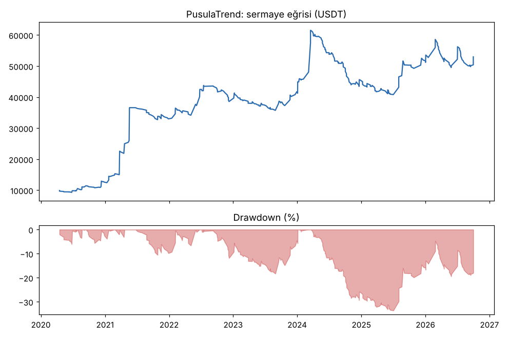
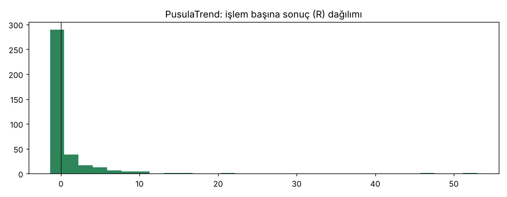
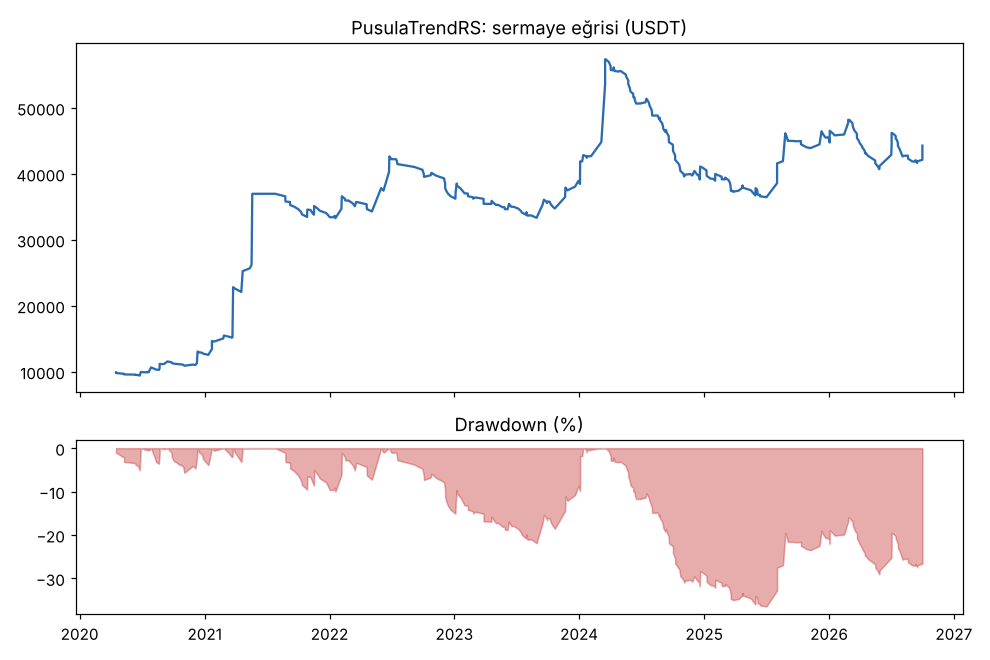
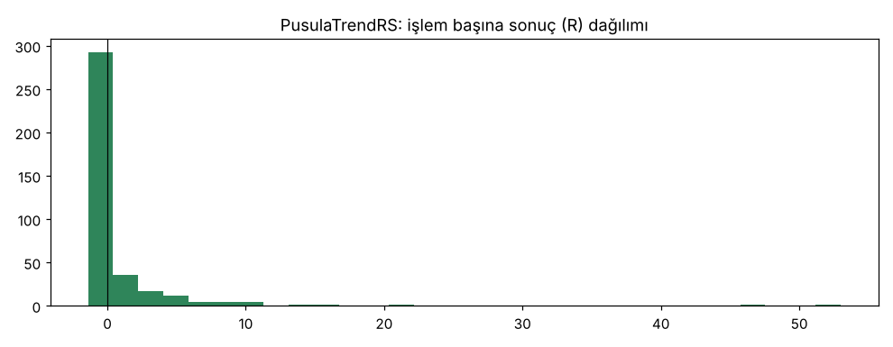

# PusulaTrend vs PusulaTrendRS — tur1_zayif_coin_short_wide16 — 2026-10-10

## Özet
- **PusulaTrend**: 377 işlem, işlem başına ortalama **0.57R** (maliyet ve funding dahil), net getiri 429.7%, en büyük düşüş 33.7%.
- **PusulaTrendRS**: 376 işlem, işlem başına ortalama **0.52R** (maliyet ve funding dahil), net getiri 342.9%, en büyük düşüş 36.5%.
- Aynı dönemde coinleri al-tut (eşit ağırlık): getiri 931.5%, ortalama en büyük düşüş 89.2%.

## Ayarlar
- Dönem: 2020-03-07 16:00:00 → 2026-10-01 00:00:00
- Coinler: BTC/USDT:USDT, ETH/USDT:USDT, SOL/USDT:USDT, XRP/USDT:USDT, BNB/USDT:USDT, DOGE/USDT:USDT, ADA/USDT:USDT, LINK/USDT:USDT, LTC/USDT:USDT, DOT/USDT:USDT, AVAX/USDT:USDT, TRX/USDT:USDT, ATOM/USDT:USDT, BCH/USDT:USDT, ETC/USDT:USDT, XLM/USDT:USDT
- Zaman dilimi: 4h
- Yön: long + short
- Mod: futures / isolated
- Kaldıraç: en fazla 3x, likidasyon stop mesafesinin en az 2 katı uzakta (bölüm 7.6)
- Risk: işlem başına sermayenin %1'i (pozisyon büyüklüğü stop mesafesine göre)
- Maliyet: her emir için %0.05 komisyon + %0.05 kayma (= %0.1), funding geçmiş veriden
- Başlangıç sermayesi: 10000 USDT

## Metrikler
| Metrik | PusulaTrend | PusulaTrendRS | Al-tut |
|---|---|---|---|
| Net getiri | 429.7% | 342.9% | 931.5% |
| Max drawdown | 33.7% | 36.5% | 89.2% |
| Profit factor | 1.53 | 1.45 | — |
| Ortalama R | 0.57 | 0.52 | — |
| İşlem sayısı | 377 | 376 | — |
| Winrate | 30.5% | 30.1% | — |

Winrate tek başına başarı ölçütü değildir; asıl ölçüt ortalama R (expectancy) ve drawdown'dur.

## Long / short ayrımı
| Strateji | Yön | İşlem | Ortalama R | Toplam R | Profit factor |
|---|---|---|---|---|---|
| PusulaTrend | long | 209 | 0.95 | 199.23 | 1.92 |
| PusulaTrend | short | 168 | 0.09 | 14.34 | 1.10 |
| PusulaTrendRS | long | 209 | 0.95 | 199.23 | 1.98 |
| PusulaTrendRS | short | 167 | -0.03 | -5.56 | 0.89 |

## Sinyal istatistikleri
| Strateji | Stop | BE | TP1 sonrası BE | TP2 | Diğer | İptal (bölgeye gelmedi / önce stop) | Toplam funding (USDT) |
|---|---|---|---|---|---|---|---|
| PusulaTrend | 38.2% | 13.8% | 0.0% | 0.0% | 48.0% | 9.6% | -9714.82 |
| PusulaTrendRS | 40.7% | 14.1% | 0.0% | 0.0% | 45.2% | 10.3% | -9034.13 |

## Coin bazında
| Strateji | Coin | İşlem | Ortalama R | Toplam R | Al-tut getirisi |
|---|---|---|---|---|---|
| PusulaTrend | BTC/USDT:USDT | 52 | 0.86 | 44.72 | 841.1% |
| PusulaTrend | ETH/USDT:USDT | 41 | 0.54 | 21.95 | 1027.8% |
| PusulaTrend | SOL/USDT:USDT | 16 | 0.45 | 7.13 | 3424.0% |
| PusulaTrend | XRP/USDT:USDT | 14 | -0.36 | -5.10 | 531.4% |
| PusulaTrend | BNB/USDT:USDT | 49 | 0.68 | 33.43 | 3739.0% |
| PusulaTrend | DOGE/USDT:USDT | 11 | 0.59 | 6.50 | 2460.3% |
| PusulaTrend | ADA/USDT:USDT | 19 | 1.06 | 20.23 | 409.9% |
| PusulaTrend | LINK/USDT:USDT | 18 | 0.48 | 8.61 | 224.4% |
| PusulaTrend | LTC/USDT:USDT | 24 | 0.08 | 1.85 | 11.3% |
| PusulaTrend | DOT/USDT:USDT | 19 | 0.04 | 0.71 | -63.4% |
| PusulaTrend | AVAX/USDT:USDT | 11 | -0.19 | -2.07 | 171.8% |
| PusulaTrend | TRX/USDT:USDT | 46 | 0.58 | 26.91 | 1881.6% |
| PusulaTrend | ATOM/USDT:USDT | 9 | -0.27 | -2.46 | -51.5% |
| PusulaTrend | BCH/USDT:USDT | 24 | 0.12 | 2.88 | -7.2% |
| PusulaTrend | ETC/USDT:USDT | 13 | 3.67 | 47.70 | 14.6% |
| PusulaTrend | XLM/USDT:USDT | 11 | 0.05 | 0.56 | 289.8% |
| PusulaTrendRS | BTC/USDT:USDT | 36 | 1.47 | 52.88 | 841.1% |
| PusulaTrendRS | ETH/USDT:USDT | 45 | 0.40 | 18.22 | 1027.8% |
| PusulaTrendRS | SOL/USDT:USDT | 17 | 0.30 | 5.11 | 3424.0% |
| PusulaTrendRS | XRP/USDT:USDT | 18 | -0.32 | -5.73 | 531.4% |
| PusulaTrendRS | BNB/USDT:USDT | 46 | 0.73 | 33.37 | 3739.0% |
| PusulaTrendRS | DOGE/USDT:USDT | 12 | 0.46 | 5.47 | 2460.3% |
| PusulaTrendRS | ADA/USDT:USDT | 22 | 0.71 | 15.51 | 409.9% |
| PusulaTrendRS | LINK/USDT:USDT | 17 | 0.57 | 9.75 | 224.4% |
| PusulaTrendRS | LTC/USDT:USDT | 24 | -0.23 | -5.57 | 11.3% |
| PusulaTrendRS | DOT/USDT:USDT | 22 | -0.15 | -3.21 | -63.4% |
| PusulaTrendRS | AVAX/USDT:USDT | 12 | -0.26 | -3.12 | 171.8% |
| PusulaTrendRS | TRX/USDT:USDT | 43 | 0.59 | 25.17 | 1881.6% |
| PusulaTrendRS | ATOM/USDT:USDT | 13 | -0.10 | -1.28 | -51.5% |
| PusulaTrendRS | BCH/USDT:USDT | 23 | -0.06 | -1.38 | -7.2% |
| PusulaTrendRS | ETC/USDT:USDT | 15 | 3.19 | 47.92 | 14.6% |
| PusulaTrendRS | XLM/USDT:USDT | 11 | 0.05 | 0.56 | 289.8% |

## Grafikler

## Yorum: güçlü yanlar / şüpheli noktalar
_(Claude tarafından rakamlara bakılarak yazılır.)_

## Karar: devam / düzelt / emekli
_(Claude tarafından yazılır, gerekçesiyle.)_
