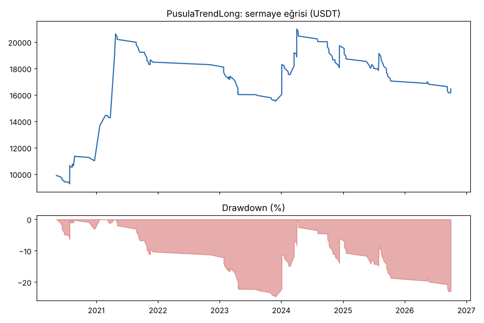
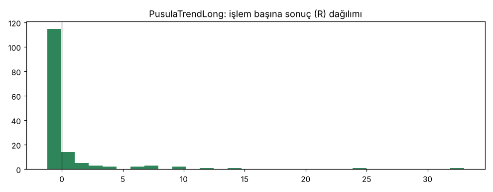
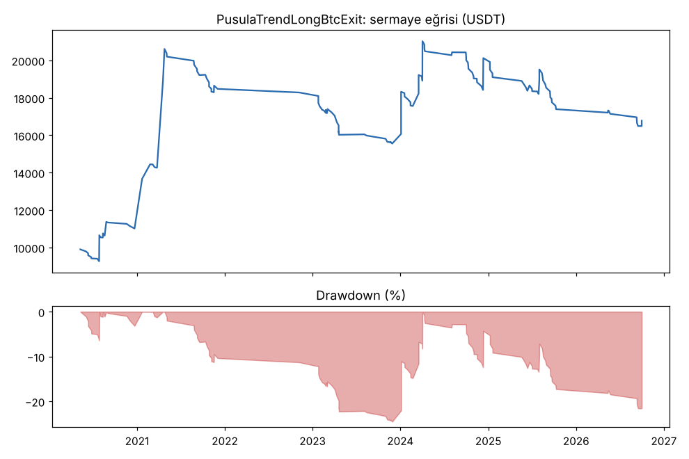
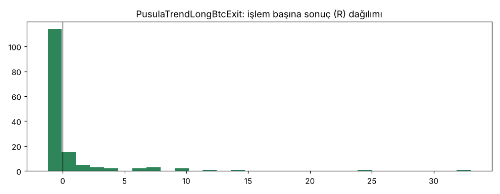
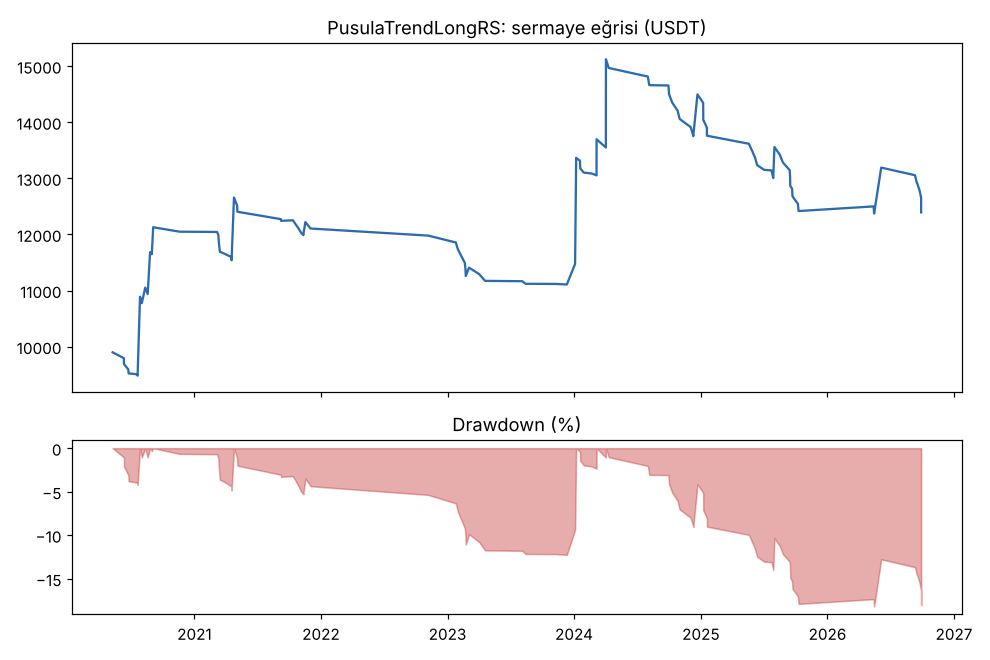
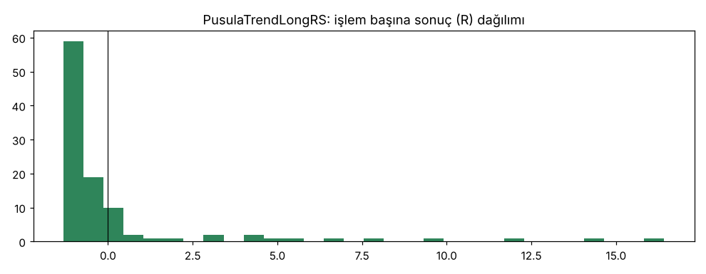

# PusulaTrendLong vs PusulaTrendLongBtcExit vs PusulaTrendLongRS — tur2_new20 — 2026-10-10

## Özet
- **PusulaTrendLong**: 150 işlem, işlem başına ortalama **0.44R** (maliyet ve funding dahil), net getiri 64.5%, en büyük düşüş 24.7%.
- **PusulaTrendLongBtcExit**: 150 işlem, işlem başına ortalama **0.46R** (maliyet ve funding dahil), net getiri 67.8%, en büyük düşüş 24.6%.
- **PusulaTrendLongRS**: 104 işlem, işlem başına ortalama **0.27R** (maliyet ve funding dahil), net getiri 23.9%, en büyük düşüş 18.2%.
- Aynı dönemde coinleri al-tut (eşit ağırlık): getiri 194.7%, ortalama en büyük düşüş 97.6%.

## Ayarlar
- Dönem: 2020-04-11 00:00:00 → 2026-09-30 20:00:00
- Coinler: FIL/USDT:USDT, UNI/USDT:USDT, AAVE/USDT:USDT, NEAR/USDT:USDT, ALGO/USDT:USDT, XTZ/USDT:USDT, THETA/USDT:USDT, VET/USDT:USDT, ICP/USDT:USDT, SAND/USDT:USDT, MANA/USDT:USDT, AXS/USDT:USDT, EGLD/USDT:USDT, HBAR/USDT:USDT, CHZ/USDT:USDT, ENJ/USDT:USDT, ZEC/USDT:USDT, DASH/USDT:USDT, NEO/USDT:USDT, IOTA/USDT:USDT
- Zaman dilimi: 4h
- Yön: long + short
- Mod: futures / isolated
- Kaldıraç: en fazla 3x, likidasyon stop mesafesinin en az 2 katı uzakta (bölüm 7.6)
- Risk: işlem başına sermayenin %1'i (pozisyon büyüklüğü stop mesafesine göre)
- Maliyet: her emir için %0.05 komisyon + %0.05 kayma (= %0.1), funding geçmiş veriden
- Başlangıç sermayesi: 10000 USDT

## Metrikler
| Metrik | PusulaTrendLong | PusulaTrendLongBtcExit | PusulaTrendLongRS | Al-tut |
|---|---|---|---|---|
| Net getiri | 64.5% | 67.8% | 23.9% | 194.7% |
| Max drawdown | 24.7% | 24.6% | 18.2% | 97.6% |
| Profit factor | 1.39 | 1.41 | 1.27 | — |
| Ortalama R | 0.44 | 0.46 | 0.27 | — |
| İşlem sayısı | 150 | 150 | 104 | — |
| Winrate | 18.0% | 19.3% | 16.3% | — |

Winrate tek başına başarı ölçütü değildir; asıl ölçüt ortalama R (expectancy) ve drawdown'dur.

## Long / short ayrımı
| Strateji | Yön | İşlem | Ortalama R | Toplam R | Profit factor |
|---|---|---|---|---|---|
| PusulaTrendLong | long | 150 | 0.44 | 66.50 | 1.39 |
| PusulaTrendLong | short | 0 | — | 0.00 | — |
| PusulaTrendLongBtcExit | long | 150 | 0.46 | 68.51 | 1.41 |
| PusulaTrendLongBtcExit | short | 0 | — | 0.00 | — |
| PusulaTrendLongRS | long | 104 | 0.27 | 28.08 | 1.27 |
| PusulaTrendLongRS | short | 0 | — | 0.00 | — |

## Sinyal istatistikleri
| Strateji | Stop | BE | TP1 sonrası BE | TP2 | Diğer | İptal (bölgeye gelmedi / önce stop) | Toplam funding (USDT) |
|---|---|---|---|---|---|---|---|
| PusulaTrendLong | 50.0% | 14.0% | 0.0% | 0.0% | 36.0% | 5.1% | -3068.31 |
| PusulaTrendLongBtcExit | 49.3% | 13.3% | 0.0% | 0.0% | 37.3% | 5.1% | -3070.58 |
| PusulaTrendLongRS | 53.8% | 17.3% | 0.0% | 0.0% | 28.8% | 5.5% | -1589.85 |

## Coin bazında
| Strateji | Coin | İşlem | Ortalama R | Toplam R | Al-tut getirisi |
|---|---|---|---|---|---|
| PusulaTrendLong | FIL/USDT:USDT | 3 | 10.46 | 31.38 | -97.9% |
| PusulaTrendLong | UNI/USDT:USDT | 17 | -0.40 | -6.74 | 62.4% |
| PusulaTrendLong | AAVE/USDT:USDT | 15 | -0.72 | -10.73 | 286.5% |
| PusulaTrendLong | NEAR/USDT:USDT | 7 | 1.41 | 9.88 | 373.4% |
| PusulaTrendLong | ALGO/USDT:USDT | 8 | 0.37 | 3.00 | -47.9% |
| PusulaTrendLong | XTZ/USDT:USDT | 13 | 0.01 | 0.14 | -84.3% |
| PusulaTrendLong | THETA/USDT:USDT | 10 | 1.71 | 17.07 | -48.0% |
| PusulaTrendLong | VET/USDT:USDT | 7 | 2.59 | 18.13 | 139.2% |
| PusulaTrendLong | ICP/USDT:USDT | 4 | -0.56 | -2.25 | -99.3% |
| PusulaTrendLong | SAND/USDT:USDT | 3 | -0.73 | -2.19 | -54.0% |
| PusulaTrendLong | MANA/USDT:USDT | 5 | -0.31 | -1.57 | -91.4% |
| PusulaTrendLong | AXS/USDT:USDT | 3 | -1.03 | -3.09 | 136.4% |
| PusulaTrendLong | EGLD/USDT:USDT | 5 | -0.16 | -0.80 | -65.7% |
| PusulaTrendLong | HBAR/USDT:USDT | 2 | -0.06 | -0.12 | -68.6% |
| PusulaTrendLong | CHZ/USDT:USDT | 7 | -0.67 | -4.66 | -26.0% |
| PusulaTrendLong | ENJ/USDT:USDT | 2 | 2.32 | 4.65 | -83.5% |
| PusulaTrendLong | ZEC/USDT:USDT | 8 | -0.48 | -3.81 | 3815.4% |
| PusulaTrendLong | DASH/USDT:USDT | 12 | 0.32 | 3.83 | -19.1% |
| PusulaTrendLong | NEO/USDT:USDT | 11 | 0.84 | 9.28 | -65.8% |
| PusulaTrendLong | IOTA/USDT:USDT | 8 | 0.64 | 5.10 | -66.9% |
| PusulaTrendLongBtcExit | FIL/USDT:USDT | 3 | 10.46 | 31.38 | -97.9% |
| PusulaTrendLongBtcExit | UNI/USDT:USDT | 17 | -0.38 | -6.54 | 62.4% |
| PusulaTrendLongBtcExit | AAVE/USDT:USDT | 15 | -0.59 | -8.91 | 286.5% |
| PusulaTrendLongBtcExit | NEAR/USDT:USDT | 7 | 1.41 | 9.88 | 373.4% |
| PusulaTrendLongBtcExit | ALGO/USDT:USDT | 8 | 0.37 | 3.00 | -47.9% |
| PusulaTrendLongBtcExit | XTZ/USDT:USDT | 13 | 0.01 | 0.14 | -84.3% |
| PusulaTrendLongBtcExit | THETA/USDT:USDT | 10 | 1.71 | 17.07 | -48.0% |
| PusulaTrendLongBtcExit | VET/USDT:USDT | 7 | 2.59 | 18.13 | 139.2% |
| PusulaTrendLongBtcExit | ICP/USDT:USDT | 4 | -0.56 | -2.25 | -99.3% |
| PusulaTrendLongBtcExit | SAND/USDT:USDT | 3 | -0.73 | -2.19 | -54.0% |
| PusulaTrendLongBtcExit | MANA/USDT:USDT | 5 | -0.31 | -1.57 | -91.4% |
| PusulaTrendLongBtcExit | AXS/USDT:USDT | 3 | -1.03 | -3.09 | 136.4% |
| PusulaTrendLongBtcExit | EGLD/USDT:USDT | 5 | -0.16 | -0.80 | -65.7% |
| PusulaTrendLongBtcExit | HBAR/USDT:USDT | 2 | -0.06 | -0.12 | -68.6% |
| PusulaTrendLongBtcExit | CHZ/USDT:USDT | 7 | -0.67 | -4.66 | -26.0% |
| PusulaTrendLongBtcExit | ENJ/USDT:USDT | 2 | 2.32 | 4.65 | -83.5% |
| PusulaTrendLongBtcExit | ZEC/USDT:USDT | 8 | -0.48 | -3.81 | 3815.4% |
| PusulaTrendLongBtcExit | DASH/USDT:USDT | 12 | 0.32 | 3.83 | -19.1% |
| PusulaTrendLongBtcExit | NEO/USDT:USDT | 11 | 0.84 | 9.28 | -65.8% |
| PusulaTrendLongBtcExit | IOTA/USDT:USDT | 8 | 0.64 | 5.10 | -66.9% |
| PusulaTrendLongRS | FIL/USDT:USDT | 1 | 0.76 | 0.76 | -97.9% |
| PusulaTrendLongRS | UNI/USDT:USDT | 10 | -0.30 | -2.99 | 62.4% |
| PusulaTrendLongRS | AAVE/USDT:USDT | 15 | -0.37 | -5.57 | 286.5% |
| PusulaTrendLongRS | NEAR/USDT:USDT | 8 | 4.25 | 34.00 | 373.4% |
| PusulaTrendLongRS | ALGO/USDT:USDT | 6 | -0.33 | -1.97 | -47.9% |
| PusulaTrendLongRS | XTZ/USDT:USDT | 5 | -0.76 | -3.80 | -84.3% |
| PusulaTrendLongRS | THETA/USDT:USDT | 4 | -0.94 | -3.77 | -48.0% |
| PusulaTrendLongRS | VET/USDT:USDT | 5 | 3.54 | 17.72 | 139.2% |
| PusulaTrendLongRS | ICP/USDT:USDT | 4 | -0.81 | -3.24 | -99.3% |
| PusulaTrendLongRS | SAND/USDT:USDT | 2 | -0.73 | -1.45 | -54.0% |
| PusulaTrendLongRS | MANA/USDT:USDT | 1 | -1.03 | -1.03 | -91.4% |
| PusulaTrendLongRS | AXS/USDT:USDT | 2 | -1.01 | -2.03 | 136.4% |
| PusulaTrendLongRS | EGLD/USDT:USDT | 6 | -0.18 | -1.10 | -65.7% |
| PusulaTrendLongRS | HBAR/USDT:USDT | 0 | — | 0.00 | -68.6% |
| PusulaTrendLongRS | CHZ/USDT:USDT | 3 | -0.78 | -2.34 | -26.0% |
| PusulaTrendLongRS | ENJ/USDT:USDT | 3 | -1.05 | -3.15 | -83.5% |
| PusulaTrendLongRS | ZEC/USDT:USDT | 7 | -0.36 | -2.50 | 3815.4% |
| PusulaTrendLongRS | DASH/USDT:USDT | 6 | -0.59 | -3.51 | -19.1% |
| PusulaTrendLongRS | NEO/USDT:USDT | 9 | 0.90 | 8.12 | -65.8% |
| PusulaTrendLongRS | IOTA/USDT:USDT | 7 | 0.85 | 5.96 | -66.9% |

## Grafikler

## Yorum: güçlü yanlar / şüpheli noktalar
_(Claude tarafından rakamlara bakılarak yazılır.)_

## Karar: devam / düzelt / emekli
_(Claude tarafından yazılır, gerekçesiyle.)_
