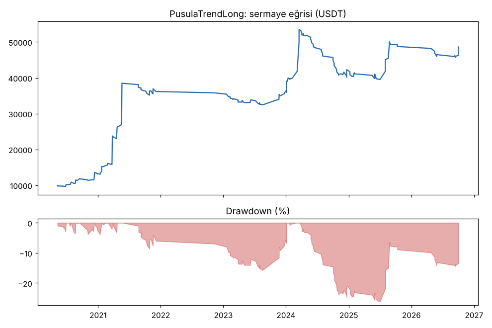
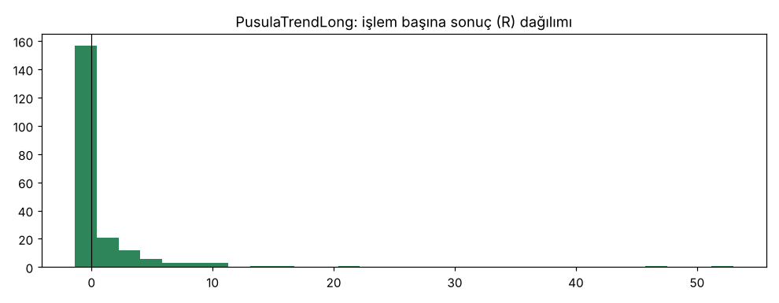
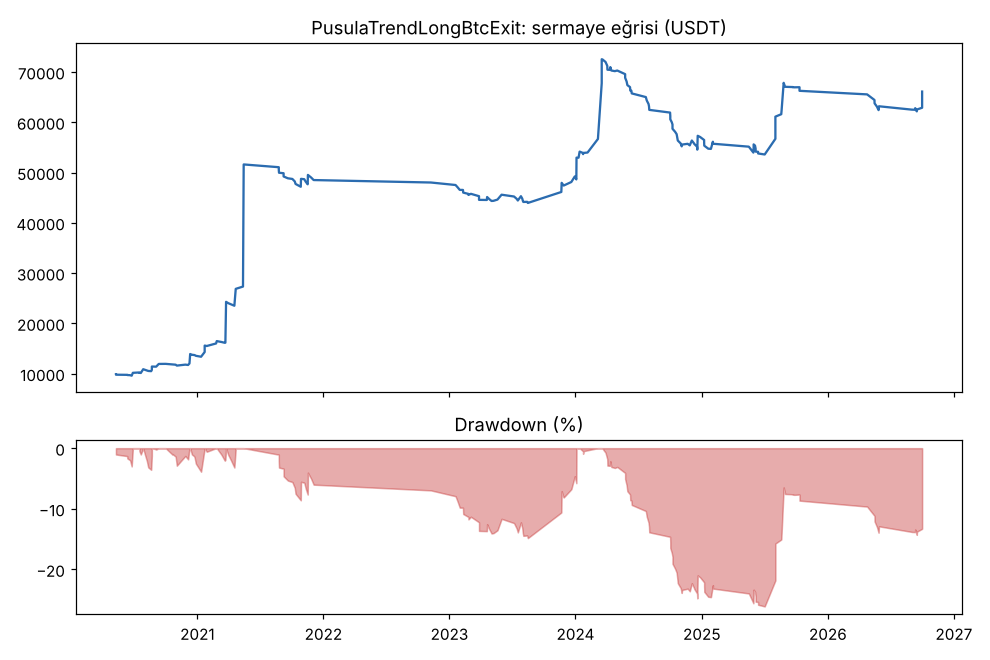
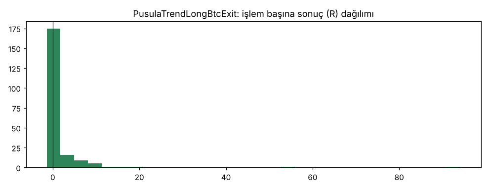
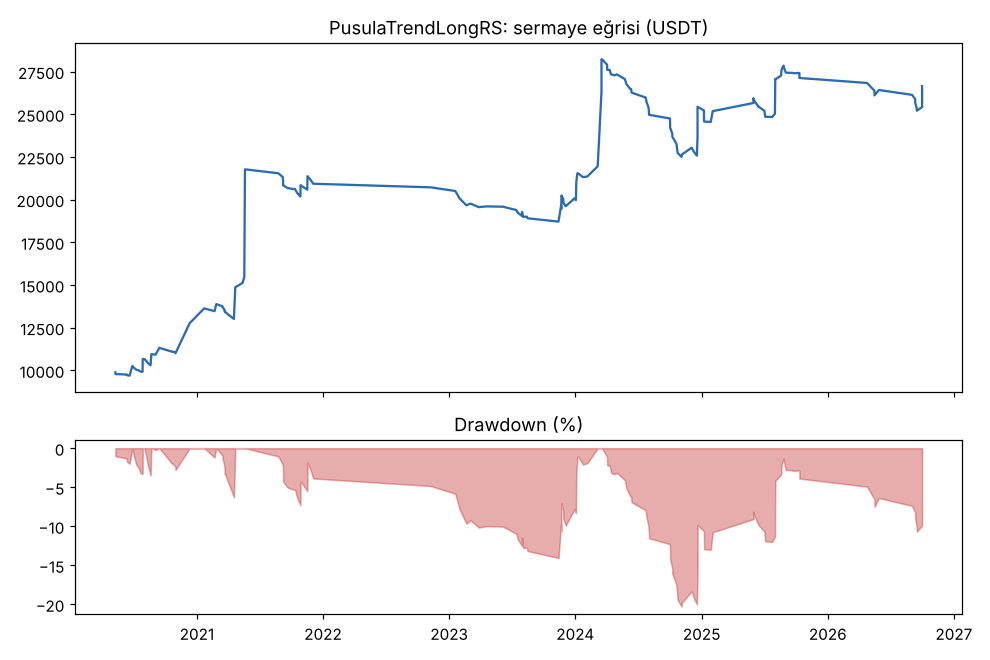
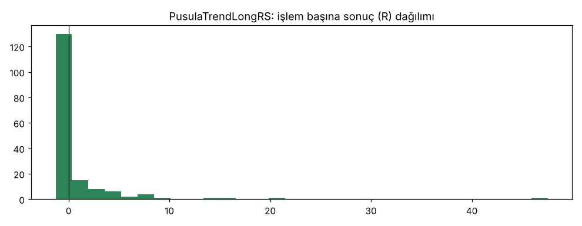

# PusulaTrendLong vs PusulaTrendLongBtcExit vs PusulaTrendLongRS — tur2_wide16 — 2026-10-10

## Özet
- **PusulaTrendLong**: 210 işlem, işlem başına ortalama **0.95R** (maliyet ve funding dahil), net getiri 386.2%, en büyük düşüş 26.1%.
- **PusulaTrendLongBtcExit**: 210 işlem, işlem başına ortalama **1.20R** (maliyet ve funding dahil), net getiri 561.0%, en büyük düşüş 26.1%.
- **PusulaTrendLongRS**: 170 işlem, işlem başına ortalama **0.72R** (maliyet ve funding dahil), net getiri 166.5%, en büyük düşüş 20.3%.
- Aynı dönemde coinleri al-tut (eşit ağırlık): getiri 931.5%, ortalama en büyük düşüş 89.2%.

## Ayarlar
- Dönem: 2020-03-07 16:00:00 → 2026-10-01 00:00:00
- Coinler: BTC/USDT:USDT, ETH/USDT:USDT, SOL/USDT:USDT, XRP/USDT:USDT, BNB/USDT:USDT, DOGE/USDT:USDT, ADA/USDT:USDT, LINK/USDT:USDT, LTC/USDT:USDT, DOT/USDT:USDT, AVAX/USDT:USDT, TRX/USDT:USDT, ATOM/USDT:USDT, BCH/USDT:USDT, ETC/USDT:USDT, XLM/USDT:USDT
- Zaman dilimi: 4h
- Yön: long + short
- Mod: futures / isolated
- Kaldıraç: en fazla 3x, likidasyon stop mesafesinin en az 2 katı uzakta (bölüm 7.6)
- Risk: işlem başına sermayenin %1'i (pozisyon büyüklüğü stop mesafesine göre)
- Maliyet: her emir için %0.05 komisyon + %0.05 kayma (= %0.1), funding geçmiş veriden
- Başlangıç sermayesi: 10000 USDT

## Metrikler
| Metrik | PusulaTrendLong | PusulaTrendLongBtcExit | PusulaTrendLongRS | Al-tut |
|---|---|---|---|---|
| Net getiri | 386.2% | 561.0% | 166.5% | 931.5% |
| Max drawdown | 26.1% | 26.1% | 20.3% | 89.2% |
| Profit factor | 1.97 | 2.07 | 1.85 | — |
| Ortalama R | 0.95 | 1.20 | 0.72 | — |
| İşlem sayısı | 210 | 210 | 170 | — |
| Winrate | 29.5% | 30.5% | 27.6% | — |

Winrate tek başına başarı ölçütü değildir; asıl ölçüt ortalama R (expectancy) ve drawdown'dur.

## Long / short ayrımı
| Strateji | Yön | İşlem | Ortalama R | Toplam R | Profit factor |
|---|---|---|---|---|---|
| PusulaTrendLong | long | 210 | 0.95 | 198.71 | 1.97 |
| PusulaTrendLong | short | 0 | — | 0.00 | — |
| PusulaTrendLongBtcExit | long | 210 | 1.20 | 253.04 | 2.07 |
| PusulaTrendLongBtcExit | short | 0 | — | 0.00 | — |
| PusulaTrendLongRS | long | 170 | 0.72 | 121.73 | 1.85 |
| PusulaTrendLongRS | short | 0 | — | 0.00 | — |

## Sinyal istatistikleri
| Strateji | Stop | BE | TP1 sonrası BE | TP2 | Diğer | İptal (bölgeye gelmedi / önce stop) | Toplam funding (USDT) |
|---|---|---|---|---|---|---|---|
| PusulaTrendLong | 38.1% | 12.4% | 0.0% | 0.0% | 49.5% | 5.8% | -8491.67 |
| PusulaTrendLongBtcExit | 37.6% | 11.9% | 0.0% | 0.0% | 50.5% | 5.8% | -10431.51 |
| PusulaTrendLongRS | 41.2% | 12.4% | 0.0% | 0.0% | 46.5% | 8.1% | -4160.01 |

## Coin bazında
| Strateji | Coin | İşlem | Ortalama R | Toplam R | Al-tut getirisi |
|---|---|---|---|---|---|
| PusulaTrendLong | BTC/USDT:USDT | 36 | 1.47 | 52.88 | 841.1% |
| PusulaTrendLong | ETH/USDT:USDT | 30 | 0.74 | 22.21 | 1027.8% |
| PusulaTrendLong | SOL/USDT:USDT | 8 | -0.37 | -2.98 | 3424.0% |
| PusulaTrendLong | XRP/USDT:USDT | 7 | -0.13 | -0.90 | 531.4% |
| PusulaTrendLong | BNB/USDT:USDT | 41 | 0.92 | 37.63 | 3739.0% |
| PusulaTrendLong | DOGE/USDT:USDT | 4 | -0.04 | -0.17 | 2460.3% |
| PusulaTrendLong | ADA/USDT:USDT | 5 | 2.72 | 13.58 | 409.9% |
| PusulaTrendLong | LINK/USDT:USDT | 7 | 0.49 | 3.42 | 224.4% |
| PusulaTrendLong | LTC/USDT:USDT | 14 | -0.28 | -3.92 | 11.3% |
| PusulaTrendLong | DOT/USDT:USDT | 2 | -0.54 | -1.08 | -63.4% |
| PusulaTrendLong | AVAX/USDT:USDT | 5 | 0.03 | 0.17 | 171.8% |
| PusulaTrendLong | TRX/USDT:USDT | 34 | 0.83 | 28.39 | 1881.6% |
| PusulaTrendLong | ATOM/USDT:USDT | 2 | -1.04 | -2.07 | -51.5% |
| PusulaTrendLong | BCH/USDT:USDT | 8 | 0.35 | 2.80 | -7.2% |
| PusulaTrendLong | ETC/USDT:USDT | 3 | 17.11 | 51.34 | 14.6% |
| PusulaTrendLong | XLM/USDT:USDT | 4 | -0.65 | -2.59 | 289.8% |
| PusulaTrendLongBtcExit | BTC/USDT:USDT | 36 | 1.47 | 52.88 | 841.1% |
| PusulaTrendLongBtcExit | ETH/USDT:USDT | 30 | 0.88 | 26.30 | 1027.8% |
| PusulaTrendLongBtcExit | SOL/USDT:USDT | 8 | -0.37 | -2.98 | 3424.0% |
| PusulaTrendLongBtcExit | XRP/USDT:USDT | 7 | 0.20 | 1.38 | 531.4% |
| PusulaTrendLongBtcExit | BNB/USDT:USDT | 41 | 0.95 | 39.04 | 3739.0% |
| PusulaTrendLongBtcExit | DOGE/USDT:USDT | 4 | -0.04 | -0.17 | 2460.3% |
| PusulaTrendLongBtcExit | ADA/USDT:USDT | 5 | 2.72 | 13.58 | 409.9% |
| PusulaTrendLongBtcExit | LINK/USDT:USDT | 7 | 0.49 | 3.42 | 224.4% |
| PusulaTrendLongBtcExit | LTC/USDT:USDT | 14 | -0.28 | -3.92 | 11.3% |
| PusulaTrendLongBtcExit | DOT/USDT:USDT | 2 | -0.54 | -1.08 | -63.4% |
| PusulaTrendLongBtcExit | AVAX/USDT:USDT | 5 | 0.03 | 0.17 | 171.8% |
| PusulaTrendLongBtcExit | TRX/USDT:USDT | 34 | 0.84 | 28.39 | 1881.6% |
| PusulaTrendLongBtcExit | ATOM/USDT:USDT | 2 | -1.04 | -2.07 | -51.5% |
| PusulaTrendLongBtcExit | BCH/USDT:USDT | 8 | 0.35 | 2.80 | -7.2% |
| PusulaTrendLongBtcExit | ETC/USDT:USDT | 3 | 32.63 | 97.89 | 14.6% |
| PusulaTrendLongBtcExit | XLM/USDT:USDT | 4 | -0.65 | -2.59 | 289.8% |
| PusulaTrendLongRS | BTC/USDT:USDT | 42 | 1.15 | 48.18 | 841.1% |
| PusulaTrendLongRS | ETH/USDT:USDT | 20 | 0.70 | 13.98 | 1027.8% |
| PusulaTrendLongRS | SOL/USDT:USDT | 11 | -0.09 | -1.04 | 3424.0% |
| PusulaTrendLongRS | XRP/USDT:USDT | 8 | -0.24 | -1.88 | 531.4% |
| PusulaTrendLongRS | BNB/USDT:USDT | 22 | -0.45 | -9.99 | 3739.0% |
| PusulaTrendLongRS | DOGE/USDT:USDT | 2 | -0.54 | -1.08 | 2460.3% |
| PusulaTrendLongRS | ADA/USDT:USDT | 6 | 1.14 | 6.83 | 409.9% |
| PusulaTrendLongRS | LINK/USDT:USDT | 8 | 1.46 | 11.69 | 224.4% |
| PusulaTrendLongRS | LTC/USDT:USDT | 8 | -0.38 | -3.02 | 11.3% |
| PusulaTrendLongRS | DOT/USDT:USDT | 1 | -0.96 | -0.96 | -63.4% |
| PusulaTrendLongRS | AVAX/USDT:USDT | 6 | -0.14 | -0.87 | 171.8% |
| PusulaTrendLongRS | TRX/USDT:USDT | 23 | 0.87 | 19.95 | 1881.6% |
| PusulaTrendLongRS | ATOM/USDT:USDT | 4 | -1.04 | -4.17 | -51.5% |
| PusulaTrendLongRS | BCH/USDT:USDT | 6 | -0.52 | -3.09 | -7.2% |
| PusulaTrendLongRS | ETC/USDT:USDT | 1 | 47.52 | 47.52 | 14.6% |
| PusulaTrendLongRS | XLM/USDT:USDT | 2 | -0.16 | -0.33 | 289.8% |

## Grafikler

## Yorum: güçlü yanlar / şüpheli noktalar
_(Claude tarafından rakamlara bakılarak yazılır.)_

## Karar: devam / düzelt / emekli
_(Claude tarafından yazılır, gerekçesiyle.)_
