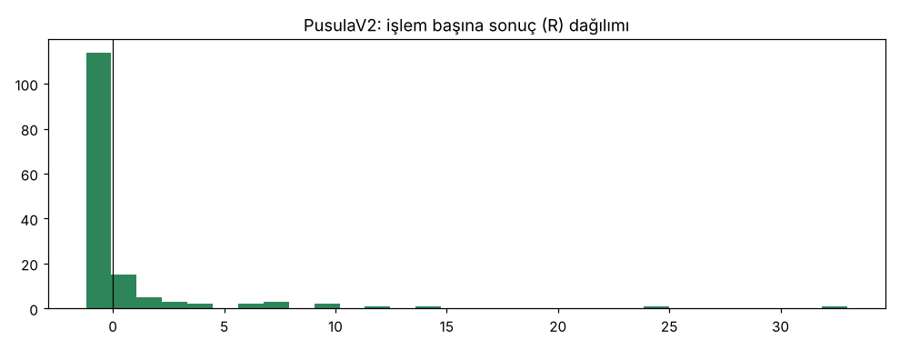
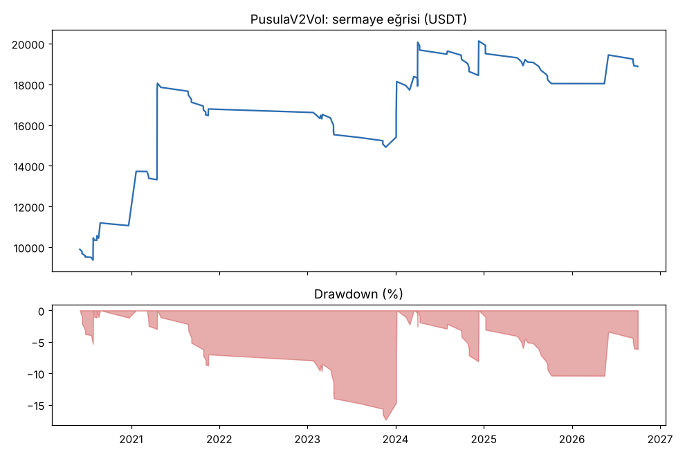
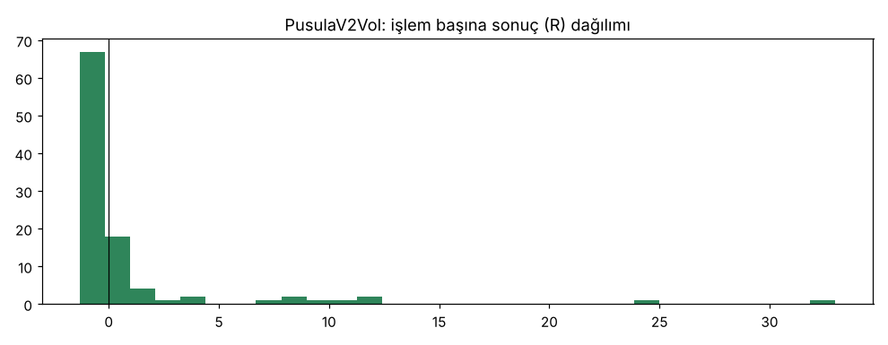
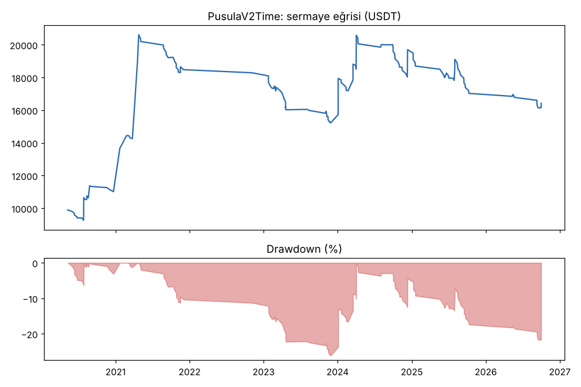
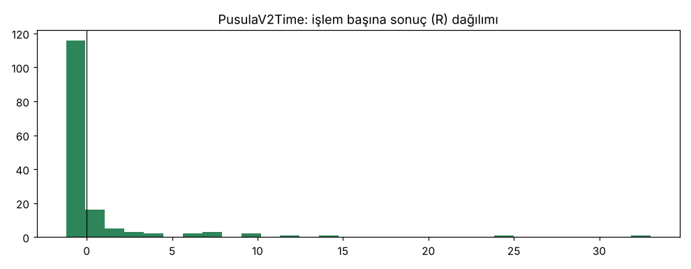

# PusulaV2 vs PusulaV2Vol vs PusulaV2Time — tur3_new20 — 2026-10-10

## Özet
- **PusulaV2**: 150 işlem, işlem başına ortalama **0.46R** (maliyet ve funding dahil), net getiri 67.8%, en büyük düşüş 24.6%.
- **PusulaV2Vol**: 101 işlem, işlem başına ortalama **0.76R** (maliyet ve funding dahil), net getiri 88.7%, en büyük düşüş 17.4%.
- **PusulaV2Time**: 153 işlem, işlem başına ortalama **0.43R** (maliyet ve funding dahil), net getiri 64.3%, en büyük düşüş 26.2%.
- Aynı dönemde coinleri al-tut (eşit ağırlık): getiri 194.7%, ortalama en büyük düşüş 97.6%.

## Ayarlar
- Dönem: 2020-04-11 00:00:00 → 2026-09-30 20:00:00
- Coinler: FIL/USDT:USDT, UNI/USDT:USDT, AAVE/USDT:USDT, NEAR/USDT:USDT, ALGO/USDT:USDT, XTZ/USDT:USDT, THETA/USDT:USDT, VET/USDT:USDT, ICP/USDT:USDT, SAND/USDT:USDT, MANA/USDT:USDT, AXS/USDT:USDT, EGLD/USDT:USDT, HBAR/USDT:USDT, CHZ/USDT:USDT, ENJ/USDT:USDT, ZEC/USDT:USDT, DASH/USDT:USDT, NEO/USDT:USDT, IOTA/USDT:USDT
- Zaman dilimi: 4h
- Yön: long + short
- Mod: futures / isolated
- Kaldıraç: en fazla 3x, likidasyon stop mesafesinin en az 2 katı uzakta (bölüm 7.6)
- Risk: işlem başına sermayenin %1'i (pozisyon büyüklüğü stop mesafesine göre)
- Maliyet: her emir için %0.05 komisyon + %0.05 kayma (= %0.1), funding geçmiş veriden
- Başlangıç sermayesi: 10000 USDT

## Metrikler
| Metrik | PusulaV2 | PusulaV2Vol | PusulaV2Time | Al-tut |
|---|---|---|---|---|
| Net getiri | 67.8% | 88.7% | 64.3% | 194.7% |
| Max drawdown | 24.6% | 17.4% | 26.2% | 97.6% |
| Profit factor | 1.41 | 1.81 | 1.38 | — |
| Ortalama R | 0.46 | 0.76 | 0.43 | — |
| İşlem sayısı | 150 | 101 | 153 | — |
| Winrate | 19.3% | 18.8% | 19.6% | — |

Winrate tek başına başarı ölçütü değildir; asıl ölçüt ortalama R (expectancy) ve drawdown'dur.

## Long / short ayrımı
| Strateji | Yön | İşlem | Ortalama R | Toplam R | Profit factor |
|---|---|---|---|---|---|
| PusulaV2 | long | 150 | 0.46 | 68.51 | 1.41 |
| PusulaV2 | short | 0 | — | 0.00 | — |
| PusulaV2Vol | long | 101 | 0.76 | 76.62 | 1.81 |
| PusulaV2Vol | short | 0 | — | 0.00 | — |
| PusulaV2Time | long | 153 | 0.43 | 66.37 | 1.38 |
| PusulaV2Time | short | 0 | — | 0.00 | — |

## Sinyal istatistikleri
| Strateji | Stop | BE | TP1 sonrası BE | TP2 | Diğer | İptal (bölgeye gelmedi / önce stop) | Toplam funding (USDT) |
|---|---|---|---|---|---|---|---|
| PusulaV2 | 49.3% | 13.3% | 0.0% | 0.0% | 37.3% | 5.1% | -3070.58 |
| PusulaV2Vol | 52.5% | 16.8% | 0.0% | 0.0% | 30.7% | 7.3% | -2342.10 |
| PusulaV2Time | 50.3% | 12.4% | 0.0% | 0.0% | 37.3% | 5.0% | -3039.19 |

## Coin bazında
| Strateji | Coin | İşlem | Ortalama R | Toplam R | Al-tut getirisi |
|---|---|---|---|---|---|
| PusulaV2 | FIL/USDT:USDT | 3 | 10.46 | 31.38 | -97.9% |
| PusulaV2 | UNI/USDT:USDT | 17 | -0.38 | -6.54 | 62.4% |
| PusulaV2 | AAVE/USDT:USDT | 15 | -0.59 | -8.91 | 286.5% |
| PusulaV2 | NEAR/USDT:USDT | 7 | 1.41 | 9.88 | 373.4% |
| PusulaV2 | ALGO/USDT:USDT | 8 | 0.37 | 3.00 | -47.9% |
| PusulaV2 | XTZ/USDT:USDT | 13 | 0.01 | 0.14 | -84.3% |
| PusulaV2 | THETA/USDT:USDT | 10 | 1.71 | 17.07 | -48.0% |
| PusulaV2 | VET/USDT:USDT | 7 | 2.59 | 18.13 | 139.2% |
| PusulaV2 | ICP/USDT:USDT | 4 | -0.56 | -2.25 | -99.3% |
| PusulaV2 | SAND/USDT:USDT | 3 | -0.73 | -2.19 | -54.0% |
| PusulaV2 | MANA/USDT:USDT | 5 | -0.31 | -1.57 | -91.4% |
| PusulaV2 | AXS/USDT:USDT | 3 | -1.03 | -3.09 | 136.4% |
| PusulaV2 | EGLD/USDT:USDT | 5 | -0.16 | -0.80 | -65.7% |
| PusulaV2 | HBAR/USDT:USDT | 2 | -0.06 | -0.12 | -68.6% |
| PusulaV2 | CHZ/USDT:USDT | 7 | -0.67 | -4.66 | -26.0% |
| PusulaV2 | ENJ/USDT:USDT | 2 | 2.32 | 4.65 | -83.5% |
| PusulaV2 | ZEC/USDT:USDT | 8 | -0.48 | -3.81 | 3815.4% |
| PusulaV2 | DASH/USDT:USDT | 12 | 0.32 | 3.83 | -19.1% |
| PusulaV2 | NEO/USDT:USDT | 11 | 0.84 | 9.28 | -65.8% |
| PusulaV2 | IOTA/USDT:USDT | 8 | 0.64 | 5.10 | -66.9% |
| PusulaV2Vol | FIL/USDT:USDT | 1 | 32.99 | 32.99 | -97.9% |
| PusulaV2Vol | UNI/USDT:USDT | 8 | -0.59 | -4.73 | 62.4% |
| PusulaV2Vol | AAVE/USDT:USDT | 12 | -0.61 | -7.28 | 286.5% |
| PusulaV2Vol | NEAR/USDT:USDT | 4 | 5.49 | 21.97 | 373.4% |
| PusulaV2Vol | ALGO/USDT:USDT | 5 | -0.46 | -2.31 | -47.9% |
| PusulaV2Vol | XTZ/USDT:USDT | 7 | 0.10 | 0.69 | -84.3% |
| PusulaV2Vol | THETA/USDT:USDT | 4 | 5.31 | 21.24 | -48.0% |
| PusulaV2Vol | VET/USDT:USDT | 8 | 1.81 | 14.48 | 139.2% |
| PusulaV2Vol | ICP/USDT:USDT | 3 | -0.62 | -1.85 | -99.3% |
| PusulaV2Vol | SAND/USDT:USDT | 2 | -1.07 | -2.13 | -54.0% |
| PusulaV2Vol | MANA/USDT:USDT | 5 | -1.09 | -5.44 | -91.4% |
| PusulaV2Vol | AXS/USDT:USDT | 1 | -1.02 | -1.02 | 136.4% |
| PusulaV2Vol | EGLD/USDT:USDT | 4 | -0.00 | -0.01 | -65.7% |
| PusulaV2Vol | HBAR/USDT:USDT | 2 | 5.81 | 11.62 | -68.6% |
| PusulaV2Vol | CHZ/USDT:USDT | 5 | -0.51 | -2.53 | -26.0% |
| PusulaV2Vol | ENJ/USDT:USDT | 0 | — | 0.00 | -83.5% |
| PusulaV2Vol | ZEC/USDT:USDT | 8 | -0.51 | -4.11 | 3815.4% |
| PusulaV2Vol | DASH/USDT:USDT | 10 | 0.50 | 5.02 | -19.1% |
| PusulaV2Vol | NEO/USDT:USDT | 5 | -0.60 | -2.99 | -65.8% |
| PusulaV2Vol | IOTA/USDT:USDT | 7 | 0.43 | 3.00 | -66.9% |
| PusulaV2Time | FIL/USDT:USDT | 3 | 10.46 | 31.38 | -97.9% |
| PusulaV2Time | UNI/USDT:USDT | 17 | -0.38 | -6.54 | 62.4% |
| PusulaV2Time | AAVE/USDT:USDT | 15 | -0.59 | -8.91 | 286.5% |
| PusulaV2Time | NEAR/USDT:USDT | 7 | 1.41 | 9.88 | 373.4% |
| PusulaV2Time | ALGO/USDT:USDT | 9 | 0.22 | 1.95 | -47.9% |
| PusulaV2Time | XTZ/USDT:USDT | 14 | -0.06 | -0.89 | -84.3% |
| PusulaV2Time | THETA/USDT:USDT | 10 | 1.71 | 17.07 | -48.0% |
| PusulaV2Time | VET/USDT:USDT | 8 | 2.26 | 18.06 | 139.2% |
| PusulaV2Time | ICP/USDT:USDT | 4 | -0.56 | -2.25 | -99.3% |
| PusulaV2Time | SAND/USDT:USDT | 3 | -0.73 | -2.19 | -54.0% |
| PusulaV2Time | MANA/USDT:USDT | 5 | -0.31 | -1.57 | -91.4% |
| PusulaV2Time | AXS/USDT:USDT | 3 | -1.03 | -3.09 | 136.4% |
| PusulaV2Time | EGLD/USDT:USDT | 5 | -0.16 | -0.80 | -65.7% |
| PusulaV2Time | HBAR/USDT:USDT | 2 | -0.06 | -0.12 | -68.6% |
| PusulaV2Time | CHZ/USDT:USDT | 7 | -0.67 | -4.66 | -26.0% |
| PusulaV2Time | ENJ/USDT:USDT | 2 | 2.32 | 4.65 | -83.5% |
| PusulaV2Time | ZEC/USDT:USDT | 8 | -0.48 | -3.81 | 3815.4% |
| PusulaV2Time | DASH/USDT:USDT | 12 | 0.32 | 3.83 | -19.1% |
| PusulaV2Time | NEO/USDT:USDT | 11 | 0.84 | 9.28 | -65.8% |
| PusulaV2Time | IOTA/USDT:USDT | 8 | 0.64 | 5.10 | -66.9% |

## Grafikler

## Yorum: güçlü yanlar / şüpheli noktalar
_(Claude tarafından rakamlara bakılarak yazılır.)_

## Karar: devam / düzelt / emekli
_(Claude tarafından yazılır, gerekçesiyle.)_
