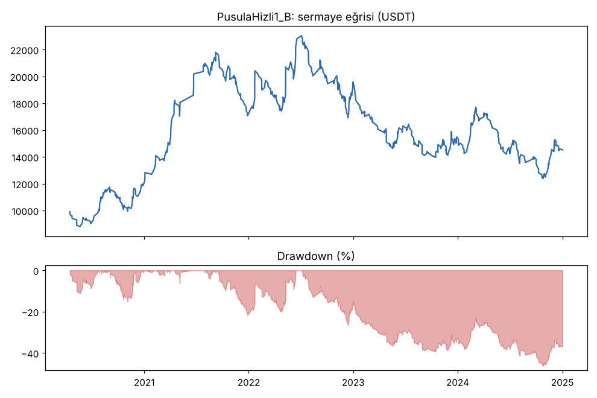
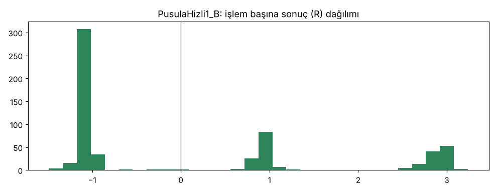

# PusulaHizli1_B (Hızlı Pusula) — gelistirme_36coin — 2026-10-10

## GUO'ya not
- **Kârlı mı?** Masraf ve funding sonrası çok az artıda (işlem başına +0.09R), ama 5 yılda kasa bir ara %46 düştü (sınır %25) ve masraf iki katına çıkınca kâr neredeyse sıfırlanıyor (+0.06R; long tarafı başa baş, PF 0.99). Geçemedi.
- **Günde kaç işlem?** 36 coinde günde sadece **0.34** işlem (ayda ~10). Hedef günde 1-3 idi; 8 işlem sınırıyla bile günde 0.5.
- **Neden az?** Kırılım sinyallerinin üçte ikisi, stop fiyatın %8'inden uzak olduğu için kurallar gereği atlanıyor; kalanların yarısı aynı mumda 5+ coinde birden geliyor (coinler birlikte kırıyor), işlemler de ortalama 8-9 gün sürüyor.
- **Karar:** Emekli (doğrulamaya ve kasaya bakılmadı). Pusula ve demo etkilenmiyor. Günde 1-3 işlem için 4 saatlik kırılım + bu stop kuralı yetmiyor; sıradaki deneme daha kısa grafikte (1h, kuyruk 1b) olmalı.

## Özet
- **PusulaHizli1_B**: 599 işlem, işlem başına ortalama **0.09R** (maliyet ve funding dahil), net getiri 45.2%, en büyük düşüş 46.2%.
- Aynı dönemde coinleri al-tut (eşit ağırlık): getiri 821.3%, ortalama en büyük düşüş 92.2%.

## Ayarlar
- Dönem: 2020-03-07 16:00:00 → 2025-01-01 00:00:00
- Coinler: BTC/USDT:USDT, ETH/USDT:USDT, SOL/USDT:USDT, XRP/USDT:USDT, BNB/USDT:USDT, DOGE/USDT:USDT, ADA/USDT:USDT, LINK/USDT:USDT, LTC/USDT:USDT, DOT/USDT:USDT, AVAX/USDT:USDT, TRX/USDT:USDT, ATOM/USDT:USDT, BCH/USDT:USDT, ETC/USDT:USDT, XLM/USDT:USDT, FIL/USDT:USDT, UNI/USDT:USDT, AAVE/USDT:USDT, NEAR/USDT:USDT, ALGO/USDT:USDT, XTZ/USDT:USDT, THETA/USDT:USDT, VET/USDT:USDT, ICP/USDT:USDT, SAND/USDT:USDT, MANA/USDT:USDT, AXS/USDT:USDT, EGLD/USDT:USDT, HBAR/USDT:USDT, CHZ/USDT:USDT, ENJ/USDT:USDT, ZEC/USDT:USDT, DASH/USDT:USDT, NEO/USDT:USDT, IOTA/USDT:USDT
- Zaman dilimi: 4h
- Yön: long + short
- Mod: futures / isolated
- Kaldıraç: en fazla 3x, likidasyon stop mesafesinin en az 2 katı uzakta (bölüm 7.6)
- Risk: işlem başına sermayenin %1'i (pozisyon büyüklüğü stop mesafesine göre)
- Maliyet: her emir için %0.05 komisyon + %0.05 kayma (= %0.1), funding geçmiş veriden
- Başlangıç sermayesi: 10000 USDT

## Metrikler
| Metrik | PusulaHizli1_B | Al-tut |
|---|---|---|
| Net getiri | 45.2% | 821.3% |
| Max drawdown | 46.2% | 92.2% |
| Profit factor | 1.07 | — |
| Ortalama R | 0.09 | — |
| İşlem sayısı | 599 | — |
| Winrate | 38.9% | — |

Winrate tek başına başarı ölçütü değildir; asıl ölçüt ortalama R (expectancy) ve drawdown'dur.

## Long / short ayrımı
| Strateji | Yön | İşlem | Ortalama R | Toplam R | Profit factor |
|---|---|---|---|---|---|
| PusulaHizli1_B | long | 376 | 0.09 | 35.30 | 1.03 |
| PusulaHizli1_B | short | 223 | 0.10 | 21.39 | 1.14 |

## Sinyal istatistikleri
| Strateji | Stop | BE | TP1 sonrası BE | TP2 | Diğer | İptal (bölgeye gelmedi / önce stop) | Toplam funding (USDT) |
|---|---|---|---|---|---|---|---|
| PusulaHizli1_B | 60.6% | 0.0% | 19.7% | 19.2% | 0.5% | 10.2% | -3416.48 |

## Coin bazında
| Strateji | Coin | İşlem | Ortalama R | Toplam R | Al-tut getirisi |
|---|---|---|---|---|---|
| PusulaHizli1_B | BTC/USDT:USDT | 68 | 0.13 | 8.73 | 954.4% |
| PusulaHizli1_B | ETH/USDT:USDT | 46 | 0.07 | 3.36 | 1303.7% |
| PusulaHizli1_B | SOL/USDT:USDT | 18 | 0.51 | 9.16 | 5552.9% |
| PusulaHizli1_B | XRP/USDT:USDT | 26 | -0.09 | -2.31 | 786.4% |
| PusulaHizli1_B | BNB/USDT:USDT | 45 | 0.15 | 6.79 | 3417.7% |
| PusulaHizli1_B | DOGE/USDT:USDT | 14 | 0.11 | 1.51 | 8425.3% |
| PusulaHizli1_B | ADA/USDT:USDT | 19 | 0.20 | 3.83 | 1631.2% |
| PusulaHizli1_B | LINK/USDT:USDT | 18 | -0.26 | -4.70 | 348.7% |
| PusulaHizli1_B | LTC/USDT:USDT | 26 | -0.50 | -13.02 | 71.7% |
| PusulaHizli1_B | DOT/USDT:USDT | 14 | 0.36 | 4.98 | 94.5% |
| PusulaHizli1_B | AVAX/USDT:USDT | 10 | 0.15 | 1.50 | 770.3% |
| PusulaHizli1_B | TRX/USDT:USDT | 50 | 0.27 | 13.66 | 1398.8% |
| PusulaHizli1_B | ATOM/USDT:USDT | 8 | -0.55 | -4.42 | 68.5% |
| PusulaHizli1_B | BCH/USDT:USDT | 26 | -0.06 | -1.47 | 31.3% |
| PusulaHizli1_B | ETC/USDT:USDT | 12 | 0.38 | 4.61 | 220.3% |
| PusulaHizli1_B | XLM/USDT:USDT | 24 | 0.11 | 2.56 | 478.0% |
| PusulaHizli1_B | FIL/USDT:USDT | 7 | 0.66 | 4.59 | -89.8% |
| PusulaHizli1_B | UNI/USDT:USDT | 20 | -0.36 | -7.15 | 142.2% |
| PusulaHizli1_B | AAVE/USDT:USDT | 10 | -0.28 | -2.79 | 657.1% |
| PusulaHizli1_B | NEAR/USDT:USDT | 4 | -0.53 | -2.12 | 337.5% |
| PusulaHizli1_B | ALGO/USDT:USDT | 9 | 0.06 | 0.52 | 41.1% |
| PusulaHizli1_B | XTZ/USDT:USDT | 9 | 0.26 | 2.36 | -58.0% |
| PusulaHizli1_B | THETA/USDT:USDT | 6 | 0.31 | 1.89 | 415.1% |
| PusulaHizli1_B | VET/USDT:USDT | 9 | 0.06 | 0.57 | 653.1% |
| PusulaHizli1_B | ICP/USDT:USDT | 6 | -0.02 | -0.10 | -97.9% |
| PusulaHizli1_B | SAND/USDT:USDT | 2 | -1.07 | -2.15 | 472.0% |
| PusulaHizli1_B | MANA/USDT:USDT | 3 | 0.31 | 0.92 | -55.1% |
| PusulaHizli1_B | AXS/USDT:USDT | 4 | -0.55 | -2.21 | 1173.3% |
| PusulaHizli1_B | EGLD/USDT:USDT | 12 | 0.80 | 9.59 | 156.3% |
| PusulaHizli1_B | HBAR/USDT:USDT | 10 | 0.15 | 1.47 | -19.4% |
| PusulaHizli1_B | CHZ/USDT:USDT | 7 | -0.51 | -3.55 | 273.9% |
| PusulaHizli1_B | ENJ/USDT:USDT | 9 | -0.15 | -1.31 | 17.4% |
| PusulaHizli1_B | ZEC/USDT:USDT | 11 | -0.36 | -4.01 | 9.5% |
| PusulaHizli1_B | DASH/USDT:USDT | 17 | 0.69 | 11.65 | -57.1% |
| PusulaHizli1_B | NEO/USDT:USDT | 7 | 0.79 | 5.55 | 15.4% |
| PusulaHizli1_B | IOTA/USDT:USDT | 13 | 0.63 | 8.20 | 28.1% |

## Ek ölçümler (aynı geliştirme dönemi, aynı kurallar)
Dönem fiilen 2020-03-07 → 2024-12-31 (1761 gün; ilk 67 gün göstergelerin ısınması).

| Test | İşlem | Günde | Ortalama R | Long R (işlem), PF | Short R (işlem), PF | PF | Net | Max DD |
|---|---|---|---|---|---|---|---|---|
| **PusulaHizli1_B** (ana, puan ±1, en fazla 5) | 599 | 0.34 | +0.09 | +0.09 (376), 1.03 | +0.10 (223), 1.14 | 1.07 | +%45.2 | %46.2 |
| Masraf x2 (`--fee 0.002`) | 599 | 0.34 | +0.06 | +0.06 (376), 0.99 | +0.06 (223), 1.08 | 1.03 | +%16.6 | %52.5 |
| Masrafsız (`--fee 0`, teşhis) | 599 | 0.34 | +0.13 | +0.13 (376), 1.07 | +0.13 (223), 1.20 | 1.12 | +%80.1 | %39.1 |
| Varyant 2: en fazla 8 işlem | 901 | 0.51 | +0.11 | +0.11 (545), 1.03 | +0.12 (356), 1.15 | 1.08 | +%82.5 | %54.1 |
| Varyant 1 / ilk tur: puan ±2 (= ±3), en fazla 5 | 524 | 0.30 | +0.23 | +0.21 (310), 1.13 | +0.25 (214), 1.39 | 1.24 | +%172.9 | %25.9 |
| Al-tut (36 coin, eşit ağırlık) | — | — | — | — | — | — | +%821 | ort. %92 |

- **Tanım hatası (ilk tur):** kartta ana sürüm "puan ≥ +2" diye yazılmıştı. Puan üç tane ±1 işaretin toplamı olduğu için hep tek sayı (-3, -1, +1, +3); "≥ +2" pratikte "= +3" ile aynı. Ana sürüm ve varyant 1 aynı 524 işlemi verdi, rejim gevşemedi. Kartta hipotezin niyeti ("3 işaretin 2'si") puan ≥ +1 olduğu için düzeltme turu (`PusulaHizli1_B`) sonuç görülmeden kartta yazıldı ve karar ona göre verildi. Başka hiçbir şey değiştirilmedi.
- **Gevşetmek kötüleştirdi:** ±1 rejimi işlem sayısını sadece %14 artırdı (524 → 599) ama ortalamayı +0.23R'den +0.09R'ye, PF'yi 1.24'ten 1.07'ye düşürdü, DD'yi %26'dan %46'ya çıkardı. Ek gelen ~75 işlem (sadece 2/3 işaret) açıkça zararlı.
- **±3 sürümü de geçmiyor:** DD %25.9 (> %25), günde 0.30 işlem, 2023 +0.07R, 2024 ≈0R (son iki yıl kârsız). Bu Pusula'nın sabit hedefli ilk sürümünün (`Pusula_B`) 36 coinde 5 işlemle çalışan hali; öncekiyle uyumlu.
- **Yıl bazında (ana, işlem başı R):** 2020 +0.21, 2021 +0.40, 2022 +0.15, 2023 -0.17, 2024 -0.01. Kâr ilk üç yılda; son iki yıl eksi.
- En iyi 10 işlem çıkarılınca toplam +56.7R → +26.1R (masraf x2'de +4.2R). 22/36 coin artıda (%61).
- **Neden günde 1-3 işlem çıkmıyor (ölçüldü):** 36 coinde ham kırılım sinyali günde 5.6 (9802). Bunların sadece %35'inde (3402) stop fiyatın %8'i içinde; geri kalanında ortak kural gereği sinyal yok (4h'de 10 mumluk dip/tepe stopu kırılımdan sonra çok uzakta kalıyor). Kalan sinyallerin yarısından fazlası (%56'sı) aynı 4h mumda 5+ coinde birden geliyor; sinyal olan farklı gün sayısı 1184/1761. İşlemler ortalama 8.6 gün (medyan 4.7) sürüyor, 5 slot zamanın %31'inde dolu. 8 slotla bile günde 0.51 işlem.
- **Masraf:** Masrafsız +0.13R → %0.1 masrafla +0.09R → x2 ile +0.06R. Masraf işlem başı ~0.04R yiyor (geniş stop sayesinde az); asıl sorun girişin kendisinin zayıf olması (masrafsız bile PF 1.12, DD %39).
- **Funding:** long'lar 5 yılda ≈3300 USDT funding ödedi, short'lar ≈100 USDT ödedi. Masraf x2'de long tarafının PF'si 0.99 (kârsız).
- Hile testi (lookahead-analysis, BTC/ETH/SOL/DOGE/ADA 2021, 30 sinyal): `PusulaHizli_B` ve `PusulaHizli1_B` için geleceği görme yok.
- Al-tut aynı dönemde +%821 (ortalama en büyük düşüş %92). Strateji çok daha az getiri verdi; düşüşü daha küçük (%46) ama kendi sınırının (%25) çok üstünde.

## Grafikler

## Yorum: güçlü yanlar / şüpheli noktalar
Güçlü yan: long ve short benzer (ikisi de ≈+0.1R), coinlerin %61'i artıda, masraf payı küçük. Zayıf yanlar ağır basıyor: PF 1.07 (sınır 1.2), DD %46 (sınır %25), son iki yıl eksi, masraf x2'de long eksi. İşlem sıklığı hedefinin (günde 1-3) çok altında: günde 0.34. Asıl amaç (sık ve kârlı işlem) iki açıdan da tutmadı. Rejimi gevşetmek kaliteyi düşürdü, sıklığı neredeyse artırmadı; sıklığı kısıtlayan şey rejim değil, stop kuralı (%8 sınırı) ve coinlerin aynı anda kırması.

## Karar: devam / düzelt / emekli
**Emekli.** Ana sürüm (`PusulaHizli1_B`) eşikleri geçemedi: PF 1.07 < 1.2, DD %46.2 > %25, al-tutun gerisinde; işlem sıklığı hedefi (≥ ~1500 işlem) 599 ile tutmadı. Önceden tanımlı iki varyant da geçmedi (8 işlem: DD %54; ±3: DD %25.9 ve günde 0.30). Kartta yazıldığı gibi doğrulama sadece geçerse yapılacaktı; yapılmadı. Kasa verisine dokunulmadı. Kod `strategies/retired/pusula_hizli.py`.
