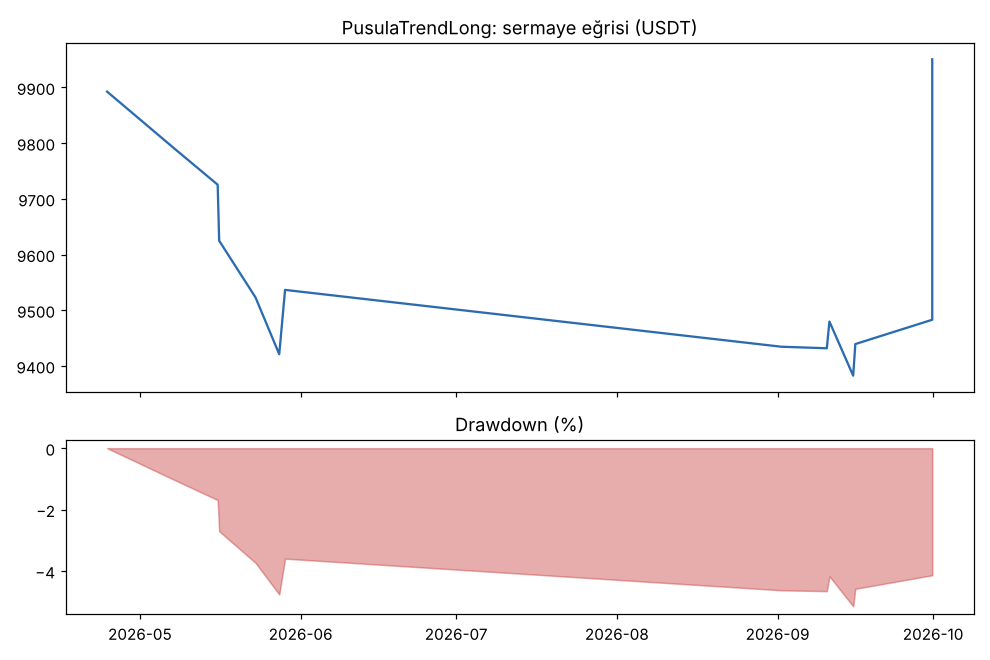
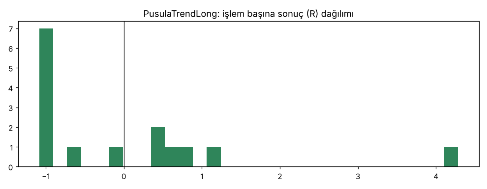
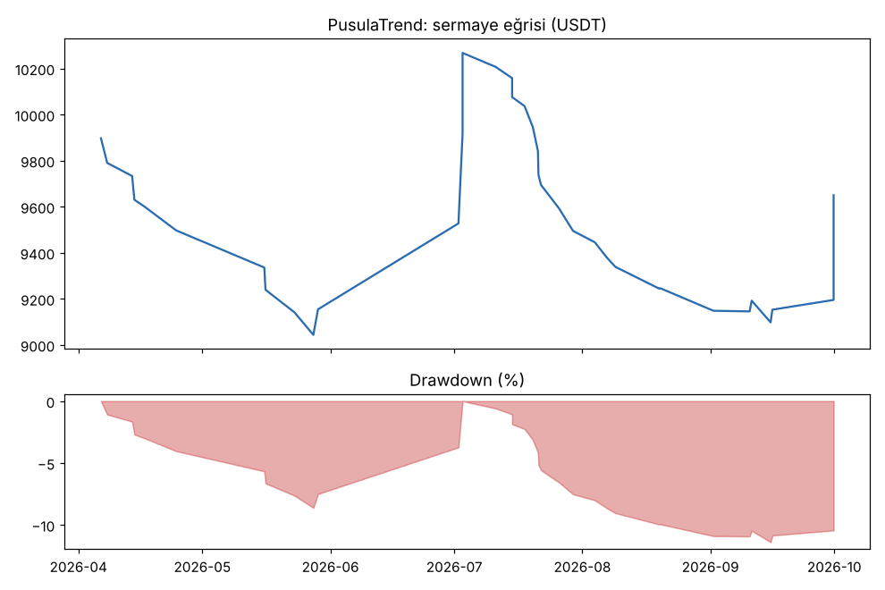
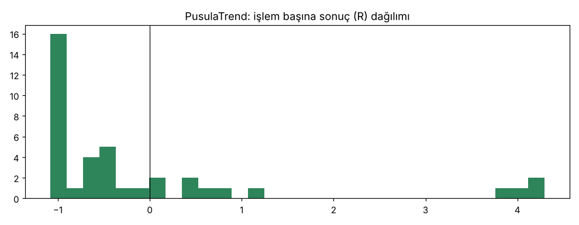

# PusulaTrendLong vs PusulaTrend — kasa_16coin — 2026-10-10

## GUO'ya not
- **Kasa sınavı: başa baş, geçemedi.** Son 6 ayda 15 işlem, toplam sonuç neredeyse sıfır (-%0.5). Kasa en fazla %6 eridi.
- Kötü değil ama kâr da yok. Bu 6 ayda büyük bir trend yakalanmadı. Strateji kârını zaten büyük trendlerden çıkarıyordu.
- Dönem sonunda 3 işlem hâlâ açıktı ve kârdaydı (AVAX +4.3R). Ama kural gereği sınav burada bitiyor.
- Sıradaki adım: para koymadan canlı takip, yani yeni veriyle sınamak.

## Özet
- **PusulaTrendLong**: 15 işlem, işlem başına ortalama **-0.02R** (maliyet ve funding dahil), net getiri -0.5%, en büyük düşüş 6.2%.
- **PusulaTrend**: 39 işlem, işlem başına ortalama **-0.07R** (maliyet ve funding dahil), net getiri -3.5%, en büyük düşüş 11.4%.
- Aynı dönemde coinleri al-tut (eşit ağırlık): getiri 15.9%, ortalama en büyük düşüş 39.2%.

## Ayarlar
- Dönem: 2026-04-01 00:00:00 → 2026-09-30 20:00:00
- Coinler: BTC/USDT:USDT, ETH/USDT:USDT, SOL/USDT:USDT, XRP/USDT:USDT, BNB/USDT:USDT, DOGE/USDT:USDT, ADA/USDT:USDT, LINK/USDT:USDT, LTC/USDT:USDT, DOT/USDT:USDT, AVAX/USDT:USDT, TRX/USDT:USDT, ATOM/USDT:USDT, BCH/USDT:USDT, ETC/USDT:USDT, XLM/USDT:USDT
- Zaman dilimi: 4h
- Yön: long + short
- Mod: futures / isolated
- Kaldıraç: en fazla 3x, likidasyon stop mesafesinin en az 2 katı uzakta (bölüm 7.6)
- Risk: işlem başına sermayenin %1'i (pozisyon büyüklüğü stop mesafesine göre)
- Maliyet: her emir için %0.05 komisyon + %0.05 kayma (= %0.1), funding geçmiş veriden
- Başlangıç sermayesi: 10000 USDT

## Metrikler
| Metrik | PusulaTrendLong | PusulaTrend | Al-tut |
|---|---|---|---|
| Net getiri | -0.5% | -3.5% | 15.9% |
| Max drawdown | 6.2% | 11.4% | 39.2% |
| Profit factor | 0.94 | 0.84 | — |
| Ortalama R | -0.02 | -0.07 | — |
| İşlem sayısı | 15 | 39 | — |
| Winrate | 40.0% | 25.6% | — |

Winrate tek başına başarı ölçütü değildir; asıl ölçüt ortalama R (expectancy) ve drawdown'dur.

## Long / short ayrımı
| Strateji | Yön | İşlem | Ortalama R | Toplam R | Profit factor |
|---|---|---|---|---|---|
| PusulaTrendLong | long | 15 | -0.02 | -0.35 | 0.94 |
| PusulaTrendLong | short | 0 | — | 0.00 | — |
| PusulaTrend | long | 15 | -0.02 | -0.35 | 0.94 |
| PusulaTrend | short | 24 | -0.09 | -2.24 | 0.78 |

## Sinyal istatistikleri
| Strateji | Stop | BE | TP1 sonrası BE | TP2 | Diğer | İptal (bölgeye gelmedi / önce stop) | Toplam funding (USDT) |
|---|---|---|---|---|---|---|---|
| PusulaTrendLong | 46.7% | 6.7% | 0.0% | 0.0% | 46.7% | 11.8% | -41.36 |
| PusulaTrend | 38.5% | 7.7% | 0.0% | 0.0% | 53.8% | 20.4% | -55.13 |

## Coin bazında
| Strateji | Coin | İşlem | Ortalama R | Toplam R | Al-tut getirisi |
|---|---|---|---|---|---|
| PusulaTrendLong | BTC/USDT:USDT | 2 | -0.88 | -1.75 | 22.7% |
| PusulaTrendLong | ETH/USDT:USDT | 2 | -0.28 | -0.57 | 27.7% |
| PusulaTrendLong | SOL/USDT:USDT | 0 | — | 0.00 | 41.6% |
| PusulaTrendLong | XRP/USDT:USDT | 0 | — | 0.00 | 10.5% |
| PusulaTrendLong | BNB/USDT:USDT | 4 | -0.36 | -1.45 | 24.7% |
| PusulaTrendLong | DOGE/USDT:USDT | 1 | -1.04 | -1.04 | 2.2% |
| PusulaTrendLong | ADA/USDT:USDT | 0 | — | 0.00 | 0.5% |
| PusulaTrendLong | LINK/USDT:USDT | 1 | -1.04 | -1.04 | 62.9% |
| PusulaTrendLong | LTC/USDT:USDT | 1 | 0.61 | 0.61 | 24.3% |
| PusulaTrendLong | DOT/USDT:USDT | 0 | — | 0.00 | -3.0% |
| PusulaTrendLong | AVAX/USDT:USDT | 1 | 4.28 | 4.28 | 22.1% |
| PusulaTrendLong | TRX/USDT:USDT | 2 | 0.05 | 0.09 | 6.6% |
| PusulaTrendLong | ATOM/USDT:USDT | 0 | — | 0.00 | 2.5% |
| PusulaTrendLong | BCH/USDT:USDT | 0 | — | 0.00 | -33.9% |
| PusulaTrendLong | ETC/USDT:USDT | 1 | 0.51 | 0.51 | 8.9% |
| PusulaTrendLong | XLM/USDT:USDT | 0 | — | 0.00 | 33.4% |
| PusulaTrend | BTC/USDT:USDT | 2 | -0.88 | -1.75 | 22.7% |
| PusulaTrend | ETH/USDT:USDT | 3 | 1.10 | 3.31 | 27.7% |
| PusulaTrend | SOL/USDT:USDT | 0 | — | 0.00 | 41.6% |
| PusulaTrend | XRP/USDT:USDT | 2 | -0.75 | -1.50 | 10.5% |
| PusulaTrend | BNB/USDT:USDT | 5 | -0.38 | -1.88 | 24.7% |
| PusulaTrend | DOGE/USDT:USDT | 1 | -1.04 | -1.04 | 2.2% |
| PusulaTrend | ADA/USDT:USDT | 2 | -0.71 | -1.41 | 0.5% |
| PusulaTrend | LINK/USDT:USDT | 1 | -1.04 | -1.04 | 62.9% |
| PusulaTrend | LTC/USDT:USDT | 5 | 0.60 | 3.00 | 24.3% |
| PusulaTrend | DOT/USDT:USDT | 4 | -0.65 | -2.61 | -3.0% |
| PusulaTrend | AVAX/USDT:USDT | 2 | 1.73 | 3.46 | 22.1% |
| PusulaTrend | TRX/USDT:USDT | 3 | -0.27 | -0.81 | 6.6% |
| PusulaTrend | ATOM/USDT:USDT | 0 | — | 0.00 | 2.5% |
| PusulaTrend | BCH/USDT:USDT | 3 | 1.14 | 3.41 | -33.9% |
| PusulaTrend | ETC/USDT:USDT | 4 | -0.39 | -1.57 | 8.9% |
| PusulaTrend | XLM/USDT:USDT | 2 | -1.07 | -2.14 | 33.4% |

## Grafikler

## Yorum: güçlü yanlar / şüpheli noktalar
- Tek seferlik kasa testi, kurallar 4. turdaki haliyle. Plan önceden kartta yazıldı.
- **Ana karar (PusulaTrendLong, 16 coin):** -0.02R, PF 0.94, DD %6.2, 15 işlem. Geçme şartı > 0R'ydi: **kıl payı geçemedi.**
- 15 işlemin 9'u kayıp. Mayıs'ta 6 işlemden 5'i stop oldu (trend dönemi gibi görünüp devam etmeyen kırılımlar). Kazançların çoğu Eylül sonunda açık olan işlemlerde (AVAX +4.28R, BNB +0.74R, ETH +0.47R; dönem sonunda zorla kapatıldı).
- Al-tut +%15.9 (DD %39). Bu dönem güçlü bir trend değil, dalgalı bir yükseliş.
- Bilgi için: PusulaTrend (long+short) -0.07R, short'lar -0.09R (24 işlem). 6 coinlik sürüm -0.68R (15 işlem, 13'ü kayıp): 16 coinlik liste yine daha sağlam.
- 15 işlem çok küçük bir örnek. Geliştirme döneminde de 6 aylık dilimlerin bir kısmı başa baş veya ekside (örneğin 2023 başı, 2024 Mart sonrası).

## Karar: devam / düzelt / emekli
**Kasa testi geçilemedi (kıl payı, -0.02R).** Strateji "active" olamaz. Emekli edilmiyor: geçmiş 6 yılda ve 16 coinde tutarlı, son 6 ayda sadece başa baş. Kasa verisi artık kullanıldı; kurallar bu sonuca göre değiştirilmeyecek. Sonraki doğru sınav yeni veri: dry-run ile ileriye dönük kâğıt testi (proje sahibinin kararı).
