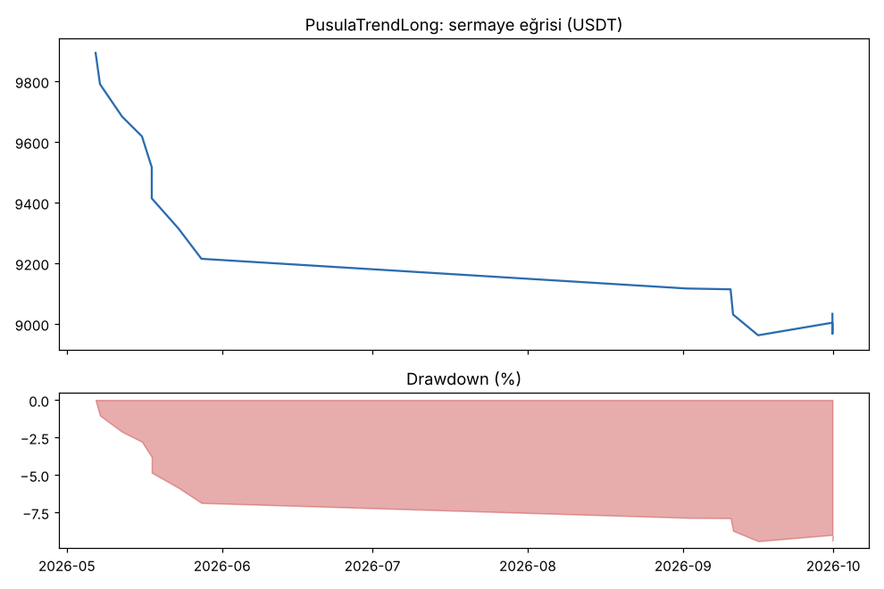
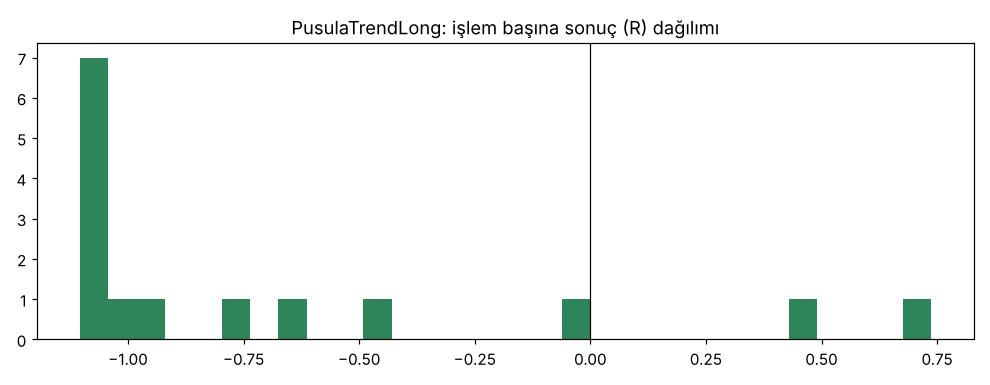

# PusulaTrendLong — kasa_6coin — 2026-10-10

## Özet
- **PusulaTrendLong**: 15 işlem, işlem başına ortalama **-0.68R** (maliyet ve funding dahil), net getiri -9.7%, en büyük düşüş 10.4%.
- Aynı dönemde coinleri al-tut (eşit ağırlık): getiri 21.6%, ortalama en büyük düşüş 34.3%.

## Ayarlar
- Dönem: 2026-04-01 00:00:00 → 2026-09-30 20:00:00
- Coinler: BTC/USDT:USDT, ETH/USDT:USDT, SOL/USDT:USDT, XRP/USDT:USDT, BNB/USDT:USDT, DOGE/USDT:USDT
- Zaman dilimi: 4h
- Yön: long + short
- Mod: futures / isolated
- Kaldıraç: en fazla 3x, likidasyon stop mesafesinin en az 2 katı uzakta (bölüm 7.6)
- Risk: işlem başına sermayenin %1'i (pozisyon büyüklüğü stop mesafesine göre)
- Maliyet: her emir için %0.05 komisyon + %0.05 kayma (= %0.1), funding geçmiş veriden
- Başlangıç sermayesi: 10000 USDT

## Metrikler
| Metrik | PusulaTrendLong | Al-tut |
|---|---|---|
| Net getiri | -9.7% | 21.6% |
| Max drawdown | 10.4% | 34.3% |
| Profit factor | 0.10 | — |
| Ortalama R | -0.68 | — |
| İşlem sayısı | 15 | — |
| Winrate | 13.3% | — |

Winrate tek başına başarı ölçütü değildir; asıl ölçüt ortalama R (expectancy) ve drawdown'dur.

## Long / short ayrımı
| Strateji | Yön | İşlem | Ortalama R | Toplam R | Profit factor |
|---|---|---|---|---|---|
| PusulaTrendLong | long | 15 | -0.68 | -10.22 | 0.10 |
| PusulaTrendLong | short | 0 | — | 0.00 | — |

## Sinyal istatistikleri
| Strateji | Stop | BE | TP1 sonrası BE | TP2 | Diğer | İptal (bölgeye gelmedi / önce stop) | Toplam funding (USDT) |
|---|---|---|---|---|---|---|---|
| PusulaTrendLong | 53.3% | 6.7% | 0.0% | 0.0% | 40.0% | 6.2% | -20.97 |

## Coin bazında
| Strateji | Coin | İşlem | Ortalama R | Toplam R | Al-tut getirisi |
|---|---|---|---|---|---|
| PusulaTrendLong | BTC/USDT:USDT | 3 | -0.90 | -2.71 | 22.7% |
| PusulaTrendLong | ETH/USDT:USDT | 4 | -0.62 | -2.47 | 27.7% |
| PusulaTrendLong | SOL/USDT:USDT | 1 | -0.43 | -0.43 | 41.6% |
| PusulaTrendLong | XRP/USDT:USDT | 0 | — | 0.00 | 10.5% |
| PusulaTrendLong | BNB/USDT:USDT | 5 | -0.50 | -2.52 | 24.7% |
| PusulaTrendLong | DOGE/USDT:USDT | 2 | -1.05 | -2.09 | 2.2% |

## Grafikler

## Yorum: güçlü yanlar / şüpheli noktalar
- Sadece bilgi için (karar 16 coinlik sürüme göre). 6 coin, 15 işlem, 13'ü kayıp: -0.68R.

## Karar: devam / düzelt / emekli
Bilgi amaçlı; karar 16 coinlik rapordadır.
