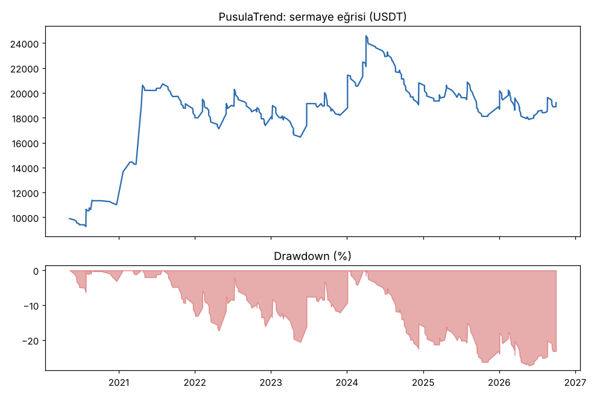

# PusulaTrendLong vs PusulaTrend — yeni20coin_2020_2026 — 2026-10-10

## Özet
- **PusulaTrendLong**: 150 işlem, işlem başına ortalama **0.44R** (maliyet ve funding dahil), net getiri 64.5%, en büyük düşüş 24.7%.
- **PusulaTrend**: 319 işlem, işlem başına ortalama **0.27R** (maliyet ve funding dahil), net getiri 92.1%, en büyük düşüş 27.3%.
- Aynı dönemde coinleri al-tut (eşit ağırlık): getiri 194.7%, ortalama en büyük düşüş 97.6%.

## Ayarlar
- Dönem: 2020-04-11 00:00:00 → 2026-09-30 20:00:00
- Coinler: FIL/USDT:USDT, UNI/USDT:USDT, AAVE/USDT:USDT, NEAR/USDT:USDT, ALGO/USDT:USDT, XTZ/USDT:USDT, THETA/USDT:USDT, VET/USDT:USDT, ICP/USDT:USDT, SAND/USDT:USDT, MANA/USDT:USDT, AXS/USDT:USDT, EGLD/USDT:USDT, HBAR/USDT:USDT, CHZ/USDT:USDT, ENJ/USDT:USDT, ZEC/USDT:USDT, DASH/USDT:USDT, NEO/USDT:USDT, IOTA/USDT:USDT
- Zaman dilimi: 4h
- Yön: long + short
- Mod: futures / isolated
- Kaldıraç: en fazla 3x, likidasyon stop mesafesinin en az 2 katı uzakta (bölüm 7.6)
- Risk: işlem başına sermayenin %1'i (pozisyon büyüklüğü stop mesafesine göre)
- Maliyet: her emir için %0.05 komisyon + %0.05 kayma (= %0.1), funding geçmiş veriden
- Başlangıç sermayesi: 10000 USDT

## Metrikler
| Metrik | PusulaTrendLong | PusulaTrend | Al-tut |
|---|---|---|---|
| Net getiri | 64.5% | 92.1% | 194.7% |
| Max drawdown | 24.7% | 27.3% | 97.6% |
| Profit factor | 1.39 | 1.26 | — |
| Ortalama R | 0.44 | 0.27 | — |
| İşlem sayısı | 150 | 319 | — |
| Winrate | 18.0% | 26.6% | — |

Winrate tek başına başarı ölçütü değildir; asıl ölçüt ortalama R (expectancy) ve drawdown'dur.

## Long / short ayrımı
| Strateji | Yön | İşlem | Ortalama R | Toplam R | Profit factor |
|---|---|---|---|---|---|
| PusulaTrendLong | long | 150 | 0.44 | 66.50 | 1.39 |
| PusulaTrendLong | short | 0 | — | 0.00 | — |
| PusulaTrend | long | 150 | 0.44 | 66.49 | 1.38 |
| PusulaTrend | short | 169 | 0.12 | 20.97 | 1.14 |

## Sinyal istatistikleri
| Strateji | Stop | BE | TP1 sonrası BE | TP2 | Diğer | İptal (bölgeye gelmedi / önce stop) | Toplam funding (USDT) |
|---|---|---|---|---|---|---|---|
| PusulaTrendLong | 50.0% | 14.0% | 0.0% | 0.0% | 36.0% | 5.1% | -3068.31 |
| PusulaTrend | 47.6% | 13.5% | 0.0% | 0.0% | 38.9% | 7.8% | -3323.89 |

## Coin bazında
| Strateji | Coin | İşlem | Ortalama R | Toplam R | Al-tut getirisi |
|---|---|---|---|---|---|
| PusulaTrendLong | FIL/USDT:USDT | 3 | 10.46 | 31.38 | -97.9% |
| PusulaTrendLong | UNI/USDT:USDT | 17 | -0.40 | -6.74 | 62.4% |
| PusulaTrendLong | AAVE/USDT:USDT | 15 | -0.72 | -10.73 | 286.5% |
| PusulaTrendLong | NEAR/USDT:USDT | 7 | 1.41 | 9.88 | 373.4% |
| PusulaTrendLong | ALGO/USDT:USDT | 8 | 0.37 | 3.00 | -47.9% |
| PusulaTrendLong | XTZ/USDT:USDT | 13 | 0.01 | 0.14 | -84.3% |
| PusulaTrendLong | THETA/USDT:USDT | 10 | 1.71 | 17.07 | -48.0% |
| PusulaTrendLong | VET/USDT:USDT | 7 | 2.59 | 18.13 | 139.2% |
| PusulaTrendLong | ICP/USDT:USDT | 4 | -0.56 | -2.25 | -99.3% |
| PusulaTrendLong | SAND/USDT:USDT | 3 | -0.73 | -2.19 | -54.0% |
| PusulaTrendLong | MANA/USDT:USDT | 5 | -0.31 | -1.57 | -91.4% |
| PusulaTrendLong | AXS/USDT:USDT | 3 | -1.03 | -3.09 | 136.4% |
| PusulaTrendLong | EGLD/USDT:USDT | 5 | -0.16 | -0.80 | -65.7% |
| PusulaTrendLong | HBAR/USDT:USDT | 2 | -0.06 | -0.12 | -68.6% |
| PusulaTrendLong | CHZ/USDT:USDT | 7 | -0.67 | -4.66 | -26.0% |
| PusulaTrendLong | ENJ/USDT:USDT | 2 | 2.32 | 4.65 | -83.5% |
| PusulaTrendLong | ZEC/USDT:USDT | 8 | -0.48 | -3.81 | 3815.4% |
| PusulaTrendLong | DASH/USDT:USDT | 12 | 0.32 | 3.83 | -19.1% |
| PusulaTrendLong | NEO/USDT:USDT | 11 | 0.84 | 9.28 | -65.8% |
| PusulaTrendLong | IOTA/USDT:USDT | 8 | 0.64 | 5.10 | -66.9% |
| PusulaTrend | FIL/USDT:USDT | 13 | 2.08 | 26.99 | -97.9% |
| PusulaTrend | UNI/USDT:USDT | 32 | -0.24 | -7.71 | 62.4% |
| PusulaTrend | AAVE/USDT:USDT | 22 | -0.61 | -13.45 | 286.5% |
| PusulaTrend | NEAR/USDT:USDT | 14 | 0.58 | 8.06 | 373.4% |
| PusulaTrend | ALGO/USDT:USDT | 19 | 0.56 | 10.60 | -47.9% |
| PusulaTrend | XTZ/USDT:USDT | 23 | -0.05 | -1.07 | -84.3% |
| PusulaTrend | THETA/USDT:USDT | 18 | 1.54 | 27.75 | -48.0% |
| PusulaTrend | VET/USDT:USDT | 19 | 0.99 | 18.84 | 139.2% |
| PusulaTrend | ICP/USDT:USDT | 13 | -0.79 | -10.30 | -99.3% |
| PusulaTrend | SAND/USDT:USDT | 8 | -0.49 | -3.94 | -54.0% |
| PusulaTrend | MANA/USDT:USDT | 12 | 0.80 | 9.66 | -91.4% |
| PusulaTrend | AXS/USDT:USDT | 11 | -0.12 | -1.35 | 136.4% |
| PusulaTrend | EGLD/USDT:USDT | 18 | -0.23 | -4.16 | -65.7% |
| PusulaTrend | HBAR/USDT:USDT | 14 | 0.87 | 12.19 | -68.6% |
| PusulaTrend | CHZ/USDT:USDT | 13 | -0.07 | -0.95 | -26.0% |
| PusulaTrend | ENJ/USDT:USDT | 10 | -0.10 | -0.96 | -83.5% |
| PusulaTrend | ZEC/USDT:USDT | 13 | -0.60 | -7.76 | 3815.4% |
| PusulaTrend | DASH/USDT:USDT | 17 | 0.57 | 9.62 | -19.1% |
| PusulaTrend | NEO/USDT:USDT | 17 | 0.76 | 12.99 | -65.8% |
| PusulaTrend | IOTA/USDT:USDT | 13 | 0.19 | 2.43 | -66.9% |

## Grafikler

## Yorum: güçlü yanlar / şüpheli noktalar
- 20 coin Pusula'nın tasarımında ve önceki testlerde hiç kullanılmadı. Kurallar aynı.
- Sadece long: +0.44R, PF 1.39, DD %24.7. Eski 16 coindeki +1.02R'nin yarısından az. 20 coinin 9'u artıda (%45, eşik %50).
- Kâr çok az sayıda işleme bağlı: en iyi 10 işlem +131R, geri kalan 140 işlem -64R. Tek başına FIL'in 3 işlemi +31R.
- Yıl bazında (yaklaşık): 2020 +37R, 2021 +48R, 2022 -2R, 2023 0R, 2024 +14R, 2025 -27R, 2026 -6R. 2022'den sonra bu coinlerde long tarafı zayıf.
- Long + short: +0.27R. Bu coinlerde short'lar artıda (+0.12R, 169 işlem); 2025'te long'lar -29R iken short'lar +22R. Bu coinlerin çoğu 2021 zirvesinden %50-99 düştü.
- Hayatta kalan coin etkisi var: hepsi bugün listede olan coinler.

## Karar: devam / düzelt / emekli
Pusula'nın long tarafı yeni coinlerde de artıda ama zayıf ve birkaç büyük işleme bağlı. Kurallar değişmiyor. Bu 20 coin bundan sonra her geliştirme fikrinin ikinci hakemi.
