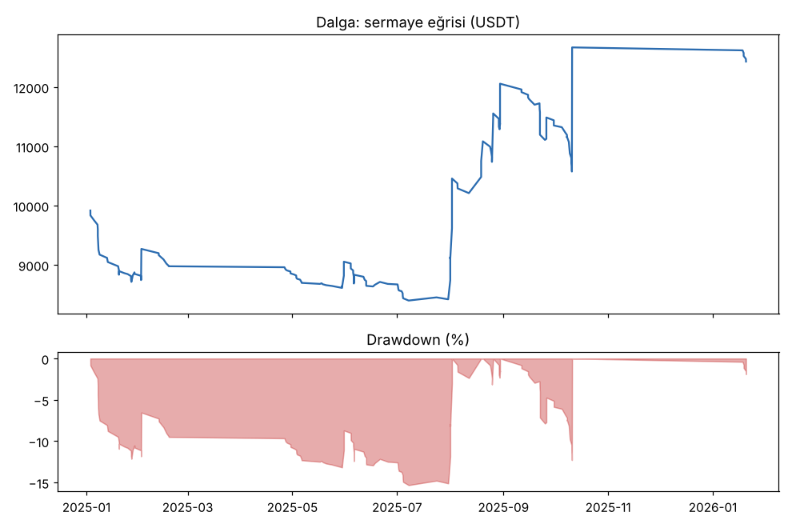
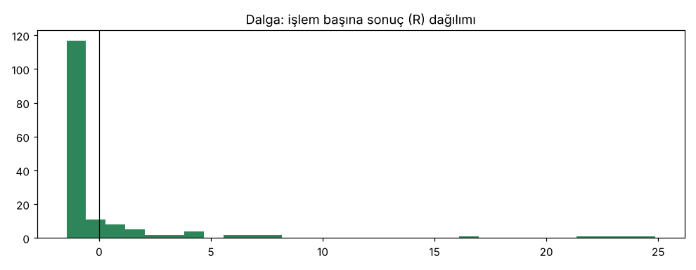

# Dalga — dogrulama_36coin — 2026-10-11

## Özet
- **Dalga**: 160 işlem, işlem başına ortalama **0.44R** (maliyet ve funding dahil), net getiri 24.3%, en büyük düşüş 16.0%.
- Aynı dönemde coinleri al-tut (eşit ağırlık): getiri -50.7%, ortalama en büyük düşüş 76.6%.

## Ayarlar
- Dönem: 2025-01-01 00:00:00 → 2026-04-01 00:00:00
- Coinler: BTC/USDT:USDT, ETH/USDT:USDT, SOL/USDT:USDT, XRP/USDT:USDT, BNB/USDT:USDT, DOGE/USDT:USDT, ADA/USDT:USDT, LINK/USDT:USDT, LTC/USDT:USDT, DOT/USDT:USDT, AVAX/USDT:USDT, TRX/USDT:USDT, ATOM/USDT:USDT, BCH/USDT:USDT, ETC/USDT:USDT, XLM/USDT:USDT, FIL/USDT:USDT, UNI/USDT:USDT, AAVE/USDT:USDT, NEAR/USDT:USDT, ALGO/USDT:USDT, XTZ/USDT:USDT, THETA/USDT:USDT, VET/USDT:USDT, ICP/USDT:USDT, SAND/USDT:USDT, MANA/USDT:USDT, AXS/USDT:USDT, EGLD/USDT:USDT, HBAR/USDT:USDT, CHZ/USDT:USDT, ENJ/USDT:USDT, ZEC/USDT:USDT, DASH/USDT:USDT, NEO/USDT:USDT, IOTA/USDT:USDT
- Zaman dilimi: 1h
- Yön: long + short
- Mod: futures / isolated
- Kaldıraç: en fazla 3x, likidasyon stop mesafesinin en az 2 katı uzakta (bölüm 7.6)
- Risk: işlem başına sermayenin %1'i (pozisyon büyüklüğü stop mesafesine göre)
- Maliyet: her emir için %0.05 komisyon + %0.05 kayma (= %0.1), funding geçmiş veriden
- Başlangıç sermayesi: 10000 USDT

## Metrikler
| Metrik | Dalga | Al-tut |
|---|---|---|
| Net getiri | 24.3% | -50.7% |
| Max drawdown | 16.0% | 76.6% |
| Profit factor | 1.40 | — |
| Ortalama R | 0.44 | — |
| İşlem sayısı | 160 | — |
| Winrate | 22.5% | — |

Winrate tek başına başarı ölçütü değildir; asıl ölçüt ortalama R (expectancy) ve drawdown'dur.

## Long / short ayrımı
| Strateji | Yön | İşlem | Ortalama R | Toplam R | Profit factor |
|---|---|---|---|---|---|
| Dalga | long | 160 | 0.44 | 70.86 | 1.40 |
| Dalga | short | 0 | — | 0.00 | — |

## Sinyal istatistikleri
| Strateji | Stop | BE | TP1 sonrası BE | TP2 | Diğer | İptal (bölgeye gelmedi / önce stop) | Toplam funding (USDT) |
|---|---|---|---|---|---|---|---|
| Dalga | 66.2% | 0.0% | 0.0% | 0.0% | 33.8% | 5.3% | -338.87 |

## Coin bazında
| Strateji | Coin | İşlem | Ortalama R | Toplam R | Al-tut getirisi |
|---|---|---|---|---|---|
| Dalga | BTC/USDT:USDT | 12 | 0.28 | 3.35 | -27.6% |
| Dalga | ETH/USDT:USDT | 10 | 1.20 | 12.02 | -37.1% |
| Dalga | SOL/USDT:USDT | 12 | -0.55 | -6.54 | -56.7% |
| Dalga | XRP/USDT:USDT | 6 | 4.24 | 25.44 | -36.3% |
| Dalga | BNB/USDT:USDT | 10 | 2.88 | 28.84 | -12.6% |
| Dalga | DOGE/USDT:USDT | 4 | -0.83 | -3.30 | -71.2% |
| Dalga | ADA/USDT:USDT | 4 | -0.50 | -2.00 | -71.6% |
| Dalga | LINK/USDT:USDT | 6 | -0.72 | -4.32 | -56.4% |
| Dalga | LTC/USDT:USDT | 8 | -0.48 | -3.85 | -48.5% |
| Dalga | DOT/USDT:USDT | 4 | -0.74 | -2.95 | -81.4% |
| Dalga | AVAX/USDT:USDT | 3 | -1.08 | -3.25 | -75.2% |
| Dalga | TRX/USDT:USDT | 17 | 0.83 | 14.18 | 22.9% |
| Dalga | ATOM/USDT:USDT | 2 | -1.08 | -2.16 | -72.9% |
| Dalga | BCH/USDT:USDT | 5 | 0.91 | 4.53 | 5.6% |
| Dalga | ETC/USDT:USDT | 1 | -1.04 | -1.04 | -67.7% |
| Dalga | XLM/USDT:USDT | 4 | -0.77 | -3.08 | -50.6% |
| Dalga | FIL/USDT:USDT | 0 | — | 0.00 | -83.5% |
| Dalga | UNI/USDT:USDT | 7 | 1.13 | 7.90 | -73.4% |
| Dalga | AAVE/USDT:USDT | 7 | 0.12 | 0.81 | -68.7% |
| Dalga | NEAR/USDT:USDT | 2 | -0.44 | -0.89 | -76.2% |
| Dalga | ALGO/USDT:USDT | 2 | -0.12 | -0.24 | -71.6% |
| Dalga | XTZ/USDT:USDT | 0 | — | 0.00 | -72.9% |
| Dalga | THETA/USDT:USDT | 2 | -1.07 | -2.14 | -93.3% |
| Dalga | VET/USDT:USDT | 2 | -0.89 | -1.77 | -84.6% |
| Dalga | ICP/USDT:USDT | 3 | -0.93 | -2.79 | -77.3% |
| Dalga | SAND/USDT:USDT | 0 | — | 0.00 | -86.3% |
| Dalga | MANA/USDT:USDT | 6 | -0.77 | -4.60 | -81.9% |
| Dalga | AXS/USDT:USDT | 0 | — | 0.00 | -82.0% |
| Dalga | EGLD/USDT:USDT | 0 | — | 0.00 | -88.8% |
| Dalga | HBAR/USDT:USDT | 4 | -0.39 | -1.57 | -67.5% |
| Dalga | CHZ/USDT:USDT | 0 | — | 0.00 | -49.3% |
| Dalga | ENJ/USDT:USDT | 0 | — | 0.00 | -90.5% |
| Dalga | ZEC/USDT:USDT | 9 | 3.06 | 27.50 | 337.0% |
| Dalga | DASH/USDT:USDT | 1 | -1.05 | -1.05 | -14.9% |
| Dalga | NEO/USDT:USDT | 1 | -0.03 | -0.03 | -80.5% |
| Dalga | IOTA/USDT:USDT | 6 | -1.02 | -6.14 | -81.1% |

## Grafikler

## Yorum: güçlü yanlar / şüpheli noktalar
_(Claude tarafından rakamlara bakılarak yazılır.)_

## Karar: devam / düzelt / emekli
_(Claude tarafından yazılır, gerekçesiyle.)_
