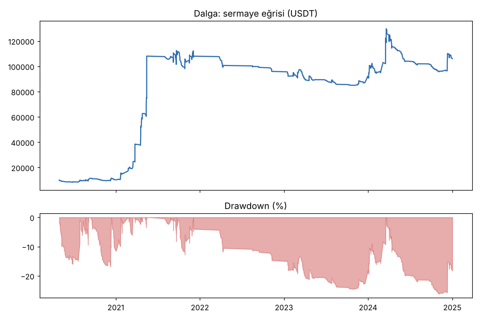
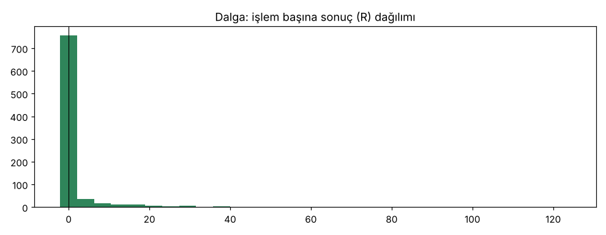
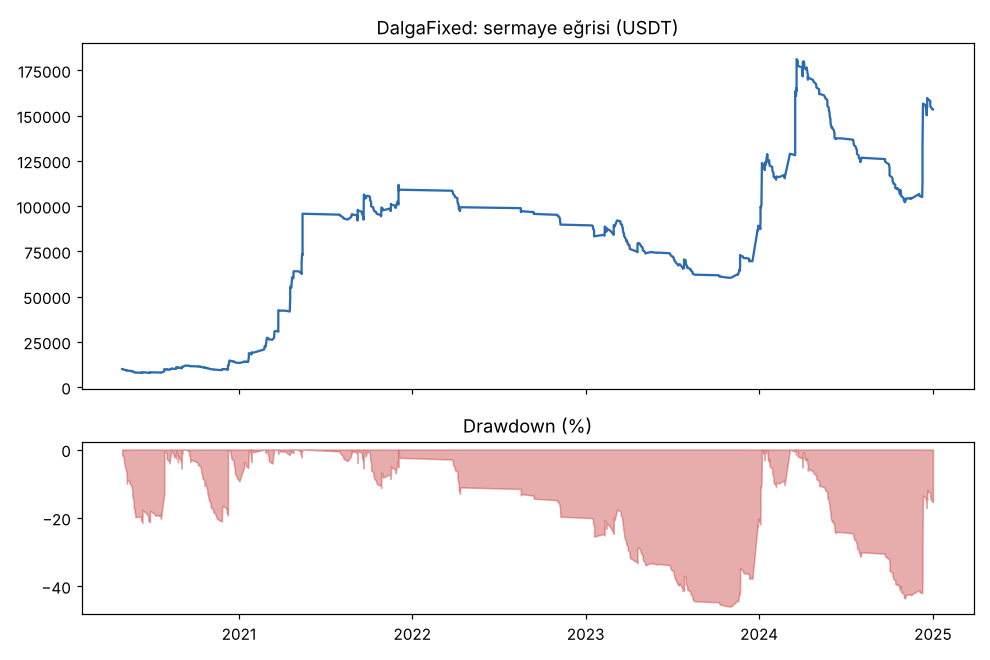

# Dalga vs DalgaFixed — gelistirme_36coin — 2026-10-11

## Özet
- **Dalga**: 859 işlem, işlem başına ortalama **1.13R** (maliyet ve funding dahil), net getiri 960.8%, en büyük düşüş 26.2%.
- **DalgaFixed**: 859 işlem, işlem başına ortalama **1.13R** (maliyet ve funding dahil), net getiri 1433.5%, en büyük düşüş 43.6%.
- Aynı dönemde coinleri al-tut (eşit ağırlık): getiri 946.5%, ortalama en büyük düşüş 92.4%.

## Ayarlar
- Dönem: 2020-04-10 00:00:00 → 2025-01-01 00:00:00
- Coinler: BTC/USDT:USDT, ETH/USDT:USDT, SOL/USDT:USDT, XRP/USDT:USDT, BNB/USDT:USDT, DOGE/USDT:USDT, ADA/USDT:USDT, LINK/USDT:USDT, LTC/USDT:USDT, DOT/USDT:USDT, AVAX/USDT:USDT, TRX/USDT:USDT, ATOM/USDT:USDT, BCH/USDT:USDT, ETC/USDT:USDT, XLM/USDT:USDT, FIL/USDT:USDT, UNI/USDT:USDT, AAVE/USDT:USDT, NEAR/USDT:USDT, ALGO/USDT:USDT, XTZ/USDT:USDT, THETA/USDT:USDT, VET/USDT:USDT, ICP/USDT:USDT, SAND/USDT:USDT, MANA/USDT:USDT, AXS/USDT:USDT, EGLD/USDT:USDT, HBAR/USDT:USDT, CHZ/USDT:USDT, ENJ/USDT:USDT, ZEC/USDT:USDT, DASH/USDT:USDT, NEO/USDT:USDT, IOTA/USDT:USDT
- Zaman dilimi: 1h
- Yön: long + short
- Mod: futures / isolated
- Kaldıraç: en fazla 3x, likidasyon stop mesafesinin en az 2 katı uzakta (bölüm 7.6)
- Risk: işlem başına sermayenin %1'i (pozisyon büyüklüğü stop mesafesine göre)
- Maliyet: her emir için %0.05 komisyon + %0.05 kayma (= %0.1), funding geçmiş veriden
- Başlangıç sermayesi: 10000 USDT

## Metrikler
| Metrik | Dalga | DalgaFixed | Al-tut |
|---|---|---|---|
| Net getiri | 960.8% | 1433.5% | 946.5% |
| Max drawdown | 26.2% | 43.6% | 92.4% |
| Profit factor | 1.52 | 1.51 | — |
| Ortalama R | 1.13 | 1.13 | — |
| İşlem sayısı | 859 | 859 | — |
| Winrate | 19.4% | 19.4% | — |

Winrate tek başına başarı ölçütü değildir; asıl ölçüt ortalama R (expectancy) ve drawdown'dur.

## Long / short ayrımı
| Strateji | Yön | İşlem | Ortalama R | Toplam R | Profit factor |
|---|---|---|---|---|---|
| Dalga | long | 859 | 1.13 | 969.72 | 1.52 |
| Dalga | short | 0 | — | 0.00 | — |
| DalgaFixed | long | 859 | 1.13 | 969.72 | 1.51 |
| DalgaFixed | short | 0 | — | 0.00 | — |

## Sinyal istatistikleri
| Strateji | Stop | BE | TP1 sonrası BE | TP2 | Diğer | İptal (bölgeye gelmedi / önce stop) | Toplam funding (USDT) |
|---|---|---|---|---|---|---|---|
| Dalga | 73.5% | 0.0% | 0.0% | 0.0% | 26.5% | 5.8% | -29438.36 |
| DalgaFixed | 73.5% | 0.0% | 0.0% | 0.0% | 26.5% | 5.8% | -37105.93 |

## Coin bazında
| Strateji | Coin | İşlem | Ortalama R | Toplam R | Al-tut getirisi |
|---|---|---|---|---|---|
| Dalga | BTC/USDT:USDT | 53 | 1.17 | 62.01 | 1194.8% |
| Dalga | ETH/USDT:USDT | 50 | 0.72 | 35.97 | 1878.9% |
| Dalga | SOL/USDT:USDT | 33 | 4.57 | 150.87 | 5616.2% |
| Dalga | XRP/USDT:USDT | 36 | 1.11 | 40.08 | 964.3% |
| Dalga | BNB/USDT:USDT | 60 | 2.97 | 178.47 | 4614.4% |
| Dalga | DOGE/USDT:USDT | 27 | 0.82 | 22.14 | 8497.3% |
| Dalga | ADA/USDT:USDT | 21 | 4.25 | 89.28 | 2274.4% |
| Dalga | LINK/USDT:USDT | 50 | 0.14 | 6.97 | 512.6% |
| Dalga | LTC/USDT:USDT | 35 | -0.56 | -19.69 | 126.5% |
| Dalga | DOT/USDT:USDT | 18 | 0.24 | 4.32 | 97.0% |
| Dalga | AVAX/USDT:USDT | 17 | 2.78 | 47.32 | 784.8% |
| Dalga | TRX/USDT:USDT | 54 | 0.61 | 32.73 | 1796.1% |
| Dalga | ATOM/USDT:USDT | 13 | 2.29 | 29.82 | 142.2% |
| Dalga | BCH/USDT:USDT | 29 | -0.28 | -8.01 | 70.6% |
| Dalga | ETC/USDT:USDT | 24 | 1.07 | 25.62 | 329.7% |
| Dalga | XLM/USDT:USDT | 25 | 0.71 | 17.64 | 554.0% |
| Dalga | FIL/USDT:USDT | 8 | 6.53 | 52.22 | -90.1% |
| Dalga | UNI/USDT:USDT | 22 | 2.69 | 59.19 | 144.8% |
| Dalga | AAVE/USDT:USDT | 28 | -0.50 | -13.89 | 660.5% |
| Dalga | NEAR/USDT:USDT | 13 | 0.73 | 9.44 | 346.9% |
| Dalga | ALGO/USDT:USDT | 13 | 2.36 | 30.72 | 45.0% |
| Dalga | XTZ/USDT:USDT | 16 | -0.93 | -14.88 | -38.9% |
| Dalga | THETA/USDT:USDT | 22 | 3.66 | 80.61 | 422.7% |
| Dalga | VET/USDT:USDT | 23 | 1.44 | 33.10 | 1043.3% |
| Dalga | ICP/USDT:USDT | 12 | 0.94 | 11.29 | -97.8% |
| Dalga | SAND/USDT:USDT | 5 | -1.11 | -5.53 | 483.8% |
| Dalga | MANA/USDT:USDT | 6 | -1.22 | -7.32 | -54.2% |
| Dalga | AXS/USDT:USDT | 10 | -0.05 | -0.50 | 1192.5% |
| Dalga | EGLD/USDT:USDT | 13 | -0.06 | -0.77 | 159.7% |
| Dalga | HBAR/USDT:USDT | 13 | 0.16 | 2.09 | -18.6% |
| Dalga | CHZ/USDT:USDT | 12 | -0.05 | -0.55 | 278.4% |
| Dalga | ENJ/USDT:USDT | 9 | 3.42 | 30.75 | 19.2% |
| Dalga | ZEC/USDT:USDT | 28 | -0.45 | -12.51 | 38.3% |
| Dalga | DASH/USDT:USDT | 17 | -0.27 | -4.55 | -53.5% |
| Dalga | NEO/USDT:USDT | 25 | 0.30 | 7.60 | 71.2% |
| Dalga | IOTA/USDT:USDT | 19 | -0.12 | -2.32 | 68.4% |
| DalgaFixed | BTC/USDT:USDT | 53 | 1.17 | 62.01 | 1194.8% |
| DalgaFixed | ETH/USDT:USDT | 50 | 0.72 | 35.97 | 1878.9% |
| DalgaFixed | SOL/USDT:USDT | 33 | 4.57 | 150.87 | 5616.2% |
| DalgaFixed | XRP/USDT:USDT | 36 | 1.11 | 40.08 | 964.3% |
| DalgaFixed | BNB/USDT:USDT | 60 | 2.97 | 178.47 | 4614.4% |
| DalgaFixed | DOGE/USDT:USDT | 27 | 0.82 | 22.14 | 8497.3% |
| DalgaFixed | ADA/USDT:USDT | 21 | 4.25 | 89.28 | 2274.4% |
| DalgaFixed | LINK/USDT:USDT | 50 | 0.14 | 6.97 | 512.6% |
| DalgaFixed | LTC/USDT:USDT | 35 | -0.56 | -19.69 | 126.5% |
| DalgaFixed | DOT/USDT:USDT | 18 | 0.24 | 4.32 | 97.0% |
| DalgaFixed | AVAX/USDT:USDT | 17 | 2.78 | 47.32 | 784.8% |
| DalgaFixed | TRX/USDT:USDT | 54 | 0.61 | 32.73 | 1796.1% |
| DalgaFixed | ATOM/USDT:USDT | 13 | 2.29 | 29.82 | 142.2% |
| DalgaFixed | BCH/USDT:USDT | 29 | -0.28 | -8.01 | 70.6% |
| DalgaFixed | ETC/USDT:USDT | 24 | 1.07 | 25.62 | 329.7% |
| DalgaFixed | XLM/USDT:USDT | 25 | 0.71 | 17.64 | 554.0% |
| DalgaFixed | FIL/USDT:USDT | 8 | 6.53 | 52.22 | -90.1% |
| DalgaFixed | UNI/USDT:USDT | 22 | 2.69 | 59.19 | 144.8% |
| DalgaFixed | AAVE/USDT:USDT | 28 | -0.50 | -13.89 | 660.5% |
| DalgaFixed | NEAR/USDT:USDT | 13 | 0.73 | 9.44 | 346.9% |
| DalgaFixed | ALGO/USDT:USDT | 13 | 2.36 | 30.72 | 45.0% |
| DalgaFixed | XTZ/USDT:USDT | 16 | -0.93 | -14.88 | -38.9% |
| DalgaFixed | THETA/USDT:USDT | 22 | 3.66 | 80.61 | 422.7% |
| DalgaFixed | VET/USDT:USDT | 23 | 1.44 | 33.10 | 1043.3% |
| DalgaFixed | ICP/USDT:USDT | 12 | 0.94 | 11.29 | -97.8% |
| DalgaFixed | SAND/USDT:USDT | 5 | -1.11 | -5.53 | 483.8% |
| DalgaFixed | MANA/USDT:USDT | 6 | -1.22 | -7.32 | -54.2% |
| DalgaFixed | AXS/USDT:USDT | 10 | -0.05 | -0.50 | 1192.5% |
| DalgaFixed | EGLD/USDT:USDT | 13 | -0.06 | -0.77 | 159.7% |
| DalgaFixed | HBAR/USDT:USDT | 13 | 0.16 | 2.09 | -18.6% |
| DalgaFixed | CHZ/USDT:USDT | 12 | -0.05 | -0.55 | 278.4% |
| DalgaFixed | ENJ/USDT:USDT | 9 | 3.42 | 30.75 | 19.2% |
| DalgaFixed | ZEC/USDT:USDT | 28 | -0.45 | -12.51 | 38.3% |
| DalgaFixed | DASH/USDT:USDT | 17 | -0.27 | -4.55 | -53.5% |
| DalgaFixed | NEO/USDT:USDT | 25 | 0.30 | 7.60 | 71.2% |
| DalgaFixed | IOTA/USDT:USDT | 19 | -0.12 | -2.32 | 68.4% |

## Grafikler

## Yorum: güçlü yanlar / şüpheli noktalar
_(Claude tarafından rakamlara bakılarak yazılır.)_

## Karar: devam / düzelt / emekli
_(Claude tarafından yazılır, gerekçesiyle.)_
